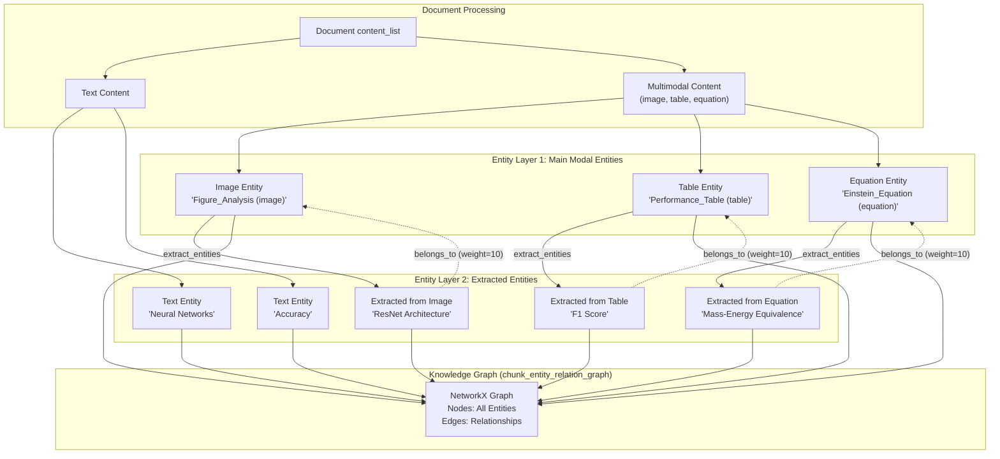
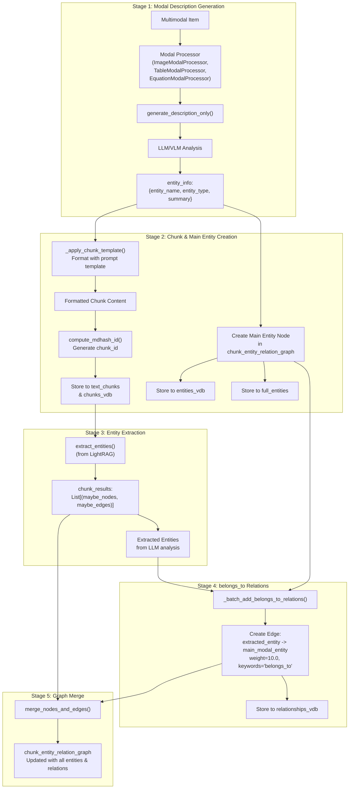
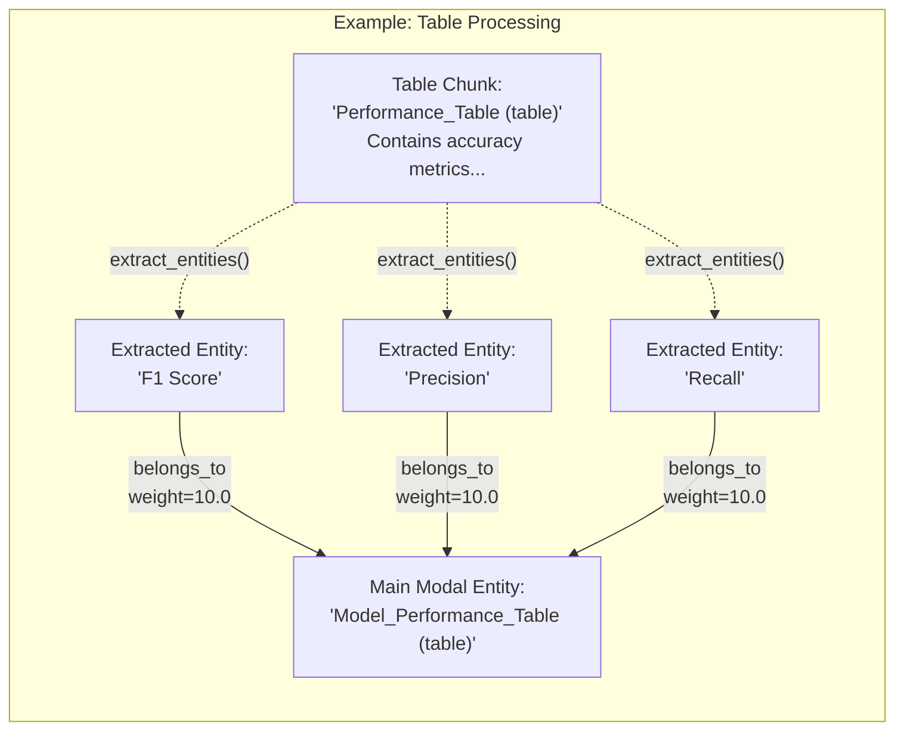
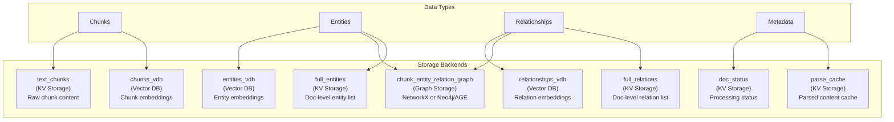

<!-- source: DeepWiki mcp.deepwiki.com · repo HKUDS/RAG-Anything · page 6 Knowledge Graph and Storage · fetched 2026-11-09 -->

# Knowledge Graph and Storage

Relevant source files

The following files were used as context for generating this wiki page:

- [.gitignore](.gitignore)
- [env.example](env.example)
- [examples/lmstudio_integration_example.py](examples/lmstudio_integration_example.py)
- [raganything/processor.py](raganything/processor.py)
- [tests/test_insert_content_list.py](tests/test_insert_content_list.py)

## Purpose and Scope

This page documents the knowledge graph construction and storage architecture in RAG-Anything. It covers how entities and relationships are extracted from both text and multimodal content, the dual-layer entity system with `belongs_to` relationships, and the multi-storage backend architecture.

For information about how multimodal content is processed before entering the knowledge graph, see [Multimodal Content Processing](#5). For query-time retrieval from the knowledge graph, see [Query System](#7).

---

## Knowledge Graph Architecture

RAG-Anything constructs a hierarchical knowledge graph that integrates both text-based entities and multimodal entities (images, tables, equations) into a unified structure.

### Dual-Layer Entity System

**Sources:** `ProcessorMixin` in [raganything/processor.py:32-33](), multimodal extraction logic in [raganything/processor.py:1205-1267](), and `BaseModalProcessor` logic in [raganything/modalprocessors.py:326-335]().

The system creates two layers of entities:

1. **Main Modal Entities** (Layer 1): Represent entire multimodal objects. These are created directly from parsed content (images, tables, equations) and named with the format: `"{descriptive_name} ({type})"`, e.g., `"Performance_Comparison (table)"`.
2. **Extracted Entities** (Layer 2): Domain-specific entities extracted via LLM analysis from both text chunks and modal content chunks. These are connected to their source modal entities via `"belongs_to"` relationships.

### Entity Creation Flow

**Sources:** `_process_multimodal_content` flow in [raganything/processor.py:706-881](), `_batch_add_belongs_to_relations` in [raganything/processor.py:1205-1267](), and modal processor description logic in [raganything/modalprocessors.py:465-545]().

---

## Entity Types and Naming

### Main Modal Entity Naming Convention

Main modal entities follow a consistent naming pattern that includes both a descriptive name and the content type: `{entity_name} ({entity_type})`. This naming convention is enforced in the modal processor response parsing.

**Sources:** `_parse_response` in [raganything/modalprocessors.py:1011-1013](), `_parse_table_response` in [raganything/modalprocessors.py:1205-1207](), and `_parse_equation_response` in [raganything/modalprocessors.py:1389-1391]().

### Entity Data Structure

Each entity stored in the knowledge graph contains metadata such as `entity_id`, `entity_type`, `description`, `source_id`, and `file_path`.

**Sources:** Entity structure in [raganything/modalprocessors.py:505-513]() and [raganything/processor.py:1084-1092]().

---

## Relationship Types

### Standard Entity Relationships

Standard relationships are extracted by LightRAG's `extract_entities()` function from chunk content. These capture semantic relationships between entities mentioned in the text.

**Sources:** [raganything/processor.py:1176-1203](), [raganything/modalprocessors.py:727-734]().

### belongs_to Relationships

The `"belongs_to"` relationship is unique to RAG-Anything's multimodal processing. It creates hierarchical connections from extracted entities to their source modal entities.

**Sources:** `_batch_add_belongs_to_relations` in [raganything/processor.py:1205-1267]() and [raganything/modalprocessors.py:738-770]().

---

## Storage Architecture

RAG-Anything uses a multi-storage architecture inherited from LightRAG, with distinct storage systems working together.

### Storage System Overview

**Sources:** `lightrag` storage access in [raganything/processor.py:1006-1022](), [raganything/processor.py:1099-1101](), and [raganything/modalprocessors.py:380-384]().

### Key Storage Components

- **text_chunks (KV Storage)**: Stores raw chunk content and multimodal flags [raganything/processor.py:911-924]().
- **chunks_vdb / entities_vdb / relationships_vdb**: Vector databases for semantic retrieval [raganything/processor.py:1015](), [raganything/processor.py:1099-1101]().
- **chunk_entity_relation_graph**: Graph storage for entity-relationship structure [raganything/processor.py:1095-1097]().
- **doc_status**: Tracks document processing state, including the `multimodal_processed` flag [raganything/processor.py:138-159](), [raganything/processor.py:189-200]().
- **parse_cache**: Caches parsed document results using a generated `cache_key` [raganything/processor.py:50-98](), [raganything/processor.py:212-278]().

---

## Storage Backend Options

RAG-Anything supports multiple storage backends configured via environment variables or `RAGAnythingConfig`.

| Storage Type | Options |
|--------------|---------|
| **KV Storage** | `JsonKVStorage`, `PGKVStorage`, `MongoDBStorage`, `RedisStorage` |
| **Vector DB** | `NanoVectorDBStorage`, `PGVectorStorage`, `MilvusVectorStorage`, `QdrantVectorStorage` |
| **Graph DB** | `NetworkXStorage`, `Neo4jStorage`, `AGEStorage`, `MongoDBGraphStorage` |

**Sources:** `env.example:152-212]()` and `RAGAnythingConfig` parameters.

For details, see [Storage Architecture](#6.2) and [Storage Backend Configuration](#8.3).

---

