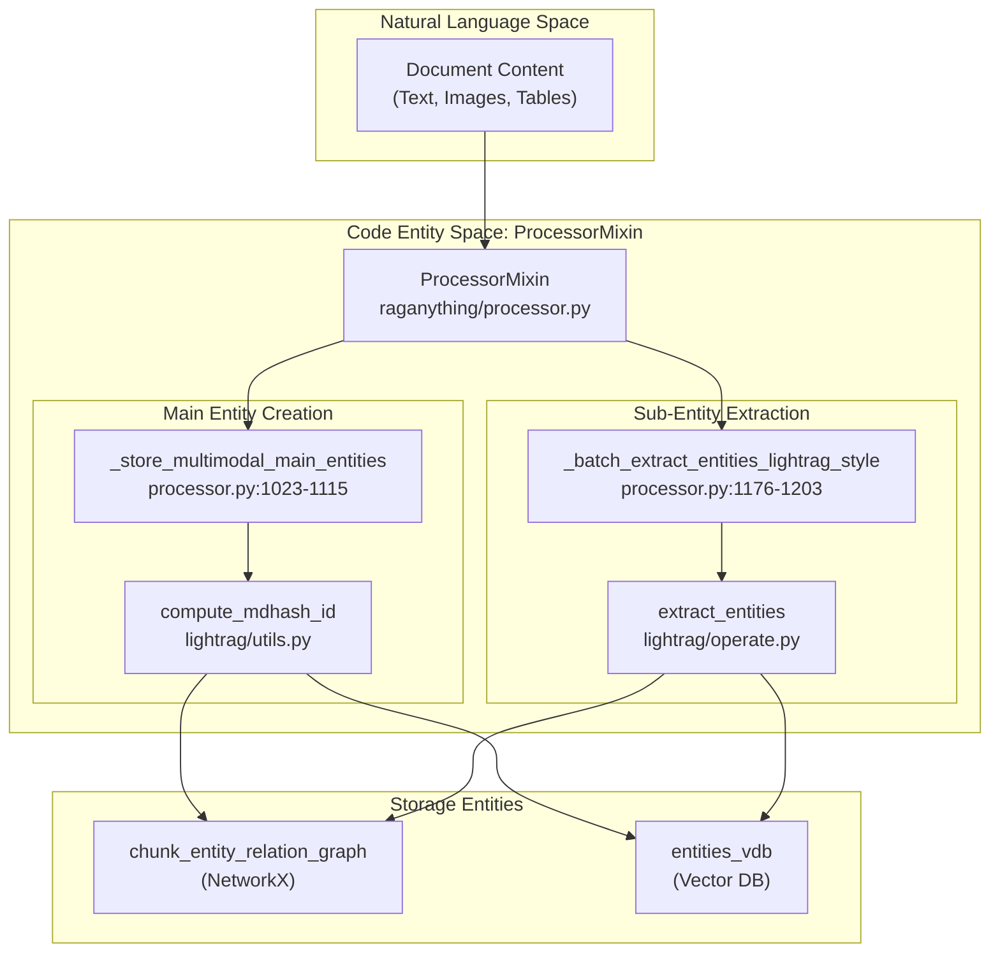
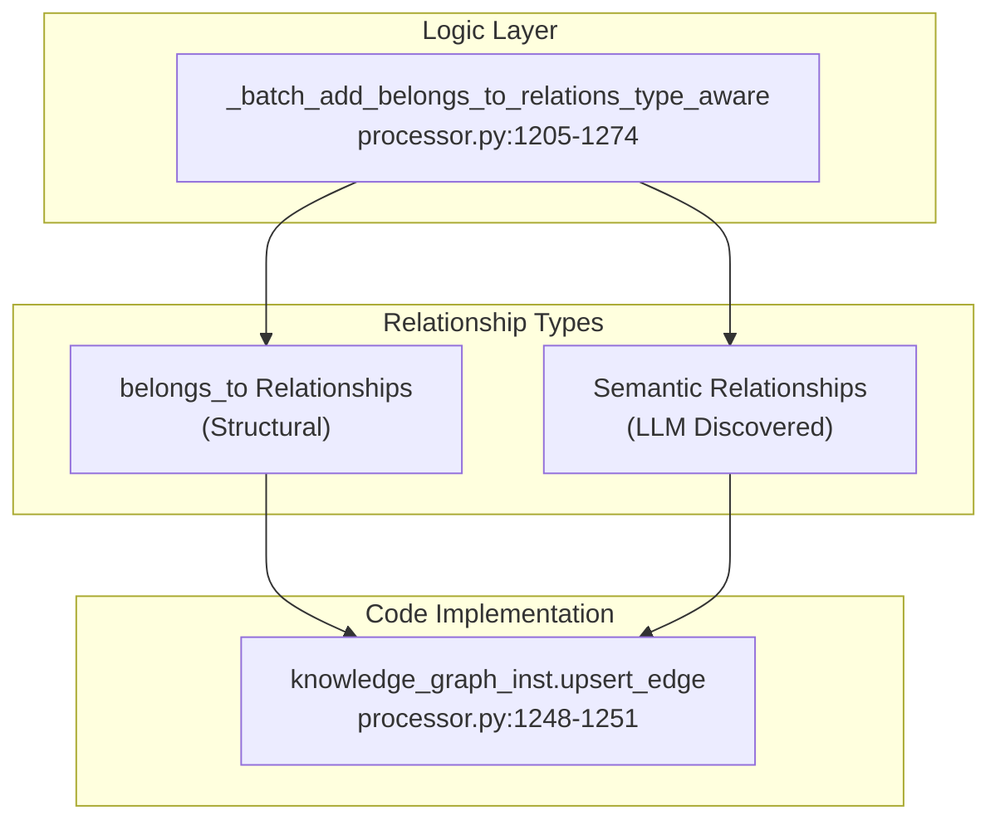

<!-- source: DeepWiki mcp.deepwiki.com · repo HKUDS/RAG-Anything · page 6.1 Knowledge Graph Construction · fetched 2026-11-09 -->

# Knowledge Graph Construction

Relevant source files

The following files were used as context for generating this wiki page:

- [raganything/modalprocessors.py](raganything/modalprocessors.py)
- [raganything/processor.py](raganything/processor.py)
- [tests/test_insert_content_list.py](tests/test_insert_content_list.py)

This page documents how RAG-Anything transforms multimodal document content into a structured knowledge graph. The system extracts entities from text, images, tables, and equations, establishes cross-modal relationships, and preserves document hierarchy through specialized `belongs_to` connections.

For information about the underlying storage systems and backend options, see [Storage Architecture](#6.2). For details on how multimodal content is processed before graph construction, see [Multimodal Content Processing](#5).

---

## Overview

Knowledge graph construction in RAG-Anything is a multi-stage process that converts processed document content into a queryable graph structure. The system creates two types of entities:

1. **Main Multimodal Entities** - Top-level entities representing images, tables, and equations as distinct knowledge objects (e.g., "Performance Comparison Table (table)").
2. **Sub-Entities** - Entities extracted from the content descriptions via LLM analysis (e.g., concepts, metrics, people mentioned within a table).

These entities are connected through:
- **Standard Relationships** - Semantic connections discovered by the LLM.
- **`belongs_to` Relationships** - Hierarchical links connecting sub-entities to their source multimodal entities.

The resulting graph enables both semantic retrieval (via vector embeddings) and structural traversal (via graph relationships).

---

## Entity Extraction Architecture

The extraction process bridges the gap between raw parsed content and the final graph storage.

### Natural Language Space to Code Entity Space

The following diagram illustrates how natural language elements from documents are mapped to specific code classes and functions within the `raganything` package.

**Entity Extraction Data Flow**

Sources: [raganything/processor.py:1023-1115](), [raganything/processor.py:1176-1203](), [raganything/modalprocessors.py:20-27]()

**Stage 1: Main Entity Creation**
Main multimodal entities are created first to represent the multimodal content items themselves. The process generates an `entity_name` with a type suffix (e.g., `(image)`), an `entity_type`, and a `content` field containing the enhanced description from the modal processor. The ID is generated using `compute_mdhash_id(entity_name, prefix="ent-")`.

**Stage 2: Sub-Entity Extraction**
Sub-entities are extracted from the enhanced descriptions using LightRAG's LLM-based entity extraction. The function `_batch_extract_entities_lightrag_style` iterates through multimodal chunks and uses `extract_entities` to identify concepts, metrics, or people mentioned within the descriptions.

Sources: [raganything/processor.py:1023-1115](), [raganything/processor.py:1176-1203](), [raganything/modalprocessors.py:465-545]()

---

## Relationship Mapping

Relationships define how entities interact within the graph.

**Relationship Mapping Flow**

**Belongs_to Relationships**
The `belongs_to` relationship is a special hierarchical link. It is created in `_batch_add_belongs_to_relations_type_aware` to link every sub-entity back to its parent multimodal entity. 
- **Keywords**: `"belongs_to,part_of,contained_in"`
- **Weight**: Defaulted to `10.0` to emphasize structural importance.
- **Description**: Formatted as `"Entity {src} belongs to {tgt}"`.

Sources: [raganything/processor.py:1205-1274](), [raganything/modalprocessors.py:736-770]()

---

## Graph Structure and Schema

Every entity and relationship follows a strict schema to ensure compatibility with retrieval modes.

### Node Schema
| Attribute | Type | Source |
|-----------|------|--------|
| `entity_id` | string | [raganything/processor.py:1085]() |
| `entity_type` | string | [raganything/processor.py:1086]() |
| `description` | string | [raganything/processor.py:1087]() |
| `source_id` | string | [raganything/processor.py:1088]() |
| `file_path` | string | [raganything/processor.py:1089]() |

### Edge Schema
| Attribute | Type | Source |
|-----------|------|--------|
| `keywords` | string | [raganything/processor.py:1243]() |
| `description` | string | [raganything/processor.py:1242]() |
| `weight` | float | [raganything/processor.py:1245]() |
| `source_id` | string | [raganything/processor.py:1244]() |

Sources: [raganything/processor.py:1084-1097](), [raganything/processor.py:1240-1266]()

---

## Multi-Storage Integration

The knowledge graph data is distributed across three storage layers to optimize different retrieval strategies.

| Storage Name | Code Reference | Purpose |
|--------------|----------------|---------|
| `entities_vdb` | [raganything/processor.py:1078]() | Vector search for semantic entity matching. |
| `relationships_vdb` | [raganything/processor.py:1255]() | Vector search for semantic relationship matching. |
| `chunk_entity_relation_graph` | [raganything/processor.py:1095]() | NetworkX graph for structural traversal. |
| `full_entities` | [raganything/processor.py:1104]() | KV Storage mapping document IDs to entity lists. |

Sources: [raganything/processor.py:1078-1115](), [raganything/processor.py:1255-1266]()

---

## Batch Processing Pipeline

The `_process_multimodal_content_batch_type_aware` method in `ProcessorMixin` orchestrates the construction in a pipeline fashion.

1.  **Description Generation**: Uses `generate_description_only` from modal processors.
2.  **Chunking**: `_convert_to_lightrag_chunks_type_aware` transforms descriptions into chunks.
3.  **Entity Insertion**: `_store_multimodal_main_entities` populates the graph and VDB.
4.  **Relationship Linking**: `_batch_add_belongs_to_relations_type_aware` establishes hierarchy.
5.  **Final Merge**: `_batch_merge_lightrag_style` commits all nodes and edges to the persistent graph.

Sources: [raganything/processor.py:706-881](), [raganything/processor.py:1276-1297]()

---

## Context-Aware Entity Extraction

Multimodal entities are extracted with awareness of their surrounding document context using the `ContextExtractor` system. This allows the LLM to understand that a table on page 5 is related to the text on page 4.

**Context Configuration (`ContextConfig`)**
- `context_window`: Number of surrounding items to include.
- `context_mode`: Whether to use `page`, `chunk`, or `token` boundaries.

The `extract_context` method is called during description generation to provide the LLM with the necessary background information to name entities accurately.

Sources: [raganything/modalprocessors.py:33-358](), [raganything/modalprocessors.py:415-440]()

---

