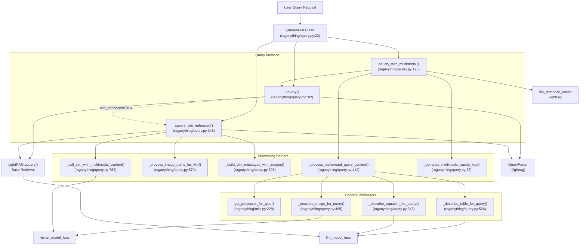
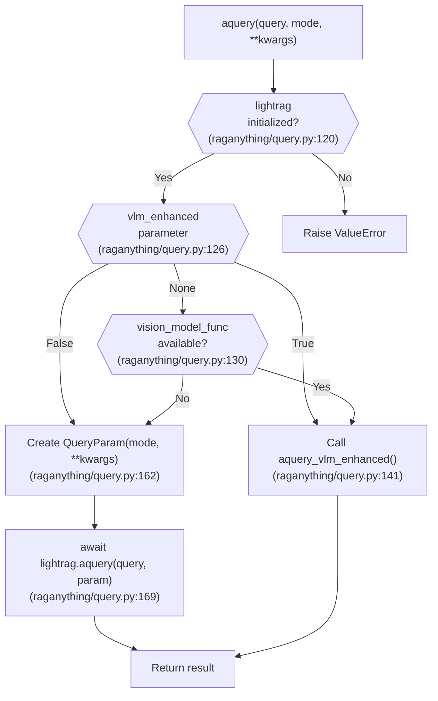
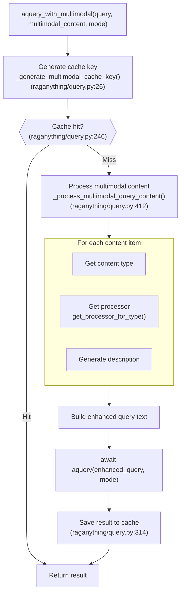
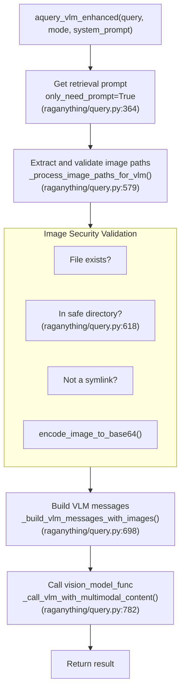

<!-- source: DeepWiki mcp.deepwiki.com · repo HKUDS/RAG-Anything · page 7 Query System · fetched 2026-11-09 -->

# Query System

Relevant source files

The following files were used as context for generating this wiki page:

- [raganything/batch.py](raganything/batch.py)
- [raganything/query.py](raganything/query.py)

The Query System is the retrieval and question-answering subsystem of RAG-Anything. It provides three query modes: pure text queries that leverage LightRAG's knowledge graph retrieval, multimodal queries that accept explicit image/table/equation content, and VLM-enhanced queries that automatically detect and process images in retrieved context. All query functionality is implemented through the `QueryMixin` class [raganything/query.py:23](), which integrates with LightRAG's retrieval engine while adding multimodal capabilities.

For document processing and indexing operations, see [Document Processing](#4). For configuration of LLM and vision model providers, see [Model Provider Configuration](#8.4).

## QueryMixin Architecture

The `QueryMixin` class [raganything/query.py:23-24]() provides query functionality that extends LightRAG's base capabilities. It is designed as a mixin to be inherited by the main `RAGAnything` class, providing three distinct query methods:

| Method | Type | Key Capability |
|--------|------|----------------|
| `aquery` | Text | Pure text query via LightRAG [raganything/query.py:102]() |
| `aquery_with_multimodal` | Multimodal | Query with explicit multimodal content [raganything/query.py:195]() |
| `aquery_vlm_enhanced` | VLM-Enhanced | Automatic image processing from retrieved context [raganything/query.py:343]() |

### Query System Component Relationships

**Sources:** [raganything/query.py:23-859](), [raganything/utils.py:228-249]()

## Text Queries

The `aquery` method [raganything/query.py:102-193]() provides pure text querying by delegating to LightRAG's retrieval engine. It supports all LightRAG query modes and can automatically upgrade to VLM-enhanced mode if a vision model is available [raganything/query.py:128-143]().

### Query Flow

### LightRAG Query Modes

The query mode parameter [raganything/query.py:110]() controls LightRAG's retrieval strategy:

| Mode | Description |
|------|-------------|
| `local` | Local search around specific entities |
| `global` | Global graph traversal |
| `hybrid` | Combines local + global |
| `naive` | Simple vector similarity |
| `mix` | Adaptive mode selection (default) |
| `bypass` | Skip retrieval, direct LLM |

For details, see [Text Queries](#7.2).

**Sources:** [raganything/query.py:102-193]()

## Multimodal Queries

The `aquery_with_multimodal` method [raganything/query.py:195-341]() enables queries that include explicit multimodal content (images, tables, equations). It processes the multimodal content to generate enhanced textual descriptions [raganything/query.py:412-453](), then performs a standard text query with the enriched context.

### Multimodal Query Processing Flow

### Content Description Generation

The system generates descriptions for each content type [raganything/query.py:465-577]():
1. **Images**: Analyzed via `vision_model_func` [raganything/query.py:495-524]().
2. **Tables**: Structured analysis using `modal_caption_func` [raganything/query.py:526-541]().
3. **Equations**: Formula explanation using `modal_caption_func` [raganything/query.py:543-558]().

For details, see [Multimodal Queries](#7.3).

**Sources:** [raganything/query.py:195-341](), [raganything/query.py:412-577](), [raganything/query.py:26-100]()

## VLM-Enhanced Queries

The `aquery_vlm_enhanced` method [raganything/query.py:343-410]() automatically detects image paths in retrieved context from LightRAG and processes them with the vision model. This enables the system to answer questions about images found within documents without explicit user input of the images.

### VLM Enhancement Architecture

For details, see [VLM-Enhanced Queries](#7.4).

**Sources:** [raganything/query.py:343-410](), [raganything/query.py:579-696](), [raganything/query.py:698-813]()

## Query Result Caching

Multimodal queries use MD5-based cache keys generated from normalized query parameters [raganything/query.py:26-100](). The cache is stored in LightRAG's `llm_response_cache` [raganything/query.py:263-338]().

### Cache Normalization
- **File Paths**: Reduced to basenames to ensure portability [raganything/query.py:60]().
- **Large Content**: Strings over 200 characters (like table bodies) are hashed [raganything/query.py:67-69]().
- **Parameters**: Includes `stream`, `top_k`, `temperature`, etc. [raganything/query.py:83-92]().

**Sources:** [raganything/query.py:26-100](), [raganything/query.py:263-338]()

## Synchronous Query Methods

The system provides synchronous wrappers for all async query methods using `always_get_an_event_loop()` [raganything/query.py:816-859]():

- `query()`: Synchronous version of `aquery` [raganything/query.py:816-832]().
- `query_with_multimodal()`: Synchronous version of `aquery_with_multimodal` [raganything/query.py:834-859]().

**Sources:** [raganything/query.py:816-859]()

---

