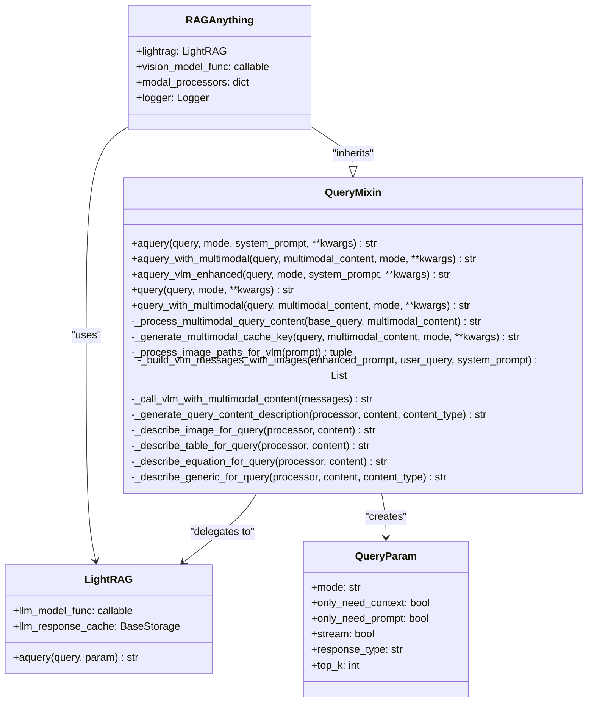
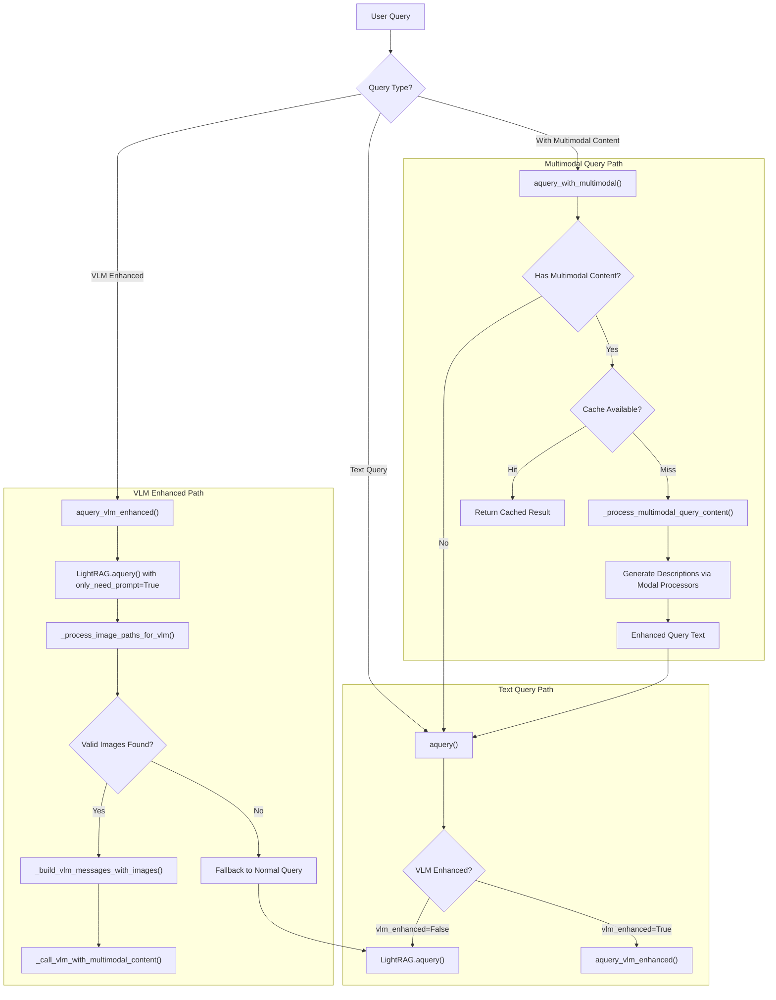
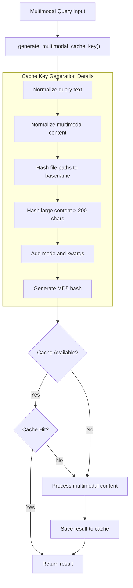
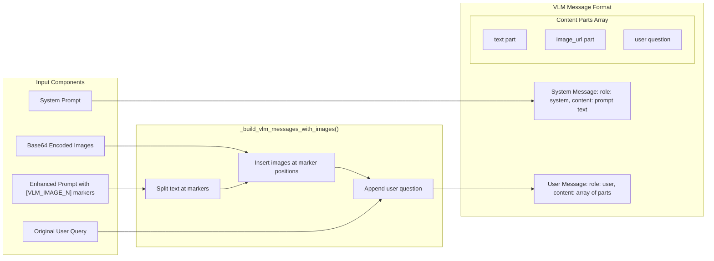

<!-- source: DeepWiki mcp.deepwiki.com · repo HKUDS/RAG-Anything · page 7.1 Query Architecture · fetched 2026-11-09 -->

# Query Architecture

Relevant source files

The following files were used as context for generating this wiki page:

- [raganything/batch.py](raganything/batch.py)
- [raganything/query.py](raganything/query.py)
- [raganything/raganything.py](raganything/raganything.py)

This document describes the architectural design of RAG-Anything's query system, including the `QueryMixin` class structure, the three distinct query paths (text, VLM-enhanced, and multimodal), and the underlying retrieval modes. For detailed implementation and usage of specific query types, see [7.2 Text Queries](), [7.3 Multimodal Queries](), and [7.4 VLM-Enhanced Queries]().

## Overview

RAG-Anything's query architecture extends the LightRAG framework with sophisticated multimodal query capabilities. The system provides three distinct query paths that serve different use cases while sharing a common retrieval infrastructure. All query functionality is encapsulated in the `QueryMixin` class, which is composed into the main `RAGAnything` class.

Sources: [raganything/query.py:1-24](), [raganything/raganything.py:51-51]()

## QueryMixin Class Structure

The `QueryMixin` class provides the query interface for RAG-Anything and integrates with the LightRAG framework's retrieval system.

Title: QueryMixin Architecture

**Key Components:**

- **Public Query Methods**: Three async methods (`aquery`, `aquery_with_multimodal`, `aquery_vlm_enhanced`) and their synchronous wrappers [raganything/query.py:102-365]().
- **Content Processing**: Private methods for processing multimodal content and generating descriptions [raganything/query.py:367-531]().
- **VLM Integration**: Methods for image path extraction and VLM message formatting [raganything/query.py:533-692]().
- **Caching**: Multimodal query cache key generation and cache management [raganything/query.py:26-100]().

Sources: [raganything/query.py:23-770](), [raganything/raganything.py:51-107]()

## Three Query Paths

The query architecture provides three distinct paths, each optimized for different content types and use cases.

Title: Query Execution Logic

**Path 1: Text Queries (`aquery`)**
Pure text queries that directly leverage LightRAG's retrieval and generation capabilities [raganything/query.py:102-193](). When `vision_model_func` is available, this automatically routes to VLM-enhanced mode unless explicitly disabled [raganything/query.py:125-143]().

**Path 2: Multimodal Queries (`aquery_with_multimodal`)**
Accepts user-provided multimodal content (images, tables, equations) alongside the query text [raganything/query.py:195-302](). The system generates textual descriptions of the provided content and combines them with the query for enhanced retrieval [raganything/query.py:367-434]().

**Path 3: VLM-Enhanced Queries (`aquery_vlm_enhanced`)**
Automatically detects images in the retrieved context and integrates them directly with the VLM for visual understanding [raganything/query.py:303-365](). This path extracts image paths from LightRAG's retrieval results, encodes them as base64, and formats them in VLM-compatible message structures [raganything/query.py:533-692]().

Sources: [raganything/query.py:102-365]()

## Retrieval Modes

RAG-Anything inherits LightRAG's retrieval modes via the `QueryParam` class [raganything/query.py:162-162]().

| Mode | Description | Retrieval Strategy |
|------|-------------|-------------------|
| `hybrid` | Combines vector similarity and graph traversal | Vector DB + Graph DB |
| `local` | Context-focused retrieval using graph relationships | Graph DB (local context) |
| `global` | High-level overview using full knowledge graph | Graph DB (global view) |
| `naive` | Simple vector similarity search | Vector DB only |
| `mix` | Dynamically selects between local and global | Auto-selection |
| `bypass` | Skips retrieval, direct LLM query | No retrieval |

Sources: [raganything/query.py:103-110](), [raganything/query.py:162-162]()

## Multimodal Query Caching

RAG-Anything implements a specialized caching mechanism for multimodal queries to avoid redundant processing of complex content.

Title: Cache Key Generation Logic

**Cache Key Components [raganything/query.py:26-100]():**
1. **Query Text**: Stripped and normalized.
2. **Mode**: Retrieval mode string.
3. **Multimodal Content**: 
   - File paths reduced to basenames for portability.
   - Large content (table bodies > 200 chars) replaced with MD5 hashes.
4. **Relevant kwargs**: `stream`, `response_type`, `top_k`, `max_tokens`, `temperature`, `system_prompt`.

The cache key is generated using the pattern: `multimodal_query:<md5_hash>`.

Sources: [raganything/query.py:26-100](), [raganything/query.py:217-230]()

## VLM Message Format

When processing VLM-enhanced queries, the system constructs messages in a format compatible with vision-language models.

Title: VLM Message Construction

The system splits the prompt based on the `[VLM_IMAGE_N]` regex and intersperses text parts with base64 image objects [raganything/query.py:613-685]().

Sources: [raganything/query.py:609-692](), [raganything/query.py:533-607]()

## Error Handling and Fallbacks

The query system implements graceful degradation:

- **Missing LightRAG**: Raises `ValueError` if `self.lightrag` is `None` [raganything/query.py:120-123]().
- **Missing Vision Model**: If `vlm_enhanced` is requested but `vision_model_func` is absent, it logs a warning and falls back to a normal text query [raganything/query.py:144-149]().
- **VLM Image Validation**: Checks image existence and format before encoding [raganything/query.py:553-568](). If validation fails, it skips that specific image.
- **VLM Prompt Fallback**: If no valid images are extracted from the retrieved context, `aquery_vlm_enhanced` falls back to a standard `lightrag.aquery` call [raganything/query.py:345-351]().

Sources: [raganything/query.py:120-150](), [raganything/query.py:345-351](), [raganything/query.py:553-568]()

---

