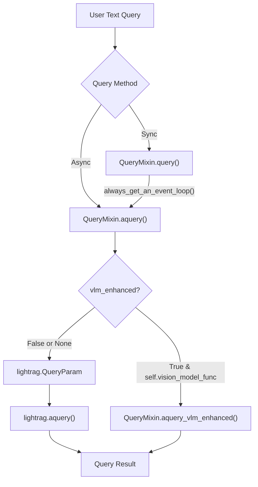
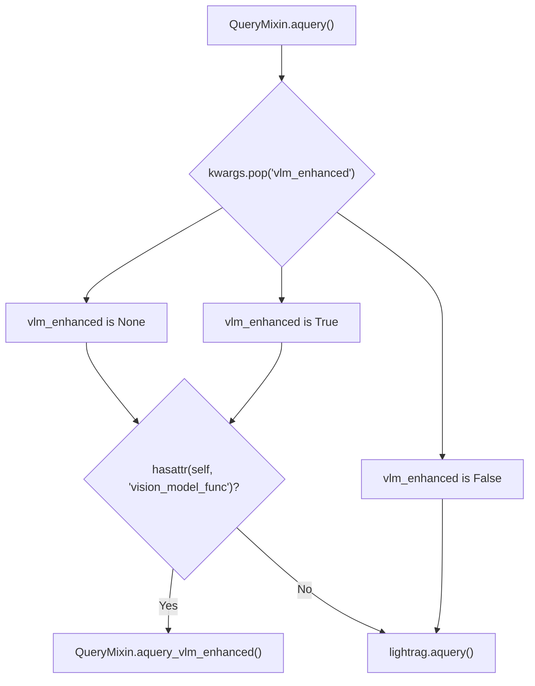

<!-- source: DeepWiki mcp.deepwiki.com · repo HKUDS/RAG-Anything · page 7.2 Text Queries · fetched 2026-11-09 -->

# Text Queries

<details>
<summary>Relevant source files</summary>

The following files were used as context for generating this wiki page:

- [examples/raganything_example.py](examples/raganything_example.py)
- [raganything/batch.py](raganything/batch.py)
- [raganything/query.py](raganything/query.py)

</details>


## Purpose and Scope

This page documents the pure text query functionality in RAG-Anything, specifically the `aquery` and `query` methods provided by the `QueryMixin` class. Text queries are the primary mechanism for retrieving information from the knowledge base using natural language questions without explicitly providing multimodal content in the query.

Text queries directly leverage LightRAG's retrieval capabilities and support multiple query modes for different retrieval strategies. When a `vision_model_func` is provided, text queries can automatically upgrade to VLM-enhanced mode to process images found in the retrieved context.

---

## Query Methods Overview

The `QueryMixin` class provides two primary methods for text queries: an asynchronous version (`aquery`) and a synchronous wrapper (`query`).

### Code Entity Space: Query Flow

The following diagram illustrates how the natural language query is handled by the internal methods of the `QueryMixin` class.



**Diagram: Text Query Method Flow**

Sources: [raganything/query.py:102-143](), [raganything/query.py:776-792]()

### aquery (Asynchronous)

The `aquery` method is the primary asynchronous text query interface. It manages the logic for determining whether to perform a standard RAG query or an enhanced VLM query.

**Method Signature:**
[raganything/query.py:102-104]()
```python
async def aquery(
    self, query: str, mode: str = "mix", system_prompt: str | None = None, **kwargs
) -> str:
```

**Parameters:**
- `query`: The query text (natural language question).
- `mode`: Query mode determining retrieval strategy (default: `"mix"`).
- `system_prompt`: Optional system prompt for LLM.
- `**kwargs`: Additional query parameters passed to `QueryParam`, including:
  - `vlm_enhanced`: Boolean to explicitly enable/disable VLM enhancement. If `None`, it is auto-detected based on `vision_model_func` availability. [raganything/query.py:126-133]()

**Returns:** Query result as a string.

Sources: [raganything/query.py:102-119]()

### query (Synchronous)

The `query` method is a synchronous wrapper around `aquery` for convenience, using `always_get_an_event_loop` to execute the coroutine. [raganything/query.py:776-792]()

---

## Query Modes

Text queries support multiple retrieval modes defined by the underlying LightRAG system. These modes determine the search strategy within the Knowledge Graph and Vector Databases.

| Mode | Description |
|------|-------------|
| `"local"` | Focuses on specific entities and their direct relationships. |
| `"global"` | Uses high-level community summaries for broad thematic understanding. |
| `"hybrid"` | Combines local and global retrieval strategies. |
| `"naive"` | Simple vector similarity search without graph traversal. |
| `"mix"` | Adaptive strategy that selects appropriate mode based on query. |
| `"bypass"` | Bypasses retrieval and directly uses the LLM. |

Sources: [raganything/query.py:110](), [examples/raganything_example.py:223-241]()

---

## VLM Enhancement Auto-Detection

RAG-Anything intelligently detects if it should use a Vision-Language Model (VLM) to interpret visual elements found in the retrieved context.

### Code Entity Space: Auto-Detection Logic

This diagram shows how the system bridges the "Vision Model" configuration to the "Query Pipeline".



**Diagram: VLM Enhancement Decision Flow**

**Behavior:**
1. **Auto-Detection**: If `vlm_enhanced` is not specified, it defaults to `True` if `self.vision_model_func` is present. [raganything/query.py:129-133]()
2. **Explicit Control**: Users can force disable VLM processing even if a model is available by passing `vlm_enhanced=False`. [raganything/query.py:126]()
3. **Fallback**: If VLM enhancement is requested but no `vision_model_func` is found, the system logs a warning and falls back to a normal text query. [raganything/query.py:144-149]()

Sources: [raganything/query.py:125-149]()

---

## Implementation and Data Flow

### Retrieval Pipeline

When a standard text query is executed, the following flow occurs:

1. **LightRAG Initialization**: Verifies `self.lightrag` is not `None`. [raganything/query.py:120-123]()
2. **Callback Dispatch**: Triggers `on_query_start` via the `callback_manager`. [raganything/query.py:151-159]()
3. **Parameter Packaging**: Constructs a `lightrag.QueryParam` object using the provided `mode` and `**kwargs`. [raganything/query.py:162]()
4. **Execution**: Calls `await self.lightrag.aquery()`. [raganything/query.py:169-171]()
5. **Completion**: Triggers `on_query_complete` with duration and result length statistics. [raganything/query.py:183-192]()

### Integration with Callbacks

The `QueryMixin` interacts with the `callback_manager` to provide observability into the query lifecycle.

| Event | Data Provided | Call Site |
|-------|---------------|-----------|
| `on_query_start` | `query`, `mode` | [raganything/query.py:155-159]() |
| `on_query_error` | `query`, `mode`, `error` | [raganything/query.py:173-179]() |
| `on_query_complete` | `query`, `mode`, `duration_seconds`, `result_length` | [raganything/query.py:186-192]() |

Sources: [raganything/query.py:151-193]()

---

## Usage Examples

### Basic Asynchronous Query

```python
# From examples/raganything_example.py
result = await rag.aquery(
    "What are the main findings in the research?",
    mode="hybrid"
)
```
Sources: [examples/raganything_example.py:231-234]()

### Query with Custom Parameters

Users can pass standard LightRAG parameters through `**kwargs` to the `aquery` method.

```python
result = await rag.aquery(
    "Explain the methodology",
    mode="local",
    top_k=5,
    max_tokens=1000,
    temperature=0.2
)
```
Sources: [raganything/query.py:102-113](), [raganything/query.py:162]()

### Forcing VLM Enhancement

If you want to ensure the system attempts to process images found in the retrieved context:

```python
result = await rag.aquery(
    "What is shown in Figure 1?",
    vlm_enhanced=True
)
```
Sources: [raganything/query.py:126-143]()

---

