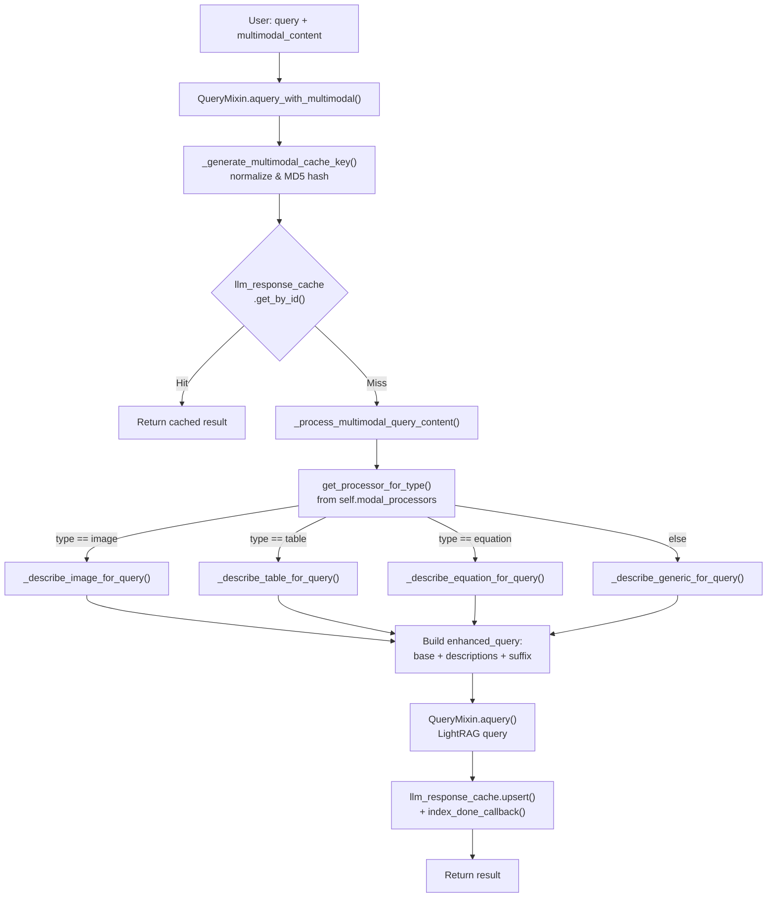
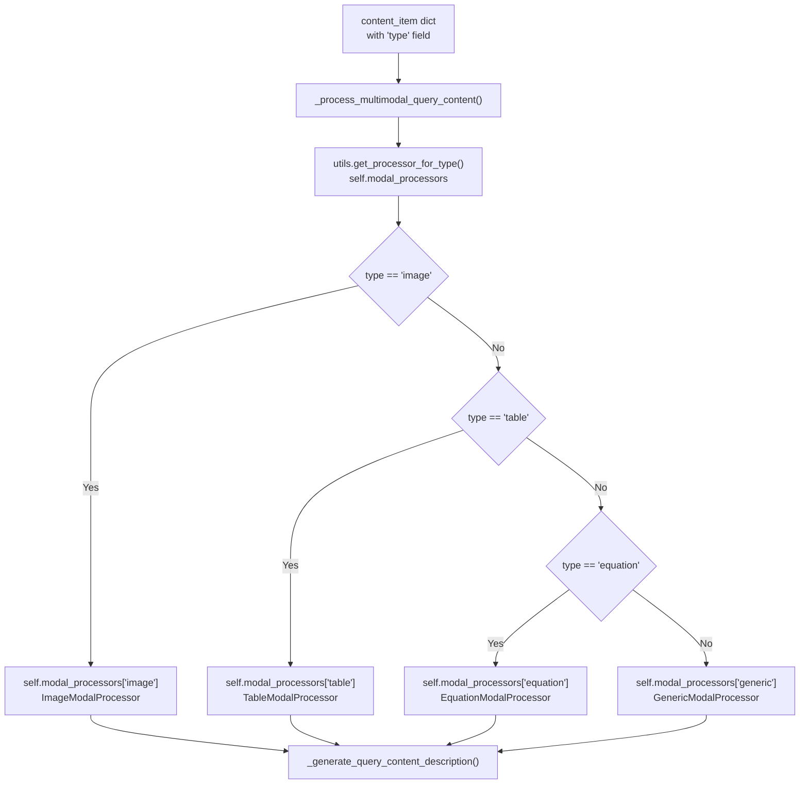
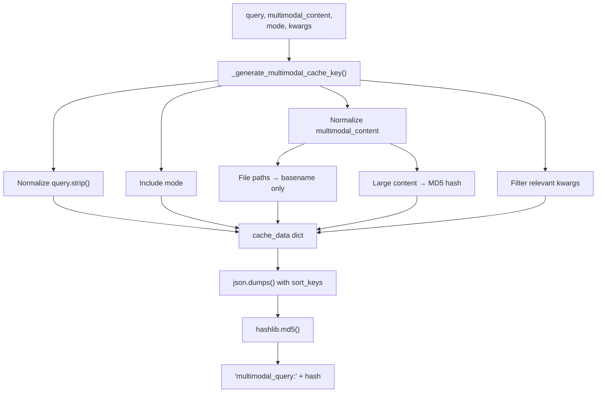

<!-- source: DeepWiki mcp.deepwiki.com · repo HKUDS/RAG-Anything · page 7.3 Multimodal Queries · fetched 2026-11-09 -->

# Multimodal Queries

<details>
<summary>Relevant source files</summary>

The following files were used as context for generating this wiki page:

- [examples/raganything_example.py](examples/raganything_example.py)
- [raganything/batch.py](raganything/batch.py)
- [raganything/query.py](raganything/query.py)

</details>


## Purpose and Scope

This page describes the multimodal query functionality in RAG-Anything, specifically the `aquery_with_multimodal()` method that enables querying with both text and structured multimodal content such as tables, equations, and images. This functionality allows users to provide specific multimodal content alongside their queries for enhanced context-aware retrieval and generation.

**Scope:**
- Multimodal query execution via `aquery_with_multimodal()`
- Content injection and description generation
- Table, equation, and image query integration
- Query caching mechanism and normalization

**Related Pages:**
- For standard text-based queries, see [7.2 Text Queries]()
- For VLM-enhanced queries with automatic image processing, see [7.4 VLM-Enhanced Queries]()
- For the overall query architecture, see [7.1 Query Architecture]()

Sources: [raganything/query.py:1-24](), [raganything/query.py:195-205]()

---

## Overview

Multimodal queries in RAG-Anything extend standard text queries by allowing users to inject specific multimodal content (tables, equations, images) directly into the query context. Unlike VLM-enhanced queries that automatically process images found in retrieved documents, multimodal queries are designed for scenarios where the user wants to explicitly provide specific content for analysis.

The system processes this content through specialized modal processors to generate rich descriptions, then combines these descriptions with the user's query to create an enhanced query that is executed against the knowledge base.

**Key Characteristics:**
- **Explicit Content Injection**: User provides specific multimodal content to analyze.
- **Type-Aware Processing**: Different content types (table, equation, image) are processed by their respective specialized processors.
- **Query Enhancement**: Multimodal content is transformed into descriptive text that enriches the base query.
- **Caching Support**: Enhanced queries and their results are cached using a normalized hashing strategy.

Sources: [raganything/query.py:195-210](), [raganything/query.py:372-385]()

---

## Query Execution Flow

**Diagram: Multimodal Query Execution Pipeline**


**Query Flow Stages:**

1. **Cache Check**: `_generate_multimodal_cache_key()` [raganything/query.py:26-40]() generates a normalized key and checks `self.lightrag.llm_response_cache` [raganything/query.py:223-233]().
2. **Content Processing**: `_process_multimodal_query_content()` [raganything/query.py:372-423]() routes each multimodal item via `get_processor_for_type()` [raganything/utils.py:228-248]().
3. **Description Generation**: Generates rich textual descriptions using processor-specific methods like `_describe_image_for_query()` [raganything/query.py:455-484]().
4. **Query Enhancement**: Combines descriptions with the user query and `PROMPTS["QUERY_ENHANCEMENT_SUFFIX"]` [raganything/query.py:419-420]().
5. **Query Execution**: Executes the enhanced query using the standard `aquery()` path [raganything/query.py:257]().
6. **Cache Storage**: Saves result to `llm_response_cache` and triggers `index_done_callback()` for persistence [raganything/query.py:288-298]().

Sources: [raganything/query.py:26-100](), [raganything/query.py:217-298](), [raganything/query.py:372-423]()

---

## Content Injection Mechanism

### Query Method Signature

The primary entry point is `QueryMixin.aquery_with_multimodal()` defined in [raganything/query.py:195-205]():

```python
async def aquery_with_multimodal(
    self,
    query: str,
    multimodal_content: List[Dict[str, Any]] = None,
    mode: str = "mix",
    system_prompt: str | None = None,
    **kwargs,
) -> str
```

**Parameters:**
- `query`: Base query text provided by the user.
- `multimodal_content`: List of dictionaries containing `type` and content data.
- `mode`: Query mode (e.g., `"local"`, `"global"`, `"hybrid"`, `"naive"`, `"mix"`, `"bypass"`) [raganything/query.py:199]().
- `**kwargs`: Additional parameters forwarded to `QueryParam` (e.g., `top_k`, `max_tokens`).

**Fallback Behavior**: If `multimodal_content` is `None` or empty, the method automatically delegates to `aquery()` for standard text query processing [raganything/query.py:212-215]().

Sources: [raganything/query.py:195-215]()

---

### Multimodal Content Format

Each item in the `multimodal_content` list must be a dictionary with a `type` field and type-specific fields:

| Content Type | Required Fields | Optional Fields | Processing Method |
|-------------|----------------|-----------------|-------------------|
| `image` | `type`, `img_path` | `image_caption`, `image_footnote` | `_describe_image_for_query()` |
| `table` | `type`, `table_data` | `table_caption` | `_describe_table_for_query()` |
| `equation` | `type`, `latex` | `equation_caption` | `_describe_equation_for_query()` |
| Generic | `type` | Any custom fields | `_describe_generic_for_query()` |

**Content Routing**: The `type` field determines which processor is selected via `get_processor_for_type()` in [raganything/utils.py:228-248](), which maps types to instances in `self.modal_processors`.

Sources: [raganything/query.py:198-204](), [raganything/utils.py:228-248]()

---

## Content Description Generation

### Type-Based Routing

**Diagram: Content Type to Processor Routing**


The routing logic iterates through `multimodal_content` and fetches the processor instance [raganything/query.py:389-402](). If a processor is found, it calls `_generate_query_content_description()` [raganything/query.py:404-407]().

Sources: [raganything/query.py:372-423](), [raganything/utils.py:228-248]()

---

### Image Description Generation

The `_describe_image_for_query()` method in [raganything/query.py:455-484]() processes image content:

**Processing Flow:**
1. **Extract Metadata**: Extracts `img_path`, `image_caption`, and `image_footnote` [raganything/query.py:459-461]().
2. **Path Validation**: Checks if the file exists [raganything/query.py:463]().
3. **Base64 Encoding**: Encodes the image via `encode_image_to_base64()` [raganything/query.py:465]().
4. **VLM Analysis**: Calls `processor.modal_caption_func` with `PROMPTS["QUERY_IMAGE_DESCRIPTION"]` and `PROMPTS["QUERY_IMAGE_ANALYST_SYSTEM"]` [raganything/query.py:466-472]().
5. **Metadata Fallback**: If processing fails or image is missing, it constructs a description from available text metadata [raganything/query.py:476-484]().

Sources: [raganything/query.py:455-484](), [raganything/utils.py:281-300]()

---

### Table Description Generation

The `_describe_table_for_query()` method in [raganything/query.py:486-501]() analyzes table content:

**Processing Steps:**
1. **Extract Table Data**: Gets `table_data` (Markdown/CSV) and `table_caption` [raganything/query.py:490-491]().
2. **Build Analysis Prompt**: Formats `PROMPTS["QUERY_TABLE_ANALYSIS"]` with the data [raganything/query.py:493-495]().
3. **LLM Analysis**: Sends to `modal_caption_func()` with `PROMPTS["QUERY_TABLE_ANALYST_SYSTEM"]` [raganything/query.py:497-499]().

Sources: [raganything/query.py:486-501]()

---

### Equation Description Generation

The `_describe_equation_for_query()` method in [raganything/query.py:503-518]() interprets mathematical equations:

**Processing Steps:**
1. **Extract LaTeX**: Gets `latex` formula and `equation_caption` [raganything/query.py:507-508]().
2. **Build Analysis Prompt**: Formats `PROMPTS["QUERY_EQUATION_ANALYSIS"]` [raganything/query.py:510-512]().
3. **LLM Analysis**: Generates interpretation via `modal_caption_func()` using `PROMPTS["QUERY_EQUATION_ANALYST_SYSTEM"]` [raganything/query.py:514-516]().

Sources: [raganything/query.py:503-518]()

---

### Generic Content Description

The `_describe_generic_for_query()` method in [raganything/query.py:520-537]() handles custom content types by serializing the dictionary to a string [raganything/query.py:524]() and prompting the LLM to analyze it based on the `content_type` [raganything/query.py:526-535]().

Sources: [raganything/query.py:520-537]()

---

## Caching System

### Cache Key Generation

**Diagram: Cache Key Generation Process**


The `_generate_multimodal_cache_key()` method in [raganything/query.py:26-100]() ensures stability:
- **Path Normalization**: Uses `Path(value).name` for file paths to keep keys portable [raganything/query.py:60]().
- **Content Hashing**: Hashes `table_data` or `table_body` if length exceeds 200 characters [raganything/query.py:61-69]().
- **Kwarg Filtering**: Only includes relevant parameters like `top_k` and `temperature` in the hash [raganything/query.py:79-94]().

Sources: [raganything/query.py:26-100]()

---

## Usage Examples

### Example: Multimodal Query with Table and Equation

This example demonstrates how to pass explicit structured data to the query system.

```python
from raganything import RAGAnything

async def run_query(rag: RAGAnything):
    result = await rag.aquery_with_multimodal(
        query="Compare the performance metrics in this table with the theoretical formula.",
        multimodal_content=[
            {
                "type": "table",
                "table_data": "Method,Accuracy\nRAGAnything,95.2%\nBaseline,87.3%",
                "table_caption": "Empirical Results"
            },
            {
                "type": "equation",
                "latex": "Acc = \\frac{TP + TN}{Total}",
                "equation_caption": "Accuracy Definition"
            }
        ],
        mode="hybrid"
    )
    print(result)
```

Sources: [examples/raganything_example.py:228-261]()

---

## Synchronous API

For non-async environments, `QueryMixin` provides a synchronous wrapper `query_with_multimodal()` [raganything/query.py:794-818]():

```python
def query_with_multimodal(self, query: str, multimodal_content: List[Dict[str, Any]] = None, 
                          mode: str = "mix", **kwargs) -> str:
    loop = always_get_an_event_loop()
    return loop.run_until_complete(
        self.aquery_with_multimodal(query, multimodal_content, mode=mode, **kwargs)
    )
```

This uses `lightrag.utils.always_get_an_event_loop` to manage execution [raganything/query.py:815-817]().

Sources: [raganything/query.py:794-818]()

---

