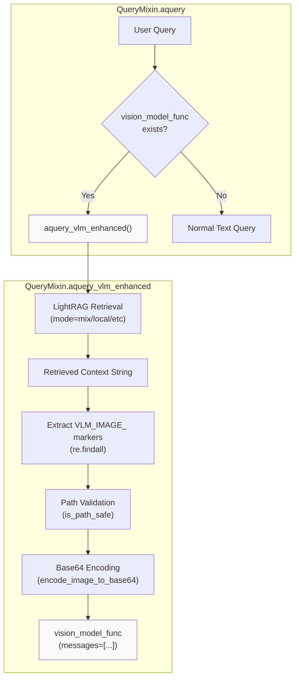
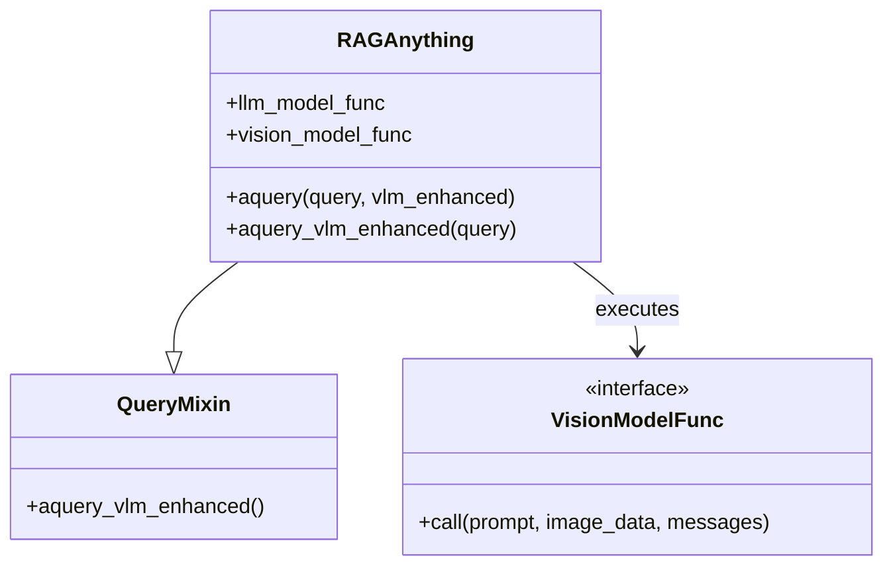
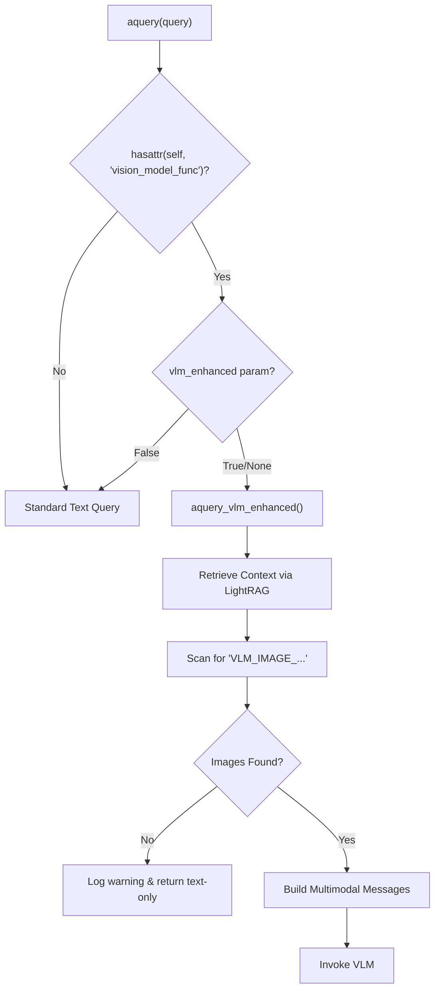

<!-- source: DeepWiki mcp.deepwiki.com · repo HKUDS/RAG-Anything · page 7.4 VLM-Enhanced Queries · fetched 2026-11-09 -->

# VLM-Enhanced Queries

<details>
<summary>Relevant source files</summary>

The following files were used as context for generating this wiki page:

- [docs/multimodal_rag_failure_modes.md](docs/multimodal_rag_failure_modes.md)
- [raganything/asset_urls.py](raganything/asset_urls.py)
- [raganything/batch.py](raganything/batch.py)
- [raganything/query.py](raganything/query.py)
- [tests/test_asset_urls.py](tests/test_asset_urls.py)

</details>


## Purpose and Scope

This page documents the VLM-Enhanced Query feature in RAG-Anything, implemented primarily within the `QueryMixin` class. This capability allows the system to automatically process visual information retrieved during the RAG process by identifying image markers in the context, validating their paths, and reconstructing a multimodal prompt for a Vision-Language Model (VLM).

VLM-Enhanced Queries differ from:
- **Text queries**: which ignore visual markers in retrieved context [raganything/query.py:102-119]().
- **Explicit multimodal queries**: which require the user to provide new images at query time [raganything/query.py:195-202]().

---

## Overview

VLM-Enhanced Queries bridge the gap between structured document ingestion and multimodal reasoning. During ingestion, images are saved to disk and their paths are stored in the knowledge graph. During retrieval, if these paths appear in the context, the system automatically fetches the files, encodes them, and invokes the VLM.


**VLM-Enhanced Query Data Flow**

Sources: [raganything/query.py:102-143](), [raganything/query.py:276-340]()

---

## System Components and Implementation

### The QueryMixin Class
The `QueryMixin` class provides the core logic for routing queries. It checks if `vision_model_func` is available and whether the user has requested `vlm_enhanced` mode [raganything/query.py:126-143]().

### Image Marker Reconstruction
When documents are parsed, images are represented in the text as specific markers. `aquery_vlm_enhanced` uses a regular expression `VLM_IMAGE_([^\s\n]+)` to find these markers in the retrieved text [raganything/query.py:302-303]().

### Path Validation and Security
To prevent arbitrary file access, the system validates extracted paths:
1.  **Safety Check**: The `is_path_safe` utility ensures the image resides within the configured `working_dir` or `parser_output_dir` [raganything/query.py:311-315]().
2.  **Existence Check**: It verifies the file physically exists on the disk before attempting to read it [raganything/query.py:316-318]().

### Base64 Encoding
Images are converted to base64 strings using `encode_image_to_base64` from `raganything.utils` to be compatible with standard VLM API message formats [raganything/query.py:321-322]().

Sources: [raganything/query.py:23-24](), [raganything/query.py:276-340](), [raganything/utils.py:114-129]()

---

## Vision Model Function Architecture

The `vision_model_func` is a flexible interface that handles both ingestion-time captioning and query-time reasoning.

### Invocation Patterns
The system uses the `messages` parameter pattern for VLM-enhanced queries, allowing for a mix of multiple images and retrieved text.


**Association between Query Logic and Model Execution**

| Parameter | Type | Usage in VLM-Enhanced Query |
| :--- | :--- | :--- |
| `messages` | `List[Dict]` | Contains the full conversation history including base64 images [raganything/query.py:333-340](). |
| `prompt` | `str` | The original user query, often embedded in the last user message [raganything/query.py:330](). |
| `system_prompt` | `str` | Optional instructions for the VLM [raganything/query.py:326](). |

Sources: [raganything/query.py:131-143](), [raganything/query.py:333-340]()

---

## Query Processing Workflow

### Decision Logic
The `aquery` method automatically determines whether to use VLM enhancement based on the presence of `vision_model_func` [raganything/query.py:129-133]().


**Decision Logic for VLM Enhancement**

Sources: [raganything/query.py:126-150](), [raganything/query.py:276-305]()

---

## Configuration and Environment

### Public URL Mapping
While VLM-enhanced queries typically use local paths for processing, the system supports mapping these to public URLs for UI display via `attach_public_media_urls` [raganything/asset_urls.py:65-76](). This is controlled by:
- `RAGANYTHING_PUBLIC_ASSET_BASE_URL` [raganything/asset_urls.py:77]()
- `RAGANYTHING_PUBLIC_ASSET_STRIP_PREFIX` [raganything/asset_urls.py:78]()

### Safe Directories
Path validation in `aquery_vlm_enhanced` relies on the configuration's directory settings to prevent path traversal attacks [raganything/query.py:311-315]().

Sources: [raganything/asset_urls.py:1-12](), [raganything/query.py:311-318]()

---

## Usage Examples

### Enabling VLM-Enhanced Queries
Users simply need to provide a `vision_model_func` during initialization. The system handles the rest during `aquery`.

```python
# The system automatically detects if VLM enhancement is possible
result = await rag.aquery(
    "Explain the diagram on page 5", 
    mode="hybrid"
)
```

### Manual Control
You can explicitly disable the feature even if a VLM is configured.

```python
# Force text-only retrieval even if images are present
result = await rag.aquery(
    "Summarize the text only", 
    vlm_enhanced=False
)
```

Sources: [raganything/query.py:102-116](), [raganything/query.py:126-133]()

---

