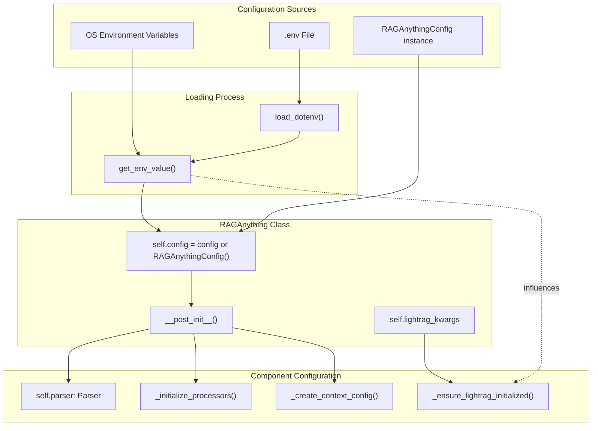
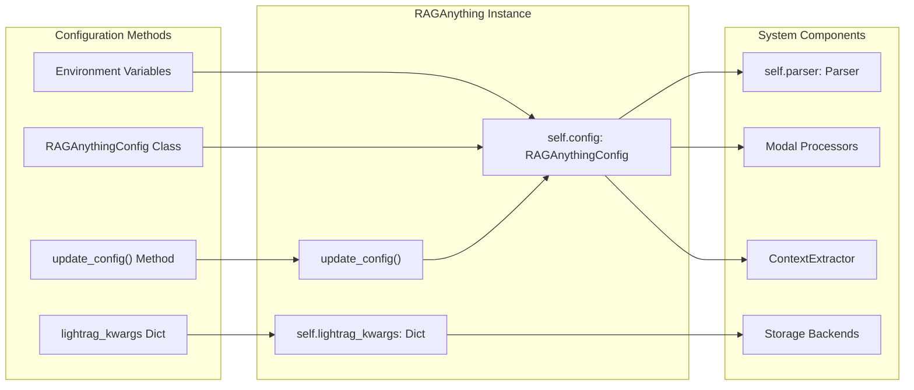

<!-- source: DeepWiki mcp.deepwiki.com · repo HKUDS/RAG-Anything · page 8 Configuration · fetched 2026-11-09 -->

# Configuration

<details>
<summary>Relevant source files</summary>

The following files were used as context for generating this wiki page:

- [.gitignore](.gitignore)
- [env.example](env.example)
- [examples/lmstudio_integration_example.py](examples/lmstudio_integration_example.py)
- [raganything/config.py](raganything/config.py)

</details>


This page provides a comprehensive guide to configuring RAG-Anything, covering configuration sources, the `RAGAnythingConfig` class, environment variables, storage backends, and model providers. Configuration determines system behavior including parser selection, multimodal processing capabilities, context extraction parameters, storage backends, and external service integration.

For installation and setup procedures, see [Installation](#2.1). For environment-specific setup steps, see [Environment Configuration](#2.3). For advanced deployment scenarios, see [Offline Deployment](#11.1).

## Configuration Architecture

RAG-Anything uses a two-tier configuration system: environment variables loaded from `.env` files and programmatic configuration via the `RAGAnythingConfig` class. Environment variables provide deployment-level configuration (API keys, storage credentials, server settings), while `RAGAnythingConfig` provides document processing configuration (parser settings, multimodal processing, context extraction).

**Configuration Architecture Flow**



**Sources:** [raganything/raganything.py:22-135](), [raganything/config.py:1-159](), [env.example:1-212]()

### Configuration Loading Order

The configuration loading follows a specific precedence order:

1.  **Environment variables** are loaded first via `load_dotenv()` with `override=False` at [raganything/raganything.py:25](). This ensures OS-level environment variables take precedence over `.env` file values.
2.  **RAGAnythingConfig initialization** occurs. If no config is provided, a new instance is created at [raganything/raganything.py:102-103]() which reads from environment variables via the `get_env_value()` helper function at [raganything/config.py:9]().
3.  **Component-specific configuration** happens during initialization:
    *   Parser selection at [raganything/raganything.py:112-114]().
    *   Working directory setup at [raganything/raganything.py:106]().
    *   Multimodal processor configuration at [raganything/raganything.py:177-220]().
4.  **LightRAG configuration** merges user-provided `lightrag_kwargs` with defaults at [raganything/raganything.py:320-327]().

**Sources:** [raganything/raganything.py:22-135](), [raganything/config.py:8-159]()

## Configuration Sources

RAG-Anything supports multiple configuration methods that can be combined:

**Configuration Methods and Effects**



### Environment Variables (.env)

Environment variables are defined in a `.env` file following the template in `env.example`. The file is loaded at [raganything/raganything.py:25]() before any imports, which is critical for `TIKTOKEN_CACHE_DIR` to work in offline environments.

**Key characteristics:**
*   Loaded with `override=False` - OS environment takes precedence.
*   Affects both RAGAnything and LightRAG configuration.
*   Required for service credentials (API keys, database passwords).
*   Optional for RAGAnything-specific settings (defaults provided in `RAGAnythingConfig`).

### RAGAnythingConfig Class

The `RAGAnythingConfig` dataclass (defined at [raganything/config.py:13]()) provides programmatic configuration. When instantiated without parameters, it reads from environment variables. When provided explicitly to `RAGAnything.__init__()`, it overrides environment-based defaults.

**Initialization pattern:**
```python
# Method 1: Use environment variables
config = RAGAnythingConfig()  # Reads from environment via get_env_value

# Method 2: Override programmatically
config = RAGAnythingConfig(
    parser="mineru",
    parse_method="auto",
    enable_image_processing=True
)

rag = RAGAnything(config=config, ...)
```

Referenced at [raganything/raganything.py:67-68]() and initialized at [raganything/raganything.py:102-103]().

### lightrag_kwargs Dictionary

The `lightrag_kwargs` parameter provides direct passthrough to LightRAG initialization. This allows configuring storage backends, chunking parameters, and LightRAG-specific settings without modifying RAGAnything configuration.

**Usage pattern:**
```python
rag = RAGAnything(
    config=my_config,
    lightrag_kwargs={
        "kv_storage": "PGKVStorage",
        "vector_storage": "MilvusVectorStorage",
        "chunk_token_size": 1200,
        "max_parallel_insert": 2
    }
)
```

Documented at [raganything/raganything.py:72-83](), merged at [raganything/raganything.py:320-327]().

**Sources:** [raganything/raganything.py:67-83](), [raganything/raganything.py:222-229](), [env.example:1-212]()

## RAGAnythingConfig Fields

The `RAGAnythingConfig` dataclass contains all document processing configuration. Each field is populated via `get_env_value()` from environment variables or uses the specified default.

### Directory and Parser Configuration

| Field | Type | Default | Environment Variable | Line Reference |
| :--- | :--- | :--- | :--- | :--- |
| `working_dir` | `str` | `"./rag_storage"` | `WORKING_DIR` | [raganything/config.py:18]() |
| `parser_output_dir` | `str` | `"./output"` | `OUTPUT_DIR` | [raganything/config.py:26]() |
| `parser` | `str` | `"mineru"` | `PARSER` | [raganything/config.py:29]() |
| `parse_method` | `str` | `"auto"` | `PARSE_METHOD` | [raganything/config.py:23]() |

**Note:** `MINERU_PARSE_METHOD` is supported for backward compatibility but deprecated in favor of `PARSE_METHOD` at [raganything/config.py:120-130]().

### Multimodal and Batch Processing

| Field | Type | Default | Environment Variable | Line Reference |
| :--- | :--- | :--- | :--- | :--- |
| `enable_image_processing` | `bool` | `True` | `ENABLE_IMAGE_PROCESSING` | [raganything/config.py:39-41]() |
| `enable_table_processing` | `bool` | `True` | `ENABLE_TABLE_PROCESSING` | [raganything/config.py:44-46]() |
| `enable_equation_processing` | `bool` | `True` | `ENABLE_EQUATION_PROCESSING` | [raganything/config.py:49-52]() |
| `max_concurrent_files` | `int` | `1` | `MAX_CONCURRENT_FILES` | [raganything/config.py:56-58]() |
| `supported_file_extensions` | `List[str]` | (Standard extensions) | `SUPPORTED_FILE_EXTENSIONS` | [raganything/config.py:61-71]() |

### Context Extraction Configuration

| Field | Type | Default | Environment Variable | Line Reference |
| :--- | :--- | :--- | :--- | :--- |
| `context_window` | `int` | `1` | `CONTEXT_WINDOW` | [raganything/config.py:80]() |
| `context_mode` | `str` | `"page"` | `CONTEXT_MODE` | [raganything/config.py:83]() |
| `max_context_tokens` | `int` | `2000` | `MAX_CONTEXT_TOKENS` | [raganything/config.py:86-88]() |
| `include_headers` | `bool` | `True` | `INCLUDE_HEADERS` | [raganything/config.py:91]() |
| `include_captions` | `bool` | `True` | `INCLUDE_CAPTIONS` | [raganything/config.py:94-96]() |

**Sources:** [raganything/config.py:13-159](), [env.example:40-66]()

## Environment Variable Reference

For a complete reference, see [Environment Variables](#8.2). Key categories include:

*   **Server Configuration:** `HOST`, `PORT`, `WEBUI_TITLE`, `WEBUI_DESCRIPTION` ([env.example:5-8]()).
*   **Authentication:** `AUTH_ACCOUNTS`, `TOKEN_SECRET`, `LIGHTRAG_API_KEY` ([env.example:20-27]()).
*   **Offline Deployment:** `TIKTOKEN_CACHE_DIR` at [env.example:17]().
*   **Processing Pipeline:** `CHUNK_SIZE`, `CHUNK_OVERLAP_SIZE`, `MAX_PARALLEL_INSERT` ([env.example:100-103]()).
*   **LLM/Embedding:** `LLM_BINDING`, `LLM_MODEL`, `EMBEDDING_BINDING`, `EMBEDDING_MODEL` ([env.example:113-141]()).

## Storage Backend Configuration

RAG-Anything supports multiple storage backends through LightRAG. These are configured via environment variables and passed through `lightrag_kwargs`. For detailed setup, see [Storage Backend Configuration](#8.3).

**Supported Backends:**
*   **PostgreSQL:** All-in-one storage for KV, Vector, Graph, and DocStatus ([env.example:168-173]()).
*   **Neo4j:** Native graph storage ([env.example:178-180]()).
*   **Milvus/Qdrant:** Specialized vector storage ([env.example:200-207]()).
*   **MongoDB:** Document-based storage ([env.example:194-195]()).
*   **Redis:** High-speed KV caching ([env.example:211]()).

## Model Provider Configuration

RAG-Anything supports various model providers for both LLM and embedding tasks. For detailed configuration signatures, see [Model Provider Configuration](#8.4).

**Integration Examples:**
*   **OpenAI:** Standard cloud models ([env.example:113-122]()).
*   **Ollama:** Local model serving ([env.example:136-141]()).
*   **Azure OpenAI:** Enterprise-grade deployments ([env.example:124-125]()).
*   **LM Studio / vLLM:** High-performance local inference ([env.example:129-132](), [examples/lmstudio_integration_example.py:14-21]()).

**Sources:** [env.example:113-211](), [examples/lmstudio_integration_example.py:14-21]()

---

