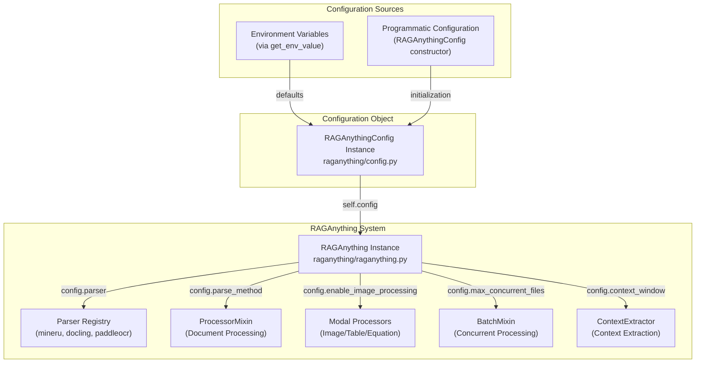
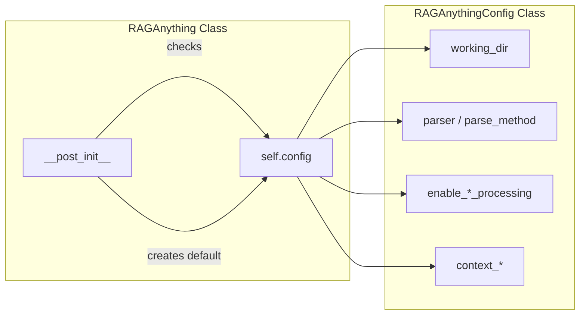

<!-- source: DeepWiki mcp.deepwiki.com · repo HKUDS/RAG-Anything · page 8.1 RAGAnythingConfig · fetched 2026-11-09 -->

# RAGAnythingConfig

<details>
<summary>Relevant source files</summary>

The following files were used as context for generating this wiki page:

- [README.md](README.md)
- [raganything/config.py](raganything/config.py)

</details>


## Purpose and Scope

`RAGAnythingConfig` is the centralized configuration class for the RAG-Anything system. It defines all operational parameters for document parsing, multimodal content analysis, batch processing, and context extraction. This class is implemented as a dataclass with built-in environment variable support, serving as the single source of truth for system configuration.

This page documents the configuration parameters, their defaults, and their mapping to environment variables. For information about:
- Overall system architecture and components, see [System Architecture](#3)
- Configuration of storage backends, see [Storage Backend Configuration](#8.3)
- Configuration of AI model providers, see [Model Provider Configuration](#8.4)
- Environment variables reference, see [Environment Variables](#8.2)

## Configuration Architecture

The following diagram illustrates how `RAGAnythingConfig` integrates with the RAG-Anything system components.

### System Configuration Flow


**Sources:** [raganything/config.py:12-116](), [raganything/raganything.py:99-135]()

## Configuration Initialization

`RAGAnythingConfig` is initialized in the `RAGAnything.__post_init__` method. If no configuration object is provided during `RAGAnything` instantiation, a default instance is created which automatically pulls values from the environment.

### Code Entity Space: Configuration Mapping


**Sources:** [raganything/raganything.py:99-110](), [raganything/config.py:12-116]()

## Configuration Parameters

### Directory Configuration
These parameters control file system locations for storage and parsing output.

| Parameter | Type | Default | Env Variable | Description |
|-----------|------|---------|--------------|-------------|
| `working_dir` | `str` | `"./rag_storage"` | `WORKING_DIR` | Directory where RAG storage and cache files are stored. |
| `parser_output_dir` | `str` | `"./output"` | `OUTPUT_DIR` | Default output directory for parsed content. |

**Sources:** [raganything/config.py:18-27]()

### Parser Configuration
Controls document parser selection and extraction behavior.

| Parameter | Type | Default | Env Variable | Description |
|-----------|------|---------|--------------|-------------|
| `parser` | `str` | `"mineru"` | `PARSER` | Parser selection: `'mineru'`, `'docling'`, or `'paddleocr'`. |
| `parse_method` | `str` | `"auto"` | `PARSE_METHOD` | Default parsing method: `'auto'`, `'ocr'`, or `'txt'`. |
| `display_content_stats` | `bool` | `True` | `DISPLAY_CONTENT_STATS` | Whether to display content statistics during parsing. |

**Backward Compatibility:** The configuration supports a legacy variable `MINERU_PARSE_METHOD`. If `PARSE_METHOD` is not set, it will fallback to this value and issue a `DeprecationWarning`.

**Sources:** [raganything/config.py:23-35](), [raganything/config.py:117-158]()

### Multimodal Processing Configuration
Controls the activation of specialized modal processors.

| Parameter | Type | Default | Env Variable | Description |
|-----------|------|---------|--------------|-------------|
| `enable_image_processing` | `bool` | `True` | `ENABLE_IMAGE_PROCESSING` | Enable image content processing via `ImageModalProcessor`. |
| `enable_table_processing` | `bool` | `True` | `ENABLE_TABLE_PROCESSING` | Enable table content processing via `TableModalProcessor`. |
| `enable_equation_processing` | `bool` | `True` | `ENABLE_EQUATION_PROCESSING` | Enable equation content processing via `EquationModalProcessor`. |

**Sources:** [raganything/config.py:39-52]()

### Context Extraction Configuration
Controls how surrounding context is provided to modal processors to improve description accuracy.

| Parameter | Type | Default | Env Variable | Description |
|-----------|------|---------|--------------|-------------|
| `context_window` | `int` | `1` | `CONTEXT_WINDOW` | Number of items before/after current item to include. |
| `context_mode` | `str` | `"page"` | `CONTEXT_MODE` | Context mode: `'page'` (page-based) or `'chunk'` (chunk-based). |
| `max_context_tokens` | `int` | `2000` | `MAX_CONTEXT_TOKENS` | Maximum number of tokens in extracted context. |
| `include_headers` | `bool` | `True` | `INCLUDE_HEADERS` | Whether to include document headers and titles in context. |
| `include_captions` | `bool` | `True` | `INCLUDE_CAPTIONS` | Whether to include image/table captions in context. |
| `context_filter_content_types`| `List[str]`| `["text"]` | `CONTEXT_FILTER_CONTENT_TYPES`| Content types to include in context extraction. |
| `content_format` | `str` | `"minerU"` | `CONTENT_FORMAT` | Default content format for context extraction. |

**Sources:** [raganything/config.py:80-111]()

### Batch Processing Configuration
Controls concurrent processing behavior for folders or multiple documents.

| Parameter | Type | Default | Env Variable | Description |
|-----------|------|---------|--------------|-------------|
| `max_concurrent_files` | `int` | `1` | `MAX_CONCURRENT_FILES` | Maximum number of files to process concurrently. |
| `supported_file_extensions` | `List[str]` | (Standard set) | `SUPPORTED_FILE_EXTENSIONS` | List of supported extensions (e.g., .pdf, .docx, .md). |
| `recursive_folder_processing`| `bool` | `True` | `RECURSIVE_FOLDER_PROCESSING`| Whether to recursively process subfolders. |

**Sources:** [raganything/config.py:56-76]()

### Path Handling Configuration
| Parameter | Type | Default | Env Variable | Description |
|-----------|------|---------|--------------|-------------|
| `use_full_path` | `bool` | `False` | `USE_FULL_PATH` | Whether to use full file path or just basename for file references. |

**Sources:** [raganything/config.py:114-115]()

## Configuration Methods in RAGAnything

The `RAGAnything` class provides several methods to interact with and update this configuration at runtime.

### Dynamic Updates
- `update_config(**kwargs)`: Updates general configuration parameters. [raganything/raganything.py:222-230]()
- `update_context_config(**context_kwargs)`: Specifically updates context extraction parameters and recreates the `ContextExtractor`. [raganything/raganything.py:521-551]()

### Inspection Methods
- `get_config_info()`: Returns a categorized dictionary of the current configuration, including directory, parsing, multimodal, context, and batch settings. [raganything/raganything.py:437-491]()
- `get_processor_info()`: Returns a status report of the system, including initialized modal processors and the current configuration state. [raganything/raganything.py:553-585]()

**Sources:** [raganything/raganything.py:222-585]()

## Complete Configuration Example

```python
from raganything import RAGAnything, RAGAnythingConfig

# Programmatic initialization
config = RAGAnythingConfig(
    parser="docling",
    parse_method="ocr",
    max_concurrent_files=4,
    context_window=2,
    enable_equation_processing=False
)

# Initializing RAGAnything with the custom config
rag = RAGAnything(
    config=config,
    working_dir="./my_knowledge_base" # Overrides config.working_dir if provided
)

# Updating configuration after initialization
rag.update_config(display_content_stats=False)
rag.update_context_config(max_context_tokens=1000)
```

**Sources:** [raganything/config.py:12-116](), [raganything/raganything.py:99-135](), [raganything/raganything.py:222-230]()

---

