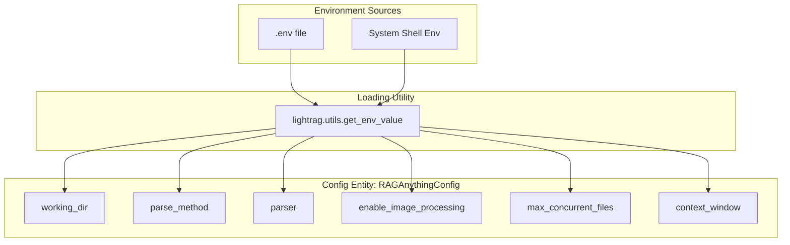
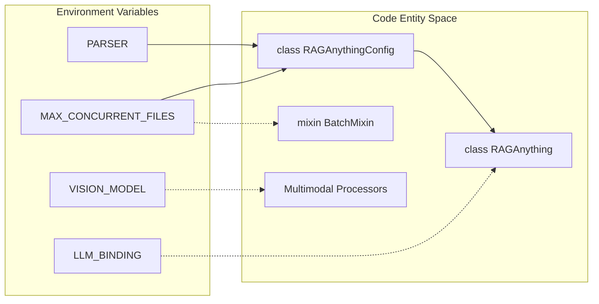

<!-- source: DeepWiki mcp.deepwiki.com · repo HKUDS/RAG-Anything · page 8.2 Environment Variables · fetched 2026-11-09 -->

# Environment Variables

Relevant source files

The following files were used as context for generating this wiki page:

- [.gitignore](.gitignore)
- [env.example](env.example)
- [examples/lmstudio_integration_example.py](examples/lmstudio_integration_example.py)
- [raganything/config.py](raganything/config.py)

This page documents all environment variables supported by RAG-Anything and LightRAG. Environment variables provide a declarative way to configure the system without modifying code, making deployment and configuration management easier across different environments.

**Scope**: This page covers environment variables loaded from `.env` files and system environment. For programmatic Python configuration using `RAGAnythingConfig`, see [RAGAnythingConfig](#8.1). For detailed storage backend connection strings and parameters, see [Storage Backend Configuration](#8.3). For model provider API keys and endpoints, see [Model Provider Configuration](#8.4).

## Environment Variable Loading

RAG-Anything loads environment variables using the following priority (highest to lowest):

1. **System environment variables** - Variables set in your shell or deployment environment.
2. **`.env` file** - Variables defined in a `.env` file in the working directory.
3. **Default values** - Hardcoded defaults in the codebase.

The system uses the `get_env_value` utility from `lightrag.utils` to read variables, which handles automatic type conversion for numeric and boolean values [raganything/config.py:9-10]().

### Data Flow Diagram: Configuration Initialization

The following diagram illustrates how the `RAGAnythingConfig` class [raganything/config.py:13-116]() consumes environment variables during instantiation.

**Sources:** [raganything/config.py:13-116](), [env.example:1-40]()

## Configuration Categories

### Logging Configuration

Controls logging behavior and output destinations for the RAG-Anything system.

| Variable | Type | Default | Description |
|----------|------|---------|-------------|
| `LOG_LEVEL` | string | `INFO` | Logging level: `DEBUG`, `INFO`, `WARNING`, `ERROR`, `CRITICAL` |
| `VERBOSE` | boolean | `False` | Enable verbose logging output |
| `LOG_MAX_BYTES` | integer | `10485760` | Maximum size of log files in bytes (10MB default) |
| `LOG_BACKUP_COUNT` | integer | `5` | Number of rotated log files to keep |
| `LOG_DIR` | path | current directory | Directory path for log file storage |

**Sources:** [env.example:75-81]()

### Document Processing Configuration

Controls document parsing, output directories, and parser selection.

| Variable | Type | Default | Description |
|----------|------|---------|-------------|
| `PARSER` | string | `mineru` | Parser selection: `mineru`, `docling`, or `paddleocr` [raganything/config.py:29-30]() |
| `PARSE_METHOD` | string | `auto` | Parse method: `auto`, `ocr`, or `txt` [raganything/config.py:23-24]() |
| `OUTPUT_DIR` | path | `./output` | Output directory for parsed documents [raganything/config.py:26-27]() |
| `DISPLAY_CONTENT_STATS` | boolean | `true` | Display content statistics after parsing [raganything/config.py:32-35]() |
| `INPUT_DIR` | path | `./inputs` | Default input directory for documents [env.example:38]() |
| `WORKING_DIR` | path | `./rag_storage` | Directory for RAG storage and cache [raganything/config.py:18-19]() |

**Deprecation Warning:** The variable `MINERU_PARSE_METHOD` is deprecated. The `RAGAnythingConfig.__post_init__` method [raganything/config.py:117-129]() automatically maps it to `PARSE_METHOD` if the latter is not set, while issuing a `DeprecationWarning`.

**Sources:** [raganything/config.py:16-36](), [raganything/config.py:117-158](), [env.example:35-46]()

### Multimodal Processing Configuration

Enables or disables processing of specific content modalities during the multimodal batch processing stage.

| Variable | Type | Default | Description |
|----------|------|---------|-------------|
| `ENABLE_IMAGE_PROCESSING` | boolean | `true` | Enable image content processing and captioning [raganything/config.py:39-42]() |
| `ENABLE_TABLE_PROCESSING` | boolean | `true` | Enable table structure analysis and processing [raganything/config.py:44-47]() |
| `ENABLE_EQUATION_PROCESSING` | boolean | `true` | Enable mathematical equation parsing [raganything/config.py:49-52]() |

**Sources:** [raganything/config.py:37-52](), [env.example:48-51]()

### Batch Processing Configuration

Controls concurrent document processing and file type filtering.

| Variable | Type | Default | Description |
|----------|------|---------|-------------|
| `MAX_CONCURRENT_FILES` | integer | `1` | Maximum number of files to process concurrently [raganything/config.py:56-59]() |
| `SUPPORTED_FILE_EXTENSIONS` | string | (Long list) | Comma-separated list of supported extensions [raganything/config.py:61-71]() |
| `RECURSIVE_FOLDER_PROCESSING` | boolean | `true` | Enable recursive folder traversal [raganything/config.py:73-76]() |

**Sources:** [raganything/config.py:54-77](), [env.example:53-56]()

### Context Extraction Configuration

Controls how contextual text is extracted around multimodal elements for enhanced understanding by the `ContextExtractor`.

| Variable | Type | Default | Description |
|----------|------|---------|-------------|
| `CONTEXT_WINDOW` | integer | `1` | Number of content units before/after modal element [raganything/config.py:80-81]() |
| `CONTEXT_MODE` | string | `page` | Context extraction mode: `page` or `chunk` [raganything/config.py:83-84]() |
| `MAX_CONTEXT_TOKENS` | integer | `2000` | Maximum tokens to extract from context [raganything/config.py:86-89]() |
| `INCLUDE_HEADERS` | boolean | `true` | Include document headers in context [raganything/config.py:91-92]() |
| `INCLUDE_CAPTIONS` | boolean | `true` | Include element captions in context [raganything/config.py:94-97]() |
| `CONTEXT_FILTER_CONTENT_TYPES` | string | `text` | Comma-separated list of content types [raganything/config.py:99-107]() |
| `CONTENT_FORMAT` | string | `minerU` | Default format for extraction [raganything/config.py:109-110]() |

**Sources:** [raganything/config.py:78-111](), [env.example:58-65]()

### RAG Query Configuration

Controls retrieval and response generation behavior during queries.

| Variable | Type | Default | Description |
|----------|------|---------|-------------|
| `HISTORY_TURNS` | integer | `3` | Number of conversation turns to include in history |
| `COSINE_THRESHOLD` | float | `0.2` | Minimum cosine similarity for vector retrieval |
| `TOP_K` | integer | `60` | Number of top results to retrieve |
| `MAX_TOKEN_TEXT_CHUNK` | integer | `4000` | Maximum tokens per text chunk in context |
| `MAX_TOKEN_RELATION_DESC` | integer | `4000` | Maximum tokens for relationship descriptions |
| `MAX_TOKEN_ENTITY_DESC` | integer | `4000` | Maximum tokens for entity descriptions |
| `MAX_GRAPH_NODES` | integer | `1000` | Maximum nodes to retrieve from graph |

**Sources:** [env.example:83-90]()

### LLM and Embedding Configuration

These variables configure the model bindings used for text generation, vision analysis, and vector embeddings.

| Variable | Type | Default | Description |
|----------|------|---------|-------------|
| `LLM_BINDING` | string | `openai` | LLM provider: `openai`, `ollama`, `vllm`, `lmstudio`, etc. [env.example:117-118]() |
| `LLM_MODEL` | string | `gpt-4o` | Model name or identifier [env.example:119]() |
| `VISION_MODEL` | string | `gpt-4o` | Model used for image analysis [env.example:120]() |
| `LLM_BINDING_HOST` | url | - | API endpoint URL [env.example:121]() |
| `LLM_BINDING_API_KEY` | string | - | API authentication key [env.example:122]() |
| `MAX_ASYNC` | integer | `4` | Maximum concurrent LLM requests [env.example:113]() |
| `EMBEDDING_BINDING` | string | `ollama` | Embedding provider [env.example:136]() |
| `EMBEDDING_MODEL` | string | `bge-m3:latest` | Embedding model name [env.example:137]() |
| `EMBEDDING_DIM` | integer | `1024` | Vector dimension [env.example:138]() |

**Sources:** [env.example:105-151](), [examples/lmstudio_integration_example.py:39-43]()

## Environment Variable to Code Entity Mapping

This diagram bridges the environment variables to the specific code classes and logic they initialize.

**Sources:** [raganything/config.py:13-31](), [raganything/config.py:56-59](), [env.example:117-120]()

## Storage Backend Selection

Selects storage implementations for different data layers.

| Variable | Type | Default | Description |
|----------|------|---------|-------------|
| `LIGHTRAG_KV_STORAGE` | string | - | Key-value storage class (e.g., `PGKVStorage`) |
| `LIGHTRAG_VECTOR_STORAGE` | string | - | Vector storage class (e.g., `PGVectorStorage`) |
| `LIGHTRAG_DOC_STATUS_STORAGE`| string | - | Document status storage class |
| `LIGHTRAG_GRAPH_STORAGE` | string | - | Graph storage class (e.g., `Neo4JStorage`) |

**Sources:** [env.example:152-156]()

## Offline Deployment Configuration

Enables air-gapped deployment without internet access for model downloads.

| Variable | Type | Default | Description |
|----------|------|---------|-------------|
| `TIKTOKEN_CACHE_DIR` | path | - | Local directory containing cached tiktoken models |

**Sources:** [env.example:13-17]()

## Server Configuration (API Server)

Configuration for the optional LightRAG API server.

| Variable | Type | Default | Description |
|----------|------|---------|-------------|
| `HOST` | string | `0.0.0.0` | Server bind address |
| `PORT` | integer | `9621` | Server port |
| `AUTH_ACCOUNTS` | string | - | Authentication accounts: `user:pass,user2:pass2` |
| `TOKEN_SECRET` | string | - | JWT token secret |
| `LIGHTRAG_API_KEY` | string | - | API key for server authentication |

**Sources:** [env.example:4-28]()

---

