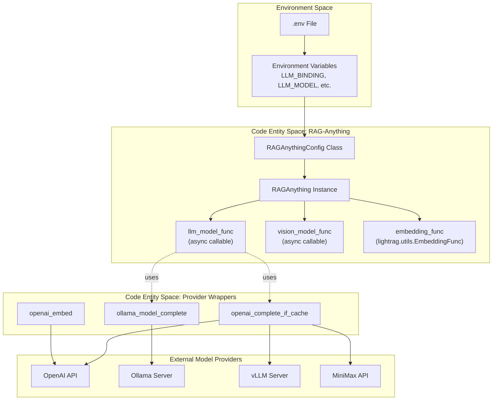

<!-- source: DeepWiki mcp.deepwiki.com · repo HKUDS/RAG-Anything · page 8.4 Model Provider Configuration · fetched 2026-11-09 -->

# Model Provider Configuration

<details>
<summary>Relevant source files</summary>

The following files were used as context for generating this wiki page:

- [.gitignore](.gitignore)
- [docs/vllm_integration.md](docs/vllm_integration.md)
- [env.example](env.example)
- [examples/lmstudio_integration_example.py](examples/lmstudio_integration_example.py)
- [examples/minimax_integration_example.py](examples/minimax_integration_example.py)
- [examples/vllm_integration_example.py](examples/vllm_integration_example.py)
- [tests/test_minimax_integration.py](tests/test_minimax_integration.py)

</details>


## Purpose and Scope

This page documents how to configure different LLM (Large Language Model) and embedding model providers in RAG-Anything. The system supports multiple providers including OpenAI, Ollama, Azure OpenAI, LM Studio, vLLM, and MiniMax for both text generation and embeddings.

For general configuration parameters, see [RAGAnythingConfig](#8.1). For storage backend configuration, see [Storage Backend Configuration](#8.3). For environment variable reference, see [Environment Variables](#8.2).

---

## Provider Architecture Overview

RAG-Anything uses a provider abstraction layer that allows you to configure different AI service providers through environment variables. The configuration flows from environment variables to the `RAGAnything` instance, which then uses these settings to create the appropriate function wrappers.

### Data Flow and System Entities

The following diagram maps the configuration from environment space into the code entity space, specifically showing how `RAGAnything` and `LightRAG` interact with provider functions.



**Sources:** [env.example:105-145](), [examples/lmstudio_integration_example.py:45-73](), [examples/vllm_integration_example.py:59-93]()

---

## Supported Provider Types

RAG-Anything supports the following provider types through the `LLM_BINDING` and `EMBEDDING_BINDING` environment variables:

| Provider Type | Value | LLM Support | Embedding Support | Description |
|---------------|-------|-------------|-------------------|-------------|
| OpenAI | `openai` | ✅ | ✅ | Official OpenAI API |
| Ollama | `ollama` | ✅ | ✅ | Local model server |
| Azure OpenAI | `azure_openai` | ✅ | ✅ | Microsoft Azure OpenAI Service |
| LM Studio | `lmstudio` | ✅ | ✅ | Local OpenAI-compatible server |
| vLLM | `vllm` | ✅ | ✅ | High-throughput production server |
| MiniMax | `minimax` | ✅ | ❌ | High-quality cloud LLM (OpenAI-compatible) |

**Sources:** [env.example:117-118](), [env.example:129-130](), [examples/minimax_integration_example.py:1-34]()

---

## LLM Configuration

### Common LLM Parameters

These parameters apply to all LLM providers:

| Environment Variable | Purpose | Default | Valid Values |
|---------------------|---------|---------|--------------|
| `LLM_BINDING` | Provider type | `openai` | `openai`, `ollama`, `azure_openai`, `lmstudio`, `vllm` |
| `LLM_MODEL` | Model identifier | `gpt-4o` | Provider-specific model names |
| `LLM_BINDING_HOST` | API endpoint URL | `https://api.openai.com/v1` | Full URL with protocol |
| `LLM_BINDING_API_KEY` | Authentication key | - | Provider API key or token |
| `TIMEOUT` | Request timeout in seconds | `240` | Integer or `None` |
| `TEMPERATURE` | Generation temperature | `0` | `0.0` to `2.0` |
| `MAX_TOKENS` | Context window size | `32768` | Integer (e.g., 32768) |
| `MAX_ASYNC` | Max concurrent LLM requests | `4` | Integer |

**Sources:** [env.example:105-116]()

### Provider-Specific Details

#### vLLM (Production High-Throughput)
vLLM is the recommended backend for high-throughput production RAG. It exposes an OpenAI-compatible API and supports continuous batching and PagedAttention.

*   **Setup:** Use `vllm serve <model_name>` to start the server.
*   **Configuration:** Set `LLM_BINDING=vllm` and point `LLM_BINDING_HOST` to the vLLM endpoint (default `:8000/v1`).

**Sources:** [docs/vllm_integration.md:1-18](), [examples/vllm_integration_example.py:51-56]()

#### MiniMax (Cloud LLM)
MiniMax is integrated using its OpenAI-compatible endpoint.
*   **Constraint:** MiniMax requires temperature to be in the range `(0.0, 1.0]`. RAG-Anything's integration examples handle this via `_normalize_minimax_temperature`.
*   **Embeddings:** MiniMax does not provide an embedding model; you must use a separate provider (e.g., OpenAI or Ollama) for embeddings.

**Sources:** [examples/minimax_integration_example.py:77-86](), [examples/minimax_integration_example.py:114-126]()

#### LM Studio (Local Offline)
Ideal for local development and testing offline models.
*   **Configuration:** Set `LLM_BINDING=lmstudio` and `LLM_BINDING_HOST=http://localhost:1234/v1`.

**Sources:** [examples/lmstudio_integration_example.py:14-22]()

---

## Embedding Configuration

### Parameters

| Environment Variable | Purpose | Default | Valid Values |
|---------------------|---------|---------|--------------|
| `EMBEDDING_BINDING` | Provider type | `ollama` | `openai`, `ollama`, `vllm`, `lmstudio` |
| `EMBEDDING_MODEL` | Model identifier | `bge-m3:latest` | e.g., `text-embedding-3-large` |
| `EMBEDDING_DIM` | Vector dimension | `1024` | 1024, 1536, 3072, etc. |
| `EMBEDDING_BINDING_HOST` | API endpoint URL | `http://localhost:11434` | Full URL |
| `EMBEDDING_BATCH_NUM` | Chunks per request | `32` | Integer |

**Sources:** [env.example:134-143]()

---

## Implementation and Function Binding

RAG-Anything initializes model functions during instantiation. If no functions are provided to the `RAGAnything` constructor, it generates them based on environment variables.

### LLM and Embedding Function Mapping

This diagram illustrates the association between the `RAGAnything` initialization logic and the specific provider functions.

```mermaid
graph LR
    subgraph "Initialization Logic"
        Init["RAGAnything.__init__"]
        Config["RAGAnythingConfig"]
    end

    subgraph "Provider Functions (lightrag.llm)"
        OAI_Comp["openai_complete_if_cache"]
        OAI_Embed["openai_embed"]
    end

    subgraph "Custom Integration Wrappers"
        vLLM_Func["vllm_llm_model_func"]
        MiniMax_Func["minimax_llm_model_func"]
        LMS_Func["lmstudio_llm_model_func"]
    end

    Init -->| "Reads LLM_BINDING" | Config
    Config -->| "if vllm" | vLLM_Func
    Config -->| "if minimax" | MiniMax_Func
    
    vLLM_Func --> OAI_Comp
    MiniMax_Func --> OAI_Comp
    LMS_Func --> OAI_Comp
```

**Sources:** [examples/lmstudio_integration_example.py:45-60](), [examples/minimax_integration_example.py:89-111](), [examples/vllm_integration_example.py:59-77]()

### Manual Binding Example (LM Studio)
Users can manually bind functions if they need custom logic or are not using environment variables.

```python
from raganything import RAGAnything, RAGAnythingConfig
from lightrag.llm.openai import openai_complete_if_cache

async def custom_llm_func(prompt, system_prompt=None, history_messages=None, **kwargs):
    return await openai_complete_if_cache(
        model="your-model",
        prompt=prompt,
        system_prompt=system_prompt,
        base_url="http://localhost:1234/v1",
        api_key="lm-studio",
        **kwargs
    )

rag = RAGAnything(
    config=RAGAnythingConfig(working_dir="./storage"),
    llm_model_func=custom_llm_func
)
```

**Sources:** [examples/lmstudio_integration_example.py:45-60](), [examples/lmstudio_integration_example.py:180-184]()

---

## Summary of Configuration Variables

| Category | Variables |
|----------|-----------|
| **OpenAI** | `LLM_BINDING=openai`, `LLM_MODEL`, `LLM_BINDING_API_KEY` |
| **Azure** | `LLM_BINDING=azure_openai`, `AZURE_OPENAI_DEPLOYMENT`, `AZURE_OPENAI_API_VERSION` |
| **Ollama** | `LLM_BINDING=ollama`, `LLM_MODEL`, `LLM_BINDING_HOST` |
| **vLLM** | `LLM_BINDING=vllm`, `LLM_MODEL`, `LLM_BINDING_HOST`, `LLM_BINDING_API_KEY` |
| **MiniMax** | `MINIMAX_API_KEY`, `MINIMAX_LLM_MODEL`, `MINIMAX_BASE_URL` |

**Sources:** [env.example:112-132](), [examples/minimax_integration_example.py:53-55]()

---

