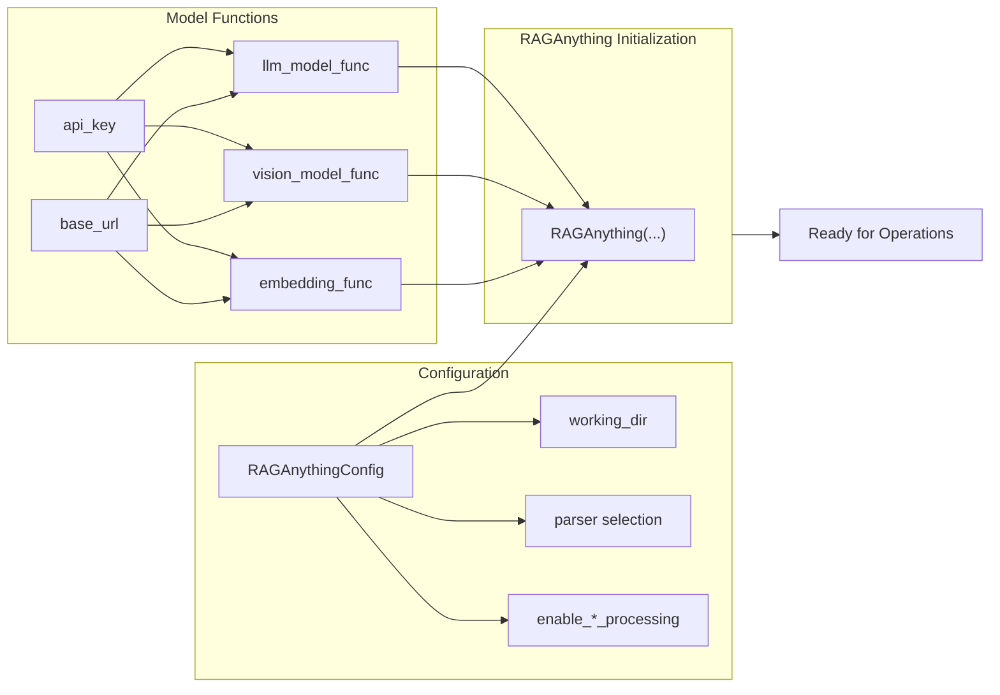
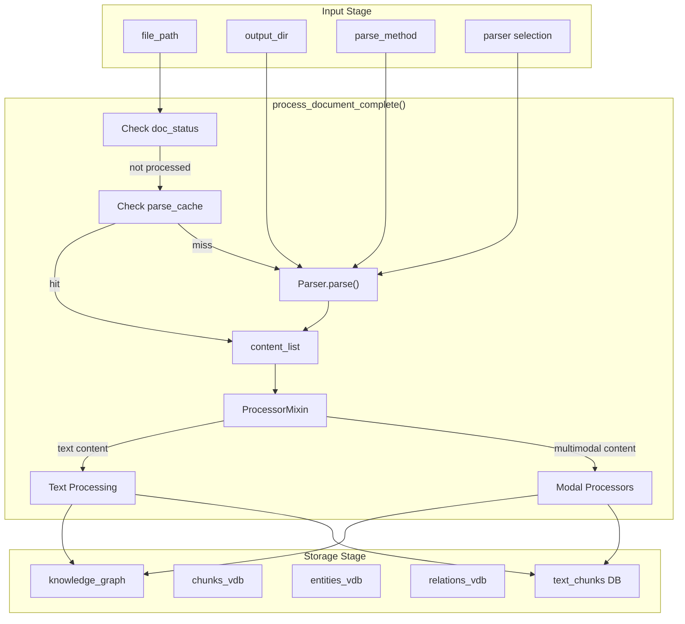
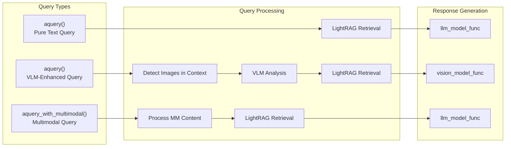
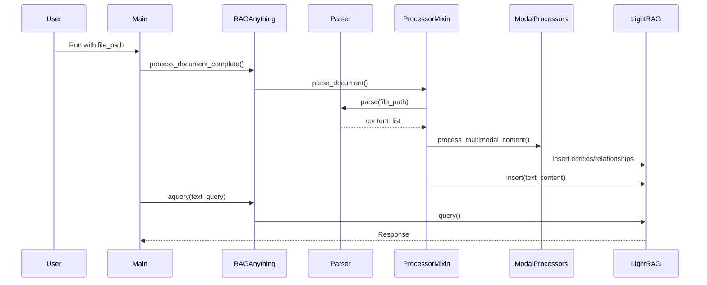

<!-- source: DeepWiki mcp.deepwiki.com · repo HKUDS/RAG-Anything · page 9 Usage Examples · fetched 2026-11-09 -->

# Usage Examples

<details>
<summary>Relevant source files</summary>

The following files were used as context for generating this wiki page:

- [README.md](README.md)
- [examples/raganything_example.py](examples/raganything_example.py)

</details>


## Purpose and Scope

This page provides an overview of common usage patterns and practical examples for RAG-Anything. It demonstrates the core workflows for processing documents, querying content, and integrating with various components.

For detailed examples of specific scenarios, see:
- **Basic single document processing**: [Basic Document Processing](#9.1) — Step-by-step example of processing a single document with `process_document_complete`, including parser selection and output directory configuration.
- **Processing multiple documents**: [Batch Processing](#9.2) — Example of processing multiple documents with `process_folder_complete`, `BatchParser` dry-run mode, and configuring `max_workers` and concurrency.
- **Using pre-parsed content**: [Direct Content List Insertion](#9.3) — Example of inserting pre-parsed content using `insert_content_list`, including the content list schema and supported content types.
- **Different query approaches**: [Query Examples](#9.4) — Examples of different query types (text, multimodal, VLM-enhanced) with code snippets showing mode selection and `multimodal_content` structure.
- **Offline deployment**: [Local LLM Integration](#9.5) — Complete example of integrating with LM Studio, Ollama, and vLLM for offline deployment, including function wrappers and compatibility patches.
- **Using existing LightRAG instances**: [Loading Existing LightRAG Instances](#9.6) — Example of initializing `RAGAnything` with a pre-configured LightRAG instance to add multimodal capabilities to a previously text-only index.
- **Format-specific processing**: [Format-Specific Processing Examples](#9.7) — Examples of processing different file formats (PDF, Office documents, images, text files, Markdown) including enhanced Markdown-to-PDF conversion.

For configuration details, see [Configuration](#8). For understanding the processing pipeline, see [Five-Stage Processing Pipeline](#3.2).

## Common Usage Patterns

RAG-Anything supports three primary usage patterns, each suited to different scenarios:

```mermaid
graph TB
    subgraph Pattern1["Pattern 1: End-to-End Processing"]
        Doc1["Document File<br/>(PDF/Office/Image)"]
        Process1["process_document_complete()"]
        Query1["aquery() / query()"]
        Result1["Response"]
        
        Doc1 --> Process1
        Process1 --> Query1
        Query1 --> Result1
    end
    
    subgraph Pattern2["Pattern 2: Pre-Parsed Content"]
        ContentList["content_list<br/>(List of Dicts)"]
        Insert["insert_content_list()"]
        Query2["aquery() / query()"]
        Result2["Response"]
        
        ContentList --> Insert
        Insert --> Query2
        Query2 --> Result2
    end
    
    subgraph Pattern3["Pattern 3: Existing LightRAG"]
        ExistingRAG["Existing LightRAG<br/>Instance"]
        InitRAG["RAGAnything(lightrag=...)"]
        Process3["process_document_complete()"]
        Query3["aquery() / query()"]
        Result3["Response"]
        
        ExistingRAG --> InitRAG
        InitRAG --> Process3
        Process3 --> Query3
        Query3 --> Result3
    end
```



**Sources:** [README.md:249-966](), [examples/raganything_example.py:1-331]()

## Core Initialization Pattern

All usage examples follow a common initialization pattern involving three key components: configuration, model functions, and `RAGAnything` instantiation.

### Standard Initialization Code Structure



**Sources:** [README.md:326-427](), [examples/raganything_example.py:108-206]()

### Configuration Setup

The `RAGAnythingConfig` class centralizes all configuration parameters:

```python
# From examples/raganything_example.py:108-116
config = RAGAnythingConfig(
    working_dir="./rag_storage",
    parser="mineru",  # or "docling", "paddleocr"
    parse_method="auto",  # or "ocr", "txt"
    enable_image_processing=True,
    enable_table_processing=True,
    enable_equation_processing=True,
)
```

**Key Parameters:**
- `working_dir`: Directory for LightRAG storage (text_chunks, vector DBs, knowledge graph) [examples/raganything_example.py:111]()
- `parser`: Parser backend selection - `mineru`, `docling`, or `paddleocr` [examples/raganything_example.py:112]()
- `parse_method`: Parsing approach - `auto` (intelligent selection), `ocr` (OCR-focused), or `txt` (text extraction) [examples/raganything_example.py:113]()
- `enable_*_processing`: Boolean flags for each multimodal content type [examples/raganything_example.py:114-116]()

**Sources:** [README.md:336-344](), [examples/raganything_example.py:108-116]()

### Model Function Definitions

Three model functions must be provided: LLM, vision, and embedding functions.

#### LLM Model Function

```python
# From examples/raganything_example.py:123-132
def llm_model_func(prompt, system_prompt=None, history_messages=[], **kwargs):
    return openai_complete_if_cache(
        llm_model,
        prompt,
        system_prompt=system_prompt,
        history_messages=history_messages,
        api_key=api_key,
        base_url=base_url,
        **kwargs,
    )
```

This function handles text generation for entity extraction, relationship mapping, and query response generation.

**Sources:** [examples/raganything_example.py:123-132]()

#### Vision Model Function

```python
# From examples/raganything_example.py:135-187
def vision_model_func(
    prompt,
    system_prompt=None,
    history_messages=[],
    image_data=None,
    messages=None,
    **kwargs,
):
    # If messages format is provided (for multimodal VLM enhanced query), use it directly
    if messages:
        return openai_complete_if_cache(vision_model, "", messages=messages, ...)
    # Traditional single image format for ImageModalProcessor
    elif image_data:
        return openai_complete_if_cache(
            vision_model,
            "",
            messages=[
                {"role": "user", "content": [
                    {"type": "text", "text": prompt},
                    {"type": "image_url", "image_url": {"url": f"data:image/jpeg;base64,{image_data}"}}
                ]}
            ],
            ...
        )
    # Pure text format
    else:
        return llm_model_func(prompt, system_prompt, history_messages, **kwargs)
```

This function supports three modes:
1. **Messages format**: Used by VLM-enhanced queries with multiple images [examples/raganything_example.py:144-154]()
2. **Single image format**: Used by `ImageModalProcessor` for image captioning [examples/raganything_example.py:156-184]()
3. **Text fallback**: Used when no image data is provided [examples/raganything_example.py:186-187]()

**Sources:** [examples/raganything_example.py:131-183](), [README.md:359-406]()

#### Embedding Function

```python
# From examples/raganything_example.py:193-203
embedding_func = EmbeddingFunc(
    embedding_dim=embedding_dim,
    max_token_size=8192,
    func=partial(
        openai_embed.func,
        model=embedding_model,
        api_key=api_key,
        base_url=base_url,
    ),
)
```

The embedding function generates vector representations for semantic search. The `embedding_dim` must match the model's output dimension.

**Sources:** [examples/raganything_example.py:190-203](), [README.md:408-418]()

### RAGAnything Instantiation

```python
# From examples/raganything_example.py:206-211
rag = RAGAnything(
    config=config,
    llm_model_func=llm_model_func,
    vision_model_func=vision_model_func,
    embedding_func=embedding_func,
)
```

This creates a `RAGAnything` instance that internally initializes LightRAG and the modal processing subsystem.

**Sources:** [examples/raganything_example.py:206-211]()

## Document Processing Workflow



**Sources:** [README.md:428-433]()

### Basic Processing Example

```python
# From README.md:428-433
await rag.process_document_complete(
    file_path="path/to/your/document.pdf",
    output_dir="./output",
    parse_method="auto"
)
```

The `process_document_complete()` method performs the full five-stage pipeline:

1. **Document Parsing**: Calls the configured parser to extract `content_list`.
2. **Content Separation**: Separates text from multimodal content.
3. **Multimodal Processing**: Routes images/tables/equations to modal processors.
4. **Entity Extraction**: Extracts entities and relationships via LLM.
5. **Storage**: Writes to all storage backends.

**Sources:** [README.md:428-433]()

## Query Patterns

RAG-Anything supports three distinct query patterns, each suited to different use cases:



**Sources:** [README.md:602-671](), [examples/raganything_example.py:213-260]()

### Pure Text Queries

```python
# From examples/raganything_example.py:222-225
result = await rag.aquery(query, mode="hybrid")
```

Pure text queries use LightRAG's retrieval without additional processing. Supported modes include `hybrid`, `local`, `global`, and `naive` [examples/raganything_example.py:222-225]().

**Sources:** [examples/raganything_example.py:216-225](), [README.md:607-616]()

### VLM-Enhanced Queries

```python
# From README.md:619-645
vlm_result = await rag.aquery(
    "Analyze the charts and figures in the document",
    mode="hybrid"
)
```

When `vision_model_func` is provided, the system automatically detects image markers (e.g., `VLM_IMAGE_`) in retrieved context and integrates them into the VLM prompt [README.md:619-645]().

**Sources:** [README.md:619-645]()

### Multimodal Queries

```python
# From examples/raganything_example.py:231-244
multimodal_result = await rag.aquery_with_multimodal(
    "Compare this performance data with any similar results mentioned in the document",
    multimodal_content=[
        {
            "type": "table",
            "table_data": """Method,Accuracy,Processing_Time
                        RAGAnything,95.2%,120ms
                        Traditional_RAG,87.3%,180ms""",
            "table_caption": "Performance comparison results",
        }
    ],
    mode="hybrid",
)
```

This pattern allows querying with explicit multimodal content (tables, equations, images) provided by the user [examples/raganything_example.py:231-244]().

**Sources:** [examples/raganything_example.py:228-260](), [README.md:648-671]()

## Example Execution Flow

The following sequence diagram illustrates the document processing and querying flow:



**Sources:** [examples/raganything_example.py:89-267]()

## Code Organization for Examples

RAG-Anything provides several example scripts in the `examples/` directory:

| Example File | Purpose | API Key Required |
|-------------|---------|------------------|
| `raganything_example.py` | End-to-end processing with queries [examples/raganything_example.py:1-10]() | Yes |
| `modalprocessors_example.py` | Direct multimodal processing [README.md:1034]() | Yes |
| `office_document_test.py` | Office format parsing test [README.md:1015]() | No |
| `image_format_test.py` | Image format parsing test [README.md:1020]() | No |
| `text_format_test.py` | Text format parsing test [README.md:1025]() | No |

**Sources:** [README.md:1000-1034](), [examples/raganything_example.py:1-10]()

---

