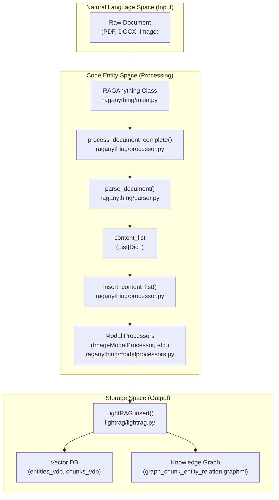
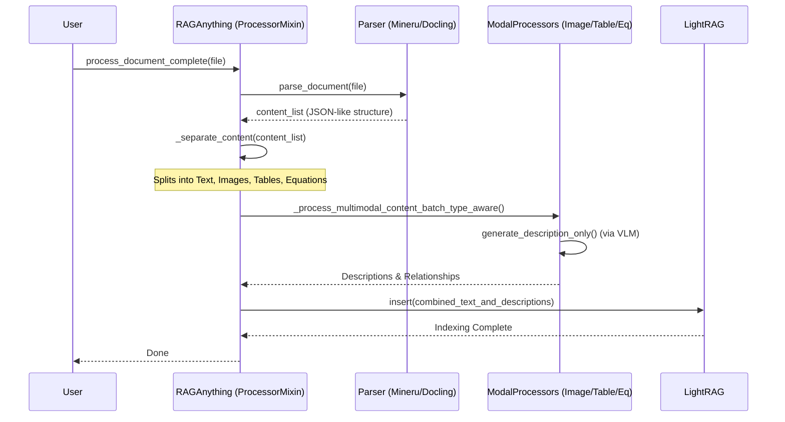

<!-- source: DeepWiki mcp.deepwiki.com · repo HKUDS/RAG-Anything · page 9.1 Basic Document Processing · fetched 2026-11-09 -->

# Basic Document Processing

<details>
<summary>Relevant source files</summary>

The following files were used as context for generating this wiki page:

- [examples/image_format_test.py](examples/image_format_test.py)
- [examples/office_document_test.py](examples/office_document_test.py)
- [examples/raganything_example.py](examples/raganything_example.py)
- [examples/text_format_test.py](examples/text_format_test.py)

</details>


## Purpose

This page provides a step-by-step example of processing a single document with RAG-Anything. The example covers initialization, document processing with `process_document_complete()`, and basic querying with `aquery()`. 

RAG-Anything extends the standard RAG pipeline by incorporating multimodal analysis (images, tables, equations) into the knowledge graph construction process.

---

## Processing Pipeline Overview

Document processing transforms raw files into a queryable knowledge graph through five stages. The `ProcessorMixin` class coordinates the flow from raw file to indexed content.

### Code Entity Flow

The following diagram maps the high-level stages to the specific code entities responsible for the transformation.



**Sources:** [raganything/processor.py:150-250](), [raganything/parser.py:1-50](), [examples/raganything_example.py:90-117]()

---

## Step-by-Step Implementation

### 1. Import and Configuration
First, initialize the configuration and model functions. RAG-Anything relies on `RAGAnythingConfig` to define the environment and parser settings.

```python
from raganything import RAGAnything, RAGAnythingConfig
from lightrag.llm.openai import openai_complete_if_cache, openai_embed
from lightrag.utils import EmbeddingFunc

config = RAGAnythingConfig(
    working_dir="./rag_storage",
    parser="mineru",         # Options: mineru, docling, paddleocr
    parse_method="auto",     # Options: auto, ocr, txt
    enable_image_processing=True,
    enable_table_processing=True,
    enable_equation_processing=True,
)
```

**Sources:** [examples/raganything_example.py:109-117](), [raganything/config.py:1-40]()

### 2. Define Model Functions
RAG-Anything requires three core functions: `llm_model_func` for text, `vision_model_func` for multimodal analysis, and `embedding_func` for vectorization.

```python
# LLM Function for entity extraction
def llm_model_func(prompt, **kwargs):
    return openai_complete_if_cache("gpt-4o-mini", prompt, api_key="sk-...", **kwargs)

# Vision Function for describing images/tables
def vision_model_func(prompt, image_data=None, messages=None, **kwargs):
    if messages: # VLM-enhanced query format
        return openai_complete_if_cache("gpt-4o", "", messages=messages, **kwargs)
    return openai_complete_if_cache("gpt-4o", prompt, image_data=image_data, **kwargs)

# Embedding Function
embedding_func = EmbeddingFunc(
    embedding_dim=3072,
    func=lambda texts: openai_embed(texts, model="text-embedding-3-large", api_key="sk-...")
)
```

**Sources:** [examples/raganything_example.py:123-198](), [README.md:346-418]()

### 3. Initialize and Process
Initialize the `RAGAnything` instance and call `process_document_complete`. This method handles the entire lifecycle: parsing, content separation, multimodal description generation, and knowledge graph insertion.

```python
rag = RAGAnything(
    config=config,
    llm_model_func=llm_model_func,
    vision_model_func=vision_model_func,
    embedding_func=embedding_func
)

# Complete pipeline execution
await rag.process_document_complete(
    file_path="manual.pdf",
    output_dir="./output_files"
)
```

**Sources:** [raganything/processor.py:150-170](), [examples/raganything_example.py:201-211]()

---

## Parameter Reference

### process_document_complete()
Defined in `ProcessorMixin`, this is the primary entry point for single document ingestion.

| Parameter | Type | Default | Description |
| :--- | :--- | :--- | :--- |
| `file_path` | `str` | Required | Path to the document (PDF, DOCX, Image, TXT, MD). |
| `output_dir` | `str` | `None` | Directory for parser artifacts (JSON, images, MD). |
| `parse_method` | `str` | `None` | Overrides config `parse_method` ("auto", "ocr", "txt"). |
| `parser` | `str` | `None` | Overrides config `parser` ("mineru", "docling", "paddleocr"). |
| `display_stats` | `bool` | `True` | Logs the count of text blocks, images, and tables found. |

**Sources:** [raganything/processor.py:150-168]()

### Supported File Formats
RAG-Anything supports a wide range of formats through its parser backends:
*   **MinerU/Docling:** PDF, DOCX, PPTX, XLSX. [examples/office_document_test.py:60-64]()
*   **Images:** JPG, PNG, BMP, TIFF, WebP. [examples/image_format_test.py:66-75]()
*   **Text:** TXT, MD. [examples/text_format_test.py:49-50]()

---

## Internal Data Flow

The following diagram illustrates how the `ProcessorMixin` coordinates data between the `Parser` and the `ModalProcessors`.



**Sources:** [raganything/processor.py:170-240](), [raganything/processor.py:348-380](), [raganything/modalprocessors.py:100-150]()

---

## Next Steps

*   **Batch Processing:** To process entire directories, see [9.2 Batch Processing](9.2).
*   **Pre-parsed Content:** If you already have JSON content, use `insert_content_list()`. See [9.3 Direct Content List Insertion](9.3).
*   **Querying:** Learn about the different retrieval modes in [7.1 Query Architecture](7.1).

---

