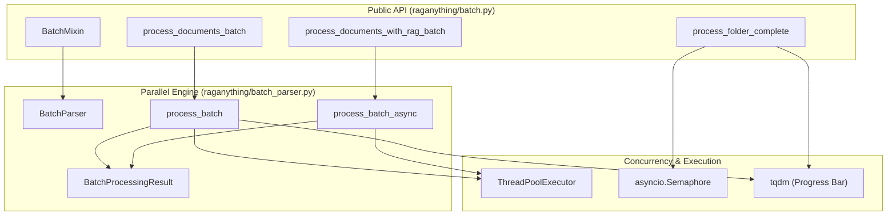
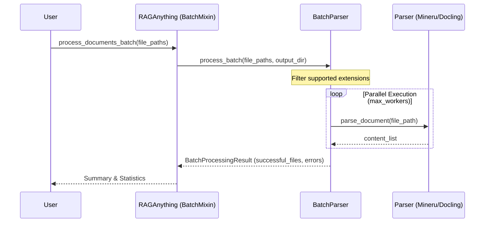

<!-- source: DeepWiki mcp.deepwiki.com · repo HKUDS/RAG-Anything · page 9.2 Batch Processing · fetched 2026-11-09 -->

# Batch Processing

Relevant source files

The following files were used as context for generating this wiki page:

- [docs/batch_processing.md](docs/batch_processing.md)
- [docs/enhanced_markdown.md](docs/enhanced_markdown.md)
- [examples/batch_dry_run_example.py](examples/batch_dry_run_example.py)
- [examples/batch_processing_example.py](examples/batch_processing_example.py)
- [examples/enhanced_markdown_example.py](examples/enhanced_markdown_example.py)
- [raganything/batch.py](raganything/batch.py)
- [raganything/batch_parser.py](raganything/batch_parser.py)
- [raganything/query.py](raganything/query.py)
- [tests/test_custom_parser.py](tests/test_custom_parser.py)

RAG-Anything provides robust batch processing capabilities through the `BatchMixin` and the specialized `BatchParser` class. These components enable efficient ingestion of large document collections via concurrent processing, progress tracking, and detailed result reporting.

## Overview

Batch processing in RAG-Anything is designed for high throughput and reliability. It abstracts the complexity of managing multiple asynchronous tasks, allowing users to process entire directories or lists of files with a single method call.

Key components include:
- **`BatchMixin`**: A mixin for the `RAGAnything` class providing high-level batch methods [raganything/batch.py:19-21]().
- **`BatchParser`**: A standalone utility for parallel document parsing [raganything/batch_parser.py:53-59]().
- **`BatchProcessingResult`**: A dataclass containing success rates, timing, and error details [raganything/batch_parser.py:21-32]().

## Key Methods

### 1. process_folder_complete
The primary entry point for processing all supported documents within a directory. It handles file discovery, concurrency control via semaphores, and final statistics reporting [raganything/batch.py:34-45]().

### 2. process_documents_batch
A flexible method to process a specific list of file paths. It utilizes `BatchParser` internally to handle the parsing stage in parallel [raganything/batch.py:177-186]().

### 3. process_documents_with_rag_batch
An end-to-end asynchronous method that first parses documents in batch and then sequentially inserts them into the LightRAG knowledge base [raganything/batch.py:255-265]().

## System Architecture

The following diagram bridges the high-level batch request to the internal code entities.

### Batch Processing Architecture

Sources: [raganything/batch.py:19-21](), [raganything/batch_parser.py:53-59](), [raganything/batch_parser.py:203-210]()

## Concurrency and Resource Control

RAG-Anything manages system resources during batch operations through two primary mechanisms:

1.  **Async Semaphores**: In `process_folder_complete`, an `asyncio.Semaphore` is initialized using `max_workers` (defaulting to `config.max_concurrent_files`) to limit the number of simultaneous `process_document_complete` tasks [raganything/batch.py:106-110]().
2.  **Thread Pools**: The `BatchParser` uses a `ThreadPoolExecutor` to run CPU-bound parsing tasks in parallel, preventing the event loop from blocking [raganything/batch_parser.py:231-235]().

### Data Flow: Batch Parsing to Result

Sources: [raganything/batch.py:177-186](), [raganything/batch_parser.py:203-210](), [raganything/batch_parser.py:158-160]()

## Dry-Run Mode

The `BatchParser` supports a `dry_run` mode. When enabled, the system performs file discovery and extension filtering but skips the actual parsing logic [raganything/batch_parser.py:209-215](). This is useful for verifying which files in a large directory are supported by the selected parser (e.g., Mineru vs. Docling) before committing resources [examples/batch_dry_run_example.py:43-49]().

## Configuration Parameters

Batch processing behavior is governed by both method arguments and `RAGAnythingConfig` defaults.

| Parameter | Source | Description |
| :--- | :--- | :--- |
| `max_workers` | `MAX_CONCURRENT_FILES` | Max parallel tasks for parsing/processing [raganything/batch.py:71-72](). |
| `recursive` | `RECURSIVE_FOLDER_PROCESSING` | Whether to scan subdirectories [raganything/batch.py:68-69](). |
| `file_extensions` | `SUPPORTED_FILE_EXTENSIONS` | List of extensions to include in batch [raganything/batch.py:66-67](). |
| `timeout_per_file` | Constructor | Max seconds allowed for a single file parse [raganything/batch_parser.py:66-68](). |

Sources: [raganything/batch.py:60-72](), [raganything/batch_parser.py:61-68]()

## Implementation Details

### Result Tracking
The `BatchProcessingResult` dataclass tracks:
- `successful_files`: List of paths that completed without error [raganything/batch_parser.py:25]().
- `failed_files`: List of paths that encountered exceptions [raganything/batch_parser.py:26]().
- `errors`: A dictionary mapping file paths to their specific error messages [raganything/batch_parser.py:29]().
- `processing_time`: Total wall-clock time for the batch operation [raganything/batch_parser.py:28]().

### File Discovery
The system uses `pathlib` for robust path handling. `filter_supported_files` automatically identifies files based on the parser's supported formats (Office, Image, Text, and PDF) [raganything/batch_parser.py:110-123](). It handles both explicit file lists and directory scanning [raganything/batch_parser.py:126-152]().

Sources: [raganything/batch_parser.py:21-32](), [raganything/batch_parser.py:110-156]()

---

