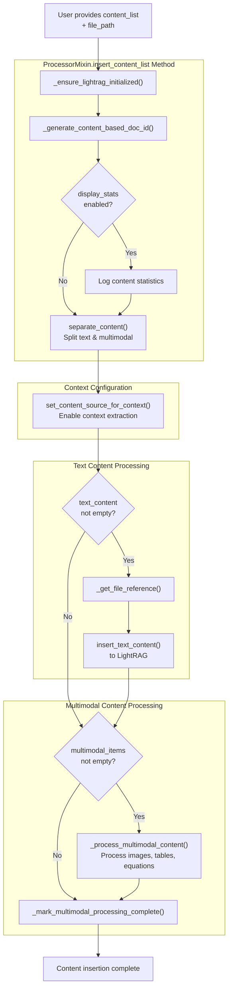
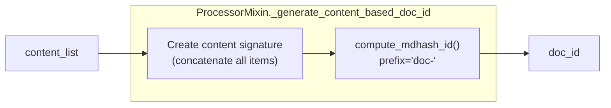
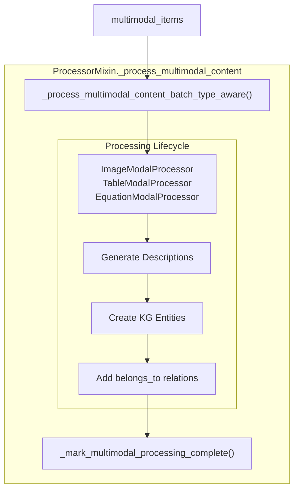

<!-- source: DeepWiki mcp.deepwiki.com · repo HKUDS/RAG-Anything · page 9.3 Direct Content List Insertion · fetched 2026-11-09 -->

# Direct Content List Insertion

<details>
<summary>Relevant source files</summary>

The following files were used as context for generating this wiki page:

- [docs/context_aware_processing.md](docs/context_aware_processing.md)
- [examples/insert_content_list_example.py](examples/insert_content_list_example.py)
- [examples/modalprocessors_example.py](examples/modalprocessors_example.py)
- [raganything/processor.py](raganything/processor.py)
- [tests/test_embedding_examples.py](tests/test_embedding_examples.py)
- [tests/test_insert_content_list.py](tests/test_insert_content_list.py)

</details>


This page documents the direct content list insertion feature, which allows users to insert pre-parsed content into RAGAnything without going through the document parsing stage. For full document processing workflows that include parsing, see [Basic Document Processing](#9.1). For details about batch processing multiple documents, see [Batch Processing](#9.2).

## Purpose and Scope

The `insert_content_list` method provides a way to bypass the document parsing phase and directly insert structured content into the RAG system. This is particularly useful when:

- Content has already been parsed by external tools (non-MinerU/Docling parsers)
- Content is programmatically generated rather than extracted from documents
- Parsing results have been cached and need to be reused
- Multiple content sources need to be integrated into a single knowledge base

The method accepts a standardized content list format and processes it through the same multimodal content pipeline as regular document processing, ensuring consistent knowledge graph construction and storage.

## Content List Format Specification

The `content_list` parameter accepts a list of dictionaries, where each dictionary represents a content block. The format is standardized across all content types:

### Supported Content Types

| Content Type | Required Fields | Optional Fields | Notes |
|--------------|----------------|-----------------|-------|
| **text** | `type`, `text`, `page_idx` | - | Plain text content |
| **image** | `type`, `img_path`, `page_idx` | `image_caption`, `image_footnote` | `img_path` must be absolute |
| **table** | `type`, `table_body`, `page_idx` | `table_caption`, `table_footnote` | `table_body` in markdown format |
| **equation** | `type`, `latex`, `page_idx` | `text` | LaTeX formula representation |
| **generic** | `type`, `content`, `page_idx` | Custom fields | Extensible for custom types |

### Format Examples

```python
# Text content
{
    "type": "text",
    "text": "This is the introduction section.",
    "page_idx": 0
}

# Image content
{
    "type": "image",
    "img_path": "/absolute/path/to/figure.jpg",  # Must be absolute path
    "image_caption": ["Figure 1: System Architecture"],
    "image_footnote": ["Source: Authors' design"],
    "page_idx": 1
}

# Table content
{
    "type": "table",
    "table_body": "| Method | Accuracy |\n|--------|----------|\n| Ours | 95.2% |",
    "table_caption": ["Table 1: Results"],
    "table_footnote": ["Test dataset"],
    "page_idx": 2
}

# Equation content
{
    "type": "equation",
    "latex": "P(d|q) = \\frac{P(q|d) \\cdot P(d)}{P(q)}",
    "text": "Document relevance probability",
    "page_idx": 3
}
```

**Sources:** [examples/insert_content_list_example.py:104-172](), [raganything/processor.py:1769-1786]()

## Processing Workflow

The following diagram illustrates the complete processing flow for direct content list insertion:



**Sources:** [raganything/processor.py:1759-1864](), [tests/test_insert_content_list.py:131-155]()

### Key Processing Steps

#### 1. Initialization and Validation

The method begins by ensuring LightRAG is initialized via `_ensure_lightrag_initialized()` and preparing the processing environment by reading the `display_stats` configuration from `self.config.display_content_stats`.

**Sources:** [raganything/processor.py:1793-1798](), [tests/test_insert_content_list.py:116-117]()

#### 2. Document ID Generation

If no `doc_id` is provided, the system generates a content-based ID using `_generate_content_based_doc_id`, which creates a hash from the content's key elements (text, image paths, table bodies, and equations).



**Sources:** [raganything/processor.py:202-239](), [raganything/processor.py:1805-1806]()

#### 3. Content Separation

The `separate_content` utility function splits the content list into text and multimodal components. Text items are concatenated with page markers, while images, tables, and equations are collected into a separate list.

**Sources:** [raganything/processor.py:1826](), [tests/test_insert_content_list.py:131-155]()

#### 4. Context Configuration for Multimodal Processing

If multimodal items exist, the system calls `set_content_source_for_context(content_list, "mineru")` to enable context-aware processing. This allows modal processors to look up surrounding text during description generation.

**Sources:** [raganything/processor.py:1829-1835](), [docs/context_aware_processing.md:102-114]()

#### 5. Text Content Insertion

Text content is inserted through `insert_text_content`, which calls `self.lightrag.ainsert`. This triggers LightRAG's standard pipeline for chunking, embedding, and entity extraction.

**Sources:** [raganything/processor.py:1838-1848](), [tests/test_insert_content_list.py:141-145]()

#### 6. Multimodal Content Processing

Multimodal items are processed through `_process_multimodal_content`, which manages the batch lifecycle of modal processors.



**Sources:** [raganything/processor.py:1854-1855](), [raganything/processor.py:706-882](), [examples/modalprocessors_example.py:85-165]()

## Method Signature and Parameters

The `insert_content_list` method is defined in the `ProcessorMixin` class:

```python
async def insert_content_list(
    self,
    content_list: List[Dict[str, Any]],
    file_path: str = "unknown_document",
    split_by_character: str | None = None,
    split_by_character_only: bool = False,
    doc_id: str | None = None,
    display_stats: bool = None,
)
```

### Parameter Details

| Parameter | Type | Default | Description |
|-----------|------|---------|-------------|
| `content_list` | `List[Dict[str, Any]]` | Required | Pre-parsed content items in standardized format |
| `file_path` | `str` | `"unknown_document"` | Reference file path/name for citation purposes |
| `split_by_character` | `str \| None` | `None` | Optional character to split text content by |
| `split_by_character_only` | `bool` | `False` | If True, split only by specified character |
| `doc_id` | `str \| None` | `None` | Optional custom document ID (auto-generated if not provided) |
| `display_stats` | `bool \| None` | `None` | Display content statistics (uses config default if None) |

**Sources:** [raganything/processor.py:1759-1767]()

## Complete Usage Example

The following example demonstrates how to initialize `RAGAnything` and use `insert_content_list` with various content types.

```python
import asyncio
from raganything import RAGAnything, RAGAnythingConfig
from examples.insert_content_list_example import create_sample_content_list

async def main():
    config = RAGAnythingConfig(working_dir="./rag_storage")
    rag = RAGAnything(config=config)
    
    # Create sample content list (text, image, table, equation)
    content_list = create_sample_content_list()
    
    # Direct insertion
    await rag.insert_content_list(
        content_list=content_list,
        file_path="/path/to/source_doc.pdf",
        display_stats=True
    )

if __name__ == "__main__":
    asyncio.run(main())
```

**Sources:** [examples/insert_content_list_example.py:93-172](), [examples/insert_content_list_example.py:221-250]()

## Important Considerations

### Image Path Requirements

**Critical:** The `img_path` field in image content items **must be an absolute path**. The `ImageModalProcessor` uses this path to load the image for captioning and base64 encoding.

**Sources:** [examples/insert_content_list_example.py:114](), [raganything/processor.py:1774-1775]()

### Page Index Field

The `page_idx` field represents the page number where content appears (0-based). This is vital for the `ContextExtractor` to locate surrounding text when `context_mode="page"` is used.

**Sources:** [docs/context_aware_processing.md:162-167](), [raganything/processor.py:1781]()

### Document Status Tracking

The system tracks the completion of multimodal processing separately from text insertion. After text is inserted via `ainsert`, the system marks `multimodal_processed=True` in the `doc_status` record (or `multimodal_status_cache` for compatibility) only after all modal processors have finished.

**Sources:** [raganything/processor.py:161-200](), [tests/test_insert_content_list.py:146-154]()

### Use Cases

- **External Parser Integration**: Use content from specialized OCR engines.
- **Programmatic Content**: Insert data derived from databases or web scraping.
- **Performance**: Bypass expensive PDF parsing when JSON results are already available.

**Sources:** [examples/insert_content_list_example.py:5-11](), [examples/modalprocessors_example.py:4-5]()

---

