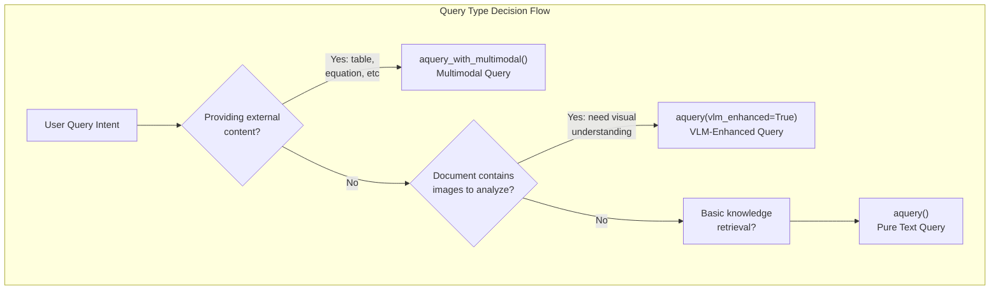
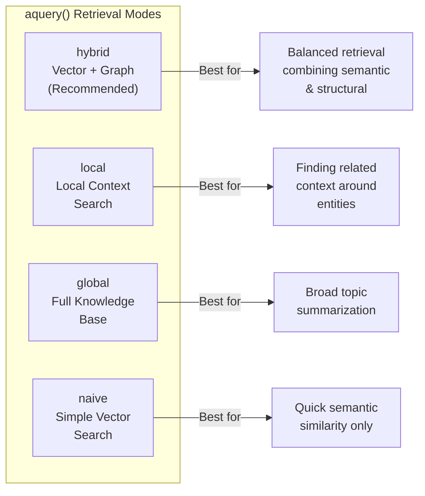
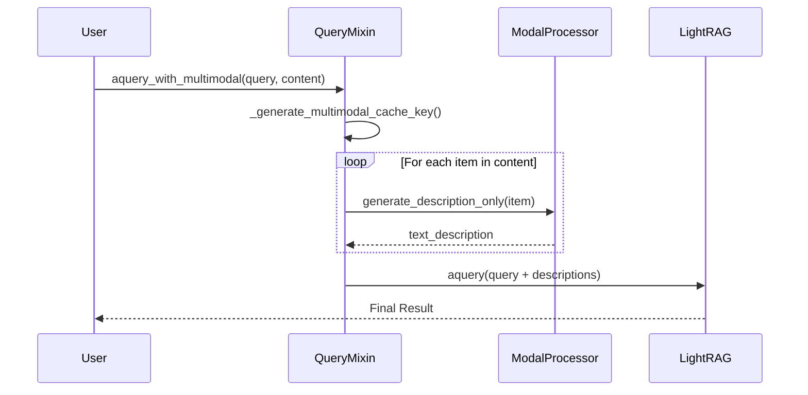
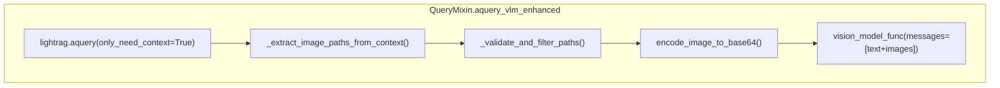

<!-- source: DeepWiki mcp.deepwiki.com · repo HKUDS/RAG-Anything · page 9.4 Query Examples · fetched 2026-11-09 -->

# Query Examples

<details>
<summary>Relevant source files</summary>

The following files were used as context for generating this wiki page:

- [examples/raganything_example.py](examples/raganything_example.py)
- [raganything/batch.py](raganything/batch.py)
- [raganything/query.py](raganything/query.py)

</details>


This page demonstrates practical examples of the three query types supported by RAG-Anything: pure text queries, multimodal queries, and VLM-enhanced queries. Each query type is designed for different use cases and provides specific capabilities for interacting with processed documents.

For information about the query system architecture and retrieval mechanisms, see [Query Architecture](#7.1). For API reference documentation of query methods, see [Query Methods API](#10.5). For details about the underlying query processing implementation, see [Text Queries](#7.2), [Multimodal Queries](#7.3), and [VLM-Enhanced Queries](#7.4).

---

## Query Type Overview

RAG-Anything provides three distinct query methods that correspond to different information needs. The `QueryMixin` class handles the logic for mode selection and multimodal content transformation.

| Query Type | Method | Primary Use Case | Key Capability |
|------------|--------|------------------|----------------|
| Pure Text | `aquery()` | Knowledge base search | Retrieves and synthesizes text-based information |
| Multimodal | `aquery_with_multimodal()` | Analyzing user-provided content | Compares external content with document knowledge |
| VLM-Enhanced | `aquery()` with `vlm_enhanced=True` | Visual content analysis | Directly analyzes images within retrieved context |

### Query Type Decision Flow



**Sources:** [raganything/query.py:102-143](), [raganything/query.py:195-202](), [examples/raganything_example.py:213-260]()

---

## Pure Text Queries

Pure text queries use the `aquery()` method to perform standard knowledge base retrieval. This method acts as a wrapper around `lightrag.aquery` while adding logging, callback dispatching, and automatic VLM detection.

### Query Modes



**Sources:** [raganything/query.py:110-110](), [raganything/query.py:162-162]()

### Basic Text Query Example

```python
import asyncio
from raganything import RAGAnything, RAGAnythingConfig

async def text_query_example():
    # Initialize RAGAnything
    config = RAGAnythingConfig(working_dir="./rag_storage")
    rag = RAGAnything(config=config)
    
    # Basic text query with hybrid mode (recommended)
    # This calls QueryMixin.aquery()
    result = await rag.aquery(
        "What are the main findings shown in the figures and tables?",
        mode="hybrid"
    )
    print(f"Answer: {result}")

asyncio.run(text_query_example())
```

**Sources:** [raganything/query.py:102-119](), [examples/raganything_example.py:217-225]()

---

## Multimodal Queries

Multimodal queries use the `aquery_with_multimodal()` method to analyze user-provided content. The system generates a cache key using `_generate_multimodal_cache_key` to ensure stability even with large table or image data.

### Multimodal Query Sequence



**Sources:** [raganything/query.py:26-40](), [raganything/query.py:233-247]()

### Table and Equation Examples

```python
# Query with table data
table_result = await rag.aquery_with_multimodal(
    "Compare this performance data with document results",
    multimodal_content=[
        {
            "type": "table",
            "table_data": "Method,Acc\nRAG,95%",
            "table_caption": "External results"
        }
    ],
    mode="hybrid"
)

# Query with equation content
equation_result = await rag.aquery_with_multimodal(
    "Explain this formula",
    multimodal_content=[
        {
            "type": "equation",
            "latex": "E = mc^2",
            "equation_caption": "Mass-energy equivalence"
        }
    ],
    mode="hybrid"
)
```

**Sources:** [raganything/query.py:195-210](), [examples/raganything_example.py:228-260]()

---

## VLM-Enhanced Queries

VLM-enhanced queries are triggered automatically in `aquery()` if `vision_model_func` is available. The system performs standard retrieval, then scans the context for image markers.

### VLM Retrieval Logic

The system uses `aquery_vlm_enhanced` to bridge retrieved text chunks and visual models.



**Sources:** [raganything/query.py:284-338](), [raganything/query.py:343-380]()

### Manual VLM Control

```python
# Force enable VLM enhancement even if not auto-detected
vlm_enabled = await rag.aquery(
    "What do the images show in this document?",
    mode="hybrid",
    vlm_enhanced=True
)

# Force disable VLM enhancement to save tokens
vlm_disabled = await rag.aquery(
    "Summarize the text only",
    mode="hybrid",
    vlm_enhanced=False
)
```

**Sources:** [raganything/query.py:126-143]()

---

## Complete Usage Example

This example demonstrates the standard implementation of `vision_model_func` required for VLM-enhanced queries.

```python
def vision_model_func(prompt, image_data=None, messages=None, **kwargs):
    # VLM enhanced queries pass a list of messages containing base64 images
    if messages:
        return openai_complete_if_cache(
            "gpt-4o",
            "",
            messages=messages,
            api_key=API_KEY
        )
    # Standard multimodal processing passes raw image_data
    elif image_data:
        return openai_complete_if_cache(
            "gpt-4o",
            prompt,
            image_data=image_data,
            api_key=API_KEY
        )
    return llm_model_func(prompt, **kwargs)

# Initialize with vision support
rag = RAGAnything(
    config=config,
    llm_model_func=llm_model_func,
    vision_model_func=vision_model_func
)
```

**Sources:** [examples/raganything_example.py:135-187](), [raganything/query.py:408-435]()

---

## Best Practices

1. **Cache Key Stability**: When performing multimodal queries, use consistent keys in `multimodal_content`. `_generate_multimodal_cache_key` uses the file basename and MD5 hashes of large tables to maintain cache hits across different environments. [raganything/query.py:54-72]()
2. **Safe Paths**: VLM enhancement only processes images from directories specified in `config.parser_output_dir` or the document's parent directory to prevent unauthorized file access. [raganything/query.py:353-370]()
3. **Mode Selection**:
   - Use `hybrid` for most general queries.
   - Use `naive` when you only need semantic similarity without graph relationships.
   - Use `bypass` if you want to query the LLM directly without retrieval context. [raganything/query.py:110-110]()

**Sources:** [raganything/query.py:42-100](), [raganything/query.py:343-380]()

---

