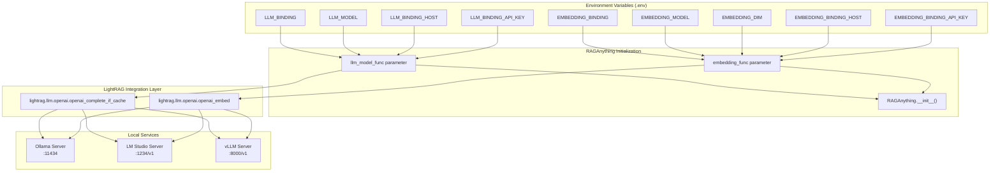
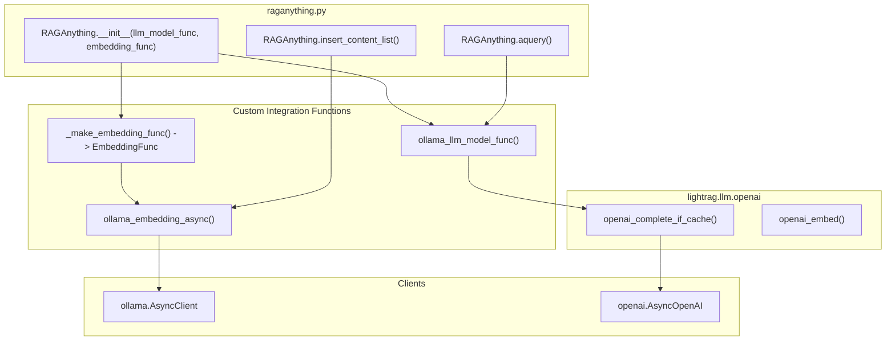
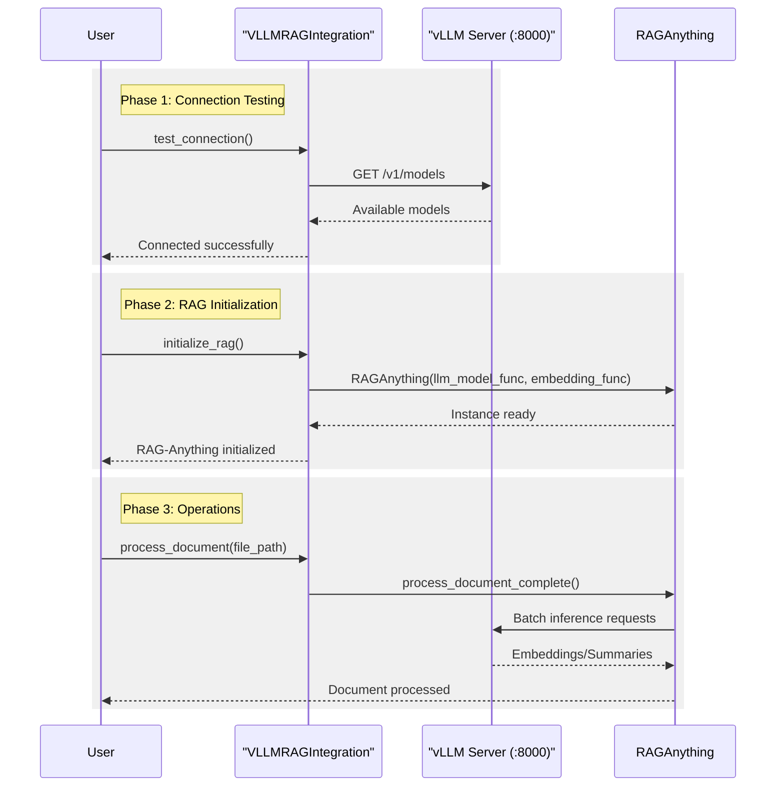

<!-- source: DeepWiki mcp.deepwiki.com · repo HKUDS/RAG-Anything · page 9.5 Local LLM Integration · fetched 2026-11-09 -->

# Local LLM Integration

<details>
<summary>Relevant source files</summary>

The following files were used as context for generating this wiki page:

- [.gitignore](.gitignore)
- [docs/vllm_integration.md](docs/vllm_integration.md)
- [env.example](env.example)
- [examples/lmstudio_integration_example.py](examples/lmstudio_integration_example.py)
- [examples/ollama_integration_example.py](examples/ollama_integration_example.py)
- [examples/vllm_integration_example.py](examples/vllm_integration_example.py)
- [reproduce/query.py](reproduce/query.py)

</details>


This page documents the integration of RAG-Anything with local Large Language Model (LLM) services, specifically **LM Studio**, **Ollama**, and **vLLM**. Local LLM integration enables fully offline document processing and querying without external API dependencies, providing production-grade performance on local hardware.

**Supported Local Services:**
- **Ollama**: Lightweight local inference server (`http://localhost:11434`) using a native embedding API [examples/ollama_integration_example.py:73-84]().
- **LM Studio**: Desktop application with OpenAI-compatible API (`http://localhost:1234/v1`) [examples/lmstudio_integration_example.py:8-22]().
- **vLLM**: High-throughput inference engine with continuous batching and PagedAttention, ideal for multi-GPU production environments [docs/vllm_integration.md:5-18]().

Sources: [env.example:112-132](), [examples/lmstudio_integration_example.py:1-22](), [docs/vllm_integration.md:1-18]()

## Configuration Architecture

Local LLM integration requires three independent function bindings: text generation (LLM), embedding generation, and optionally vision model. Each binding is configured through environment variables in the `.env` file or passed directly during class initialization.

**Binding Configuration Pattern**



Sources: [env.example:105-147](), [examples/lmstudio_integration_example.py:39-42](), [docs/vllm_integration.md:52-69]()

## Environment Variables Reference

### LLM Configuration (Text Generation)

| Variable | Purpose | Ollama Example | vLLM Example |
|----------|---------|----------------|-------------------|
| `LLM_BINDING` | Service type | `ollama` | `vllm` |
| `LLM_MODEL` | Model identifier | `llama3.2` | `Qwen/Qwen2.5-72B-Instruct` |
| `LLM_BINDING_HOST` | API endpoint | `http://localhost:11434/v1` | `http://localhost:8000/v1` |
| `LLM_BINDING_API_KEY` | API key | `ollama` | `token-abc123` |
| `MAX_ASYNC` | Concurrent requests | `4` | `16` (Higher for vLLM) |
| `MAX_TOKENS` | Context window | `32768` | `32768` |

### Embedding Configuration (Vector Generation)

| Variable | Purpose | Ollama Example | vLLM Example |
|----------|---------|----------------|-------------------|
| `EMBEDDING_BINDING` | Service type | `ollama` | `vllm` |
| `EMBEDDING_MODEL` | Model identifier | `nomic-embed-text` | `BAAI/bge-m3` |
| `EMBEDDING_DIM` | Vector dimensions | `768` | `1024` |
| `EMBEDDING_BINDING_HOST` | API endpoint | `http://localhost:11434` | `http://localhost:8001/v1` |

### Caching and Optimization

| Variable | Purpose | Recommended Value |
|----------|---------|-------------------|
| `ENABLE_LLM_CACHE` | Cache LLM responses | `true` |
| `TIKTOKEN_CACHE_DIR` | Offline tokenizer cache | `./tiktoken_cache` |

Sources: [env.example:105-147](), [examples/ollama_integration_example.py:44-52](), [docs/vllm_integration.md:78-90]()

## Function Integration Architecture

RAG-Anything requires custom callable functions for initialization that implement the LightRAG function interfaces. These functions route requests to local services via `openai_complete_if_cache` or native client libraries.

**Function Call Flow**



Sources: [examples/ollama_integration_example.py:55-84](), [examples/vllm_integration_example.py:59-93]()

## Implementation Patterns

### Ollama Implementation (Native API)

Ollama uses a different embedding API (`/api/embed`) compared to the standard OpenAI-compatible endpoint. RAG-Anything integrates this using the `ollama` Python library [examples/ollama_integration_example.py:7-10]().

**Embedding Function:**
[examples/ollama_integration_example.py:73-84]()
```python
async def ollama_embedding_async(texts: List[str]) -> List[List[float]]:
    import ollama
    client = ollama.AsyncClient(host=OLLAMA_HOST)
    response = await client.embed(model=OLLAMA_EMBEDDING_MODEL, input=texts)
    return response.embeddings
```

### vLLM Implementation (High-Throughput)

vLLM provides an OpenAI-compatible API server with continuous batching [docs/vllm_integration.md:8-9](). It is recommended to run separate vLLM instances for LLM and Embedding tasks on different ports [docs/vllm_integration.md:45-50]().

**LLM Function:**
[examples/vllm_integration_example.py:59-77]()
```python
async def vllm_llm_model_func(prompt, system_prompt=None, history_messages=None, **kwargs):
    return await openai_complete_if_cache(
        model=VLLM_MODEL_NAME,
        prompt=prompt,
        system_prompt=system_prompt,
        history_messages=history_messages or [],
        base_url=VLLM_BASE_URL,
        api_key=VLLM_API_KEY,
        **kwargs,
    )
```

### LM Studio Implementation (OpenAI-Compatible)

LM Studio acts as a standard OpenAI-compatible server. The implementation leverages `openai_complete_if_cache` and `openai_embed` helpers [examples/lmstudio_integration_example.py:45-74]().

**Embedding Wrapper:**
[examples/lmstudio_integration_example.py:167-173]()
```python
def embedding_func_factory(self):
    return EmbeddingFunc(
        embedding_dim=768,
        max_token_size=8192,
        func=lmstudio_embedding_async,
    )
```

## Initialization Process

**Complete Setup Sequence**



Sources: [examples/vllm_integration_example.py:124-155](), [examples/vllm_integration_example.py:202-219]()

### Step-by-Step Setup

#### 1. Start Local Server

**vLLM Example:**
```bash
# Chat Model
vllm serve Qwen/Qwen2.5-72B-Instruct --tensor-parallel-size 4 --port 8000
# Embedding Model
vllm serve BAAI/bge-m3 --task embedding --port 8001
```

#### 2. Configure Environment

**vLLM Configuration:**
```bash
LLM_BINDING=vllm
LLM_BINDING_HOST=http://localhost:8000/v1
EMBEDDING_BINDING=vllm
EMBEDDING_BINDING_HOST=http://localhost:8001/v1
EMBEDDING_DIM=1024
```

#### 3. Initialize RAGAnything

[examples/vllm_integration_example.py:202-219]() demonstrates initialization with the custom functions:

```python
self.rag = RAGAnything(
    config=self.config,
    llm_model_func=vllm_llm_model_func,
    embedding_func=self.embedding_func_factory(),
)
```

**Local LLM Configuration Recommendations:**

| Setting | Recommended Value | Reason |
|---------|------------------|--------|
| `enable_image_processing` | `False` | Local vision models are resource-heavy |
| `MAX_ASYNC` | `16` (vLLM) / `4` (Ollama) | vLLM handles high concurrency efficiently |
| `TIKTOKEN_CACHE_DIR` | `./tiktoken_cache` | Prevents internet access during tokenization |

Sources: [env.example:13-17](), [docs/vllm_integration.md:153-156](), [examples/vllm_integration_example.py:112-119]()

## Usage Examples

### High-Throughput Processing (vLLM)

[examples/vllm_integration_example.py:221-238]() shows processing with a high-throughput backend:

```python
await rag.process_document_complete(
    file_path="large_doc.pdf",
    output_dir="./output_vllm",
    display_stats=True
)
```

### Local Querying (Ollama)

[examples/ollama_integration_example.py:212-226]() demonstrates querying a locally hosted model:

```python
# Query using local Llama 3.2
result = await rag.aquery(
    "What are the main findings?",
    mode="hybrid"
)
```

### Compatibility Fixes

When integrating with older LightRAG versions, a "noop" patch is often applied to prevent schema errors in the document status storage [examples/lmstudio_integration_example.py:188-191]():

```python
async def _noop_mark_multimodal(doc_id: str):
    return None

self.rag._mark_multimodal_processing_complete = _noop_mark_multimodal
```

Sources: [examples/lmstudio_integration_example.py:188-191](), [examples/vllm_integration_example.py:221-238]()

---

