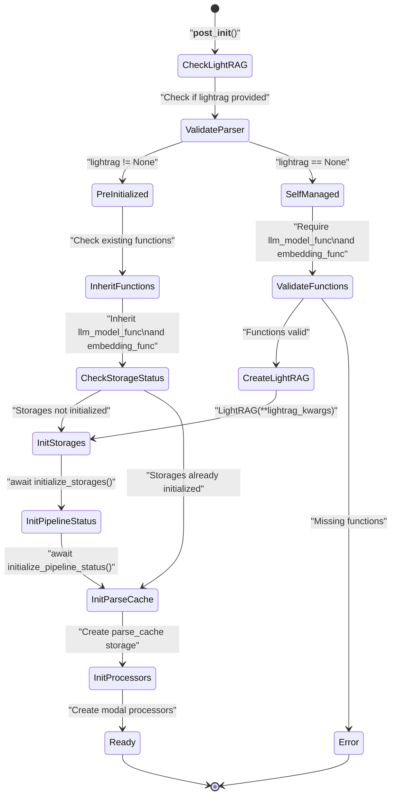
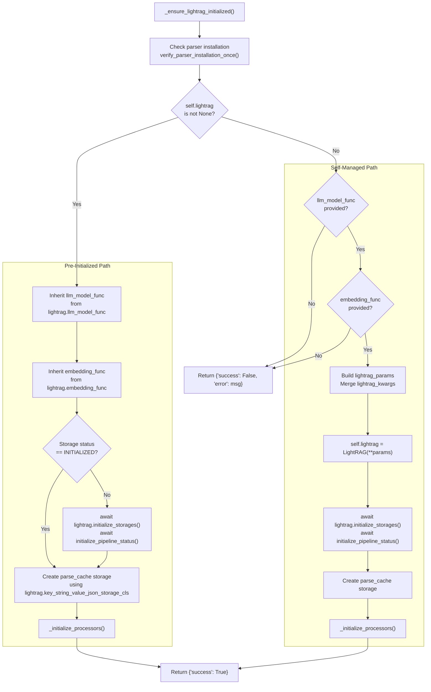
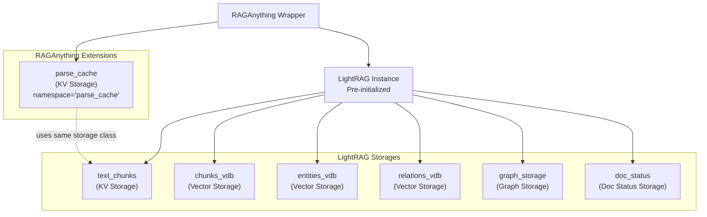
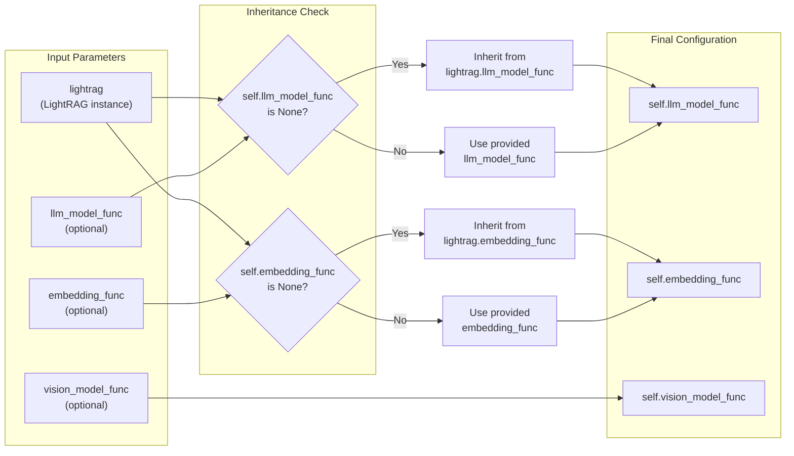

<!-- source: DeepWiki mcp.deepwiki.com · repo HKUDS/RAG-Anything · page 9.6 Loading Existing LightRAG Instances · fetched 2026-11-09 -->

# Loading Existing LightRAG Instances

<details>
<summary>Relevant source files</summary>

The following files were used as context for generating this wiki page:

- [examples/raganything_example.py](examples/raganything_example.py)
- [raganything/raganything.py](raganything/raganything.py)

</details>


This page demonstrates how to initialize `RAGAnything` with a pre-configured `LightRAG` instance, enabling multimodal capabilities on existing knowledge bases. This pattern allows extending existing RAG systems with image, table, and equation processing without rebuilding the entire knowledge graph.

For creating new RAGAnything instances from scratch, see [Basic Document Processing](9.1). For storage backend configuration, see [Storage Backend Configuration](8.3).

---

## Purpose and Use Cases

`RAGAnything` supports two initialization patterns:

1. **Self-Managed LightRAG**: RAGAnything creates and manages its own LightRAG instance internally [raganything/raganything.py:304-367]().
2. **Pre-Initialized LightRAG**: RAGAnything wraps an existing LightRAG instance, inheriting its configuration and storage handles [raganything/raganything.py:55-57]().

The pre-initialized pattern is useful when:
- You have an existing LightRAG knowledge base with processed documents.
- You want to add multimodal processing capabilities to legacy systems.
- You need fine-grained control over LightRAG's storage backends (e.g., custom Neo4j or Milvus setups) [raganything/raganything.py:73-84]().
- You're integrating RAGAnything into an existing RAG pipeline.

Sources: [raganything/raganything.py:55-84](), [raganything/raganything.py:245-302]()

---

## Initialization Patterns

### Pattern Comparison

| Aspect | Self-Managed | Pre-Initialized |
|--------|--------------|-----------------|
| **LightRAG Creation** | Automatic during `_ensure_lightrag_initialized` | Manual, passed to `__init__` |
| **Configuration Control** | Via `lightrag_kwargs` | Direct LightRAG params |
| **Storage Management** | Automatic | Manual initialization recommended |
| **Function Inheritance** | Required at init | Inherited from LightRAG |
| **Use Case** | New deployments | Existing systems / Custom Backends |

### Self-Managed Initialization

```python
rag = RAGAnything(
    config=RAGAnythingConfig(working_dir="./rag_storage"),
    llm_model_func=llm_func,        # Required
    embedding_func=embed_func,       # Required
    vision_model_func=vision_func,   # Optional
    lightrag_kwargs={                # Optional LightRAG params
        "top_k": 60,
        "chunk_token_size": 1200
    }
)
```

### Pre-Initialized Pattern

```python
# Create LightRAG instance first
lightrag = LightRAG(
    working_dir="./existing_storage",
    llm_model_func=llm_func,
    embedding_func=embed_func
)
await lightrag.initialize_storages()

# Wrap with RAGAnything
rag = RAGAnything(
    lightrag=lightrag,              # Pass existing instance
    vision_model_func=vision_func   # Add vision capabilities
    # llm_model_func and embedding_func inherited from lightrag
)
```

Sources: [raganything/raganything.py:54-83](), [raganything/raganything.py:247-258]()

---

## Initialization Flow

### RAGAnything Initialization State Machine



### Code Flow in `_ensure_lightrag_initialized`

The `_ensure_lightrag_initialized` method [raganything/raganything.py:229-230]() handles the logic of bridging an existing `LightRAG` instance into the `RAGAnything` ecosystem.



Sources: [raganything/raganything.py:229-367]()

---

## Storage Initialization Requirements

When passing a pre-initialized `LightRAG` instance, `RAGAnything` performs these initialization steps:

### Storage Status Check

The system checks if `LightRAG` storages are initialized using the `_storages_status` attribute [raganything/raganything.py:261-264]():

```python
if not hasattr(self.lightrag, "_storages_status") or self.lightrag._storages_status.name != "INITIALIZED":
    await self.lightrag.initialize_storages()
    from lightrag.kg.shared_storage import initialize_pipeline_status
    await initialize_pipeline_status()
```

### Parse Cache Creation

`RAGAnything` creates its own parse cache storage using LightRAG's storage class to ensure consistency across the backend [raganything/raganything.py:284-290]():

```python
self.parse_cache = self.lightrag.key_string_value_json_storage_cls(
    namespace="parse_cache",
    workspace=self.lightrag.working_dir,
    global_config=self.lightrag.__dict__,
    embedding_func=self.embedding_func
)
await self.parse_cache.initialize()
```

### Storage Hierarchy



Sources: [raganything/raganything.py:261-294](), [raganything/raganything.py:342-349]()

---

## Function Inheritance

### Inherited Functions from LightRAG

When `lightrag` is pre-provided, `RAGAnything` inherits these functions if not explicitly provided in the `RAGAnything` constructor [raganything/raganything.py:247-258]():

| Function | Inheritance Logic | Usage |
|----------|-------------------|-------|
| `llm_model_func` | `lightrag.llm_model_func` | Text generation, entity extraction |
| `embedding_func` | `lightrag.embedding_func` | Vector embeddings |
| `vision_model_func` | Not inherited (must provide) | Image analysis, VLM queries |

### Inheritance Code Flow



Sources: [raganything/raganything.py:247-258]()

---

## Complete Example

### Full Working Implementation

This example demonstrates how to define the vision function and wrap an existing instance.

```python
import asyncio
import os
from raganything import RAGAnything, RAGAnythingConfig
from lightrag import LightRAG
from lightrag.llm.openai import openai_complete_if_cache, openai_embed
from lightrag.kg.shared_storage import initialize_pipeline_status
from lightrag.utils import EmbeddingFunc

async def load_existing_lightrag():
    # Configuration
    api_key = os.getenv("OPENAI_API_KEY")
    lightrag_working_dir = "./existing_lightrag_storage"
    
    # Step 1: Create/Load LightRAG instance
    lightrag_instance = LightRAG(
        working_dir=lightrag_working_dir,
        llm_model_func=lambda prompt, **kwargs: 
            openai_complete_if_cache("gpt-4o-mini", prompt, api_key=api_key, **kwargs),
        embedding_func=EmbeddingFunc(
            embedding_dim=3072,
            max_token_size=8192,
            func=lambda texts: openai_embed(texts, model="text-embedding-3-large", api_key=api_key)
        )
    )
    
    # Step 2: Initialize LightRAG storages
    await lightrag_instance.initialize_storages()
    await initialize_pipeline_status()
    
    # Step 3: Define vision model function (not inherited)
    def vision_model_func(prompt, system_prompt=None, history_messages=[], 
                         image_data=None, messages=None, **kwargs):
        if messages:
            return openai_complete_if_cache("gpt-4o", "", messages=messages, api_key=api_key, **kwargs)
        elif image_data:
            return openai_complete_if_cache(
                "gpt-4o", "", 
                messages=[{"role": "user", "content": [
                    {"type": "text", "text": prompt},
                    {"type": "image_url", "image_url": {"url": f"data:image/jpeg;base64,{image_data}"}}
                ]}], api_key=api_key, **kwargs
            )
        return lightrag_instance.llm_model_func(prompt, **kwargs)
    
    # Step 4: Initialize RAGAnything with existing LightRAG
    rag = RAGAnything(
        lightrag=lightrag_instance,
        vision_model_func=vision_model_func
    )
    
    # Step 5: Query existing knowledge base
    result = await rag.aquery("Summarize the document contents", mode="hybrid")
    print("Query result:", result)
    
    await rag.finalize_storages()

if __name__ == "__main__":
    asyncio.run(load_existing_lightrag())
```

Sources: [examples/raganything_example.py:90-188](), [raganything/raganything.py:55-84]()

---

## Important Considerations

### Storage Compatibility
The pre-initialized `LightRAG` instance must use compatible storage backends. RAGAnything creates an additional `parse_cache` namespace in the same KV storage [raganything/raganything.py:284-294]().

### Configuration Precedence
When using pre-initialized LightRAG:
- **Working Directory**: Inherited from `lightrag.working_dir` [raganything/raganything.py:115]().
- **LLM Functions**: Inherited from `lightrag.llm_model_func` if not provided [raganything/raganything.py:247-252]().
- **RAGAnything Config**: Applied to multimodal processing (e.g., `enable_image_processing`) [raganything/raganything.py:369-373]().

### Cleanup
Always call `finalize_storages()` or ensure `close()` is triggered via `atexit` to persist the `parse_cache` and close database connections [raganything/raganything.py:124](), [raganything/raganything.py:143-172]().

Sources: [raganything/raganything.py:115-172](), [raganything/raganything.py:245-302]()

---

