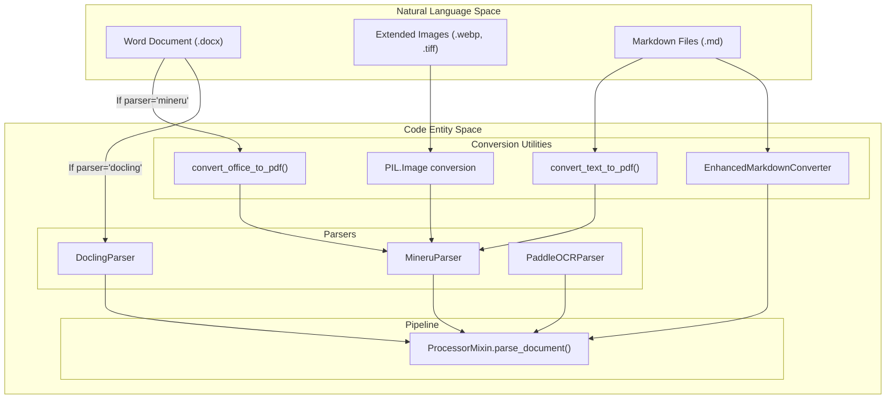
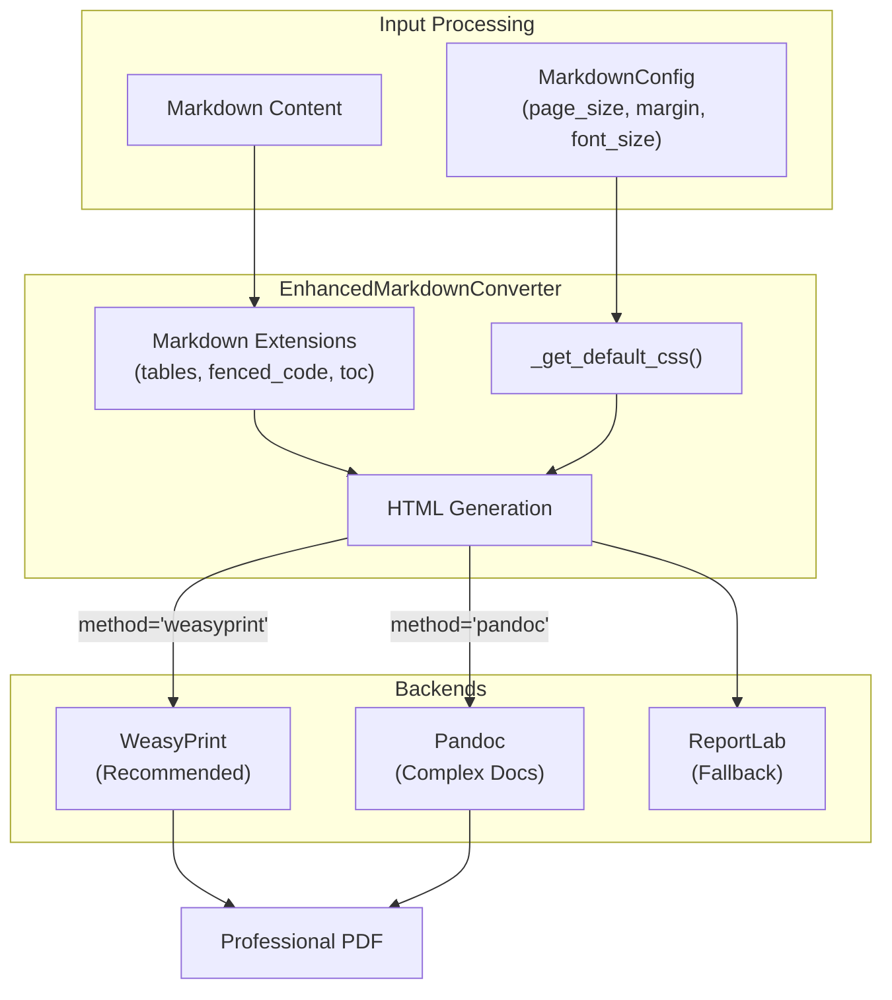

<!-- source: DeepWiki mcp.deepwiki.com · repo HKUDS/RAG-Anything · page 9.7 Format-Specific Processing Examples · fetched 2026-11-09 -->

# Format-Specific Processing Examples

<details>
<summary>Relevant source files</summary>

The following files were used as context for generating this wiki page:

- [docs/enhanced_markdown.md](docs/enhanced_markdown.md)
- [examples/batch_processing_example.py](examples/batch_processing_example.py)
- [examples/enhanced_markdown_example.py](examples/enhanced_markdown_example.py)
- [examples/image_format_test.py](examples/image_format_test.py)
- [examples/office_document_test.py](examples/office_document_test.py)
- [examples/text_format_test.py](examples/text_format_test.py)
- [raganything/enhanced_markdown.py](raganything/enhanced_markdown.py)
- [requirements.txt](requirements.txt)

</details>


This page provides practical examples of processing different document formats with RAG-Anything. Each format type has specific requirements, parser support, and processing considerations. These examples demonstrate how to handle PDF files, Office documents, images, text files, and enhanced Markdown-to-PDF conversion.

---

## Format Support Overview

RAG-Anything supports multiple parsers, each with different format capabilities. The system often uses internal conversion pipelines to normalize non-PDF formats for parsers like MinerU.

| Format Type | File Extensions | MineruParser | DoclingParser | PaddleOCRParser | Requires External Tool |
|-------------|----------------|--------------|---------------|-----------------|----------------------|
| **PDF** | `.pdf` | ✅ | ✅ | ✅ | - |
| **Office Documents** | `.doc`, `.docx`, `.ppt`, `.pptx`, `.xls`, `.xlsx` | ✅ (via conversion) | ✅ (native) | ✅ (via conversion) | LibreOffice |
| **Images** | `.png`, `.jpg`, `.jpeg` | ✅ (native) | ❌ | ✅ (native) | - |
| **Images (Extended)** | `.bmp`, `.tiff`, `.gif`, `.webp` | ✅ (via conversion) | ❌ | ✅ (native) | Pillow |
| **Text Files** | `.txt`, `.md` | ✅ (via conversion) | ❌ | ✅ (via conversion) | ReportLab |
| **HTML** | `.html`, `.htm`, `.xhtml` | ❌ | ✅ | ❌ | - |

**Sources:** [raganything/parser.py:56-59](), [requirements.txt:4-16](), [examples/office_document_test.py:60-64](), [examples/image_format_test.py:66-75]()

---

## Format-to-Code Mapping

The following diagram bridges the natural language document formats to the specific code entities responsible for their processing and conversion.

**Document Format Routing and Backend Entities**



**Sources:** [raganything/parser.py:1188-1224](), [raganything/parser.py:1091-1144](), [raganything/enhanced_markdown.py:72-80](), [examples/image_format_test.py:94-100]()

---

## Image Processing Examples

### Extended Image Format Handling
While standard formats like PNG/JPG are handled natively, extended formats (BMP, TIFF, GIF, WebP) are converted to PNG using Pillow before being passed to the OCR engine.

```python
# Example from examples/image_format_test.py
async def test_image_format_parsing(file_path: str):
    rag = RAGAnything()
    
    # Files like .webp or .bmp are automatically detected and converted
    content_list, md_content = await rag.parse_document(
        file_path=file_path,
        parse_method="ocr", # Images default to OCR
        display_stats=True
    )
    
    # Extracted metadata includes image captions and OCR text blocks
    for item in content_list:
        if item.get("type") == "image":
            print(f"Image Path: {item.get('img_path')}")
```

**Sources:** [examples/image_format_test.py:55-116](), [examples/image_format_test.py:142-154]()

---

## Office Document Processing

Office documents require LibreOffice installed on the system path. The `MineruParser` converts these to PDF, while `DoclingParser` can handle them natively.

### Word and PowerPoint Conversion
The system checks for `libreoffice` or `soffice` commands to perform the conversion.

```python
# Verification logic from examples/office_document_test.py
def check_libreoffice():
    import subprocess
    for cmd in ["libreoffice", "soffice"]:
        try:
            subprocess.run([cmd, "--version"], capture_output=True)
            return True
        except: continue
    return False
```

**Sources:** [examples/office_document_test.py:23-46](), [examples/office_document_test.py:75-81]()

---

## Enhanced Markdown-to-PDF Conversion

RAG-Anything provides an `EnhancedMarkdownConverter` that offers superior formatting compared to basic text-to-PDF utilities. It supports multiple backends like **WeasyPrint** and **Pandoc**.

### Implementation Architecture



**Sources:** [raganything/enhanced_markdown.py:46-70](), [raganything/enhanced_markdown.py:72-111](), [raganything/enhanced_markdown.py:235-265]()

### Using the Enhanced Converter

The enhanced converter allows for custom CSS and professional typography (e.g., A4 page size, 1in margins).

```python
from raganything.enhanced_markdown import EnhancedMarkdownConverter, MarkdownConfig

config = MarkdownConfig(
    page_size="A4",
    include_toc=True,
    syntax_highlighting=True,
    custom_css="body { font-family: 'Georgia', serif; }"
)

converter = EnhancedMarkdownConverter(config)
success = converter.convert_markdown_to_pdf(
    markdown_content="# My Document\nContent here...",
    output_path="professional_output.pdf",
    method="weasyprint"
)
```

**Sources:** [raganything/enhanced_markdown.py:46-70](), [examples/enhanced_markdown_example.py:97-117](), [docs/enhanced_markdown.md:90-137]()

---

## Text and Markdown Processing

For basic text processing without the enhanced converter, the system uses `ReportLab` to wrap raw text into a PDF container.

```python
# Example from examples/text_format_test.py
async def test_text_parsing(file_path: str):
    # Requires ReportLab for .txt and .md to PDF conversion
    rag = RAGAnything()
    content_list, md_content = await rag.parse_document(
        file_path=file_path,
        parse_method="auto"
    )
    print(f"Extracted {len(content_list)} blocks from text file.")
```

**Sources:** [examples/text_format_test.py:38-84](), [requirements.txt:10-15]()

---

## Format-Specific Configuration Summary

| Format | Key Config / Dependency | Primary Code Entity |
|--------|-------------------------|---------------------|
| **PDF** | `mineru[core]` | `MineruParser` [raganything/parser.py:49]() |
| **DOCX** | `LibreOffice` | `convert_office_to_pdf` [raganything/parser.py:1188]() |
| **MD** | `weasyprint`, `markdown` | `EnhancedMarkdownConverter` [raganything/enhanced_markdown.py:72]() |
| **WEBP** | `Pillow` | `PIL.Image` conversion [examples/image_format_test.py:23]() |
| **TXT** | `reportlab` | `convert_text_to_pdf` [raganything/parser.py:230]() |

**Sources:** [requirements.txt:1-16](), [raganything/enhanced_markdown.py:21-43](), [examples/office_document_test.py:8-12]()

---

