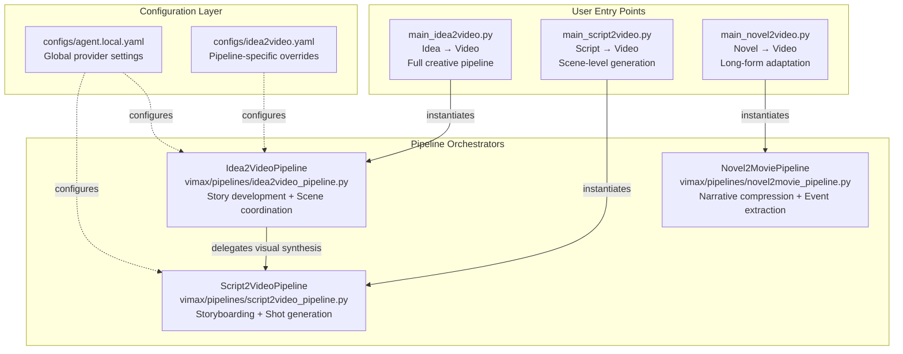
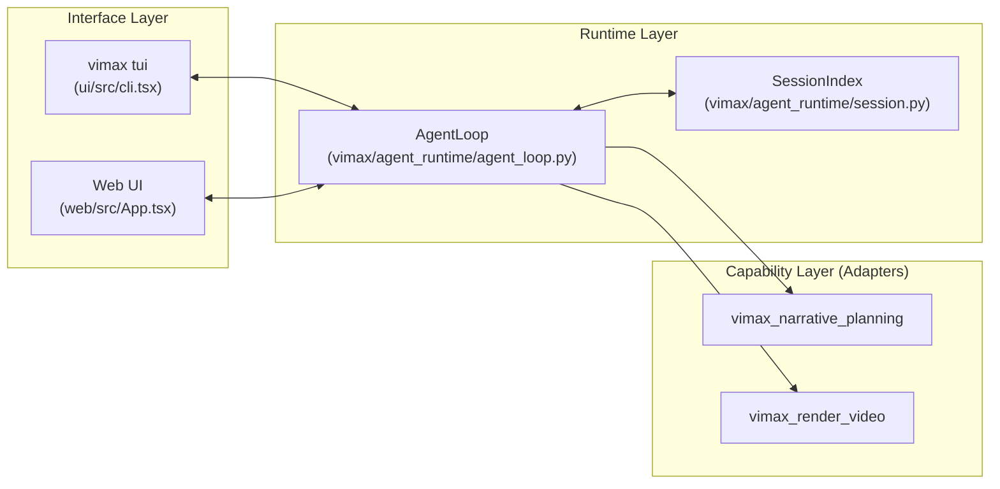

<!-- source: DeepWiki mcp.deepwiki.com · repo HKUDS/ViMax · page 1.1 What is ViMax · fetched 2026-11-09 -->

# What is ViMax

Relevant source files

The following files were used as context for generating this wiki page:

- [README_ZH.md](README_ZH.md)
- [assets/vimax.png](assets/vimax.png)
- [readme.md](readme.md)

**Purpose**: This document defines ViMax's core identity, architectural philosophy, and technical foundation as an agentic video generation system. It explains the system's position in the AI video generation landscape and introduces key code abstractions that implement its capabilities.

For detailed feature modes and capabilities, see [Key Features and Input Modes](#1.2). For the problems ViMax addresses, see [Problems Solved](#1.3). For complete architecture details, see [Architecture Overview](#3.1).

---

## Core Definition

**ViMax** is an agentic, multi-stage video generation framework that transforms narrative inputs (ideas, novels, or scripts) into complete video productions through autonomous AI agent collaboration [readme.md:74-85](). The system orchestrates specialized agents—such as `Screenwriter`, `CharacterExtractor`, `CharacterPortraitsGenerator`, `StoryboardArtist`, `CameraImageGenerator`, and `ReferenceImageSelector`—to automate the entire video production pipeline from story development to final video assembly [readme.md:40-42]().

Unlike traditional AI video generators that produce isolated clips, ViMax generates structured, multi-shot videos with maintained character and environmental consistency across scenes through intelligent reference management and camera tree architecture [readme.md:144-164]().

**Key Characteristics**:

| Characteristic | Implementation |
|----------------|----------------|
| **Agentic Architecture** | Specialized agents coordinate through orchestrators like `Idea2VideoPipeline` [readme.md:78-81]() |
| **Multi-Stage Generation** | Sequential narrative development → parallel visual synthesis → video assembly [readme.md:74-76]() |
| **Consistency Management** | Reference image selection, camera tree structure, and MLLM-based validation [readme.md:148-159]() |
| **Parallel Processing** | Asyncio-based shot generation with event coordination [readme.md:85-85]() |
| **Interactive Control** | Agent Loop and TUI/Web UI for human-in-the-loop revision [readme.md:54-58]() |

**Sources**: [readme.md:1-85](), [README_ZH.md:144-164]()

---

## System Identity and Entry Points

ViMax exposes primary workflows through executable entry points and an interactive agent runtime. The system operates in two distinct modes: a direct pipeline mode and an interactive Agent Loop mode [readme.md:58-58]().

### Workflow Hierarchy (Pipeline Mode)

- **`Idea2VideoPipeline`**: Handles complete creative workflows from raw ideas. Executes story development, character extraction, and script writing [readme.md:78-78]().
- **`Script2VideoPipeline`**: Accepts pre-written scripts and focuses on visual realization, including storyboard design and parallel shot generation [readme.md:79-79]().
- **`Novel2MoviePipeline`**: Adapts long-form fiction using narrative compression and character tracking [readme.md:80-80]().

### Agent Loop and Interactive Runtime

Beyond static pipelines, ViMax provides an **Agent Loop** that allows users to interact with the system via a Terminal User Interface (TUI) or a Web UI [readme.md:82-83]().

**Sources**: [readme.md:54-58](), [readme.md:78-83](), [readme.md:209-245]()

---

## Position in AI Video Generation Landscape

ViMax addresses fundamental limitations in current AI video generation systems through a director-centric architecture [readme.md:35-42]().

### Problem Space

| Limitation | Typical AI Video Tools | ViMax Approach |
|------------|------------------------|----------------|
| **Length Constraint** | 3-10 second clips [readme.md:36-36]() | Multi-scene segmentation and sequential scene assembly [readme.md:162-162]() |
| **Consistency Chaos** | Character/environment drift [readme.md:37-37]() | Camera tree architecture + reference selection + MLLM validation [readme.md:158-158]() |
| **Visual-Only Focus** | Missing narrative structure [readme.md:38-38]() | Full creative powerhouse: screenwriter, producer, and director agents [readme.md:41-41]() |

### Technical Differentiation

1.  **Multi-camera Filming Simulation**: Uses a camera tree structure to maintain spatial consistency across multiple angles in a scene [README_ZH.md:156-156]().
2.  **Intelligent Reference Management**: The `ReferenceImageSelector` agent and character registries ensure that characters and environments remain stable across hundreds of generated shots [README_ZH.md:158-158]().
3.  **Interactive Workflow**: Unlike "black-box" generators, the Agent Loop allows users to revise plans, inspect artifacts, and control rendering progress [readme.md:58-58]().
4.  **Parallel Asset Generation**: Accelerates production by concurrently generating shots and media assets while respecting service rate limits [readme.md:85-85]().

**Sources**: [readme.md:35-42](), [readme.md:54-85](), [README_ZH.md:144-164]()

---

## Technical Infrastructure

### Core Stack
- **Python 3.12**: Core runtime [readme.md:15-15]().
- **uv**: Environment and dependency management [readme.md:200-205]().
- **FAISS**: Vector search for narrative retrieval and asset management [readme.md:59-59]().
- **MoviePy/OpenCV**: Video processing and final assembly [README_ZH.md:61-61]().

### Service Integration
ViMax is provider-agnostic, supporting multiple backends via a unified tool registry:
- **LLMs**: Gemini (via OpenRouter), OpenAI, MiniMax [readme.md:55-61]().
- **Image Generators**: Nanobanana (Google/Yunwu), GPT Image 2 [readme.md:55-55]().
- **Video Generators**: Veo (Google), Seedance 2.0 Fast, Omni [readme.md:55-60]().

**Sources**: [readme.md:15-61](), [readme.md:200-205](), [README_ZH.md:61-61]()

---

