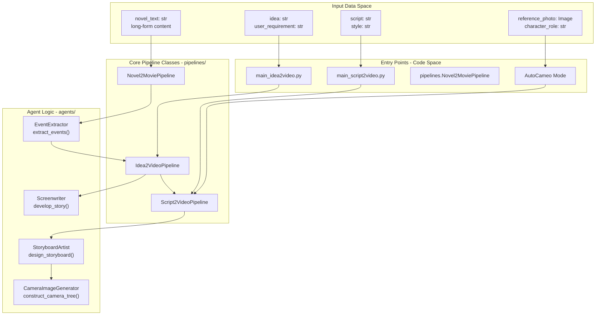
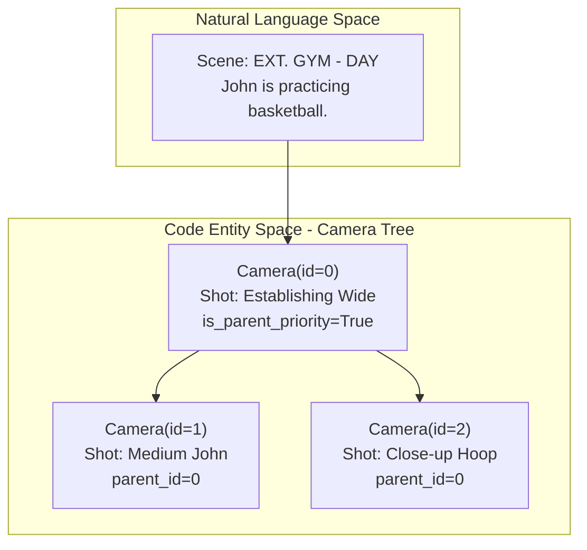

<!-- source: DeepWiki mcp.deepwiki.com · repo HKUDS/ViMax · page 1.2 Key Features and Input Modes · fetched 2026-11-09 -->

# Key Features and Input Modes

Relevant source files

The following files were used as context for generating this wiki page:

- [README_ZH.md](README_ZH.md)
- [assets/vimax.png](assets/vimax.png)
- [configs/idea2video.yaml](configs/idea2video.yaml)
- [configs/script2video.yaml](configs/script2video.yaml)
- [main_idea2video.py](main_idea2video.py)
- [main_script2video.py](main_script2video.py)
- [readme.md](readme.md)

**Purpose**: This page documents ViMax's four primary feature modes (Idea2Video, Novel2Video, Script2Video, AutoCameo) and the technical implementation of the core capabilities that enable agentic video generation. For installation, see [Installation and Setup](#2.1). For detailed pipeline logic, see [Pipelines](#4).

---

## Input Modes Overview

ViMax provides four distinct operational modes designed for different creative workflows. All modes share a unified agent architecture but differ in their entry points and narrative processing stages.

**Sources**: [readme.md:74-85](), [main_idea2video.py:22-24](), [main_script2video.py:29-30]()

---

## Input Mode Details

### Idea2Video Mode
**Entry Point**: `main_idea2video.py` [main_idea2video.py:1-27]()

This mode transforms a high-level concept into a structured screenplay and then into a video. It is the most automated workflow, involving narrative planning before visual design.

*   **Pipeline**: `Idea2VideoPipeline` [pipelines/idea2video_pipeline.py]()
*   **Key Agents**: `Screenwriter` for story development and `CharacterExtractor` for visual identity.
*   **Workflow**: Idea → Story → Characters → Script → Storyboard → Video.
*   **Configuration**: Uses `configs/idea2video.yaml` [configs/idea2video.yaml:1-33]().

### Script2Video Mode
**Entry Point**: `main_script2video.py` [main_script2video.py:1-35]()

Designed for users who already have a screenplay. It bypasses the story development phase and starts directly with visual asset generation and shot planning.

*   **Pipeline**: `Script2VideoPipeline` [pipelines/script2video_pipeline.py]()
*   **Key Agents**: `StoryboardArtist` and `CameraImageGenerator`.
*   **Workflow**: Script → Characters → Storyboard → Camera Tree → Shot Generation → Assembly.
*   **Configuration**: Uses `configs/script2video.yaml` [configs/script2video.yaml:1-34]().

### Novel2Video Mode
**Pipeline**: `Novel2MoviePipeline` [pipelines/novel2movie_pipeline.py]()

Adapts long-form fiction into episodic visual narratives. It uses semantic segmentation to break down massive texts into manageable "Events" that are then processed by the `Idea2VideoPipeline`.

*   **Key Agent**: `EventExtractor` [agents/event_extractor.py]().
*   **Mechanism**: Uses RAG (Retrieval-Augmented Generation) and FAISS for narrative compression and scene planning [readme.md:80]().

### AutoCameo Mode
**Feature**: Appearance Consistency [readme.md:81]()

Allows placing a specific person or pet from a reference photo into the generated story. It ensures the AI-generated character maintains the visual traits of the provided source image across different environments and camera angles.

---

## Key Technical Features

ViMax differentiates itself through seven core technical capabilities that manage the transition from "Natural Language Space" (ideas/scripts) to "Visual Execution Space" (frames/videos).

### 1. RAG-based Long Script Generation
To handle long-form content like novels, ViMax employs `EventExtractor` to perform narrative compression. It uses `faiss-cpu` for vector search to maintain character and plot context across long generation sequences [readme.md:59-60]().

### 2. Expressive Storyboard Design
The `StoryboardArtist` agent translates script lines into cinematic shot descriptions (`ShotDescription` model). It applies professional cinematography principles, selecting shot types (Close-up, Wide), angles, and camera movements [readme.md:79]().

### 3. Multi-camera Filming Simulation
The system constructs a "Camera Tree" via `CameraImageGenerator.construct_camera_tree()`. This organizes shots into parent-child relationships, where child cameras (e.g., a zoom-in) inherit the spatial context and first-frame reference of the parent camera (e.g., an establishing wide shot) [readme.md:84]().

**Sources**: [readme.md:293-296](), [agents/camera_image_generator.py]()

### 4. Intelligent Reference Image Selection
The `ReferenceImageSelector` identifies the best visual anchors for new shots. It looks at previously generated frames and character portraits to ensure that a character's clothing or an environment's lighting remains consistent [readme.md:76]().

### 5. Automated Image Generation and Prompting
ViMax uses specialized prompt engineering for the `ImageGenerator` tools (e.g., `ImageGeneratorNanobananaGoogleAPI`). Prompts include spatial reasoning (e.g., "character on the left") and first/last frame descriptors to guide video motion [configs/idea2video.yaml:13]().

### 6. Consistency Checking with MLLM/VLM
The system generates multiple variations of a frame and uses a Multi-modal LLM (VLM) to inspect them. It performs a "visual quality gate" to select the candidate that best matches the character's reference portrait [readme.md:84]().

### 7. High-efficiency Parallel Processing
ViMax uses an `asyncio`-based execution model to generate compatible shots and media assets concurrently. This significantly reduces the time required for multi-shot video production [readme.md:85]().

---

## Configuration and Rate Limits

Each mode is governed by YAML configurations that define API endpoints and rate limits for LLMs, Image Generators, and Video Generators.

| Feature | Idea2Video Config | Script2Video Config |
| :--- | :--- | :--- |
| **Default Model** | Gemini 2.5 Flash Lite | Gemini 2.5 Flash Lite |
| **Image Rate Limit** | 10 RPM / 500 RPD | 2 RPM / 50 RPD |
| **Video Rate Limit** | 2 RPM / 10 RPD | 2 RPM / 50 RPD |
| **Working Dir** | `.working_dir/idea2video` | `.working_dir/script2video` |

**Sources**: [configs/idea2video.yaml:9-32](), [configs/script2video.yaml:9-33]()

---

