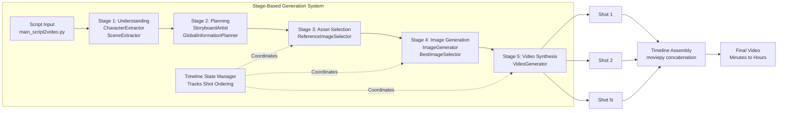
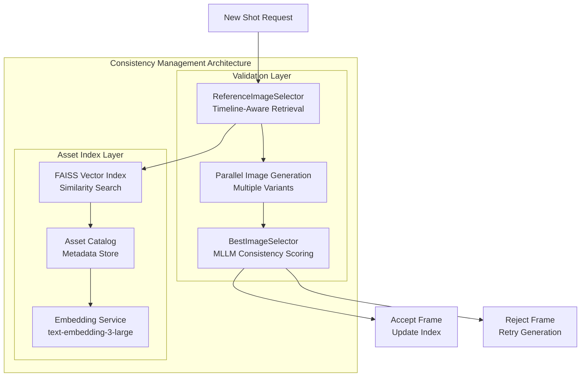
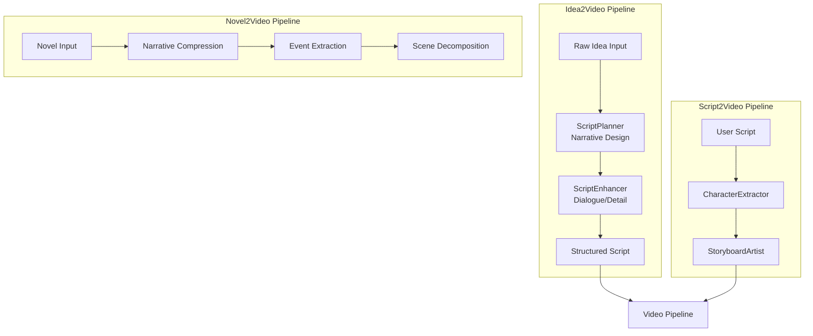

<!-- source: DeepWiki mcp.deepwiki.com · repo HKUDS/ViMax · page 1.3 Problems Solved · fetched 2026-11-09 -->

# Problems Solved

Relevant source files

The following files were used as context for generating this wiki page:

- [README_ZH.md](README_ZH.md)
- [assets/vimax.png](assets/vimax.png)
- [readme.md](readme.md)

This page documents the specific production challenges that ViMax addresses in AI video generation and explains how the system's architecture solves each problem. It serves as a technical bridge between the limitations of current video generation tools and ViMax's multi-agent solution approach.

For information about ViMax's core capabilities and features, see [Key Features and Input Modes](#1.2). For details on the technical implementation of these solutions, see [System Architecture](#3) and [Technical Capabilities](#7).

---

## Overview of Production Challenges

ViMax addresses eight fundamental problems that prevent current AI video generation systems from producing professional, long-form content with narrative coherence and visual consistency.

### Problem Domain Classification

```mermaid
graph TB
    subgraph "Content Limitations"
        P1["P1: Short Clip Barrier<br/>Seconds vs. Minutes"]
        P2["P2: Consistency Breakdown<br/>Character/Environment Drift"]
        P3["P3: Narrative Structure Gap<br/>No Story Framework"]
    end
    
    subgraph "Production Workflow Problems"
        P4["P4: Reference Management Burden<br/>Manual Frame Alignment"]
        P5["P5: Storyboard Expertise Gap<br/>Cinematography Knowledge"]
        P6["P6: Shot Design Complexity<br/>Multi-Camera Coordination"]
    end
    
    subgraph "Quality and Efficiency Barriers"
        P7["P7: Consistency Validation Cost<br/>No Automated QA"]
        P8["P8: Production Scalability Limit<br/>Sequential Processing Bottleneck"]
    end
    
    P1 --> Solution1["Multi-Agent Pipeline<br/>Stage-Based Generation"]
    P2 --> Solution2["Asset Indexing +<br/>Tracking Systems"]
    P3 --> Solution3["Script Understanding<br/>Agents"]
    P4 --> Solution4["ReferenceImageSelector<br/>+ Embeddings"]
    P5 --> Solution5["StoryboardArtist<br/>+ Shot Planning"]
    P6 --> Solution6["GlobalInformationPlanner<br/>+ Camera Simulation"]
    P7 --> Solution7["BestImageSelector<br/>+ MLLM Validation"]
    P8 --> Solution8["Parallel Processing<br/>Architecture"]
    
    style P1 stroke-dasharray: 5 5
    style P2 stroke-dasharray: 5 5
    style P3 stroke-dasharray: 5 5
    style P4 stroke-dasharray: 5 5
    style P5 stroke-dasharray: 5 5
    style P6 stroke-dasharray: 5 5
    style P7 stroke-dasharray: 5 5
    style P8 stroke-dasharray: 5 5
```

**Sources**: [readme.md:35-46](), [README_ZH.md:146-162]()

---

## Problem 1: Short Clip Limitations

### Technical Description

Current AI video generators typically produce only 3-10 second clips. This limitation stems from temporal coherence constraints in diffusion models and context window limitations. ViMax identifies this as the fundamental barrier to professional video creation: "Most AI tools generate only seconds of footage" [readme.md:36]().

### ViMax Solution: Multi-Stage Pipeline Architecture

ViMax solves this through a **staged generation pipeline** that breaks long videos into manageable units while maintaining continuity:

**Key Implementation Components**:

| Component | Role |
|-----------|------|
| `StoryboardArtist` | Segments script into shot-level units. |
| `GlobalInformationPlanner` | Coordinates cross-shot information. |
| `VideoGenerator` | Generates individual video clips via external providers (e.g., Veo, Seedance). |
| `moviepy` | Used for final assembly and concatenation of clips. |

**Sources**: [readme.md:36](), [readme.md:84-85](), [README_ZH.md:162]()

---

## Problem 2: Consistency Chaos

### Technical Description

"Characters and scenes change unpredictably across frames" [readme.md:37](). This occurs due to lack of persistent identity and environment memory between generation calls. ViMax addresses the challenge of "ensuring character appearances, environments, and artistic style remain consistent across hundreds of shots" [README_ZH.md:158]().

### ViMax Solution: Multi-Layer Consistency Management

**Key Components**:

| Layer | System | Function |
|-------|--------|----------|
| Asset Index | `FAISS` | Stores and retrieves vector embeddings of previous frames for visual reference. |
| Selection | `ReferenceImageSelector` | Retrieves similar frames from history to guide current generation. |
| Validation | `BestImageSelector` | Validates consistency of generated variants via MLLM (e.g., GPT-4o/GPT-5). |

**Sources**: [readme.md:37](), [readme.md:78-81](), [README_ZH.md:148-150](), [README_ZH.md:158]()

---

## Problem 3: Narrative Structure Gap

### Technical Description

Current tools are "Visual-Only Focus—Missing scripts, audio, narrative structure, and storytelling depth" [readme.md:38](). ViMax addresses the fact that "Professional and high-quality videos need to have rich information density and structured design" [README_ZH.md:152]().

### ViMax Solution: Narrative and Planning Agents

**Implementation Strategy**:

| Pipeline | Key Agents | Capability |
|----------|------------|------------|
| **Idea2Video** | `ScriptPlanner`, `ScriptEnhancer` | Generates structured scripts from concepts [readme.md:78](). |
| **Novel2Video** | `EventExtractor`, `SceneExtractor` | Adapts long fiction via narrative compression and character tracking [readme.md:80](). |
| **Script2Video** | `CharacterExtractor`, `StoryboardArtist` | Converts screenplays into controllable multi-scene videos [readme.md:79](). |

**Sources**: [readme.md:38](), [readme.md:78-81](), [README_ZH.md:152-154]()

---

## Problem 4: Reference Image Management Burden

### Technical Description

Manual management involves "Time-consuming acquisition, organization, and alignment of reference frames that accurately capture characters, objects, positions, and environments" [README_ZH.md:148]().

### ViMax Solution: Automated Reference Selection

ViMax uses the `ReferenceImageSelector` to automate this process. It performs vector searches against previously generated and accepted frames to provide the `ImageGenerator` with contextually relevant visual anchors.

**Sources**: [readme.md:84](), [README_ZH.md:148]()

---

## Problem 5: Storyboard Design Expertise Gap

### Technical Description

"Converting stories into visual narratives requires expertise in cinematography, scene composition, and visual storytelling that most creators lack" [README_ZH.md:154]().

### ViMax Solution: StoryboardArtist Agent

The `StoryboardArtist` (and `ScriptPlanner`) automates cinematography expertise by generating shot-level plans that include camera angles, lighting descriptions, and character movements, essentially acting as an AI director.

**Sources**: [readme.md:41](), [README_ZH.md:154]()

---

## Problem 6: Multi-Camera Shot Design Complexity

### Technical Description

"Designing reasonable shot angles, transitions, and rhythm while maintaining narrative continuity in complex scenes" [README_ZH.md:156]() is difficult for AI.

### ViMax Solution: Multi-Camera Filming Simulation

ViMax simulates a multi-camera setup by maintaining a spatial understanding of the scene. The `GlobalInformationPlanner` (implied in the architecture) coordinates how characters and environments are framed across different shots to ensure that a "cut" from a wide shot to a close-up maintains spatial logic.

**Sources**: [readme.md:84](), [README_ZH.md:156]()

---

## Problem 7: Consistency Validation and Quality Control

### Technical Description

"Even with correct reference images and prompts, image generators sometimes produce unusable images" [README_ZH.md:150]().

### ViMax Solution: MLLM-Powered Quality Gate

ViMax employs a "Consistency checking with MLLM/VLM" strategy. It generates multiple variants for a single shot and uses a vision-capable LLM (`BestImageSelector`) to inspect them against reference images, selecting only the one that best preserves character and environment identity.

**Sources**: [readme.md:174](), [README_ZH.md:150]()

---

## Problem 8: Production Scalability and Efficiency

### Technical Description

Traditional production relies on "multiple professionals and lengthy processes, hindering independent creators" [README_ZH.md:160]().

### ViMax Solution: Parallelized Generation

ViMax implements "Parallelized generation" [readme.md:85]() using `asyncio`. By coordinating references and frame dependencies, it can generate multiple compatible shots and media assets concurrently, significantly reducing the time required for multi-shot video production.

**Sources**: [readme.md:85](), [README_ZH.md:70]()

---

