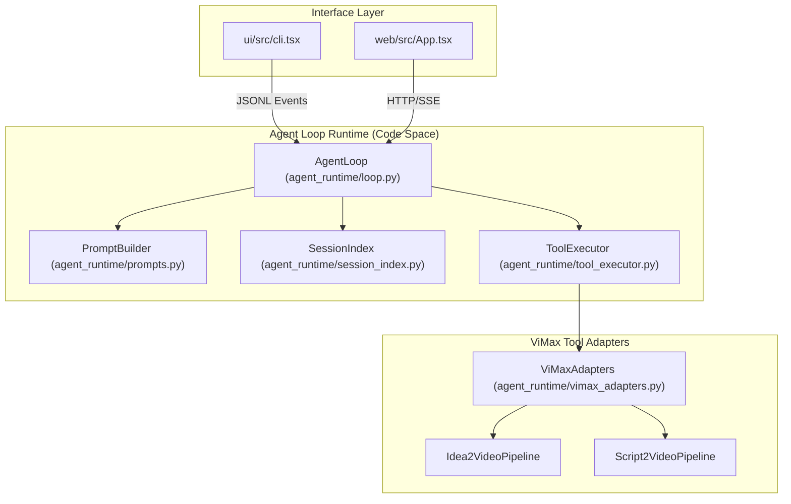
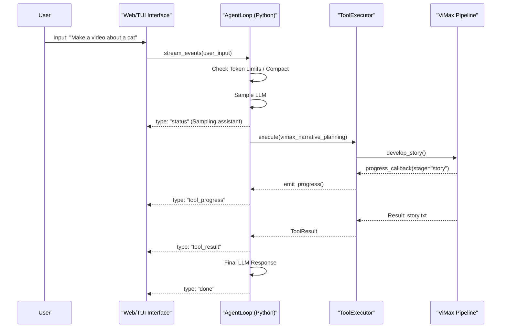

<!-- source: DeepWiki mcp.deepwiki.com · repo HKUDS/ViMax · page 10 Agent Loop and Web Interface · fetched 2026-11-09 -->

# Agent Loop and Web Interface

Relevant source files

The following files were used as context for generating this wiki page:

- [agent_runtime/loop.py](agent_runtime/loop.py)
- [agent_runtime/prompts.py](agent_runtime/prompts.py)
- [tests/test_agent_loop.py](tests/test_agent_loop.py)
- [tests/test_openrouter_video_generator.py](tests/test_openrouter_video_generator.py)
- [tests/test_vimax_adapters.py](tests/test_vimax_adapters.py)
- [ui/src/cli.tsx](ui/src/cli.tsx)
- [web/src/App.tsx](web/src/App.tsx)

## Purpose and Scope

The Agent Loop and Web Interface provide the interactive, session-based layer of the ViMax system. Unlike the direct pipelines (e.g., `Idea2VideoPipeline`), the Agent Loop allows for a multi-turn, conversational workflow where an LLM agent uses tools to plan, refine, and execute video generation tasks. This system includes a stateful runtime, a persistent session management layer, and both terminal-based (TUI) and browser-based (Web UI) interfaces.

This page provides a high-level overview of the interactive system components and how they relate to the core generation pipelines.

---

## Interactive System Architecture

The interactive system bridges the gap between natural language user requests and the execution of ViMax pipelines. It is composed of the `AgentLoop` runtime, a `SessionIndex` for persistence, and various adapters that wrap the underlying pipelines as tools.

### Natural Language to Code Entity Mapping

The following diagram illustrates how user input in the interfaces translates into the execution of specific code entities within the Agent Loop.

**Sources:** [agent_runtime/loop.py:20-29](), [ui/src/cli.tsx:135-155](), [web/src/App.tsx:104-123]()

---

## Key Components

### 10.1 Agent Loop Runtime
The `AgentLoop` class is the central orchestrator for interactive turns. It manages the conversation history, handles context compaction when token limits are approached, and manages the iterative tool-calling loop (up to a maximum of 50 passes). It uses a `PromptBuilder` to construct the system prompt from various modular components like `workflow.md` and `agent.md`.

For details, see [Agent Loop Runtime](#10.1).

**Sources:** [agent_runtime/loop.py:20-41](), [agent_runtime/prompts.py:18-32]()

### 10.2 Session Management and Persistence
The `SessionIndex` manages the lifecycle of agent sessions. It maintains a `.vimax` directory structure containing `sessions.json` for global state and `loop_history.jsonl` for individual session logs. It tracks the "artifact checklist" (e.g., whether `story.txt` or `script.json` exists) to provide the agent with situational awareness of the current project state.

For details, see [Session Management and Persistence](#10.2).

**Sources:** [agent_runtime/session_index.py:1-50](), [agent_runtime/prompts.py:55-73]()

### 10.3 ViMax Adapters and Tool Registry
To allow the agent to control video generation, the `ViMaxAdapters` class wraps complex pipelines into discrete tools like `vimax_narrative_planning` and `vimax_render_video`. These tools are registered in a `ToolRegistry` and described to the LLM via JSON schemas. The `ToolExecutor` handles the actual invocation of these tools, including progress reporting back to the UI.

For details, see [ViMax Adapters and Tool Registry](#10.3).

**Sources:** [agent_runtime/vimax_adapters.py:1-20](), [agent_runtime/loop.py:93-118]()

### 10.4 Terminal User Interface (TUI)
The TUI is a React-based terminal application (using `Ink`) located in `ui/src/cli.tsx`. It spawns the Python agent as a subprocess and communicates via JSONL events over `stdout`. It provides a rich interface with line mapping, status indicators for "thinking" or "compacting," and support for slash commands to manage sessions.

For details, see [Terminal User Interface (TUI)](#10.4).

**Sources:** [ui/src/cli.tsx:1-12](), [ui/src/cli.tsx:135-183]()

### 10.5 Web UI
The Web UI is a modern Vite/React application that provides a full-featured dashboard for video generation. It communicates with a Node.js `server.mjs` bridge via HTTP and Server-Sent Events (SSE). Key features include a multi-pane layout for chat and artifact visualization (storyboards, videos), session management, and a settings editor for `agent.local.yaml`.

For details, see [Web UI](#10.5).

**Sources:** [web/src/App.tsx:44-87](), [web/src/App.tsx:104-123]()

### 10.6 Troubleshooting Guide
This section covers common issues encountered when running the interactive loop, such as API rate limit exhaustion (e.g., HTTP 403 errors from OpenRouter), session corruption, and context window management issues.

For details, see [Troubleshooting Guide](#10.6).

**Sources:** [tests/test_vimax_adapters.py:59-61](), [agent_runtime/loop.py:70-77]()

---

## Session Lifecycle and Event Flow

The interaction between the user, the UI, and the Agent Loop follows a strictly event-driven pattern.

**Sources:** [agent_runtime/loop.py:43-132](), [web/src/App.tsx:104-123](), [tests/test_agent_loop.py:74-98]()

---

