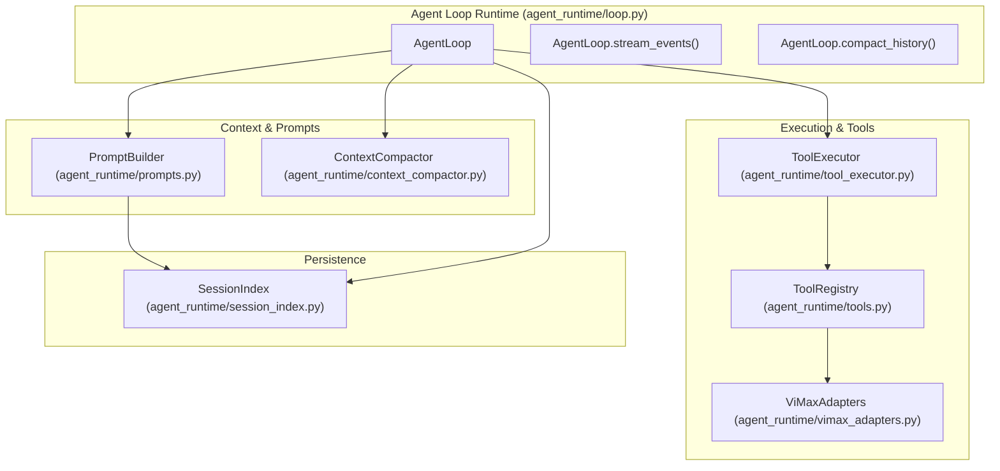

<!-- source: DeepWiki mcp.deepwiki.com · repo HKUDS/ViMax · page 10.1 Agent Loop Runtime · fetched 2026-11-09 -->

# Agent Loop Runtime

<details>
<summary>Relevant source files</summary>

The following files were used as context for generating this wiki page:

- [agent_runtime/loop.py](agent_runtime/loop.py)
- [agent_runtime/prompts.py](agent_runtime/prompts.py)
- [tests/test_agent_loop.py](tests/test_agent_loop.py)
- [tests/test_openrouter_video_generator.py](tests/test_openrouter_video_generator.py)
- [tests/test_vimax_adapters.py](tests/test_vimax_adapters.py)
- [ui/src/cli.tsx](ui/src/cli.tsx)

</details>


## Purpose and Scope

The `AgentLoop` is the central execution engine for ViMax's agentic operations. It manages the lifecycle of a single user turn, orchestrating the flow between the Large Language Model (LLM), tool execution, and context management. This document provides a deep dive into the runtime implementation, including event streaming, tool pass management, context compaction, and the prompt construction system.

---

## Architecture Overview

The `AgentLoop` operates as an asynchronous state machine that coordinates several specialized components to process user input and generate structured video assets.

### Core Components

| Component | Class | Responsibility |
|:---|:---|:---|
| **Loop Controller** | `AgentLoop` | Manages the main while-loop, history state, and event dispatching. |
| **Context Manager** | `ContextCompactor` | Monitors token usage and compresses history when thresholds are exceeded. |
| **Prompt Factory** | `PromptBuilder` | Constructs the multi-part system prompt from markdown templates and session state. |
| **Tool Execution** | `ToolExecutor` | Handles the secure execution of tools and routes progress callbacks back to the loop. |
| **State Tracking** | `SessionIndex` | Persists session metadata, logs, and artifact checklists. |

### Code Entity Space Mapping

The following diagram maps the high-level runtime concepts to their specific implementations in the codebase.



**Sources:** [agent_runtime/loop.py:20-28](), [agent_runtime/prompts.py:18-22](), [agent_runtime/vimax_adapters.py:13-16]()

---

## The Execution Loop (`stream_events`)

The `stream_events` method in `AgentLoop` is an `AsyncIterator` that yields JSON-serializable events to the UI (TUI or Web). It follows a "Sample-Execute-Observe" cycle.

### Loop Lifecycle Diagram

```mermaid
sequenceDiagram
    participant UI as "ui/src/cli.tsx"
    participant Loop as "AgentLoop.stream_events"
    participant LLM as "OpenAICompatibleLLM"
    participant Tool as "ToolExecutor"

    UI->>Loop: user_input (string)
    Loop->>Loop: Pre-flight Compaction Check
    Loop->>LLM: complete(runtime_messages, tools)
    LLM-->>Loop: AssistantMessage (text + tool_calls)
    
    loop Tool Round (Max 50)
        Loop->>UI: type: "tool_start"
        Loop->>Tool: execute(call)
        Tool-->>Loop: ToolResult
        Loop->>UI: type: "tool_result"
    end

    Loop->>LLM: complete(messages + results)
    LLM-->>Loop: Final Assistant Response
    Loop->>UI: type: "done"
```

### Key Execution Logic

1.  **Pre-flight Compaction**: Before sending the prompt to the LLM, the loop checks if the history plus the new user input exceeds the token threshold using `context_compactor.should_preflight_compact` [agent_runtime/loop.py:49-53]().
2.  **Tool Pass Limits**: To prevent infinite loops or excessive API costs, the loop is hard-coded to a maximum of 50 tool passes (`MAX_TOOL_PASSES = 50`) [agent_runtime/loop.py:17-17](). If this limit is reached, the turn is halted with an error [agent_runtime/loop.py:86-91]().
3.  **Observation Injection**: If a tool returns `model_content` (such as a path to a generated image), the loop injects a specific system message: *"Tool-provided image observation(s). Inspect these pixels as evidence..."* [agent_runtime/loop.py:121-130]().

**Sources:** [agent_runtime/loop.py:43-130](), [agent_runtime/models.py:11-12]()

---

## PromptBuilder System

The `PromptBuilder` class [agent_runtime/prompts.py:18-106]() is responsible for assembling the complex system prompt required for narrative planning and video rendering.

### Prompt Composition

The prompt is built from multiple `PromptPart` objects, categorized by their "zone" (stable vs dynamic) [agent_runtime/prompts.py:8-15]().

| Part ID | Source | Description |
|:---|:---|:---|
| `agent.core` | `agent.md` | Core persona and behavioral constraints. |
| `workflow.core` | `workflow.md` | Instructions on how to use the ViMax video generation pipeline. |
| `tool.manifest` | `ToolRegistry` | A list of available tools generated via `tool_manifest_context()` [agent_runtime/prompts.py:79-82](). |
| `session.context` | `SessionIndex` | Current working directory, active stage, and artifact checklist [agent_runtime/prompts.py:55-74](). |
| `memory.preferences` | `SessionIndex` | Long-term user preferences retrieved from memory logs [agent_runtime/prompts.py:75-77](). |

### Artifact Checklist

The `PromptBuilder` performs a structural check on the filesystem to inform the LLM about the project's progress. It checks for specific files in `idea2video/`, `script2video/`, or `novel2video/` directories [agent_runtime/prompts.py:101-105](). If text planning is complete, it explicitly instructs the LLM that it may proceed to rendering [agent_runtime/prompts.py:71-72]().

**Sources:** [agent_runtime/prompts.py:24-32](), [agent_runtime/prompts.py:55-74]()

---

## Context Compaction

ViMax uses a `ContextCompactor` to maintain long-running sessions within LLM context limits.

### Compaction Triggers

Compaction is triggered in two ways:
1.  **Automatic (Pre-flight)**: Triggered during `stream_events` if the estimated token count (calculated as `chars // 4`) exceeds the configured `token_threshold` [agent_runtime/loop.py:49-53]().
2.  **Manual**: Triggered via the `compact_history` method, often initiated by a user command in the UI [agent_runtime/loop.py:30-41]().

### The Compaction Process

When compaction occurs:
1.  The LLM is asked to summarize the conversation history, excluding the most recent $N$ messages [agent_runtime/loop.py:34-38]().
2.  A new history is constructed starting with a "synthetic summary message" [agent_runtime/loop.py:39-39]().
3.  The summary is persisted in the `SessionIndex` under `compacted_summary` [agent_runtime/loop.py:40-40]().
4.  The UI receives a `status` event with phase `compact` [agent_runtime/loop.py:54-54]().

**Sources:** [agent_runtime/loop.py:30-57](), [agent_runtime/context_compactor.py:9-10]()

---

## UI Integration and Event Handling

The TUI (Terminal User Interface) in `ui/src/cli.tsx` consumes the stream of JSONL events produced by the `AgentLoop`.

### Event Mapping

The TUI uses a `MappingState` to track which lines of terminal output correspond to which agent actions [ui/src/cli.tsx:9-12]().

| Event Type | UI Response |
|:---|:---|
| `token` | Appends text to the active assistant response block. |
| `status` | Updates the "Thinking" spinner with the current phase (e.g., "Sampling assistant", "Executing tools"). |
| `tool_start` | Creates a new UI block showing the tool name and arguments. |
| `tool_progress` | Updates the status of a specific running tool (e.g., "Designing storyboard"). |
| `compact` | Displays a notification that the context was compressed to save tokens. |

### Process Management

The TUI spawns the Python runtime using `child_process.spawn` [ui/src/cli.tsx:4-4](). It communicates via `stdin` for user commands and `stdout` for the JSONL event stream [ui/src/cli.tsx:110-110]().

**Sources:** [ui/src/cli.tsx:135-161](), [ui/src/cli.tsx:213-245]()

---

