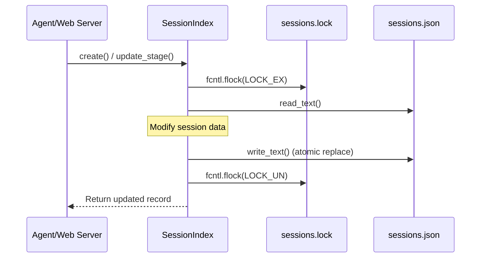
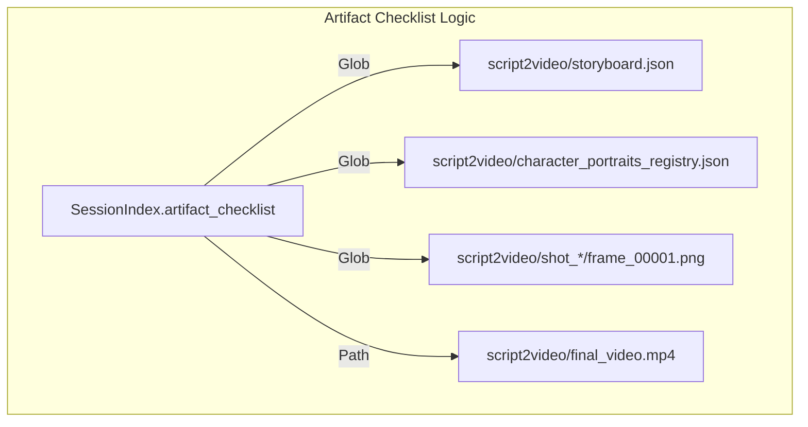

<!-- source: DeepWiki mcp.deepwiki.com · repo HKUDS/ViMax · page 10.2 Session Management and Persistence · fetched 2026-11-09 -->

# Session Management and Persistence

<details>
<summary>Relevant source files</summary>

The following files were used as context for generating this wiki page:

- [agent_runtime/session_index.py](agent_runtime/session_index.py)
- [main_agent.py](main_agent.py)
- [tests/test_agent_session_index.py](tests/test_agent_session_index.py)
- [tests/test_main_agent_cli.py](tests/test_main_agent_cli.py)
- [web/server-lib.mjs](web/server-lib.mjs)

</details>


This page documents the `SessionIndex` system, which manages the lifecycle, persistence, and directory structure of ViMax sessions. It explains how the system handles concurrent access, historical logging, and state compaction to maintain long-term agentic workflows.

**Scope**: This page focuses on the persistence layer. For the interactive loop logic, see [10.1](). For the Web UI integration, see [10.5]().

---

## Session Lifecycle and Directory Layout

ViMax stores all persistent data within a `.vimax` directory located at the workspace root [[agent_runtime/session_index.py:41]](). Each session corresponds to a unique working directory under `.working_dir` [[agent_runtime/session_index.py:45]]().

### Directory Structure
```text
workspace_root/
├── .vimax/
│   ├── sessions.json           # Master index of all sessions
│   ├── sessions.lock           # File lock for concurrent access
│   ├── memory.md               # Global user preferences
│   └── logs/
│       └── loop_history.jsonl  # Append-only history of all turns
└── .working_dir/
    └── {session_id}/           # Session-specific artifacts
        ├── idea2video/         # Assets from Idea2Video pipeline
        ├── script2video/       # Assets from Script2Video pipeline
        └── uploads/            # Files uploaded via Web UI
```
Sources: [[agent_runtime/session_index.py:41-48]](), [[web/server-lib.mjs:98-105]]()

---

## SessionIndex Implementation

The `SessionIndex` class is the primary interface for managing session state. It provides methods for creating, retrieving, and updating session metadata.

### State Management and File Locking
To prevent data corruption during concurrent access (e.g., a Web UI server and a CLI agent running simultaneously), `SessionIndex` uses a POSIX file lock on `.vimax/sessions.lock` [[agent_runtime/session_index.py:59-61]](). The `_synchronized` decorator ensures a read-modify-write cycle is atomic [[agent_runtime/session_index.py:22-35]]().


Sources: [[agent_runtime/session_index.py:22-35]](), [[agent_runtime/session_index.py:55-66]]()

### Session Creation and Normalization
When a session is created, ViMax generates a `session_id` based on the project name or idea, sanitized to be URL-friendly [[agent_runtime/session_index.py:114]](). It also initializes a checklist of "stale" keys to track which pipeline stages need re-execution [[agent_runtime/session_index.py:130]]().

| Field | Purpose |
|-------|---------|
| `session_id` | Unique slug used for directory names and API calls |
| `working_dir` | Path relative to workspace root for artifacts |
| `stale` | Dictionary tracking validity of `story`, `script`, `frames`, etc. |
| `compacted_summary` | The narrative summary used after history compaction |

Sources: [[agent_runtime/session_index.py:19-20]](), [[agent_runtime/session_index.py:121-139]]()

---

## Persistence Formats

### sessions.json
The master index stores metadata for all sessions. If the file becomes corrupt, ViMax automatically backs it up and starts with a fresh state to prevent total data loss [[agent_runtime/session_index.py:72-82]]().

### loop_history.jsonl
This append-only file records every interaction. Each line is a JSON object representing a "turn" [[agent_runtime/session_index.py:202]]().
- **Data Flow**: `AgentLoop` streams events -> `append_turn_record()` writes to JSONL [[agent_runtime/session_index.py:202-213]]().
- **Web Consumption**: `readSessionHistory` parses this file, filtering by `session_id` to reconstruct the chat UI [[web/server-lib.mjs:49-96]]().

Sources: [[agent_runtime/session_index.py:202-213]](), [[web/server-lib.mjs:49-62]]()

---

## Artifact Checklist and Discovery

ViMax identifies session progress by checking for the existence of specific files in the working directory. This is used by the UI to show completion status.



The `listSessionArtifacts` function in the web server recursively walks the session directory to find images, videos, and documents, providing a gallery view for the user [[web/server-lib.mjs:156-185]]().

Sources: [[agent_runtime/session_index.py:215-245]](), [[web/server-lib.mjs:156-185]]()

---

## History Compaction and Snapshots

To handle long conversations that exceed LLM context limits, ViMax implements a compaction mechanism.

1. **Compaction Triggers**: When history grows too large, the system generates a summary of the current state [[agent_runtime/session_index.py:183]]().
2. **Snapshots**: Before clearing history, the current session state is saved into `compaction_snapshots` [[agent_runtime/session_index.py:191]]().
3. **Context Injection**: The `compacted_summary` is prepended to the prompt in future turns [[agent_runtime/session_index.py:188]]().

| Function | Role |
|----------|------|
| `update_compaction` | Updates the summary and increments `compacted_turns` [[agent_runtime/session_index.py:181]]() |
| `compact_history` | (In AgentLoop) Orchestrates the LLM call to summarize history |

Sources: [[agent_runtime/session_index.py:181-197]](), [[tests/test_agent_session_index.py:49-68]]()

---

## Web Integration and Uploads

The web server (`server-lib.mjs`) interacts with `SessionIndex` to provide a RESTful API for session management.

### Safe File Uploads
Uploaded files are stored in a session-specific `uploads/` directory [[web/server-lib.mjs:104]](). The system ensures unique filenames by appending increments (e.g., `image (2).png`) if a collision occurs [[web/server-lib.mjs:114-118]]().

### Session Deletion
Deleting a session involves:
1. Removing the entry from `sessions.json` [[web/server-lib.mjs:32]]().
2. Recursively deleting the working directory [[web/server-lib.mjs:44]]().
3. Cleaning up associated log records in `loop_history.jsonl` [[web/server-lib.mjs:45]]().

Sources: [[web/server-lib.mjs:25-47]](), [[web/server-lib.mjs:98-130]]()

---

