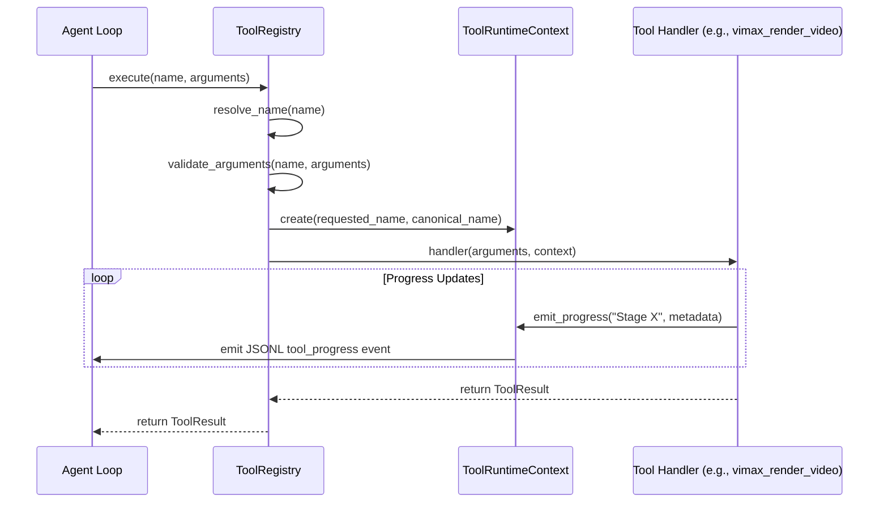
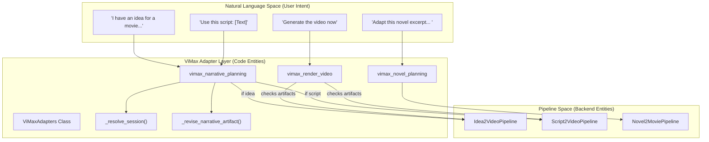

<!-- source: DeepWiki mcp.deepwiki.com · repo HKUDS/ViMax · page 10.3 ViMax Adapters and Tool Registry · fetched 2026-11-09 -->

# ViMax Adapters and Tool Registry

<details>
<summary>Relevant source files</summary>

The following files were used as context for generating this wiki page:

- [agent_runtime/tools.py](agent_runtime/tools.py)
- [agent_runtime/vimax_adapters.py](agent_runtime/vimax_adapters.py)
- [prompts/workflow.md](prompts/workflow.md)
- [tests/test_agent_tools.py](tests/test_agent_tools.py)

</details>


## Purpose and Scope

The ViMax Adapters and Tool Registry provide the integration layer between the high-level Agent Loop (Natural Language Space) and the underlying technical pipelines (Code Entity Space). This system handles the translation of user intent into structured pipeline execution, manages tool discovery and validation, and enforces critical workflow safety through a DAG-based confirmation gate.

---

## Tool Registry and Specification

The `ToolRegistry` is the central authority for managing available agent capabilities. It uses `ToolSpec` objects to define the interface, metadata, and execution logic for every tool exposed to the AI agent.

### Core Registry Components

| Class | Role | Implementation Detail |
| :--- | :--- | :--- |
| `ToolRegistry` | Management | Stores `ToolSpec` objects, handles name resolution/aliases, and validates arguments against schemas. [agent_runtime/tools.py:79-106]() |
| `ToolSpec` | Definition | Dataclass containing the tool name, description, handler function, and argument schema. [agent_runtime/tools.py:29-37]() |
| `ToolArgumentSchema` | Validation | Defines the expected type, requirement status, and default values for tool parameters. [agent_runtime/tools.py:22-25]() |
| `ToolRuntimeContext` | Execution | Provides a bridge for tools to emit progress, handle cancellation, and access turn-specific metadata. [agent_runtime/tools.py:41-47]() |

### Tool Execution Flow


**Sources:** [agent_runtime/tools.py:150-164](), [agent_runtime/tools.py:49-59]()

---

## ViMax Adapters

`ViMaxAdapters` acts as the primary interface for the Agent Loop to interact with the three core generation pipelines: `Idea2VideoPipeline`, `Script2VideoPipeline`, and `Novel2MoviePipeline`. It encapsulates the logic for session resolution and artifact management.

### Adapter Tool Definitions

The system registers three primary adapter tools via `build_vimax_adapter_specs`:

1.  **`vimax_narrative_planning`**: Orchestrates text-based planning (story, characters, script, storyboard) for Idea and Script modes. [agent_runtime/vimax_adapters.py:47-65]()
2.  **`vimax_novel_planning`**: Specialized tool for long-form prose processing using `Novel2MoviePipeline` components like `NovelCompressor` and `EventExtractor`. [agent_runtime/vimax_adapters.py:66-81]()
3.  **`vimax_render_video`**: Triggers the visual generation phase (keyframes, clips, final video) once planning artifacts are verified. [agent_runtime/vimax_adapters.py:83-95]()

### Mapping Natural Language to Code Entities

The following diagram maps the high-level workflow concepts mentioned in user prompts to the specific classes and methods in the adapter layer.


**Sources:** [agent_runtime/vimax_adapters.py:43-95](), [agent_runtime/vimax_adapters.py:103-150](), [prompts/workflow.md:24-27]()

---

## Workflow DAG and Confirmation Gate

To prevent unintended resource consumption and ensure narrative consistency, ViMax implements a strict "Confirmation Gate" before any planning tool is invoked.

### Workflow Confirmation Rules

The system enforces specific constraints via `prompts/workflow.md`:
*   **Explicit Choice**: The agent must ask for a specific workflow (`idea2video`, `script2video`, or `novel2video`) if the user's request is vague. [prompts/workflow.md:24]()
*   **Artifact Authority**: The `.working_dir/<session_id>/` directory is the source of truth for all artifacts. [prompts/workflow.md:19-20]()
*   **Source Requirements**: 
    *   `script2video` requires explicit script text. [prompts/workflow.md:44]()
    *   `novel2video` requires explicit novel prose. [prompts/workflow.md:65]()
    *   Vague ideas default to `idea2video` only after confirmation. [prompts/workflow.md:24]()

### Artifact Dependencies (DAG)

The adapters ensure that the workflow follows a logical sequence. Rendering cannot begin until the prerequisite text artifacts exist.

| Workflow | Input | Key Dependency Nodes (Simplified DAG) |
| :--- | :--- | :--- |
| **Idea2Video** | `input_idea` | `project_brief` → `characters` → `script` → `storyboard` → `camera_tree` → `final_video` |
| **Script2Video** | `input_script` | `characters` → `storyboard` → `shot_decomposition` → `camera_tree` → `final_video` |
| **Novel2Video** | `novel_text` | `compressed_novel` → `events` → `relevant_chunks` → `scenes` → `scene_scripts` |

**Sources:** [prompts/workflow.md:3-17](), [prompts/workflow.md:30-42](), [prompts/workflow.md:53-63]()

---

## Technical Implementation of Adapters

### Session Resolution Logic
The `_resolve_session` method in `ViMaxAdapters` is responsible for determining if a request should apply to an existing session or trigger a new one. If a new `idea` or `script` is provided for a non-empty session, the adapter creates a fresh session to prevent overwriting existing work. [agent_runtime/vimax_adapters.py:109-111]()

### Parallel Tool Execution
The `ToolRegistry` supports a batching mechanism for performance optimization. Tools marked as `concurrency_safe=True` can be grouped together by the `partition_calls` method for simultaneous execution.

```python
# From agent_runtime/tools.py:141-148
def partition_calls(self, calls: list[ToolCall]) -> list[list[ToolCall]]:
    batches: list[list[ToolCall]] = []
    for call in calls:
        if self.is_concurrency_safe(call.name) and batches and all(self.is_concurrency_safe(item.name) for item in batches[-1]):
            batches[-1].append(call)
        else:
            batches.append([call])
    return batches
```

### Visual Inspection Tool
The `view_image` tool is a specialized adapter used for multimodal consistency checks. It allows the agent to inspect generated frames or portraits to make visual claims based on actual pixels rather than metadata. [prompts/workflow.md:22](), [agent_runtime/tools.py:14]()

**Sources:** [agent_runtime/vimax_adapters.py:103-125](), [agent_runtime/tools.py:137-148](), [tests/test_agent_tools.py:124-135]()

---

