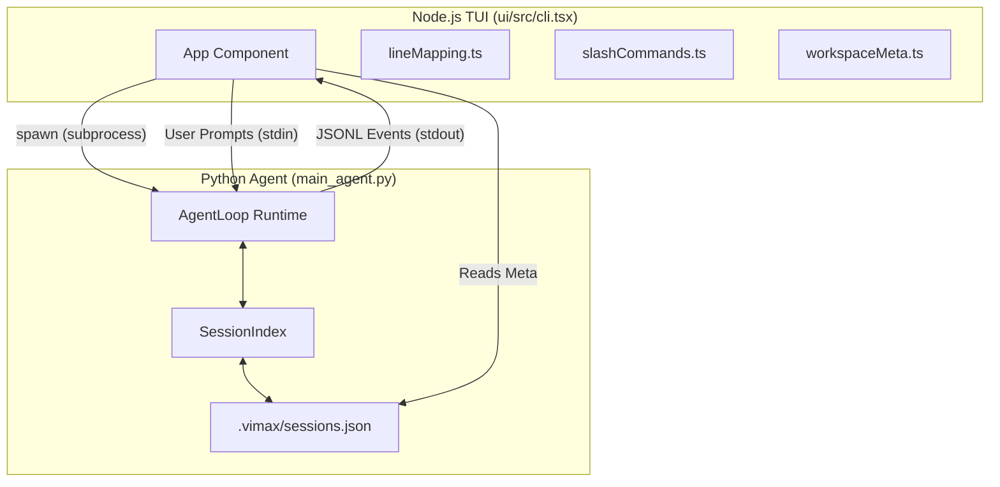
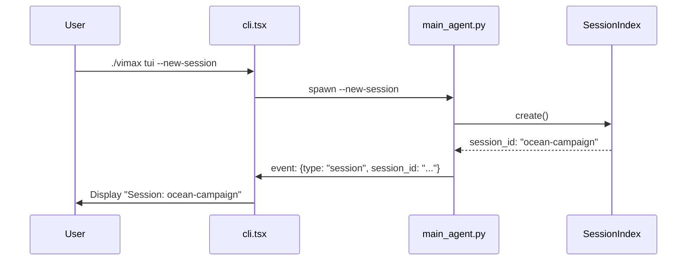

<!-- source: DeepWiki mcp.deepwiki.com · repo HKUDS/ViMax · page 10.4 Terminal User Interface (TUI) · fetched 2026-11-09 -->

# Terminal User Interface (TUI)

Relevant source files

The following files were used as context for generating this wiki page:

- [agent_runtime/prompts.py](agent_runtime/prompts.py)
- [agent_runtime/session_index.py](agent_runtime/session_index.py)
- [main_agent.py](main_agent.py)
- [tests/test_agent_session_index.py](tests/test_agent_session_index.py)
- [tests/test_main_agent_cli.py](tests/test_main_agent_cli.py)
- [tests/test_vimax_adapters.py](tests/test_vimax_adapters.py)
- [ui/src/cli.tsx](ui/src/cli.tsx)

The ViMax Terminal User Interface (TUI) provides an interactive, terminal-based dashboard for managing the agentic video generation lifecycle. Built using the **Ink** React-based framework for CLI, it orchestrates the execution of the Python agent loop, consumes real-time event streams, and provides advanced features like slash commands and context compaction visualization.

---

## Purpose and Scope

The TUI serves as the primary interactive entry point for users who prefer a terminal environment over the Web UI. It is responsible for:
- **Subprocess Management**: Spawning and managing the `main_agent.py` process.
- **Event Orchestration**: Parsing JSONL event streams from the agent and mapping them to UI components.
- **Session Control**: Resuming existing sessions or creating new ones via CLI arguments.
- **Interactive Input**: Providing a REPL-like experience with command history and slash command support.
- **State Visualization**: Displaying the current generation stage, session ID, and LLM context compaction status.

---

## Architecture and Data Flow

The TUI acts as a presentation layer that wraps the `main_agent.py` execution. It communicates with the agent via standard input (stdin) and standard output (stdout).

### System Component Diagram

**Sources:** [ui/src/cli.tsx:4-12](), [ui/src/cli.tsx:109-128](), [main_agent.py:42-76](), [agent_runtime/session_index.py:38-53]()

---

## Subprocess Management

The TUI uses Node.js `spawn` to execute the Python environment. It intelligently resolves the Python path by checking for a local virtual environment (`.venv`) or falling back to `uv run` or the system `python`.

### Command Resolution Logic

| Priority | Source | Command Construction |
| :--- | :--- | :--- |
| 1 | `VIMAX_AGENT_COMMAND` | Uses custom environment variable. |
| 2 | `VIMAX_PYTHON_CMD` | Uses specific Python binary path. |
| 3 | Local `.venv` | `repoRoot/.venv/bin/python3 main_agent.py --jsonl --stdin-repl` |
| 4 | `uv` | `uv run python main_agent.py --jsonl --stdin-repl` |

**Sources:** [ui/src/cli.tsx:113-128]()

The agent is invoked with `--jsonl` to ensure machine-readable output and `--stdin-repl` to keep the process alive for multiple turns [main_agent.py:110]().

---

## JSONL Event Consumption and Line Mapping

The core of the TUI is its ability to transform a flat stream of JSONL events into a structured, updating display. This is handled by the `lineMapping.js` utility and the `applyStreamEvent` function.

### Event Types and UI Handling

| Event Type | TUI Action | Code Reference |
| :--- | :--- | :--- |
| `turn` | Initializes a new message block in the UI. | [main_agent.py:48-49]() |
| `token` | Appends LLM text to the active message line. | [main_agent.py:50-51]() |
| `tool_progress` | Updates a status indicator for long-running tasks (e.g., "Designing storyboard"). | [main_agent.py:55-58]() |
| `terminal` | Captures stdout/stderr from internal pipelines and displays them in a sub-box. | [main_agent.py:63-65]() |
| `session` | Updates the workspace metadata (Session ID, Stage, Compaction). | [main_agent.py:68-71]() |

### Line Mapping Logic
The TUI maintains a `MappingState` which tracks `WorkspaceLine` objects. When an event arrives with a `turn_id`, the TUI looks up the corresponding line and updates its content in place rather than just appending to the terminal. This allows the TUI to show "ViMax thinking" animations and progress bars that update on a single line [ui/src/cli.tsx:9-12]().

**Sources:** [ui/src/cli.tsx:139-153](), [main_agent.py:42-76]()

---

## Interactive Features

### Slash Commands
The TUI supports "Slash Commands" to trigger system-level actions without sending a prompt to the LLM.

- `/compact`: Manually triggers the `runtime.compact_history()` method to summarize the conversation and reduce token usage [main_agent.py:131-139]().
- **Popup UI**: As the user types `/`, a popup appears (filtered via `matchingSlashCommands`) showing available options [ui/src/cli.tsx:160-161]().

### Context Compaction Display
ViMax monitors the token count of the agent's context. When compaction occurs (either manually or automatically when `compactionTarget` is reached), the TUI displays a compaction label.

- **Compaction Target**: Resolved from environment variables or defaults [ui/src/cli.tsx:151-152]().
- **Visual Feedback**: The TUI calculates `compactionUsed` and displays a progress-like indicator or label when the context has been summarized to save tokens [ui/src/cli.tsx:146-150]().

**Sources:** [ui/src/cli.tsx:10-11](), [main_agent.py:131-139](), [agent_runtime/session_index.py:132-136]()

---

## Session Lifecycle Management

The TUI interacts with the `SessionIndex` to manage the `.vimax` directory and `sessions.json` file.

### Session Transitions

**Sources:** [ui/src/cli.tsx:27-48](), [main_agent.py:113-119](), [agent_runtime/session_index.py:103-143]()

### Terminal Resilience
The TUI includes a `useTerminalWidth` hook that listens for terminal `resize` events. It sends a clear sequence (`\u001b[2J\u001b[3J\u001b[H`) and forces a re-render to prevent Ink layout corruption during window resizing [ui/src/cli.tsx:81-106]().

---

## Technical Details: UI Components

### Workspace Metadata
The `WorkspaceMeta` object (managed in `ui/src/workspaceMeta.js`) tracks:
- `workspacePath`: Path to the `.working_dir` [ui/src/cli.tsx:147]().
- `sessionId`: The unique slug for the current project [ui/src/cli.tsx:148]().
- `stage`: The current pipeline stage (e.g., `narrative_planned`, `render_completed`) [ui/src/cli.tsx:149]().
- `compactionUsed`: Number of turns or tokens currently in context [ui/src/cli.tsx:150]().

### Input Handling
The TUI implements a custom input handler to support:
- **Cursor Movement**: Left/Right arrow keys for navigating the prompt [ui/src/cli.tsx:194-201]().
- **History**: (Implied by `stdin-repl` behavior in `main_agent.py`).
- **Interrupts**: `Ctrl+C` sends a kill signal to the child process and exits the TUI [ui/src/cli.tsx:186-189]().

**Sources:** [ui/src/cli.tsx:135-202](), [main_agent.py:155-157]()

---

