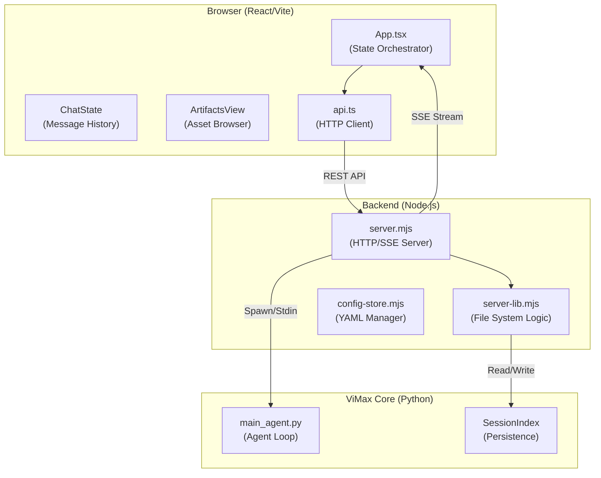
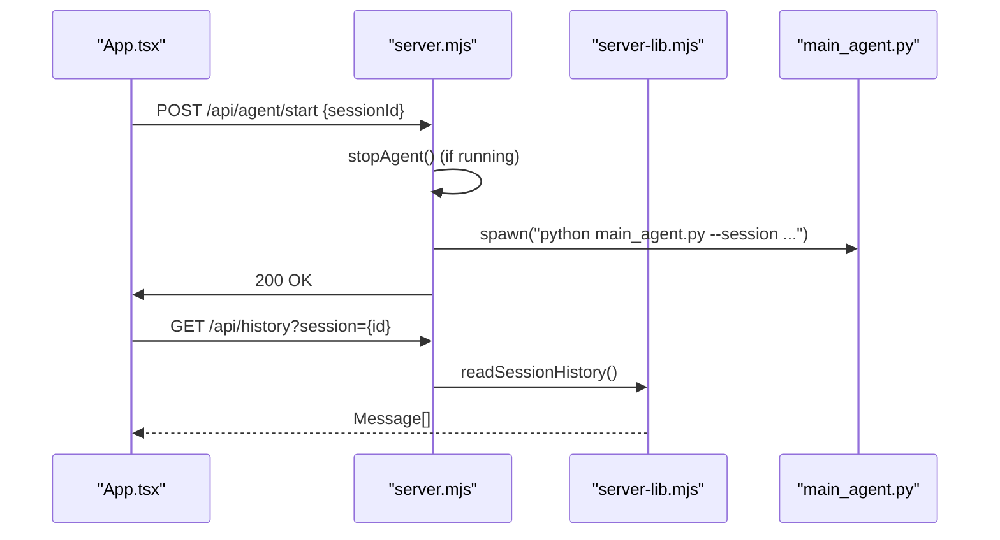

<!-- source: DeepWiki mcp.deepwiki.com · repo HKUDS/ViMax · page 10.5 Web UI · fetched 2026-11-09 -->

# Web UI

Relevant source files

The following files were used as context for generating this wiki page:

- [web/README.md](web/README.md)
- [web/index.html](web/index.html)
- [web/server-lib.mjs](web/server-lib.mjs)
- [web/server.mjs](web/server.mjs)
- [web/src/App.tsx](web/src/App.tsx)
- [web/src/events.test.ts](web/src/events.test.ts)
- [web/src/events.ts](web/src/events.ts)

The ViMax Web UI is a React-based single-page application (SPA) built with Vite that provides a visual interface for the Agent Loop. It enables session management, real-time event monitoring, artifact browsing, and interactive configuration of the video generation system.

## Architecture Overview

The Web UI follows an event-driven architecture where the frontend synchronizes its state with a backend Agent Loop via a Server-Sent Events (SSE) stream.

Sources: [web/src/App.tsx:44-123](), [web/server.mjs:33-125](), [web/README.md:1-15]()

## Event-Driven State Synchronization

The UI state is primarily managed in `App.tsx` and updated through a subscription to the `/api/events` endpoint.

### State Transition Flow
1. **Subscription**: `App.tsx` calls `subscribeToEvents` on mount [web/src/App.tsx:104-123]().
2. **Event Processing**: Incoming `AgentEvent` objects are passed to `applyAgentEvent` [web/src/events.ts:22-105]().
3. **State Mapping**: The function updates `ChatState`, handling different event types:
    - `token`: Appends assistant text deltas to the current message [web/src/events.ts:34-35]().
    - `tool_start` / `tool_progress`: Upserts "activity" messages to show progress bars or status updates [web/src/events.ts:36-56]().
    - `bridge_status`: Updates the connection status between the web server and the Python agent [web/src/events.ts:93-101]().

### Chat State Management
The `ChatState` object tracks the conversation history and the agent's current status.

| Property | Type | Description |
| :--- | :--- | :--- |
| `messages` | `Message[]` | Array of user, assistant, activity, or error messages. |
| `busy` | `boolean` | True if the agent is currently processing a turn. |
| `turnId` | `string` | Unique identifier for the current interaction turn. |

Sources: [web/src/events.ts:1-21](), [web/src/App.tsx:104-123]()

## Session Lifecycle and Persistence

The Web UI interacts with the `SessionIndex` via the `server-lib.mjs` utility.

### Session Management Operations
- **Discovery**: `readSessionState` parses `.vimax/sessions.json` to list available projects [web/server-lib.mjs:8-23]().
- **History Reconstruction**: `readSessionHistory` parses the `loop_history.jsonl` file to restore previous chat turns, including tool execution results [web/server-lib.mjs:49-96]().
- **Deletion**: `deleteSession` removes the session directory and updates the global index [web/server-lib.mjs:25-47]().

### Session Selection Diagram

Sources: [web/server.mjs:86-95](), [web/server-lib.mjs:49-96](), [web/src/App.tsx:178-200]()

## Artifact Polling and Rendering

Artifacts (images and videos) generated by the agent are displayed in the `ArtifactsView`.

1. **Detection**: When a tool named `render_video` is running, the UI initiates a polling interval [web/src/App.tsx:150-158]().
2. **Retrieval**: The `listSessionArtifacts` function recursively walks the session directory, identifying files by extension (e.g., `.mp4`, `.png`) [web/server-lib.mjs:156-184]().
3. **Streaming**: Media files are served via `streamArtifact`, which uses Node.js streams to pipe content to the browser [web/server.mjs:68-70]().

Sources: [web/src/App.tsx:150-158](), [web/server-lib.mjs:156-184](), [web/server.mjs:68-70]()

## Settings View and Configuration

The Web UI provides a `Settings` view to modify the system configuration without manually editing YAML files.

- **Loading**: `readAgentConfig` reads `configs/agent.local.yaml` [web/server.mjs:42-44]().
- **Saving**: `saveAgentConfig` writes updates back to the YAML file [web/server.mjs:45-49]().
- **Reactive Restart**: When configuration is saved, the backend calls `stopAgent('config')`, forcing the Python agent to restart with the new settings upon the next user message [web/server.mjs:47]().

Sources: [web/server.mjs:42-49](), [web/src/App.tsx:49]()

## Server HTTP API

The `server.mjs` file implements a standard REST API for the frontend.

| Endpoint | Method | Description |
| :--- | :--- | :--- |
| `/api/events` | `GET` | SSE stream for real-time agent events. |
| `/api/sessions` | `GET` | Lists all sessions in the workspace. |
| `/api/history` | `GET` | Retrieves message history for a specific session. |
| `/api/uploads` | `POST` | Uploads files to the session's `uploads/` directory. |
| `/api/messages` | `POST` | Sends user input to the agent's `stdin`. |
| `/api/agent/start` | `POST` | Starts a new or existing agent session. |

Sources: [web/server.mjs:33-110]()

---

