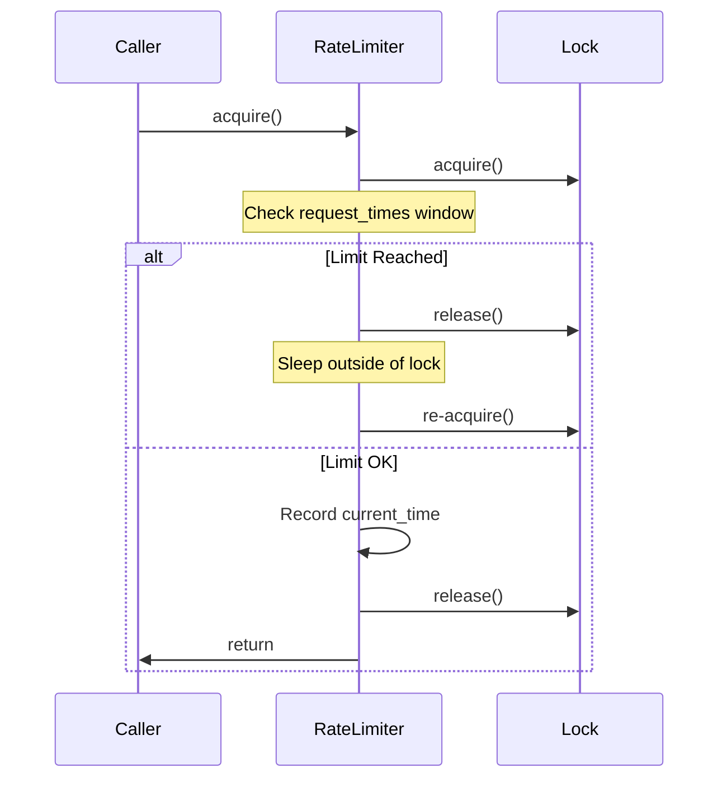
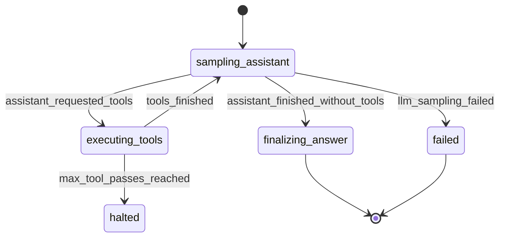

<!-- source: DeepWiki mcp.deepwiki.com · repo HKUDS/ViMax · page 10.6 Troubleshooting Guide · fetched 2026-11-09 -->

# Troubleshooting Guide

<details>
<summary>Relevant source files</summary>

The following files were used as context for generating this wiki page:

- [agent_runtime/loop.py](agent_runtime/loop.py)
- [agent_runtime/session_index.py](agent_runtime/session_index.py)
- [main_agent.py](main_agent.py)
- [tests/test_agent_loop.py](tests/test_agent_loop.py)
- [tests/test_agent_session_index.py](tests/test_agent_session_index.py)
- [tests/test_hygiene_guards.py](tests/test_hygiene_guards.py)
- [tests/test_main_agent_cli.py](tests/test_main_agent_cli.py)
- [tests/test_openrouter_video_generator.py](tests/test_openrouter_video_generator.py)
- [utils/rate_limiter.py](utils/rate_limiter.py)

</details>


This guide provides solutions to common issues encountered when running ViMax. It covers configuration errors, API failures, dependency conflicts, runtime problems, session corruption recovery, and path traversal protection.

---

## Issue Categories

```mermaid
graph TB
    START["Issue Encountered"]
    
    CONFIG["Configuration Issues"]
    API["API & Service Issues"]
    DEPS["Dependency Issues"]
    RUNTIME["Runtime Errors"]
    WORKFLOW["Workflow Failures"]
    SESSION["Session & Loop Issues"]
    
    START --> CONFIG
    START --> API
    START --> DEPS
    START --> RUNTIME
    START --> WORKFLOW
    START --> SESSION
    
    CONFIG --> CONFIG1["Missing API Keys"]
    CONFIG --> CONFIG2["Invalid Class Paths"]
    CONFIG --> CONFIG3["YAML Syntax Errors"]
    
    API --> API1["Rate Limit Exhausted"]
    API --> API2["Authentication Failed"]
    API --> API3["Generation Timeout"]
    
    DEPS --> DEPS1["Import Errors"]
    DEPS --> DEPS2["CUDA/PyTorch Issues"]
    
    RUNTIME --> RUN1["Out of Memory"]
    RUNTIME --> RUN2["Disk Space Full"]
    
    WORKFLOW --> WF1["Agent Failures"]
    WORKFLOW --> WF2["Video Concatenation"]
    
    SESSION --> SES1["Session Index Corruption"]
    SESSION --> SES2["Concurrent Write Conflicts"]
    SESSION --> SES3["Path Traversal Guard Trigger"]
```



**Sources:** `agent_runtime/session_index.py:67-82`(), `utils/rate_limiter.py:6-12`(), `utils/video.py:47-70`()

---

## Configuration Issues

### Missing or Invalid API Keys

**Symptom:** `KeyError`, `AuthenticationError`, or `401 Unauthorized` errors when starting a pipeline or agent loop.

**Diagnostic Steps:**
1. Check YAML configuration files for `api_key` fields.
2. Verify that placeholders like `<YOUR_API_KEY>` or angle-bracketed strings have been replaced.

**Solution:**
Ensure `agent.local.yaml` or specific pipeline configs contain valid keys. Note that Minimax templates must not ship with truthy placeholders to ensure environment variable fallbacks work correctly.

**Sources:** `tests/test_hygiene_guards.py:84-93`()

---

## API and Service Issues

### Rate Limit Exhausted

**Symptom:** `RateLimitError` or console messages stating "Rate limit reached... Waiting XX.Xs".

**Implementation Detail:**
The `RateLimiter` class in `utils/rate_limiter.py` manages request frequency using an asynchronous lock. It calculates a `min_delay` based on `max_requests_per_minute` to smooth out traffic.



**Diagnostic Steps:**
1. Check if the daily limit (`max_requests_per_day`) has been hit.
2. Monitor if multiple processes are sharing the same API key without a shared rate limiter.

**Sources:** `utils/rate_limiter.py:6-95`(), `tests/test_hygiene_guards.py:22-37`()

---

## Session and Loop Issues

### Session Index Corruption

**Symptom:** `json.JSONDecodeError` when loading sessions, or the system starts with an empty session list despite previous work.

**Implementation Detail:**
The `SessionIndex` class manages `sessions.json`. If it detects corruption during `load()`, it automatically backs up the corrupt file and initializes a fresh state to prevent a total crash.

**Recovery Procedure:**
1. Look for files named `sessions.json.corrupt-YYYYMMDD-HHMMSS-ffffff` in the `.vimax` directory.
2. Attempt to manually repair the JSON if critical session data is needed.
3. If corruption happens frequently, check for disk synchronization issues or unexpected process terminations during `save()`.

**Sources:** `agent_runtime/session_index.py:67-82`()

### Concurrent Write Conflicts

**Symptom:** Updates to session state (like project names or turn records) are silently dropped.

**Implementation Detail:**
ViMax uses a file-locking mechanism via `fcntl` (on POSIX systems) to synchronize read-modify-write cycles.

```python
# agent_runtime/session_index.py:22-35
def _synchronized(method):
    @wraps(method)
    def wrapper(self, *args, **kwargs):
        with self._locked():
            return method(self, *args, **kwargs)
    return wrapper
```

**Diagnostic Steps:**
1. Verify if multiple instances of `main_agent.py` or the Web UI server are running against the same workspace.
2. Check for the existence of `sessions.lock` in the `.vimax` directory.

**Sources:** `agent_runtime/session_index.py:22-35`(), `agent_runtime/session_index.py:55-65`()

### Path Traversal Guard Trigger

**Symptom:** `ValueError` when creating a session with a custom ID, or session files appearing in unexpected directories.

**Implementation Detail:**
The `SessionIndex` sanitizes `session_id` inputs to prevent directory traversal attacks. Any ID containing `..` or leading slashes is normalized to remain within the `.working_dir`.

**Solution:**
Ensure session IDs do not contain path separators. The system will automatically slugify and truncate long or complex IDs.

**Sources:** `agent_runtime/session_index.py:113-115`(), `tests/test_agent_session_index.py:39-47`()

---

## Runtime and Pipeline Errors

### Video Concatenation Failures

**Symptom:** `OSError: disk full` or FFmpeg errors during the final assembly of clips.

**Implementation Detail:**
The utility `concatenate_video_files` is designed to be resilient. It ensures that all `VideoFileClip` handles and the final `concatenate_videoclips` object are closed even if an exception occurs during the write phase.

**Diagnostic Steps:**
1. Check available disk space in the `.working_dir`.
2. Verify that all scene clips (`scene_*/video.mp4`) are valid and readable.

**Sources:** `utils/video.py:47-70`(), `tests/test_hygiene_guards.py:47-70`()

### Agent Loop Sampling Failures

**Symptom:** The agent returns an error like "Agent LLM request failed" or "provider returned invalid response shape".

**Implementation Detail:**
The `AgentLoop` in `agent_runtime/loop.py` wraps LLM calls in try-except blocks. A sampling failure will transition the turn state to `failed` and yield an `error` event, but it will not crash the main process.



**Solution:**
1. Check the `metadata.error_type` in the JSONL output.
2. Use the `/compact` command in the CLI to reduce context window pressure if the LLM is failing due to token limits.

**Sources:** `agent_runtime/loop.py:68-91`(), `main_agent.py:140-148`()

---

## Dependency and Environment Issues

### CUDA and PyTorch Mismatch

**Symptom:** GPU acceleration is unavailable despite having a compatible card.

**Requirement:**
ViMax requires CUDA 12.8. Standard `pip install torch` may install a version compiled for an older CUDA toolkit.

**Solution:**
Use the specific index URL provided in the installation guide to sync dependencies:
`uv sync --index-url https://download.pytorch.org/whl/cu128`

**Sources:** `tests/test_hygiene_guards.py:72-81`()

### Package Metadata Inconsistency

**Symptom:** `pytest` fails to find the `agent_runtime` or `tools` modules when running from the root.

**Diagnostic Steps:**
1. Ensure `pytest` is installed as a dev dependency in the current virtual environment.
2. Check `pyproject.toml` to ensure the project structure is correctly defined.

**Sources:** `tests/test_hygiene_guards.py:72-81`()

---

