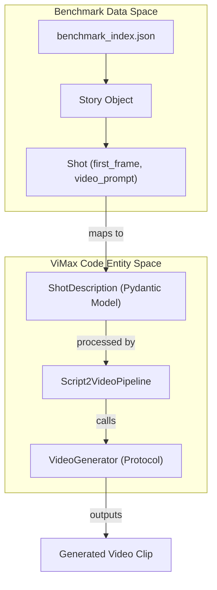
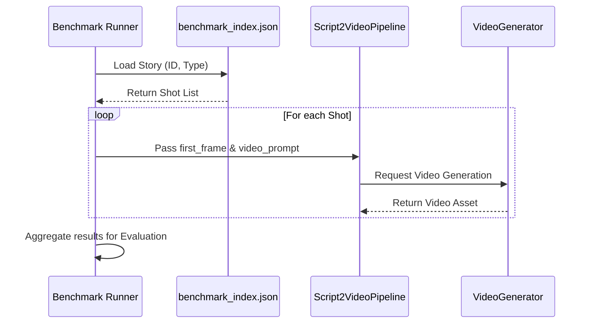

<!-- source: DeepWiki mcp.deepwiki.com · repo HKUDS/ViMax · page 11 ViMax Benchmark · fetched 2026-11-09 -->

# ViMax Benchmark

Relevant source files

The following files were used as context for generating this wiki page:

- [vimax_benchmark/benchmark_index.json](vimax_benchmark/benchmark_index.json)
- [vimax_benchmark/chef_international_kitchens_typeA.json](vimax_benchmark/chef_international_kitchens_typeA.json)

The **ViMax Benchmark** is a specialized dataset designed to evaluate the performance of AI video generation systems, with a specific focus on **visual consistency** and **narrative coherence**. While standard video benchmarks often focus on short, isolated clips, ViMax Benchmark provides structured multi-shot scenarios that test a system's ability to maintain character identity, environmental details, and prop consistency across different cinematic contexts.

## Benchmark Dataset Overview

The benchmark consists of **35 stories** categorized into three distinct consistency types. These stories are indexed in `vimax_benchmark/benchmark_index.json` [vimax_benchmark/benchmark_index.json:1-219](), which serves as the entry point for automated testing and evaluation.

### Key Metrics
The benchmark is designed to evaluate:
*   **Character Consistency:** Maintaining facial features (e.g., scars, hair) and clothing across different shots.
*   **Environmental Persistence:** Keeping background elements and lighting styles stable within a scene.
*   **Object/Prop Continuity:** Ensuring specific items (e.g., a leather notebook) remain identical throughout a narrative arc.

For a detailed breakdown of the dataset structure and evaluation metrics, see **[Benchmark Dataset Overview](#11.1)**.

## Benchmark Scenario Types

The 35 stories are divided into three types (A, B, and C), each targeting a specific technical challenge in video generation.

| Type | Description | Focus |
| :--- | :--- | :--- |
| **Type A** | Single protagonist across diverse environments | Global character & prop consistency [vimax_benchmark/benchmark_index.json:8-81]() |
| **Type B** | Multi-character scene consistency | Spatial layout and multi-entity persistence [vimax_benchmark/benchmark_index.json:82-153]() |
| **Type C** | Multi-character interaction | Interaction logic and complex identity tracking [vimax_benchmark/benchmark_index.json:154-217]() |

### Data Structure
Each benchmark file (e.g., `chef_international_kitchens_typeA.json`) follows a strict schema containing:
*   **Story Overview:** A high-level narrative summary [vimax_benchmark/chef_international_kitchens_typeA.json:2]().
*   **Scenes & Shots:** A sequence of shots, each providing a `first_frame` (visual description) and a `video_prompt` (motion/camera instructions) [vimax_benchmark/chef_international_kitchens_typeA.json:4-51]().

For detailed examples and schema definitions, see **[Benchmark Scenario Types](#11.2)**.

## System Integration

The following diagram illustrates how the Benchmark entities map to the core generation components in the ViMax codebase.

**Benchmark to Code Entity Mapping**

Sources: [vimax_benchmark/benchmark_index.json:1-219](), [vimax_benchmark/chef_international_kitchens_typeA.json:1-51]()

## Evaluation Workflow

The benchmark is typically used to test the `Script2VideoPipeline`. The workflow involves:
1.  **Parsing:** Reading the benchmark JSON to populate `ShotDescription` models.
2.  **Generation:** Executing the pipeline to generate the sequence of video clips.
3.  **Validation:** Using Multi-modal Large Language Models (MLLMs) or human annotators to score the output based on the consistency requirements defined in the `first_frame` descriptions.

**Benchmark Execution Flow**

Sources: [vimax_benchmark/benchmark_index.json:1-7](), [vimax_benchmark/chef_international_kitchens_typeA.json:4-51]()

---

