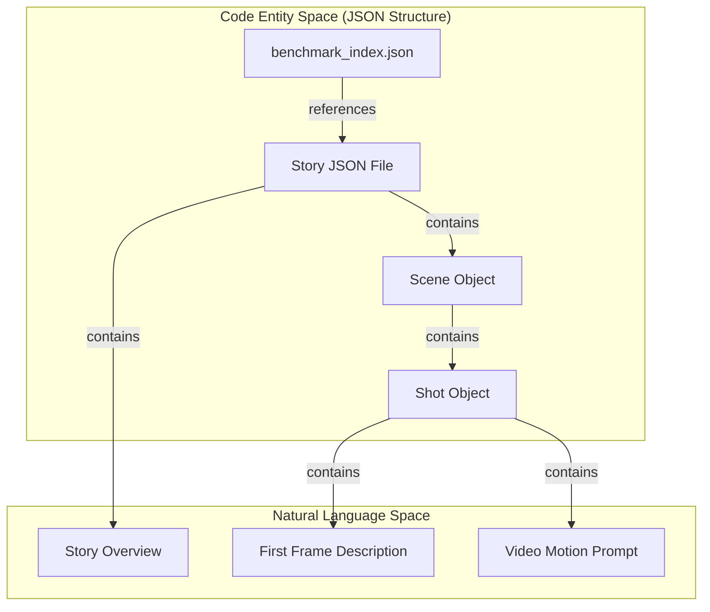
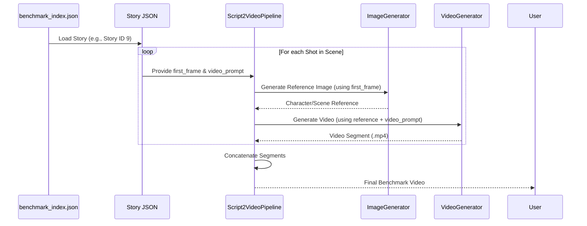

<!-- source: DeepWiki mcp.deepwiki.com · repo HKUDS/ViMax · page 11.1 Benchmark Dataset Overview · fetched 2026-11-09 -->

# Benchmark Dataset Overview

Relevant source files

The following files were used as context for generating this wiki page:

- [vimax_benchmark/athlete_training_conditions_typeA.json](vimax_benchmark/athlete_training_conditions_typeA.json)
- [vimax_benchmark/benchmark_index.json](vimax_benchmark/benchmark_index.json)

The ViMax Benchmark is a specialized dataset designed to evaluate the performance of AI video generation systems in maintaining visual and narrative consistency. It consists of 35 diverse stories, categorized into three distinct consistency types that challenge different aspects of temporal and spatial coherence.

## Dataset Structure

The benchmark is organized around a central index file that points to individual story definitions. Each story is a JSON file containing a sequence of scenes and shots, with detailed descriptors for first frames and video motion.

### The Index File
The `vimax_benchmark/benchmark_index.json` serves as the registry for all test cases. It contains metadata about the total stories and a list of story objects defining the ID, type, theme, and file path [vimax_benchmark/benchmark_index.json:1-219]().

### Story Schema
Each story file (e.g., `athlete_training_conditions_typeA.json`) follows a structured schema:
- **story_overview**: A high-level narrative summary [vimax_benchmark/athlete_training_conditions_typeA.json:2]().
- **consistency_type**: The classification (Type A, B, or C) [vimax_benchmark/athlete_training_conditions_typeA.json:3]().
- **scenes**: An array of scene objects, each containing a list of **shots** [vimax_benchmark/athlete_training_conditions_typeA.json:4-7]().
- **shots**: The atomic unit of evaluation, providing:
    - `first_frame`: A dense natural language description of the initial state, character appearance, and environment [vimax_benchmark/athlete_training_conditions_typeA.json:10]().
    - `video_prompt`: A description of the motion, camera movement, and temporal changes within the shot [vimax_benchmark/athlete_training_conditions_typeA.json:11]().

**Benchmark Data Hierarchy**

Sources: [vimax_benchmark/benchmark_index.json:1-219](), [vimax_benchmark/athlete_training_conditions_typeA.json:1-60]()

---

## Consistency Types

The benchmark categorizes challenges into three types, moving from single-subject consistency across environments to complex multi-character interactions.

### Type A: Single-Character Consistency
Focuses on maintaining the identity of a single protagonist across radically different environments, lighting conditions, and camera angles. 
*   **Example**: An athlete training in an urban track, a desert trail, and an indoor gym [vimax_benchmark/athlete_training_conditions_typeA.json:2-60]().
*   **Challenge**: The system must preserve specific features (e.g., "crescent-shaped scar on left eyebrow", "forest-green jacket with reflective piping") despite environmental shifts [vimax_benchmark/athlete_training_conditions_typeA.json:10, 15, 35]().

### Type B: Multi-Character Scene Consistency
Evaluates the ability to maintain multiple characters and a fixed environment across different shots and perspectives.
*   **Themes**: Antique bookshops, escape rooms, art galleries [vimax_benchmark/benchmark_index.json:83-102]().
*   **Challenge**: Ensuring spatial layout and relative positions of characters remain constant as the camera moves.

### Type C: Multi-Character Interaction
The most complex tier, focusing on the consistency of character dynamics and physical interactions within a narrative sequence.
*   **Themes**: Office negotiations, mentor-student learning, band rehearsals [vimax_benchmark/benchmark_index.json:155-216]().
*   **Challenge**: Maintaining fine-grained consistency during active movements like passing objects or collaborative tasks.

**Consistency Type Mapping**

| Type | Focus Area | Primary Evaluation Metric | Count |
| :--- | :--- | :--- | :--- |
| **Type A** | Subject Identity | Cross-environment character persistence | 12 |
| **Type B** | Spatial Coherence | Environment and multi-subject placement | 12 |
| **Type C** | Narrative Action | Interaction and motion consistency | 11 |

Sources: [vimax_benchmark/benchmark_index.json:7-217](), [vimax_benchmark/athlete_training_conditions_typeA.json:1-60]()

---

## Evaluation Methodology

The benchmark is designed to be used with the ViMax generation pipelines (specifically `Script2VideoPipeline`) to measure how well the agentic system follows complex, multi-shot instructions.

### Data Flow for Evaluation
The evaluation process transforms the JSON benchmark definitions into visual assets through the following flow:

### Key Technical Indicators
1.  **Identity Preservation**: Does the "crescent-shaped scar" or "lime-green stripe" on the shoe persist across all 10+ shots of a Type A story? [vimax_benchmark/athlete_training_conditions_typeA.json:10, 20, 35, 65]().
2.  **Environmental Stability**: In Type B, do the "empty bleachers" or "lane markings" stay consistent when the camera switches from a wide shot to a close-up? [vimax_benchmark/athlete_training_conditions_typeA.json:10-15]().
3.  **Prompt Adherence**: Does the generated motion match the specific lens and movement descriptions (e.g., "24mm lens", "slow lateral drift", "low angle medium shot")? [vimax_benchmark/athlete_training_conditions_typeA.json:11, 21, 26]().

Sources: [vimax_benchmark/benchmark_index.json:1-219](), [vimax_benchmark/athlete_training_conditions_typeA.json:1-60]()

---

