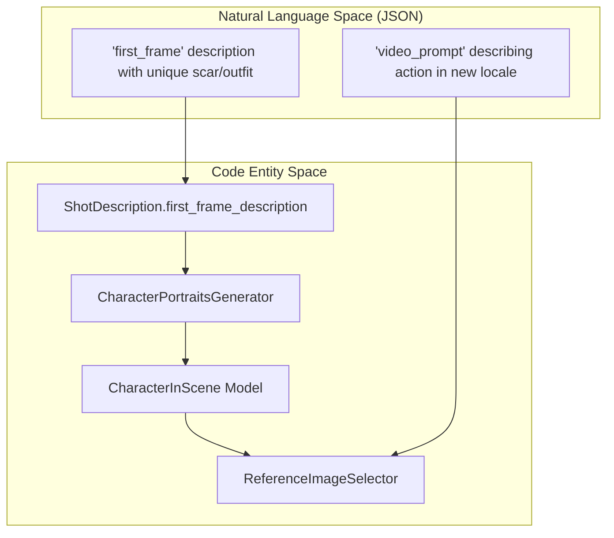
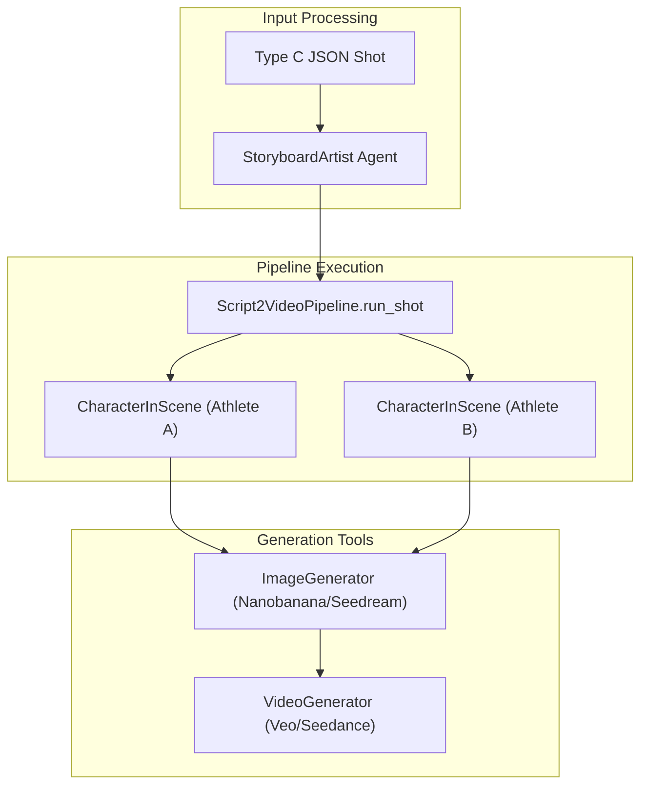

<!-- source: DeepWiki mcp.deepwiki.com · repo HKUDS/ViMax · page 11.2 Benchmark Scenario Types · fetched 2026-11-09 -->

# Benchmark Scenario Types

Relevant source files

The following files were used as context for generating this wiki page:

- [vimax_benchmark/athletes_gym_training_duo_typeC.json](vimax_benchmark/athletes_gym_training_duo_typeC.json)
- [vimax_benchmark/board_game_cafe_interior_typeB.json](vimax_benchmark/board_game_cafe_interior_typeB.json)
- [vimax_benchmark/chef_international_kitchens_typeA.json](vimax_benchmark/chef_international_kitchens_typeA.json)

The ViMax Benchmark (`vimax_benchmark`) is a curated dataset designed to evaluate the performance of agentic video generation systems across various consistency challenges. It consists of 35 stories, each categorized into one of three specific scenario types that target different aspects of visual and narrative stability.

## Benchmark Structure and Schema

Each benchmark scenario is defined by a JSON file that provides a structured narrative, character descriptions, and per-shot instructions. The system uses these files to simulate high-quality inputs for the `Script2VideoPipeline` and `Idea2VideoPipeline`.

### JSON Schema
The benchmark files follow a strict schema to ensure compatibility with ViMax agents:
*   **`story_overview`**: A high-level summary of the narrative arc.
*   **`consistency_type`**: A string identifier (`Type A`, `Type B`, or `Type C`).
*   **`scenes`**: An array of scene objects, each containing a list of `shots`.
*   **`shots`**:
    *   `shot_id`: Numerical identifier for the shot.
    *   `first_frame`: A highly detailed natural language description of the initial state of the shot, used by `CameraImageGenerator` [vimax/agents/render/camera_image_generator.py:1-50]() to produce reference images.
    *   `video_prompt`: A description of the motion, camera movement, and temporal evolution, used by `VideoGenerator` implementations.

**Sources:** [vimax_benchmark/chef_international_kitchens_typeA.json:1-60](), [vimax_benchmark/board_game_cafe_interior_typeB.json:1-50](), [vimax_benchmark/athletes_gym_training_duo_typeC.json:1-60]()

---

## Type A: Single Protagonist Across Environments

**Focus:** Character Visual Consistency (Identity Persistence).

Type A scenarios test the system's ability to maintain a single character's identity (features, clothing, unique marks) while the background environment changes drastically. This evaluates the `CharacterPortraitsGenerator` [vimax/agents/character/character_portraits_generator.py:1-40]() and the `ReferenceImageSelector` [vimax/agents/render/reference_image_selector.py:1-45]()'s ability to prioritize character features over environmental context.

| Feature | Description |
| :--- | :--- |
| **Objective** | Ensure the protagonist remains identical in disparate settings. |
| **Example** | A chef traveling through Japanese, Italian, and Mexican kitchens. |
| **Key Challenge** | Preventing "environment bleed" where the character's clothing or face changes to match the local culture/setting. |

### Code Mapping: Type A Data Flow
The following diagram shows how Type A data moves from the benchmark file into the generation entities.

**Diagram: Type A Identity Mapping**

**Sources:** [vimax_benchmark/chef_international_kitchens_typeA.json:1-30](), [vimax/models/character.py:1-50]()

---

## Type B: Multi-Character Scene Consistency

**Focus:** Spatial and Environmental Consistency (Fixed Geometry).

Type B scenarios focus on a fixed location with multiple characters. The primary challenge is maintaining the layout of the room, furniture placement, and background details (e.g., "three framed art prints," "black metal bookshelf") across different camera angles and shots. This tests the `CameraParentItem` logic and the `CameraImageGenerator`'s ability to respect spatial anchors.

| Feature | Description |
| :--- | :--- |
| **Objective** | Maintain a static environment while characters move within it. |
| **Example** | A board game cafe with fixed tables, bookshelves, and a rainy window. |
| **Key Challenge** | Handling occlusion (characters walking behind objects) and multi-angle shots of the same room. |

**Example Implementation Detail:**
In `board_game_cafe_interior_typeB.json`, shot 7 specifically tests occlusion: "the hoodie man walks... passing behind the brass lamp and partially occluded by it for a moment" [vimax_benchmark/board_game_cafe_interior_typeB.json:45-47]().

**Sources:** [vimax_benchmark/board_game_cafe_interior_typeB.json:1-50](), [vimax/models/camera.py:1-40]()

---

## Type C: Multi-Character Interaction Consistency

**Focus:** Relational and Interaction Consistency.

Type C is the most complex scenario, requiring the system to maintain two or more distinct characters who are interacting with each other and shared objects. This evaluates the system's ability to distinguish between `Athlete A` and `Athlete B` without swapping their features or clothing during physical interactions.

| Feature | Description |
| :--- | :--- |
| **Objective** | Maintain distinct identities and physics during close interaction. |
| **Example** | Two athletes (Athlete A in green, Athlete B in navy) passing a medicine ball. |
| **Key Challenge** | "Identity Swapping" where the model confuses which character is wearing which outfit during a shared action. |

### Code Mapping: Multi-Character Orchestration
This diagram illustrates how the `Script2VideoPipeline` manages multiple entities described in Type C scenarios.

**Diagram: Type C Interaction Orchestration**

**Sources:** [vimax_benchmark/athletes_gym_training_duo_typeC.json:1-57](), [vimax/pipelines/script2video_pipeline.py:50-150]()

---

## Technical Summary of Benchmark Fields

| Field | Technical Role | Implementation Reference |
| :--- | :--- | :--- |
| `first_frame` | Acts as the visual anchor. It is passed to the `ImageGenerator` to create the `ref_image`. | [vimax/models/shot.py:10-30]() |
| `video_prompt` | Controls temporal dynamics. It is combined with the `ref_image` in the `VideoGenerator`. | [vimax/models/shot.py:31-45]() |
| `consistency_type` | Metadata used by evaluation scripts to weight specific metrics (Identity vs. Background). | [vimax_benchmark/athletes_gym_training_duo_typeC.json:3]() |

**Sources:** [vimax/models/shot.py:1-60](), [vimax_benchmark/athletes_gym_training_duo_typeC.json:1-10]()

---

