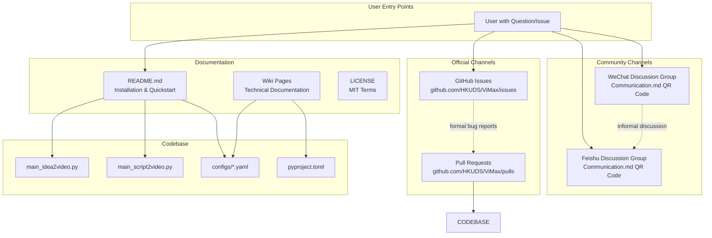
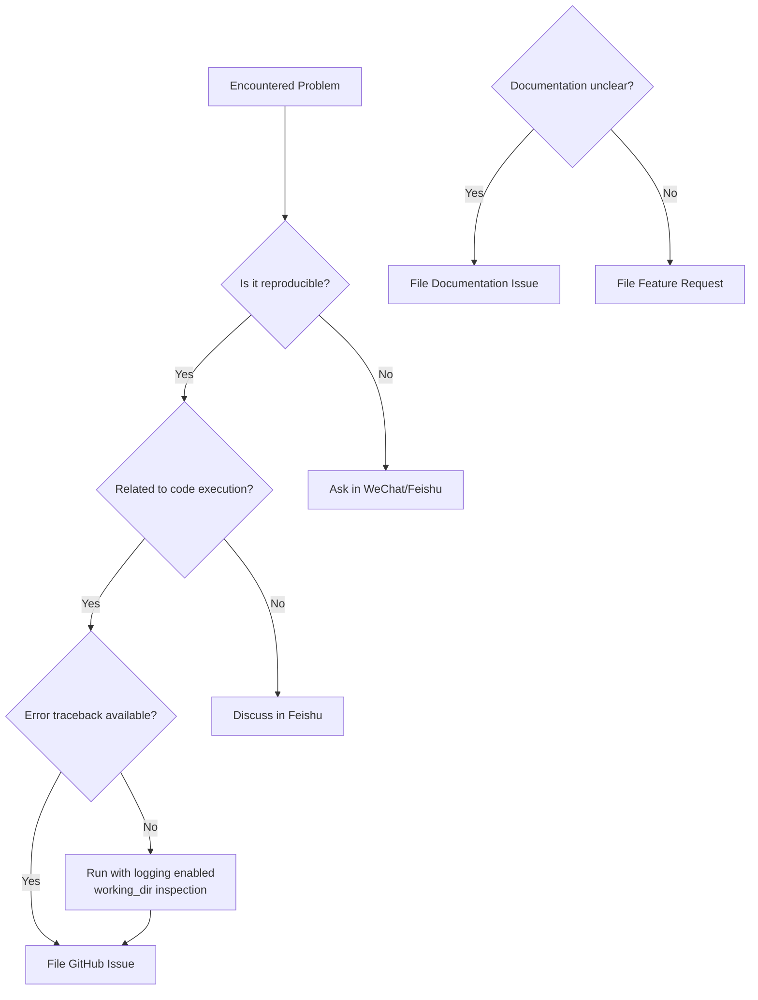
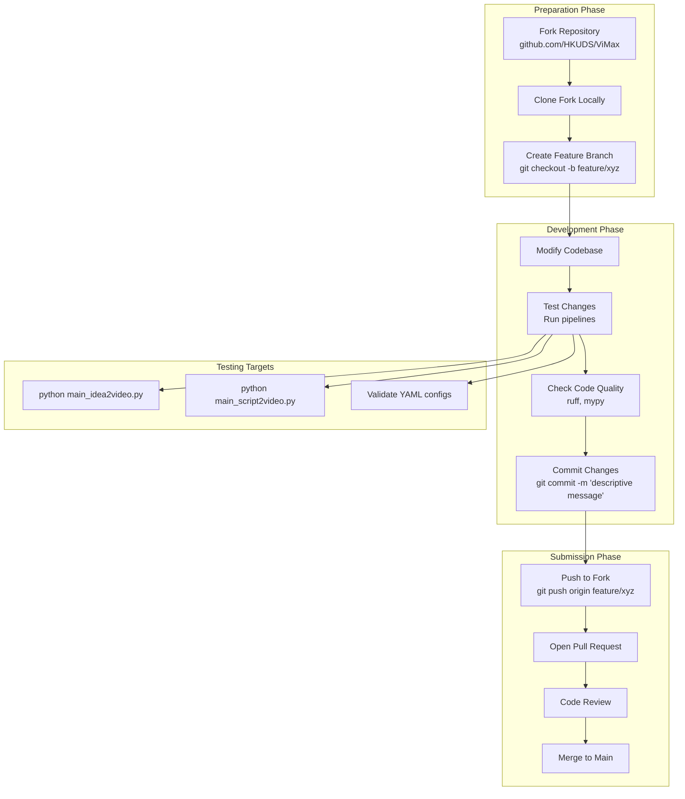
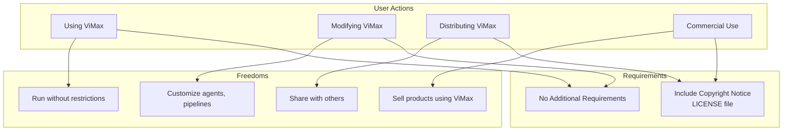

<!-- source: DeepWiki mcp.deepwiki.com · repo HKUDS/ViMax · page 12 Community and Support · fetched 2026-11-09 -->

# Community and Support

<details>
<summary>Relevant source files</summary>

The following files were used as context for generating this wiki page:

- [Communication.md](Communication.md)
- [LICENSE](LICENSE)

</details>


This page documents resources for getting help with ViMax, contributing to the project, and understanding licensing terms. It covers community discussion channels (WeChat, Feishu), the GitHub issue tracker, contribution workflows, and the MIT license under which ViMax is released.

For technical troubleshooting and error resolution, see [Troubleshooting Guide](#10.6).

---

## Support Channels Overview

ViMax provides multiple channels for community interaction and support, each serving distinct purposes in the development lifecycle.

### Support Channel Architecture



**Channel Selection Guide**:

| Channel | Purpose | Response Time | Formality | Best For |
|---------|---------|---------------|-----------|----------|
| WeChat | Real-time discussion, quick questions | Minutes-Hours | Informal | Setup help, usage questions |
| Feishu | Organized discussion threads | Hours | Semi-formal | Feature requests, design discussion |
| GitHub Issues | Bug reports, reproducible problems | Days | Formal | Bugs, API issues, documentation gaps |
| Pull Requests | Code contributions, patches | Days-Weeks | Formal | Feature implementations, fixes |

**Sources**: [Communication.md:1-7]()

---

## Getting Help

### Community Discussion Groups

ViMax maintains active discussion groups on WeChat and Feishu for real-time community support. These channels are hosted by HKUDS (Hong Kong University Data Science Lab).

**Accessing Discussion Groups**:

The [Communication.md:1-7]() file contains QR codes for joining both platforms:

```
Communication.md structure:
├── Introduction text
├── WeChat QR code image
│   └── Hosted at: https://github.com/HKUDS/.github/blob/main/profile/QR.png
└── Feishu QR code (implied)
```

**WeChat Group**:
- Scan QR code at [Communication.md:5]()
- Image width: 400px
- Suitable for: Quick questions, installation troubleshooting, API configuration help

**Feishu Group**:
- Scan QR code at [Communication.md:5]()
- Suitable for: Technical discussions, feature requests, workflow optimization

**Discussion Topics Covered**:
- API key configuration issues (see [Configuration Basics](#2.2))
- Installation problems with `uv` or dependencies in `pyproject.toml`
- Rate limiting and quota management (see [Rate Limiting Configuration](#8.4))
- Pipeline execution questions for `main_idea2video.py` or `main_script2video.py`

**Sources**: [Communication.md:1-7]()

### GitHub Issue Tracker

For reproducible bugs, API errors, or documentation improvements, file issues at the official repository:

**Repository**: `https://github.com/HKUDS/ViMax`

**When to File an Issue**:



**Issue Template Structure**:

| Section | Content | Example |
|---------|---------|---------|
| **Title** | Concise problem statement | `RateLimiter deadlock when image_generator quota exceeded` |
| **Environment** | Python version, OS, dependencies | `Python 3.12, Ubuntu 22.04, uv 0.5.13` |
| **Configuration** | Relevant YAML config sections | Rate limits from `configs/idea2video.yaml` |
| **Reproduction** | Minimal code to reproduce | Commands run from `main_idea2video.py` |
| **Expected Behavior** | What should happen | Pipeline should wait and retry |
| **Actual Behavior** | What actually happens | Pipeline hangs at `RateLimiter.acquire()` |
| **Logs** | Error tracebacks, working_dir contents | Stack trace, `.working_dir/` file listing |

**Sources**: [Communication.md:1-7]()

---

## Contributing

ViMax is open-source and welcomes contributions from the community. All contributions must adhere to the MIT License terms.

### Contribution Workflow



### Contribution Guidelines

**Code Contributions**:

1. **Agent Development**: New agents should follow the pattern in existing agents (see [Agent Architecture](#5.1)).
2. **Pipeline Extensions**: Modifications to `Idea2VideoPipeline` or `Script2VideoPipeline` should maintain the async execution model and preserve caching capability.
3. **Tool Integration**: Adding new external services should include wrapping with a `RateLimiter` and updating configuration schemas.

**Documentation Contributions**:

1. **Wiki Pages**: Follow existing page structure (Overview → Technical Details → Examples) and include code citations: `[path/to/file:startLine-endLine]()`.
2. **Code Comments**: Document parameters, return values, and exceptions in docstrings.

**Testing Requirements**:

| Contribution Type | Required Tests | Validation Method |
|-------------------|----------------|-------------------|
| New Agent | End-to-end pipeline run | `python main_idea2video.py --idea "test"` |
| Pipeline Modification | Resume capability test | Delete intermediate files, rerun |
| Configuration Change | YAML validation | Load config, verify all fields |

**Sources**: [Communication.md:1-7](), [LICENSE:1-22]()

---

## License

ViMax is released under the MIT License, a permissive open-source license that allows broad usage rights with minimal restrictions.

### MIT License Terms

The complete license text is available at [LICENSE:1-22](). Key provisions:

**Copyright**: Copyright (c) 2025 [LICENSE:3]()

**Permissions Granted**:
- **Use**: Run ViMax for any purpose, commercial or non-commercial [LICENSE:5-9]()
- **Modify**: Edit source code, customize agents, extend pipelines [LICENSE:5-9]()
- **Distribute**: Share original or modified versions [LICENSE:5-9]()
- **Sublicense**: Include in projects with different licenses [LICENSE:5-9]()
- **Sell**: Incorporate into commercial products [LICENSE:5-9]()

**Conditions**:
1. **Attribution**: Include original copyright notice and license text in all copies [LICENSE:12-13]()

**Disclaimer**:
The software is provided "AS IS" without warranties of any kind. Key disclaimer excerpts from [LICENSE:15-21]():

```
THE SOFTWARE IS PROVIDED "AS IS", WITHOUT WARRANTY OF ANY KIND, EXPRESS OR
IMPLIED, INCLUDING BUT NOT LIMITED TO THE WARRANTIES OF MERCHANTABILITY,
FITNESS FOR A PARTICULAR PURPOSE AND NONINFRINGEMENT.
```

### License Implications for Users



**Sources**: [LICENSE:1-22]()

---

## Getting Started with Community Participation

### First-Time Contributors

**Recommended Path**:

1. **Join Discussion Groups**: Scan QR codes in [Communication.md:5]() to join WeChat/Feishu.
2. **Read Documentation**: Review [Getting Started](#2) and [System Architecture](#3).
3. **Run Examples**: Execute `main_idea2video.py` and `main_script2video.py` with sample inputs.
4. **Identify Contribution Area**: Choose from new agents, pipeline optimizations, or documentation improvements.

**Support Resources Summary**:

| Resource | URL/Location | Purpose |
|----------|--------------|---------|
| WeChat Group | [Communication.md:5]() QR code | Real-time help |
| Feishu Group | [Communication.md:5]() QR code | Organized discussions |
| GitHub Issues | `github.com/HKUDS/ViMax/issues` | Bug reports, features |
| License | [LICENSE:1-22]() | Legal terms |

**Sources**: [Communication.md:1-7](), [LICENSE:1-22]()

---

