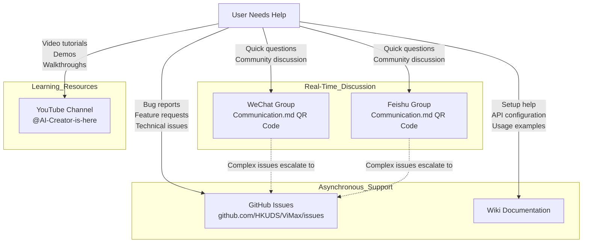
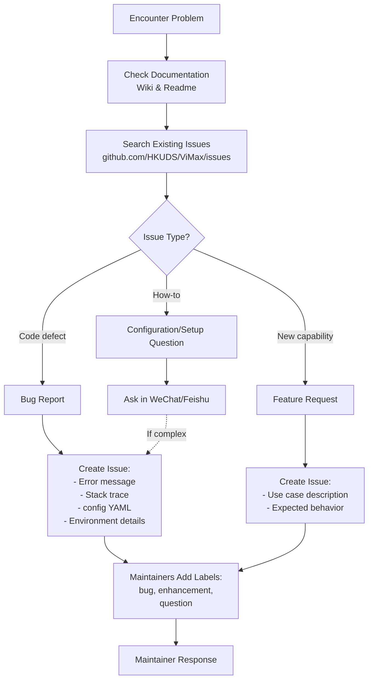
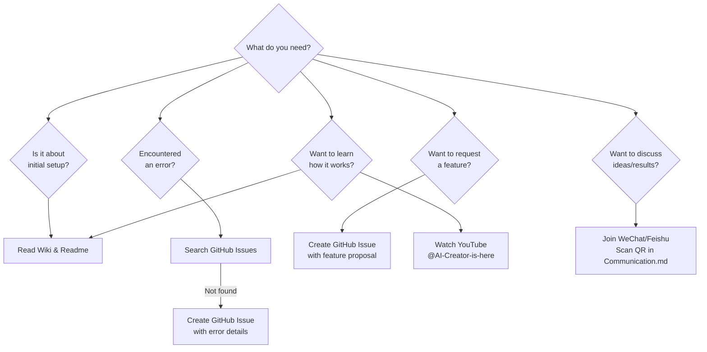

<!-- source: DeepWiki mcp.deepwiki.com · repo HKUDS/ViMax · page 12.1 Getting Help · fetched 2026-11-09 -->

# Getting Help

Relevant source files

The following files were used as context for generating this wiki page:

- [Communication.md](Communication.md)

This document describes the support channels, community resources, and communication platforms available for ViMax users. It covers how to get technical assistance, join discussion groups, report issues, and access learning resources.

---

## Overview

ViMax provides multiple support channels to accommodate different types of inquiries and user preferences. The support ecosystem is organized around three primary platforms: real-time community discussion groups, asynchronous GitHub issue tracking, and video-based learning resources.

Sources: [Communication.md:1-7]()

---

## Support Channel Architecture

The following diagram illustrates the available support channels and their relationships to different types of user needs:

Sources: [Communication.md:1-7]()

---

## Community Discussion Groups

### WeChat Group

ViMax maintains an active WeChat discussion group for real-time community support and collaboration. This is the primary channel for Chinese-speaking users.

**Access Method:**
- Scan the QR code provided in [Communication.md:1-7]()
- The QR code image is hosted at: `https://github.com/HKUDS/.github/blob/main/profile/QR.png`

**Suitable For:**
- Quick questions about setup and configuration.
- Sharing generated video results.
- Discussing creative approaches and ideas.
- Real-time troubleshooting with community members.

**Language:** Primarily Mandarin Chinese, though English questions are welcome.

Sources: [Communication.md:1-7]()

### Feishu Group

ViMax also provides a Feishu (Lark) discussion group as an alternative collaboration platform, particularly suited for users preferring structured team communication tools.

**Access Method:**
- Scan the QR code provided in [Communication.md:1-7]()
- Same QR code image as WeChat: `https://github.com/HKUDS/.github/blob/main/profile/QR.png`

**Suitable For:**
- Same use cases as WeChat group.
- Users who prefer Feishu's organizational features.
- Cross-platform access (desktop and mobile).

**Language:** Primarily Mandarin Chinese, with English support.

Sources: [Communication.md:1-7]()

---

## GitHub Issue Tracker

For technical issues, bug reports, and feature requests, the GitHub issue tracker is the official channel for asynchronous support and project improvement.

### Issue Reporting Workflow

Sources: [Communication.md:1-7]()

---

## Essential Information for Bug Reports

When creating a bug report, include:

1.  **Configuration Files:**
    *   Relevant sections from your configuration YAMLs (e.g., `idea2video.yaml`).
    *   Sanitize API keys (show format only: `sk-...abc123`).

2.  **Error Output:**
    *   Full stack trace from the terminal.
    *   Relevant log messages from the `.vimax` session directory if using the Agent Loop.

3.  **Environment:**
    *   Python version (requirement: ≥3.12).
    *   CUDA version (requirement: 12.8).
    *   Operating System (Linux/Windows).

4.  **Reproduction Steps:**
    *   Input provided (idea, script, or novel).
    *   The specific script executed (e.g., `main_idea2video.py`).

---

## Help Decision Tree

Use this decision tree to determine the most appropriate support channel:

Sources: [Communication.md:1-7]()

---

## Response Time Expectations

| Channel | Typical Response Time | Best For |
| :--- | :--- | :--- |
| **WeChat Group** | Minutes to hours | Quick questions, community discussion |
| **Feishu Group** | Minutes to hours | Quick questions, community discussion |
| **GitHub Issues** | 1-7 days | Bug reports, feature requests, technical issues |
| **YouTube Comments** | Variable | Video-specific feedback on demos |

**Note:** ViMax is an open-source project maintained by HKUDS. Response times may vary based on maintainer availability and issue complexity. Community members often provide help before official maintainers respond.

Sources: [Communication.md:1-7]()

---

