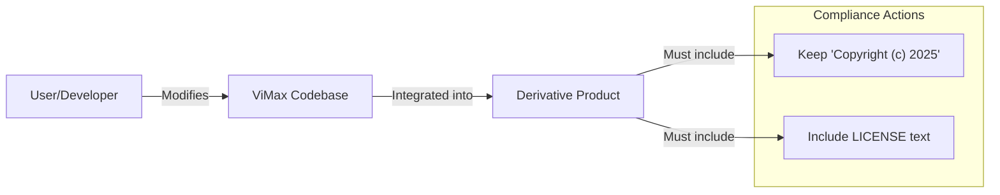

<!-- source: DeepWiki mcp.deepwiki.com · repo HKUDS/ViMax · page 12.3 License · fetched 2026-11-09 -->

# License

<details>
<summary>Relevant source files</summary>

The following files were used as context for generating this wiki page:

- [LICENSE](LICENSE)

</details>


ViMax is licensed under the MIT License, a permissive open-source license. This page documents the license terms, permissions, requirements, and how they apply to usage, modification, and distribution scenarios within the codebase.

**Related Pages**: [Contributing](#12.2), [Getting Help](#12.1)

## License Text

ViMax is distributed under the **MIT License**. The full license text is located at [LICENSE:1-21]().

**Copyright**: Copyright (c) 2025

**Sources:** [LICENSE:1-21]()

## License Structure and Code Entity Association

The following diagram maps the legal permissions and requirements to specific architectural layers and code entities within the ViMax repository.

### Natural Language Space to Code Entity Space: License Coverage

```mermaid
graph TB
    LICENSE["LICENSE file"]
    
    subgraph "Core System Components (Covered Code)"
        PIPELINES["Pipelines Layer<br/>Idea2VideoPipeline<br/>Script2VideoPipeline<br/>Novel2MoviePipeline"]
        AGENTS["Agent Layer<br/>Screenwriter<br/>StoryboardArtist<br/>CameraImageGenerator<br/>AgentLoop"]
        TOOLS["Tool Layer<br/>ImageGenerator<br/>VideoGenerator<br/>RateLimiter"]
        MODELS["Data Models<br/>ShotDescription<br/>CharacterInScene<br/>Camera"]
        ENTRY["Entry Points<br/>main_idea2video.py<br/>main_script2video.py<br/>main_agent_loop.py"]
        CONFIG["Configurations<br/>idea2video.yaml<br/>script2video.yaml<br/>agent.local.yaml"]
    end
    
    subgraph "Legal Permissions"
        USE["Use/Execute"]
        MODIFY["Modify/Patch"]
        DISTRIBUTE["Distribute/Fork"]
        SUBLICENSE["Sublicense"]
        SELL["Commercialize"]
    end
    
    subgraph "Legal Requirements"
        INCLUDE_LICENSE["Include LICENSE text"]
        INCLUDE_COPYRIGHT["Include copyright notice"]
    end
    
    subgraph "Disclaimers"
        NO_WARRANTY["No Warranty (AS IS)"]
        NO_LIABILITY["No Liability"]
    end
    
    LICENSE --> PIPELINES
    LICENSE --> AGENTS
    LICENSE --> TOOLS
    LICENSE --> MODELS
    LICENSE --> ENTRY
    LICENSE --> CONFIG
    
    LICENSE --> USE
    LICENSE --> MODIFY
    LICENSE --> DISTRIBUTE
    LICENSE --> SUBLICENSE
    LICENSE --> SELL
    
    LICENSE -.requires.-> INCLUDE_LICENSE
    LICENSE -.requires.-> INCLUDE_COPYRIGHT
    
    LICENSE -.disclaims.-> NO_WARRANTY
    LICENSE -.disclaims.-> NO_LIABILITY
```



**Sources:** [LICENSE:1-21]()

## Permissions

The MIT License grants the following permissions without restriction:

| Permission | Description | Example Application |
|------------|-------------|---------------------|
| **Use** | Run for any purpose | Deploy `Idea2VideoPipeline` in a production environment |
| **Copy** | Make copies | Clone the repository or duplicate local installations |
| **Modify** | Change source code | Customize `Screenwriter` prompts or `CameraImageGenerator` logic |
| **Merge** | Combine with other software | Integrate `Script2VideoPipeline` into a larger creative suite |
| **Publish** | Make publicly available | Host a fork of the repository on a public platform |
| **Distribute** | Share copies | Package the system as a distributable Python package |
| **Sublicense** | Grant downstream licenses | Include ViMax in a commercial product with its own EULA |
| **Sell** | Charge for copies/services | Offer a SaaS platform powered by the ViMax `AgentLoop` |

**Commercial Use**: Permitted without royalties. You may use any pipeline, agent, or utility in commercial products.

**Modification**: All components may be modified, including agents, tools, pipelines, and Pydantic models.

**Sources:** [LICENSE:5-10]()

## Requirements

The MIT License requires **only** the following when redistributing the software:

### Copyright Notice

Include the copyright notice from [LICENSE:3]():
```
Copyright (c) 2025
```

### License Text

Include the full license text from [LICENSE:1-21]() in all distributions:

| Distribution Type | Requirement |
|-------------------|-------------|
| **Source Distribution** | Include the `LICENSE` file in the root directory |
| **Binary Distribution** | Include the license in documentation or an "About" dialog |
| **Modified Files** | Retain original license; optionally add modification notices |
| **Derivative Works** | Include the original `LICENSE` file with the distribution |

**No Attribution Required for Internal Use**: Using ViMax without redistribution (e.g., running `main_idea2video.py` internally to generate content) does not require a license notice.

**Sources:** [LICENSE:11-13]()

## Disclaimers

The MIT License provides ViMax "AS IS" with explicit disclaimers regarding functionality and liability:

### No Warranty

From [LICENSE:15-17]():

> THE SOFTWARE IS PROVIDED "AS IS", WITHOUT WARRANTY OF ANY KIND, EXPRESS OR IMPLIED, INCLUDING BUT NOT LIMITED TO THE WARRANTIES OF MERCHANTABILITY, FITNESS FOR A PARTICULAR PURPOSE AND NONINFRINGEMENT.

**Applies To**: All components including the `Idea2VideoPipeline`, `Script2VideoPipeline`, specialized agents, tools, and YAML configuration files.

**Implications**:
- No guarantee of video generation quality or narrative coherence.
- No guarantee of API compatibility across versions.
- Agent outputs (e.g., from `Screenwriter` or `StoryboardArtist`) may contain errors or hallucinations.

### No Liability

From [LICENSE:18-21]():

> IN NO EVENT SHALL THE AUTHORS OR COPYRIGHT HOLDERS BE LIABLE FOR ANY CLAIM, DAMAGES OR OTHER LIABILITY, WHETHER IN AN ACTION OF CONTRACT, TORT OR OTHERWISE, ARISING FROM, OUT OF OR IN CONNECTION WITH THE SOFTWARE OR THE USE OR OTHER DEALINGS IN THE SOFTWARE.

**Includes**:
- API costs incurred from `ImageGenerator` or `VideoGenerator` usage.
- Rate limit violations or account suspensions resulting from `RateLimiter` settings.
- Incorrect outputs or data loss in session directories.

**Sources:** [LICENSE:15-21]()

## Compliance and Redistribution

### Natural Language Space to Code Entity Space: Compliance Mapping



### Summary of Key Points

| Aspect | Details |
|--------|---------|
| **License Type** | MIT License |
| **Copyright Year** | 2025 |
| **Permissions** | Use, copy, modify, merge, publish, distribute, sublicense, sell |
| **Requirements** | Include copyright and license notice in distributions |
| **Warranty** | None - provided "AS IS" |
| **Liability** | Authors not liable for any damages or claims |
| **Commercial Use** | Fully permitted |
| **Modification** | Fully permitted |

**Sources:** [LICENSE:1-21]()

## External APIs and Dependencies

The MIT License applies **only** to the ViMax source code. External services and dependencies are governed by their respective licenses:

1.  **Dependencies**: Packages like `langchain`, `moviepy`, and `faiss-cpu` have their own licenses (mostly MIT, Apache 2.0, or BSD).
2.  **External APIs**: Usage of Google Gemini, OpenAI, or Nanobanana APIs is subject to the terms of service of the respective providers. The MIT License covers the integration code (e.g., in `vimax/tools/`), but not the service access itself.

**Sources:** [LICENSE:1-21]()

---

