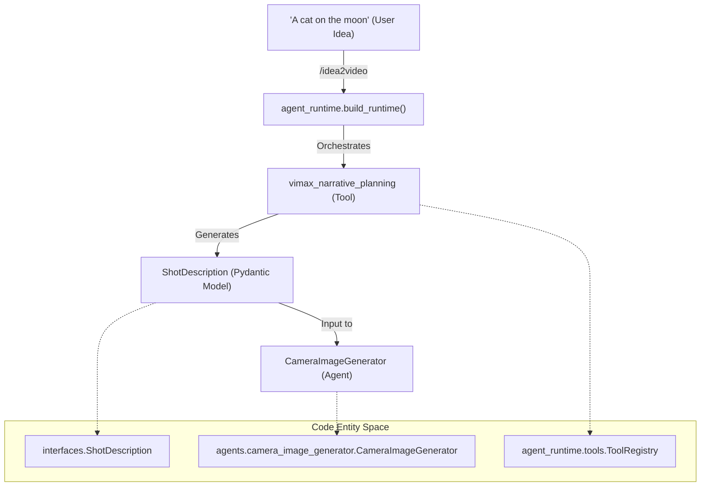
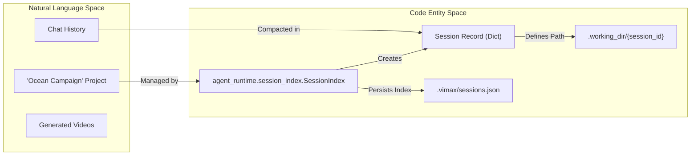
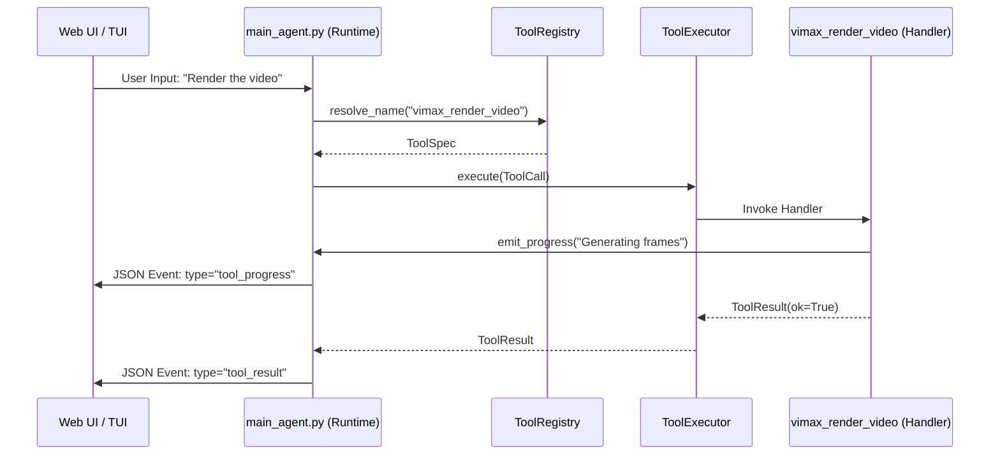

<!-- source: DeepWiki mcp.deepwiki.com · repo HKUDS/ViMax · page 13 Glossary · fetched 2026-11-09 -->

# Glossary

Relevant source files

The following files were used as context for generating this wiki page:

- [README_ZH.md](README_ZH.md)
- [agent_runtime/context_compactor.py](agent_runtime/context_compactor.py)
- [agent_runtime/session_index.py](agent_runtime/session_index.py)
- [agent_runtime/tools.py](agent_runtime/tools.py)
- [agents/camera_image_generator.py](agents/camera_image_generator.py)
- [assets/vimax.png](assets/vimax.png)
- [interfaces/shot_description.py](interfaces/shot_description.py)
- [main_agent.py](main_agent.py)
- [prompts/workflow.md](prompts/workflow.md)
- [readme.md](readme.md)
- [tests/test_agent_session_index.py](tests/test_agent_session_index.py)
- [tests/test_agent_tools.py](tests/test_agent_tools.py)
- [tests/test_crash_regressions.py](tests/test_crash_regressions.py)
- [tests/test_main_agent_cli.py](tests/test_main_agent_cli.py)
- [tools/protocols.py](tools/protocols.py)
- [tools/render_backend.py](tools/render_backend.py)
- [utils/video.py](utils/video.py)
- [web/README.md](web/README.md)
- [web/index.html](web/index.html)
- [web/src/events.test.ts](web/src/events.test.ts)
- [web/src/events.ts](web/src/events.ts)

This glossary defines technical terms, domain concepts, and architectural jargon specific to the ViMax codebase. It is intended to help onboarding engineers navigate the relationships between narrative planning and visual generation.

## Core Concepts & Jargon

### Agent Loop
The interactive execution environment where a Large Language Model (LLM) acts as an orchestrator. Unlike a linear script, the **Agent Loop** maintains a conversation state, calls tools, and reacts to feedback. It is implemented in the `agent_runtime` and exposed via the TUI and Web UI [main_agent.py:126-142]().

### Camera Tree
A hierarchical structure of camera positions used to maintain spatial consistency. A **parent camera** typically has a wider field of view (e.g., a Medium Shot) that encompasses the content of a **child camera** (e.g., a Close-up). This allows the system to derive visual references for detailed shots from broader ones [agents/camera_image_generator.py:20-58]().
*   **Root Camera**: The top-level camera in the tree (usually Camera 0) that establishes the entire scene [agents/camera_image_generator.py:57-57]().
*   **Inclusion Relationship**: The logic where a parent shot's field of view covers the child's [agents/camera_image_generator.py:50-50]().

### Session
A persistent unit of work representing a single project. Sessions are stored in the `.working_dir` and indexed in `.vimax/sessions.json` [agent_runtime/session_index.py:41-45](). Each session tracks its own `working_dir`, `idea`, `stage`, and `stale` status for artifacts [agent_runtime/session_index.py:121-139]().

### Context Compaction
A process that shrinks the LLM's conversation history when it exceeds token limits. It generates a summary of past turns to preserve "memory" while freeing up the context window [agent_runtime/session_index.py:132-136]().

### Workflow DAG
The Directed Acyclic Graph defining the dependency order of artifacts. ViMax supports three primary DAGs:
*   **Idea2Video**: `input_idea` -> `script` -> `storyboard` -> `camera_tree` -> `final_video` [prompts/workflow.md:3-17]().
*   **Script2Video**: `input_script` -> `storyboard` -> ... -> `final_video` [prompts/workflow.md:30-42]().
*   **Novel2Video**: `novel_text` -> `compressed_novel` -> `events` -> `scene_scripts` [prompts/workflow.md:53-63]().

---

## Technical Mapping: Natural Language to Code Entities

The following diagrams bridge high-level system concepts to specific classes and files in the codebase.

### Diagram 1: Narrative to Visual Orchestration
This diagram shows how user intent is transformed into structured code entities.

**Sources:** [agent_runtime/tools.py:79-106](), [agents/camera_image_generator.py:109-126](), [prompts/workflow.md:3-17]()

### Diagram 2: Session and Artifact Management
This diagram shows how project data is persisted and identified.

**Sources:** [agent_runtime/session_index.py:38-53](), [agent_runtime/session_index.py:103-143]()

---

## Terminology Reference Table

| Term | Code Pointer | Definition |
| :--- | :--- | :--- |
| **ToolSpec** | [agent_runtime/tools.py:29-37]() | A definition object for agent tools, including name, description, and `concurrency_safe` flags. |
| **ToolRuntimeContext** | [agent_runtime/tools.py:41-48]() | Provides execution metadata (e.g., `turn_id`) and helper methods like `emit_progress` to tools. |
| **ShotBriefDescription** | [interfaces/shot_description.py]() | A lightweight version of a shot description used for high-level planning. |
| **CameraParentItem** | [agents/camera_image_generator.py:69-101]() | A Pydantic model defining a node's parent in the Camera Tree, including `missing_info` analysis. |
| **Stale Keys** | [agent_runtime/session_index.py:19-19]() | A list of artifact types (e.g., `storyboard`, `camera_tree`) that are marked `stale` if upstream data changes. |
| **Virtual Path** | [tests/test_agent_tools.py:90-104]() | Synthetic file paths like `session.json` or `.log` files that the `read_json` tool generates on-the-fly from memory. |
| **Confirmation Gate** | [prompts/workflow.md:24-24]() | A system requirement where the agent must ask for an explicit workflow choice before calling planning tools. |

**Sources:** [agent_runtime/tools.py:29-78](), [agent_runtime/session_index.py:19-20](), [agents/camera_image_generator.py:69-101](), [prompts/workflow.md:24-24]()

---

## Data Flow: Tool Execution
The following sequence shows how a request for a video render flows through the system.

**Sources:** [main_agent.py:141-142](), [agent_runtime/tools.py:150-164](), [web/src/events.ts:36-67](), [agent_runtime/tools.py:49-60]()