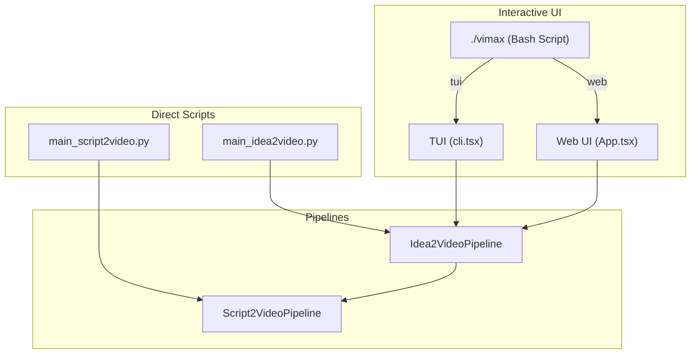
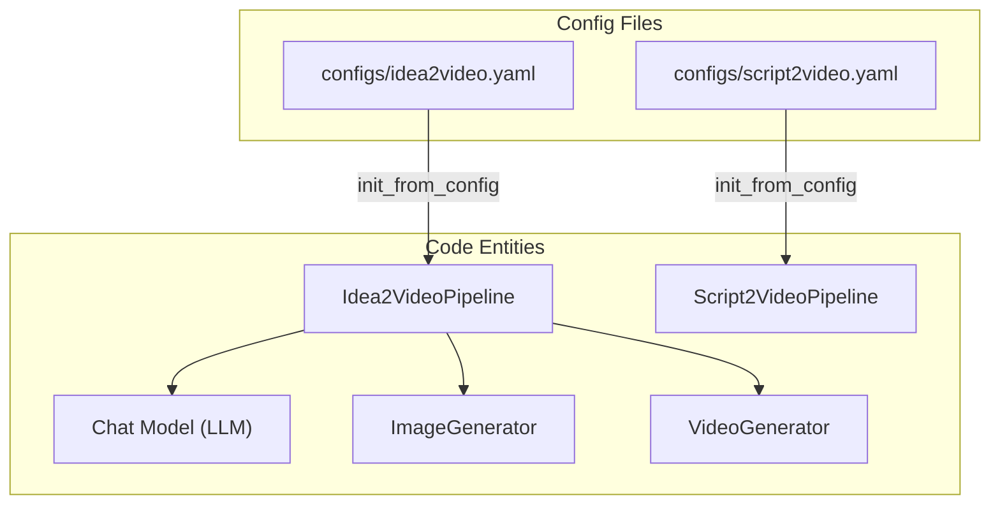

<!-- source: DeepWiki mcp.deepwiki.com · repo HKUDS/ViMax · page 2 Getting Started · fetched 2026-11-09 -->

# Getting Started

<details>
<summary>Relevant source files</summary>

The following files were used as context for generating this wiki page:

- [configs/idea2video.yaml](configs/idea2video.yaml)
- [configs/script2video.yaml](configs/script2video.yaml)
- [main_idea2video.py](main_idea2video.py)
- [main_script2video.py](main_script2video.py)
- [pyproject.toml](pyproject.toml)
- [uv.lock](uv.lock)
- [vimax](vimax)

</details>


This page guides you through installing ViMax and running your first video generation. The system provides two primary execution modes: `main_idea2video.py` for transforming raw ideas into videos, and `main_script2video.py` for converting existing screenplays into videos. Additionally, ViMax supports an interactive agentic workflow via a Terminal User Interface (TUI) and a Web UI.

For detailed installation instructions, see [Installation and Setup](#2.1). For comprehensive configuration reference, see [Configuration Basics](#2.2). For step-by-step execution guides, see [Quick Start: Idea to Video](#2.3) and [Quick Start: Script to Video](#2.4).

---

## Prerequisites

**Operating System:** Linux or Windows (for CUDA 12.8 support) [pyproject.toml:25-28]()

**Required Software:**
- Python 3.12 or higher [pyproject.toml:6]()
- `uv` package manager (recommended for dependency management) [pyproject.toml:25-39]()
- `Node.js` and `npm` (required for TUI and Web UI) [vimax:44-46](), [vimax:98-100]()

**Required API Keys:**
- Chat Model API key (e.g., OpenRouter for Gemini) [configs/idea2video.yaml:1-6]()
- Image Generation API key (e.g., Google Nanobanana) [configs/idea2video.yaml:12-16]()
- Video Generation API key (e.g., Google Veo) [configs/idea2video.yaml:22-26]()

Sources: [pyproject.toml:1-44](), [configs/idea2video.yaml:1-33](), [vimax:1-113]()

---

## Installation

### Step 1: Install uv Package Manager
The `uv` package manager provides fast dependency resolution. Install it following the official documentation at [https://docs.astral.sh/uv/](https://docs.astral.sh/uv/).

### Step 2: Install Python Dependencies
```bash
uv sync
```
This command reads [pyproject.toml:1-23]() and installs dependencies including `langchain`, `moviepy`, `opencv-python`, and `faiss-cpu`. It specifically configures `torch` and `torchaudio` to use the `pytorch-cu128` index for GPU acceleration on Linux/Windows [pyproject.toml:25-39]().

### Step 3: Install UI Dependencies (Optional)
If you intend to use the TUI or Web UI:
```bash
cd ui && npm install
cd ../web && npm install
```

Sources: [pyproject.toml:1-44](), [vimax:44-46](), [vimax:98-100]()

---

## Execution Modes

ViMax offers multiple ways to interact with the system, ranging from direct script execution to interactive UI sessions.

### Workflow Entry Points



**`main_idea2video.py`**: A high-level entry point that takes a raw idea and generates a full video by orchestrating story planning and visual rendering [main_idea2video.py:1-27]().

**`main_script2video.py`**: A direct entry point for users who already have a screenplay and want to proceed straight to shot generation [main_script2video.py:1-35]().

**`./vimax`**: A unified bash wrapper for launching the interactive **Terminal User Interface (TUI)** or the **Web UI** [vimax:1-113]().

Sources: [main_idea2video.py:1-27](), [main_script2video.py:1-35](), [vimax:1-113]()

---

## Configuration Setup

The system uses YAML files to manage API keys, model selections, and rate limits.

### Configuration Hierarchy



### Rate Limiting
Configurations include `max_requests_per_minute` and `max_requests_per_day` to manage API quotas [configs/idea2video.yaml:7-10](). Setting these to `null` disables rate limiting for that specific service [configs/script2video.yaml:8-10]().

Sources: [configs/idea2video.yaml:1-33](), [configs/script2video.yaml:1-34]()

---

## Quick Start Examples

### Idea to Video
Modify the `idea`, `user_requirement`, and `style` strings in `main_idea2video.py` [main_idea2video.py:6-18]().
```bash
python main_idea2video.py
```

### Script to Video
Modify the `script` (standard screenplay format), `user_requirement`, and `style` in `main_script2video.py` [main_script2video.py:6-24]().
```bash
python main_script2video.py
```

### Interactive Session (TUI)
To start an interactive session where you can refine the story with the agent:
```bash
./vimax tui new
```
This launches the Ink-based TUI defined in `ui/src/cli.tsx` [vimax:15-20](), [vimax:102]().

Sources: [main_idea2video.py:1-27](), [main_script2video.py:1-35](), [vimax:1-113]()

---

## Next Steps

- **Installation Details:** See [Installation and Setup](#2.1) for environment troubleshooting.
- **Configuration Guide:** See [Configuration Basics](#2.2) for setting up local overrides.
- **Workflow Deep Dives:** Explore [Quick Start: Idea to Video](#2.3) or [Quick Start: Script to Video](#2.4) for specific input format requirements.

---

