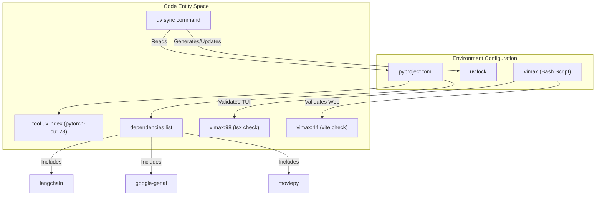
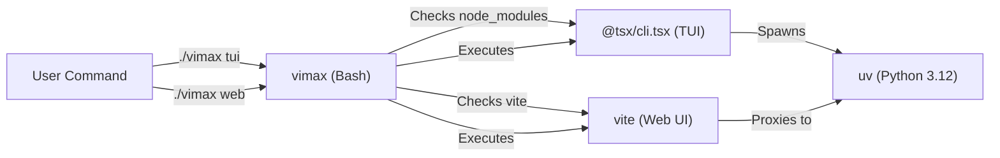

<!-- source: DeepWiki mcp.deepwiki.com · repo HKUDS/ViMax · page 2.1 Installation and Setup · fetched 2026-11-09 -->

# Installation and Setup

<details>
<summary>Relevant source files</summary>

The following files were used as context for generating this wiki page:

- [pyproject.toml](pyproject.toml)
- [uv.lock](uv.lock)
- [vimax](vimax)

</details>


This document provides step-by-step instructions for installing ViMax and configuring the development environment. It covers system requirements, dependency installation using the `uv` package manager, and platform-specific configuration for GPU acceleration. ViMax is an agentic video generation system that orchestrates complex workflows across multiple AI services.

For information about configuring API keys and model settings after installation, see **2.2 Configuration Basics**. For running your first video generation, see **2.3 Quick Start: Idea to Video**.

---

## System Requirements

ViMax has specific system and software requirements that must be met before installation.

### Operating System

The system supports the following platforms:

| Operating System | Support Status | Notes |
|-----------------|----------------|-------|
| Linux | ✅ Full Support | Recommended for production use |
| Windows | ✅ Full Support | Requires native Windows with CUDA support or WSL2 |
| macOS | ⚠️ Limited Support | CPU-only mode; no GPU acceleration for local processing |

### Python Version

ViMax strictly requires **Python 3.12**. This version requirement is enforced in the project metadata to ensure compatibility with modern async features and type hinting used throughout the agents and pipelines.

```toml
requires-python = ">=3.12"
```

**Sources:** [pyproject.toml:6-6]()

---

## Installing the uv Package Manager

ViMax uses [uv](https://github.com/astral-sh/uv) as its environment and dependency manager. The `uv` tool provides fast, reliable dependency resolution and project isolation, which is critical for the complex multi-agent dependency tree.

### Installation Methods

Install `uv` using one of the following methods:

**Linux/macOS:**
```bash
curl -LsSf https://astral.sh/uv/install.sh | sh
```

**Windows (PowerShell):**
```powershell
powershell -c "irm https://astral.sh/uv/install.ps1 | iex"
```

**Using pip (any platform):**
```bash
pip install uv
```

---

## Repository Setup and Installation

### Step 1: Clone the Repository

Clone the ViMax repository from GitHub:

```bash
git clone https://github.com/HKUDS/ViMax.git
cd ViMax
```

### Step 2: Install Python Dependencies

From within the `ViMax` directory, run:

```bash
uv sync
```

The `uv sync` command reads `pyproject.toml` [pyproject.toml:1-44](), locks dependencies in `uv.lock` [uv.lock:1-53](), and creates a virtual environment.

### Step 3: Install UI Dependencies (Optional)

If you intend to use the Terminal User Interface (TUI) or the Web UI, you must install the Node.js dependencies. The `vimax` helper script checks for these dependencies before execution [vimax:98-101]().

**For TUI:**
```bash
cd ui && npm install
```

**For Web UI:**
```bash
cd web && npm install
```

**Sources:** [vimax:44-46](), [vimax:98-101]()

---

## Dependency Architecture

ViMax's dependencies are organized into functional subsystems defined in `pyproject.toml`.

### Core Dependencies Table

| Package | Version | Purpose |
|---------|---------|---------|
| `langchain` | ≥0.3.26 | Multi-agent orchestration framework [pyproject.toml:12-12]() |
| `google-genai` | ≥1.47.0 | Integration for Gemini and Veo models [pyproject.toml:11-11]() |
| `faiss-cpu` | ≥1.12.0 | Vector search for RAG-based script generation [pyproject.toml:10-10]() |
| `moviepy` | ≥2.2.1 | Video assembly and editing [pyproject.toml:15-15]() |
| `scenedetect` | ≥0.6.7.1 | Automated scene boundary detection [pyproject.toml:21-21]() |
| `opencv-python` | (latest) | Low-level frame processing [pyproject.toml:17-17]() |

**Sources:** [pyproject.toml:7-23]()

### Dependency and Environment Flow

The following diagram bridges the natural language installation steps to the specific code entities and configuration files that govern the environment.



**Sources:** [pyproject.toml:1-44](), [vimax:1-113](), [uv.lock:1-53]()

---

## Platform-Specific PyTorch Configuration

ViMax uses conditional dependency resolution to enable GPU acceleration on Linux and Windows via CUDA 12.8.

### CUDA 12.8 Indexing

The `pyproject.toml` defines an explicit index for PyTorch to ensure the correct CUDA-enabled binaries are fetched rather than the default CPU versions.

```toml
[tool.uv.sources]
torch = [
  { index = "pytorch-cu128", marker = "sys_platform == 'linux' or sys_platform == 'win32'" },
]

[[tool.uv.index]]
name = "pytorch-cu128"
url = "https://download.pytorch.org/whl/cu128"
explicit = true
```

**Sources:** [pyproject.toml:25-38]()

---

## Verifying the Installation

After running `uv sync`, you can verify the setup using the `vimax` entry point script.

### Check CLI Entry Point

Run the helper script to see available commands:

```bash
./vimax --help
```

The script supports three primary operational modes:
1. `vimax tui`: Launches the interactive agent terminal [vimax:57-103]().
2. `vimax web`: Starts the Vite-based development server for the web interface [vimax:35-56]().
3. `vimax web start`: Serves a production build of the web app [vimax:48-54]().

**Sources:** [vimax:12-24](), [vimax:34-112]()

### Verify Python Environment

Ensure the `uv` environment is correctly mapped to Python 3.12:

```bash
uv run python --version
```

### Component Interaction Diagram

This diagram shows how the installation components interact when a user starts the system via the `vimax` script.



**Sources:** [vimax:34-112](), [pyproject.toml:6-6]()

---

## Troubleshooting

### Dependency Missing Errors
If you see `error: ui dependencies are missing`, ensure you have run `npm install` in the `ui/` directory as required by the bash script's safety checks [vimax:98-101]().

### Python Version Errors
If `uv sync` fails with a version mismatch, ensure you have Python 3.12 installed on your system. `uv` will attempt to find it, but it must be available in your PATH or manageable by `uv python install 3.12`.

**Sources:** [vimax:98-101](), [pyproject.toml:6-6]()

---

