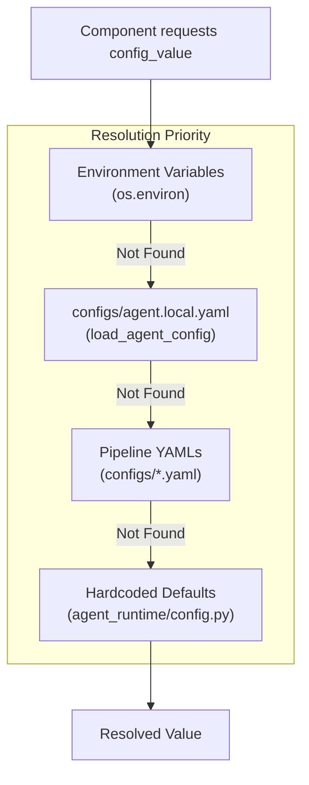
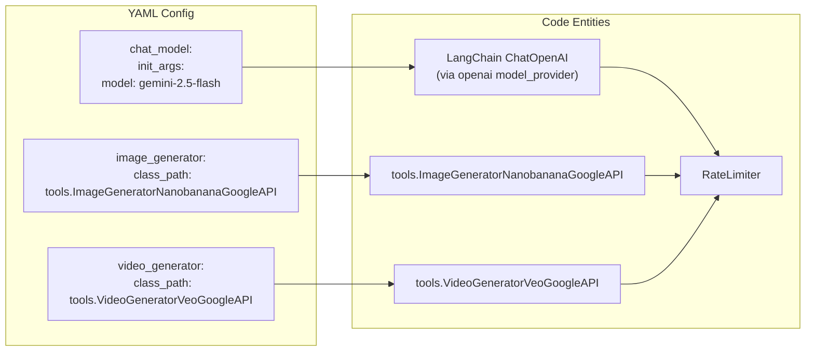

<!-- source: DeepWiki mcp.deepwiki.com · repo HKUDS/ViMax · page 2.2 Configuration Basics · fetched 2026-11-09 -->

# Configuration Basics

<details>
<summary>Relevant source files</summary>

The following files were used as context for generating this wiki page:

- [agent_runtime/__init__.py](agent_runtime/__init__.py)
- [agent_runtime/config.py](agent_runtime/config.py)
- [agent_runtime/tool_executor.py](agent_runtime/tool_executor.py)
- [configs/idea2video.yaml](configs/idea2video.yaml)
- [configs/script2video.yaml](configs/script2video.yaml)
- [main_idea2video.py](main_idea2video.py)
- [main_script2video.py](main_script2video.py)

</details>


## Purpose and Scope

This page introduces ViMax's configuration system, focusing on the YAML-based configuration structure used by pipelines and the local agent configuration mechanism. You will learn how to set up API credentials for chat models, image generators, and video generators using `agent.local.yaml` and environment variables, as well as how to manage rate limits and working directories.

**Sources**: [configs/idea2video.yaml:1-33](), [configs/script2video.yaml:1-34](), [agent_runtime/config.py:1-135]()

---

## Configuration Architecture

ViMax utilizes a multi-layered configuration strategy. High-level pipeline settings (like model selection and rate limits) are defined in pipeline-specific YAML files, while sensitive credentials and service provider defaults can be managed via a centralized `configs/agent.local.yaml` or environment variables.

### The Configuration Resolution Chain

The `agent_runtime/config.py` module provides a robust mechanism for resolving configuration values. When a component requests a setting (like an API key), the system checks sources in the following priority:

1.  **Environment Variables**: Overrides all other settings (e.g., `VIMAX_LLM_API_KEY`).
2.  **`configs/agent.local.yaml`**: A local file for user-specific credentials and provider overrides.
3.  **Pipeline YAMLs**: Specific files like `configs/idea2video.yaml` passed during initialization.
4.  **System Defaults**: Hardcoded fallbacks in the source code.

**Diagram: Configuration Resolution Flow**



**Sources**: [agent_runtime/config.py:36-46](), [agent_runtime/config.py:49-115]()

---

## Centralized Local Configuration (`agent.local.yaml`)

The `configs/agent.local.yaml` file is the recommended place to store API keys and base URLs that apply across all pipelines and agents. This prevents the need to duplicate credentials in every pipeline YAML.

### Structure of `agent.local.yaml`

The file is organized into sections corresponding to service types: `llm`, `image`, `video`, `embedding`, and `reranker`.

```yaml
llm:
  api_key: "your-llm-api-key"
  base_url: "https://openrouter.ai/api/v1"
  model: "google/gemini-2.5-flash-lite-preview-09-2025"

image:
  api_key: "your-google-api-key"
  model: "imagen-3.0-generate-001"

video:
  api_key: "your-veo-api-key"
  base_url: "https://yunwu.ai/v1"
```

**Sources**: [agent_runtime/config.py:22-33](), [agent_runtime/config.py:41-45]()

### Supported Environment Variables

Environment variables take the highest precedence. Key variables include:

| Service | Environment Variable | Default (if no config found) |
| :--- | :--- | :--- |
| **LLM** | `VIMAX_LLM_API_KEY`, `VIMAX_API_KEY` | `""` |
| **Image** | `VIMAX_IMAGE_API_KEY` | (Falls back to LLM key) |
| **Video** | `VIMAX_VIDEO_API_KEY` | (Falls back to LLM key) |
| **Models** | `VIMAX_LLM_MODEL`, `VIMAX_VIDEO_MODEL` | `gpt-5.5`, `veo3.1-fast` |

**Sources**: [agent_runtime/config.py:10-20](), [agent_runtime/config.py:50-115]()

---

## Pipeline-Specific Configuration

While `agent.local.yaml` handles credentials, pipeline YAMLs (e.g., `configs/idea2video.yaml`) define the specific tools and rate limits for a workflow.

### Service Block Structure

Each service block in a pipeline YAML specifies the `class_path` (for tools) or `init_args` (for models) and its operational limits.

**Diagram: Pipeline Config to Tool Mapping**



**Sources**: [configs/idea2video.yaml:1-30](), [configs/script2video.yaml:1-31]()

### Rate Limiting

Rate limits are crucial for managing costs and avoiding provider bans. They are defined per service:

*   `max_requests_per_minute`: Throttles concurrent or rapid-fire requests.
*   `max_requests_per_day`: Hard cap on daily consumption.
*   `null`: Disables the limit for that specific metric.

| File | LLM Limit (RPM) | Image Limit (RPM) | Video Limit (RPM) |
| :--- | :--- | :--- | :--- |
| `idea2video.yaml` | 500 | 10 | 2 |
| `script2video.yaml` | `null` | 2 | 2 |

**Sources**: [configs/idea2video.yaml:9,18,28](), [configs/script2video.yaml:9,19,29]()

---

## Configuration Implementation Details

### The `config_value` Function
The core logic for configuration retrieval resides in `agent_runtime/config.py`. It implements the resolution chain by iterating through environment variables first, then checking the dictionary returned by `load_agent_config`.

```python
def config_value(section: str, key: str, env_names: list[str], default: str = "", workspace_root: str | Path = ".") -> str:
    for env_name in env_names:
        value = os.environ.get(env_name)
        if value:
            return value
    section_payload = load_agent_config(workspace_root).get(section, {})
    # ... logic to return from payload or default ...
```

**Sources**: [agent_runtime/config.py:36-46]()

### Tool Execution Context
When a pipeline is initialized via `init_from_config`, it uses these resolved values to build the `ToolRegistry` and `ToolExecutor`. The `ToolExecutor` tracks the duration and success of every tool call, which is then logged into the session history.

**Sources**: [agent_runtime/tool_executor.py:24-47](), [agent_runtime/__init__.py:6-9]()

---

## Common Configuration Patterns

### 1. Using OpenRouter as a Unified Gateway
Users often point all services to OpenRouter to simplify key management.
```yaml
# configs/agent.local.yaml
llm:
  api_key: "sk-or-v1-..."
  base_url: "https://openrouter.ai/api/v1"
  model: "google/gemini-2.0-flash-001"
```
The system automatically detects the provider via `api_provider_from_base_url`.

### 2. Custom Working Directories
The `working_dir` setting determines where the system stores storyboard images, generated video clips, and logs. It is unique to each pipeline to prevent asset collisions.
*   `configs/idea2video.yaml`: `.working_dir/idea2video`
*   `configs/script2video.yaml`: `.working_dir/script2video`

**Sources**: [agent_runtime/config.py:118-125](), [configs/idea2video.yaml:32](), [configs/script2video.yaml:33]()

---

