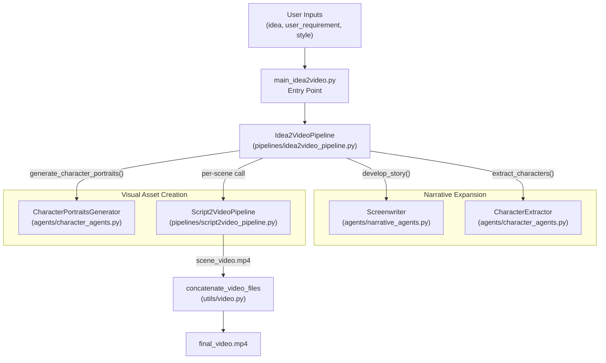
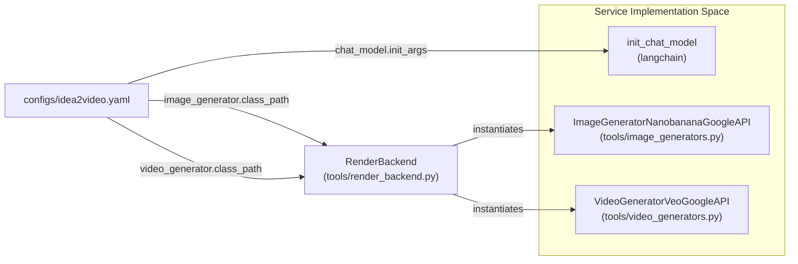

<!-- source: DeepWiki mcp.deepwiki.com · repo HKUDS/ViMax · page 2.3 Quick Start: Idea to Video · fetched 2026-11-09 -->

# Quick Start: Idea to Video

<details>
<summary>Relevant source files</summary>

The following files were used as context for generating this wiki page:

- [configs/idea2video.yaml](configs/idea2video.yaml)
- [configs/script2video.yaml](configs/script2video.yaml)
- [main_idea2video.py](main_idea2video.py)
- [main_script2video.py](main_script2video.py)
- [pipelines/idea2video_pipeline.py](pipelines/idea2video_pipeline.py)

</details>


This guide walks you through your first complete workflow using ViMax's **Idea2Video** mode. You will learn how to transform a simple narrative idea into a multi-scene video by providing natural language descriptions of your creative vision.

**Purpose**: This document covers the end-to-end process of generating a video from a conceptual idea using `main_idea2video.py`. For generating videos from existing structured scripts, see [Quick Start: Script to Video](#2.4). For installation and environment setup, see [Installation and Setup](#2.1). For detailed configuration options, see [Configuration Basics](#2.2).

---

## Prerequisites

Before proceeding, ensure you have completed:

1.  **Environment Setup**: Python ≥3.12 and dependencies installed via `uv sync` (see [Installation and Setup](#2.1))
2.  **API Credentials**: Valid API keys for required services (see [Configuration Basics](#2.2))
3.  **Configuration File**: `configs/idea2video.yaml` with your API keys configured.

---

## Understanding Idea2Video

The Idea2Video workflow transforms three simple text inputs into a complete video with the following automated stages orchestrated by the `Idea2VideoPipeline` class [pipelines/idea2video_pipeline.py:23-23]():

| **Stage** | **What Happens** | **Agent/Component** |
|-----------|------------------|---------------------|
| Story Development | Expands your idea into a structured narrative with scene breakdowns | `Screenwriter` [pipelines/idea2video_pipeline.py:37-37]() |
| Character Extraction | Identifies all characters with physical descriptions and traits | `CharacterExtractor` [pipelines/idea2video_pipeline.py:38-39]() |
| Portrait Generation | Creates visual reference images (front/side/back) for each character | `CharacterPortraitsGenerator` [pipelines/idea2video_pipeline.py:40-41]() |
| Script Writing | Converts story into screenplay format with scene descriptions and dialogue | `Screenwriter` [pipelines/idea2video_pipeline.py:154-154]() |
| Scene-by-Scene Video | For each scene, generates storyboard, shots, frames, and videos | `Script2VideoPipeline` [pipelines/idea2video_pipeline.py:214-214]() |
| Video Assembly | Concatenates all scene videos into final output | `concatenate_video_files` [pipelines/idea2video_pipeline.py:15-15]() |

**Sources**: [pipelines/idea2video_pipeline.py:1-214](), [main_idea2video.py:1-28]()

---

## Workflow Architecture

### Data Flow: Idea to Final Video
This diagram maps the high-level narrative flow to the specific code entities responsible for each transformation.



**Sources**: [pipelines/idea2video_pipeline.py:23-220](), [main_idea2video.py:21-24](), [utils/video.py:15-15]()

---

## Three Required Inputs

The Idea2Video workflow requires three text inputs defined in `main_idea2video.py`:

### 1. Idea (String)
Your creative concept in natural language.
**Example from code** ([main_idea2video.py:6-13]()):
```python
idea = """
A beaufitul fit woman with black hair, great butt and thigs is exercising in a
gym surrounded by glass windows with a beautiful beach view on the outside...
"""
```

### 2. User Requirement (String)
Production constraints and creative directives.
**Example from code** ([main_idea2video.py:14-17]()):
```python
user_requirement = """
For adults, do not exceed 3 scenes. Each scene should be no more than 5 shots.
"""
```

### 3. Style (String)
Visual and artistic direction.
**Example from code** ([main_idea2video.py:18-18]()):
```python
style = "Realistic, warm feel"
```

**Sources**: [main_idea2video.py:5-18]()

---

## Configuration Structure

The pipeline is initialized via `Idea2VideoPipeline.init_from_config()` [pipelines/idea2video_pipeline.py:43-44](), which reads `configs/idea2video.yaml`.

### Service Registry Mapping
This diagram shows how configuration keys map to internal tool classes.



**Key Configuration Fields** ([configs/idea2video.yaml:1-32]()):

| **Section** | **Key Settings** | **Purpose** |
|-------------|---------------------|-------------|
| `chat_model` | `model: google/gemini-2.5-flash-lite` | LLM for narrative tasks [configs/idea2video.yaml:3]() |
| `image_generator` | `class_path: tools.ImageGenerator...` | Generate portraits and frames [configs/idea2video.yaml:13]() |
| `video_generator` | `class_path: tools.VideoGenerator...` | Synthesize motion videos [configs/idea2video.yaml:23]() |
| `working_dir` | `.working_dir/idea2video` | Storage for all artifacts [configs/idea2video.yaml:32]() |

**Sources**: [configs/idea2video.yaml:1-32](), [pipelines/idea2video_pipeline.py:43-57]()

---

## Running Your First Idea2Video

### Step 1: Configure Your Inputs
Edit `main_idea2video.py` to set your creative inputs ([main_idea2video.py:6-18]()).

### Step 2: Execute the Pipeline
Run the entry point script:
```bash
python main_idea2video.py
```

### Step 3: Execution Logic
The `Idea2VideoPipeline.__call__` method orchestrates the following asynchronous sequence:
1.  **Story Development**: Calls `develop_story` [pipelines/idea2video_pipeline.py:121]().
2.  **Character Analysis**: Calls `extract_characters` [pipelines/idea2video_pipeline.py:59]() and `generate_character_portraits` [pipelines/idea2video_pipeline.py:81]().
3.  **Scripting**: Calls `write_script_based_on_story` [pipelines/idea2video_pipeline.py:141]().
4.  **Per-Scene Rendering**: Loops through scene scripts, initializing a `Script2VideoPipeline` for each [pipelines/idea2video_pipeline.py:214]().
5.  **Final Assembly**: Gathers all `.mp4` files from scene directories and merges them using `concatenate_video_files` [pipelines/idea2video_pipeline.py:223]().

**Sources**: [pipelines/idea2video_pipeline.py:186-228](), [main_idea2video.py:21-27]()

---

## Understanding the Output Structure

The `working_dir` (defined at [configs/idea2video.yaml:32]()) will contain:

*   `story.txt`: The expanded narrative [pipelines/idea2video_pipeline.py:127]().
*   `characters.json`: JSON list of extracted `CharacterInScene` models [pipelines/idea2video_pipeline.py:64]().
*   `character_portraits/`: Subdirectories for each character containing `front.png`, `side.png`, and `back.png` [pipelines/idea2video_pipeline.py:165-174]().
*   `script.json`: The final screenplay format [pipelines/idea2video_pipeline.py:147]().
*   `scene_0/`, `scene_1/`, etc.: Working directories for individual scenes generated by `Script2VideoPipeline`.
*   `final_video.mp4`: The primary output - complete video assembled from all scenes [pipelines/idea2video_pipeline.py:223]().

**Sources**: [pipelines/idea2video_pipeline.py:64-223](), [configs/idea2video.yaml:32-32]()

---

## Expected Execution Time and Constraints

Execution time is primarily influenced by the rate limits defined in the configuration:

*   **Chat Model**: 500 requests/minute [configs/idea2video.yaml:9](). High throughput for planning.
*   **Image Generation**: 10 requests/minute [configs/idea2video.yaml:18](). Used for character portraits and shot frames.
*   **Video Generation**: 2 requests/minute [configs/idea2video.yaml:28](). This is the main bottleneck for the pipeline.

**Example Timeline**:
1.  **Narrative (Story/Script)**: ~1-2 minutes.
2.  **Character Portraits**: ~2-5 minutes (parallel generation per character).
3.  **Video Rendering**: Dependent on shot count. With a limit of 2 videos/minute, a 15-shot video will take at least 8 minutes of pure generation time, excluding overhead.

**Sources**: [configs/idea2video.yaml:1-32](), [pipelines/idea2video_pipeline.py:96-107]()

---

