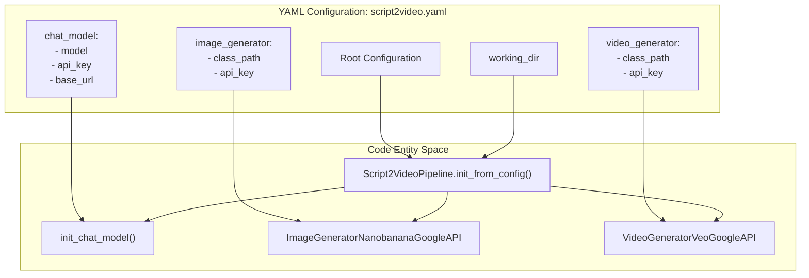
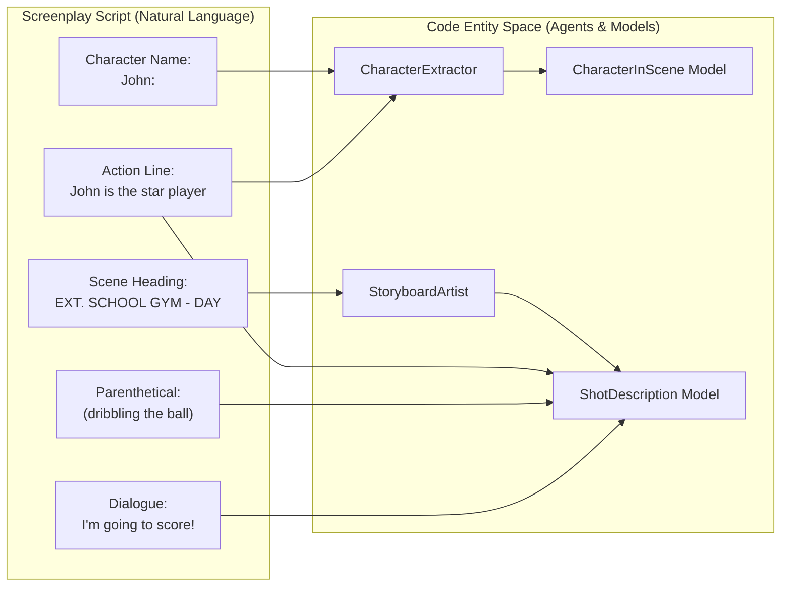
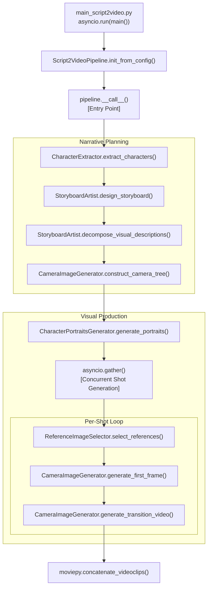

<!-- source: DeepWiki mcp.deepwiki.com · repo HKUDS/ViMax · page 2.4 Quick Start: Script to Video · fetched 2026-11-09 -->

# Quick Start: Script to Video

<details>
<summary>Relevant source files</summary>

The following files were used as context for generating this wiki page:

- [configs/idea2video.yaml](configs/idea2video.yaml)
- [configs/script2video.yaml](configs/script2video.yaml)
- [main_idea2video.py](main_idea2video.py)
- [main_script2video.py](main_script2video.py)
- [pipelines/script2video_pipeline.py](pipelines/script2video_pipeline.py)

</details>


This guide provides a complete walkthrough for generating videos from screenplay scripts using ViMax's **Script2Video** workflow. This mode is designed for users who have already written a screenplay and want to convert it directly into video without the intermediate story development stages.

**Scope**: This page covers the `main_script2video.py` entry point and the `Script2VideoPipeline` orchestrator. For the full idea-to-video workflow that includes automatic story and script generation, see [Quick Start: Idea to Video](#2.3). For detailed configuration options, see [script2video.yaml Reference](#8.3).

---

## Overview

The Script2Video pipeline transforms a screenplay script into a complete video by:
1. Extracting characters and their visual attributes from the script.
2. Generating character portrait references (front/side/back views).
3. Designing a shot-by-shot storyboard based on cinematic language.
4. Constructing a camera position tree for spatial consistency.
5. Generating frames and videos in parallel for each shot.
6. Assembling the final video with proper transitions.

Unlike the Idea2Video workflow, Script2Video assumes you already have a structured screenplay and focuses on the visual production stages.

**Sources**: [main_script2video.py:1-35](), [pipelines/script2video_pipeline.py:81-106]()

---

## Prerequisites

Before running Script2Video, ensure you have:

1. **Completed installation**: See [Installation and Setup](#2.1) for environment setup using `uv`.
2. **Configured API keys**: See [Configuration Basics](#2.2) for setting up the required services in `configs/script2video.yaml`.
3. **GPU access** (optional but recommended): For faster processing of video generation tasks.

The Script2Video pipeline requires three external services configured in `configs/script2video.yaml`:
- **Chat Model**: For character extraction, storyboard design, and prompt generation.
- **Image Generator**: For creating character portraits and shot frames.
- **Video Generator**: For synthesizing motion between frames.

**Sources**: [configs/script2video.yaml:1-31]()

---

## Configuration Setup

The Script2Video pipeline is configured through `configs/script2video.yaml`. This file defines service providers, rate limits, and pipeline behavior.

### Minimal Configuration

[configs/script2video.yaml:1-34]()
```yaml
chat_model:
  init_args:
    model: google/gemini-2.5-flash-lite-preview-09-2025
    model_provider: openai
    api_key: <YOUR_API_KEY>
    base_url: https://openrouter.ai/api/v1
  max_requests_per_minute: null

image_generator:
  class_path: tools.ImageGeneratorNanobananaGoogleAPI
  init_args:
    api_key: <YOUR_API_KEY>
  max_requests_per_minute: 2

video_generator:
  class_path: tools.VideoGeneratorVeoGoogleAPI
  init_args:
    api_key: <YOUR_API_KEY>
  max_requests_per_minute: 2

working_dir: .working_dir/script2video
```

### Configuration Structure

The following diagram maps the YAML configuration structure to the Python classes that consume it:

**Configuration to Entity Mapping**


**Sources**: [configs/script2video.yaml:1-34](), [pipelines/script2video_pipeline.py:15-16]()

---

## Script Format Requirements

The Script2Video pipeline expects scripts in **standard screenplay format**. The system uses natural language understanding to parse the script, so exact formatting is flexible.

### Example Script Structure

[main_script2video.py:6-19]()
```
EXT. SCHOOL GYM - DAY
A group of students are practicing basketball in the gym. John (18, male, tall, athletic) is the star player. Jane (17, female, short, athletic) is the assistant coach.

John: (dribbling the ball) I'm going to score a basket!
Jane: (smiling) Good job, John!
(John takes another shot. This time, the ball swishes through the net perfectly.)
```

### Script-to-Model Mapping

The following diagram shows how screenplay elements are parsed into ViMax data structures:

**Natural Language to Code Model Mapping**


**Sources**: [main_script2video.py:6-19](), [pipelines/script2video_pipeline.py:95-97]()

---

## Running the Pipeline

### Basic Usage

The `main_script2video.py` file provides the entry point for script-to-video generation.

[main_script2video.py:28-34]()
```python
import asyncio
from pipelines.script2video_pipeline import Script2VideoPipeline

async def main():
    # Load configuration and initialize pipeline
    pipeline = Script2VideoPipeline.init_from_config(
        config_path="configs/script2video.yaml"
    )
    # Execute pipeline with script, requirement, and style
    await pipeline(
        script=script, 
        user_requirement=user_requirement, 
        style=style
    )

if __name__ == "__main__":
    asyncio.run(main())
```

### Input Parameters

| Parameter | Type | Purpose | Example |
|-----------|------|---------|---------|
| `script` | `str` | Complete screenplay text | See [main_script2video.py:6-19]() |
| `user_requirement` | `str` | Creative direction and constraints | `"Fast-paced with no more than 15 shots."` |
| `style` | `str` | Visual style directive | `"Anime Style"` |

**Sources**: [main_script2video.py:20-24](), [main_script2video.py:30]()

---

## Pipeline Workflow

The `Script2VideoPipeline` orchestrates multiple AI agents through a multi-stage workflow.

### Execution Flow Diagram



### Stage-by-Stage Breakdown

1.  **Character Analysis**: `CharacterExtractor` identifies characters and their traits from the script [pipelines/script2video_pipeline.py:128-129]().
2.  **Storyboard Design**: `StoryboardArtist` designs a shot list and decomposes them into detailed visual descriptions [pipelines/script2video_pipeline.py:141-152]().
3.  **Camera Planning**: `CameraImageGenerator` constructs a `camera_tree` to maintain spatial consistency [pipelines/script2video_pipeline.py:159-162]().
4.  **Visual Assets**: `CharacterPortraitsGenerator` creates reference images [pipelines/script2video_pipeline.py:96]().
5.  **Parallel Generation**: Shots are generated concurrently using `asyncio.gather`. Each shot involves selecting references, generating frames, and synthesizing motion [pipelines/script2video_pipeline.py:98-99]().
6.  **Assembly**: The final video is concatenated using `moviepy` [pipelines/script2video_pipeline.py:8]().

**Sources**: [pipelines/script2video_pipeline.py:81-176]()

---

## Output Structure

The `working_dir` (default: `.working_dir/script2video`) contains all generated artifacts.

| File/Directory | Content |
|----------------|---------|
| `final_video.mp4` | The assembled final video. |
| `characters.json` | Extracted character data. |
| `storyboard.json` | The designed shot list. |
| `camera_tree.json` | The spatial relationship hierarchy. |
| `portraits/` | Generated character reference images. |
| `shots/` | Individual video files and frames for each shot. |

**Sources**: [configs/script2video.yaml:33](), [pipelines/script2video_pipeline.py:133-135]()

---

