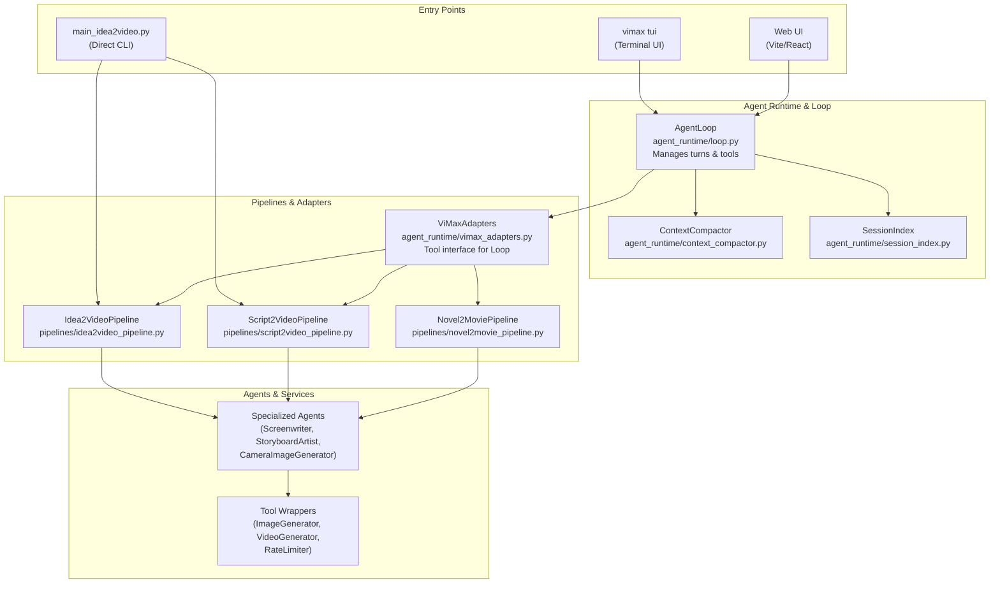
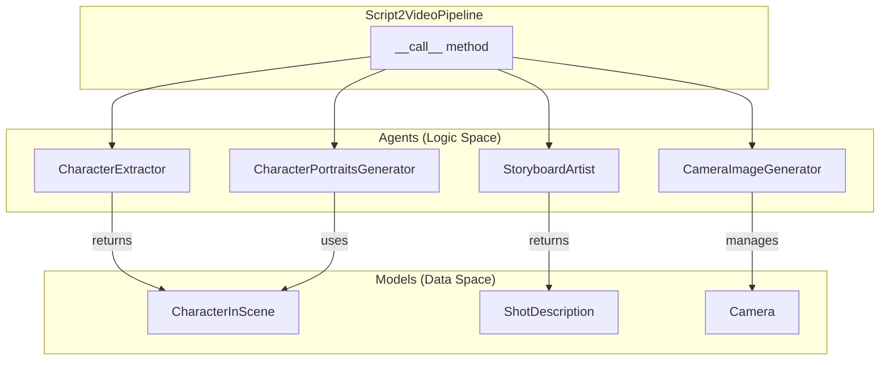

<!-- source: DeepWiki mcp.deepwiki.com · repo HKUDS/ViMax · page 3 System Architecture · fetched 2026-11-09 -->

# System Architecture

<details>
<summary>Relevant source files</summary>

The following files were used as context for generating this wiki page:

- [README_ZH.md](README_ZH.md)
- [agent_runtime/loop.py](agent_runtime/loop.py)
- [agent_runtime/vimax_adapters.py](agent_runtime/vimax_adapters.py)
- [assets/vimax.png](assets/vimax.png)
- [readme.md](readme.md)
- [tests/test_agent_loop.py](tests/test_agent_loop.py)
- [tests/test_openrouter_video_generator.py](tests/test_openrouter_video_generator.py)

</details>


This document provides a comprehensive overview of ViMax's system architecture, explaining how the codebase is organized into layers, how components interact, and the key architectural patterns employed. This page introduces the high-level structure and design principles that govern the entire system.

For detailed information about specific aspects:
- For the high-level system layers and operational modes, see [Architecture Overview](#3.1)
- For the sequential processing stages from idea to video, see [Multi-Stage Pipeline](#3.2)
- For the asyncio-based execution pattern and event coordination, see [Asynchronous Execution Model](#3.3)
- For the hierarchical camera positioning system, see [Camera Tree Architecture](#3.4)

---

## Architectural Philosophy

ViMax employs a **layered, agentic architecture** designed for narrative consistency, extensibility, and efficient resource utilization. The system is organized around three core principles:

1.  **Agentic Orchestration**: Creative tasks are delegated to specialized agents (Screenwriter, StoryboardArtist, etc.) that interact via structured data models.
2.  **Async-First Execution**: All I/O-bound operations and generation tasks use Python's `asyncio` to maximize throughput and enable parallel shot processing.
3.  **Stateful Persistence**: Workflows are session-based, with intermediate artifacts (scripts, character portraits, camera trees) persisted to disk to allow for resumption and manual intervention.

The architecture supports two primary operational modes:
-   **Direct Pipeline**: Sequential execution from entry points like `main_idea2video.py` or `main_script2video.py`.
-   **Agent Loop**: An interactive, event-driven mode where a central `AgentLoop` manages turns, tool calls, and context compaction [agent_runtime/loop.py:20-28]().

---

## System Layers

ViMax is structured as a multi-layer system, where each layer provides abstractions for the one above it.

### Complete System Architecture



**Sources**: [agent_runtime/loop.py:20-41](), [agent_runtime/vimax_adapters.py:43-95](), [pipelines/idea2video_pipeline.py:16-35](), [readme.md:74-86]()

### Layer Responsibilities

| Layer | Components | Responsibilities |
| :--- | :--- | :--- |
| **User Entry** | `tui`, `web`, `main_*.py` | Handle user input, display progress, and manage project lifecycle. |
| **Agent Runtime** | `AgentLoop`, `ToolExecutor` | Orchestrate LLM sampling, execute tool calls, and manage conversation history [agent_runtime/loop.py:68-134](). |
| **Pipelines** | `Idea2VideoPipeline`, `Script2VideoPipeline` | Define the high-level workflow DAG and coordinate multiple agents to produce video. |
| **Agents** | `Screenwriter`, `StoryboardArtist` | Execute domain-specific logic like scriptwriting or shot decomposition. |
| **Tools** | `VideoGeneratorOpenRouterAPI`, `RateLimiter` | Interface with external APIs (OpenRouter, Google, Bytedance) and enforce quotas [agent_runtime/vimax_adapters.py:24-30](). |

---

## Core Component Relationships

### Pipeline and Agent Interaction

The pipelines act as orchestrators, delegating creative and analytical tasks to specialized agents. For example, the `Script2VideoPipeline` coordinates the entire visual generation process.



**Sources**: [pipelines/script2video_pipeline.py:127-222](), [pipelines/script2video_pipeline.py:488-508](), [pipelines/script2video_pipeline.py:596-625]()

### Agent Loop and Tooling

In the interactive mode, the `AgentLoop` uses `ViMaxAdapters` to bridge natural language requests to pipeline execution.

```mermaid
sequenceDiagram
    participant User
    participant Loop as AgentLoop (loop.py)
    participant LLM as OpenAICompatibleLLM
    participant Adapter as ViMaxAdapters (vimax_adapters.py)
    participant Pipe as Script2VideoPipeline

    User->>Loop: "Generate video for this script"
    Loop->>LLM: Sample response with tools
    LLM-->>Loop: ToolCall: vimax_render_video
    Loop->>Adapter: execute(vimax_render_video)
    Adapter->>Pipe: __call__()
    Pipe-->>Adapter: VideoOutput
    Adapter-->>Loop: ToolResult
    Loop->>LLM: Final answer with result
    LLM-->>User: "Video rendered at path/to/video.mp4"
```

**Sources**: [agent_runtime/loop.py:68-134](), [agent_runtime/vimax_adapters.py:83-94](), [tests/test_agent_loop.py:135-155]()

---

## Key Architectural Patterns

### 1. Asynchronous Event Coordination
The system uses `asyncio.Event` to manage dependencies between parallel generation tasks. For instance, a shot generation task might wait for a specific character portrait or a parent camera frame to be ready before proceeding [pipelines/script2video_pipeline.py:21-23]().

### 2. Context Compaction
To handle long-running creative sessions, the `AgentLoop` employs a `ContextCompactor`. When token pressure is high, it generates a synthetic summary of past turns to stay within LLM context limits while preserving essential project state [agent_runtime/loop.py:30-41]().

### 3. Tool-Based Extensibility
External services like image and video generators are implemented as interchangeable tools. The system uses factory patterns and configuration files to swap between providers (e.g., OpenRouter vs. Yunwu API) without altering the core pipeline logic [agent_runtime/vimax_adapters.py:24-30]().

### 4. Hierarchical Camera Tree
To maintain visual consistency across multiple shots, ViMax constructs a `Camera` tree. Each camera can have a parent, allowing child cameras to inherit visual context (like the "first frame" of a parent shot) to ensure spatial continuity [pipelines/script2video_pipeline.py:459-486]().

---

## Summary

The ViMax architecture is designed to transform unstructured narrative ideas into structured cinematic assets. By separating the high-level **Agent Loop** from the concrete **Pipelines**, the system supports both fully automated and human-in-the-loop creative workflows. The use of **Pydantic models** for data exchange and **asyncio** for execution ensures that the system is both type-safe and performant.

For more details, refer to the child pages:
- [Architecture Overview](#3.1)
- [Multi-Stage Pipeline](#3.2)
- [Asynchronous Execution Model](#3.3)
- [Camera Tree Architecture](#3.4)

**Sources**: [readme.md:74-86](), [agent_runtime/loop.py:20-41](), [pipelines/script2video_pipeline.py:127-222]()

---

