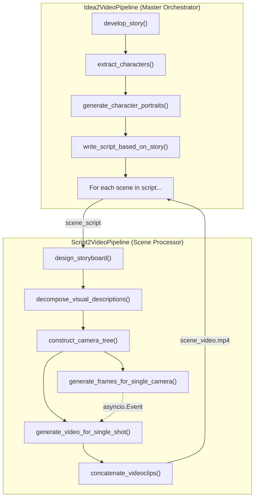

<!-- source: DeepWiki mcp.deepwiki.com · repo HKUDS/ViMax · page 3.2 Multi-Stage Pipeline · fetched 2026-11-09 -->

# Multi-Stage Pipeline

<details>
<summary>Relevant source files</summary>

The following files were used as context for generating this wiki page:

- [agents/storyboard_artist.py](agents/storyboard_artist.py)
- [pipelines/idea2video_pipeline.py](pipelines/idea2video_pipeline.py)
- [pipelines/novel2movie_pipeline.py](pipelines/novel2movie_pipeline.py)
- [pipelines/script2video_pipeline.py](pipelines/script2video_pipeline.py)
- [tests/test_novel2movie_pipeline_init.py](tests/test_novel2movie_pipeline_init.py)
- [tests/test_wrong_output_guards.py](tests/test_wrong_output_guards.py)
- [utils/text.py](utils/text.py)

</details>


## Purpose and Scope

This document describes the multi-stage pipeline architecture that orchestrates ViMax's video generation workflow. The pipeline is implemented as a two-level hierarchy: `Idea2VideoPipeline` handles complete story-to-video generation, while `Script2VideoPipeline` processes individual scenes. This page explains the sequential stages within each pipeline, their dependencies, and how data flows between them.

For details on asynchronous execution within stages, see [3.3 Asynchronous Execution Model](). For information on the camera tree construction used in scene processing, see [3.4 Camera Tree Architecture]().

---

## Two-Level Pipeline Architecture

ViMax uses a hierarchical pipeline design where high-level narrative operations are separated from low-level visual generation operations.

### Natural Language to Code Entity Space: Pipeline Delegation

The following diagram bridges the conceptual "Idea to Video" workflow with the specific class methods and orchestration logic found in the codebase.



**Sources:** [pipelines/idea2video_pipeline.py:23-42](), [pipelines/idea2video_pipeline.py:262-311](), [pipelines/script2video_pipeline.py:81-106](), [pipelines/script2video_pipeline.py:189-222]()

---

## Idea2VideoPipeline: High-Level Sequential Stages

The `Idea2VideoPipeline` class implements a sequential workflow that produces multiple scene videos from a single idea. Each stage builds upon the outputs of previous stages.

### Stage Execution Flow


### Stage Details Table

| Stage | Method | Input | Output | Component/Agent |
|-------|--------|-------|--------|-----------------|
| 1 | `develop_story()` | `idea`, `user_requirement` | `story.txt` | `Screenwriter` |
| 2 | `extract_characters()` | `story` | `characters.json` | `CharacterExtractor` |
| 3 | `generate_character_portraits()` | `characters`, `style` | `character_portraits_registry.json` | `CharacterPortraitsGenerator` |
| 4 | `write_script_based_on_story()` | `story`, `user_requirement` | `script.json` | `Screenwriter` |
| 5 | Scene Loop | Scene script, characters, portraits | Scene video files | `Script2VideoPipeline` |
| 6 | Final Assembly | All scene video paths | `final_video.mp4` | `concatenate_video_files()` |

**Sources:** [pipelines/idea2video_pipeline.py:121-139](), [pipelines/idea2video_pipeline.py:59-79](), [pipelines/idea2video_pipeline.py:81-119](), [pipelines/idea2video_pipeline.py:141-158](), [pipelines/idea2video_pipeline.py:262-311]()

### Resume and Checkpointing Implementation

Each stage in `Idea2VideoPipeline` checks for existing outputs before executing, enabling resume capability. For example, `develop_story` uses the following pattern:

```python
save_path = os.path.join(self.working_dir, "story.txt")
if os.path.exists(save_path):
    with open(save_path, "r", encoding="utf-8") as f:
        story = f.read()
    _pipeline_print(quiet, f"🚀 Loaded story from existing file.")
else:
    story = await self.screenwriter.develop_story(...)
```

This pattern is consistently applied across:
- `extract_characters()`: [pipelines/idea2video_pipeline.py:64-77]()
- `generate_character_portraits()`: [pipelines/idea2video_pipeline.py:87-114]()
- `develop_story()`: [pipelines/idea2video_pipeline.py:127-137]()
- `write_script_based_on_story()`: [pipelines/idea2video_pipeline.py:147-157]()

---

## Script2VideoPipeline: Scene-Level Processing

The `Script2VideoPipeline` class processes a single scene script into a complete video. This pipeline can be run independently or as a sub-component of `Idea2VideoPipeline`.

### Scene Processing Flow: Entity Mapping

The following diagram maps the scene generation stages to the internal methods of `Script2VideoPipeline`.

```mermaid
graph TB
    subgraph "Design Phase (Sequential)"
        SB["design_storyboard()"]
        DVD["decompose_visual_descriptions()"]
        CCT["construct_camera_tree()"]
    end
    
    subgraph "Generation Phase (Parallel)"
        GF["generate_frames_for_single_camera()"]
        GV["generate_video_for_single_shot()"]
    end
    
    subgraph "Assembly Phase"
        MV["moviepy.VideoFileClip"]
        CONCAT["concatenate_videoclips()"]
    end

    SB -->|List[ShotBriefDescription]| DVD
    DVD -->|List[ShotDescription]| CCT
    CCT -->|List[Camera]| GF
    CCT -->|List[Camera]| GV
    GF -. "self.frame_events" .-> GV
    GV --> MV
    MV --> CONCAT
```

**Sources:** [pipelines/script2video_pipeline.py:141-176](), [pipelines/script2video_pipeline.py:189-222]()

### Parallel Execution and Synchronization

The generation phase utilizes `asyncio.gather` to trigger multiple generation tasks simultaneously. However, temporal and spatial dependencies (like maintaining background consistency via the Camera Tree) require synchronization via `asyncio.Event`.

- **`self.character_portrait_events`**: Ensures character reference images are ready. [pipelines/script2video_pipeline.py:103]()
- **`self.shot_desc_events`**: Coordinates the availability of detailed visual prompts. [pipelines/script2video_pipeline.py:104]()
- **`self.frame_events`**: Critical for video generation, which must wait for the specific first and last frames to be finalized before rendering the motion. [pipelines/script2video_pipeline.py:105]()

**Sources:** [pipelines/script2video_pipeline.py:103-106](), [tests/test_wrong_output_guards.py:58-84]()

---

## Pipeline Delegation Pattern

### Idea2Video to Script2Video Handoff

When `Idea2VideoPipeline` processes a multi-scene script, it delegates each scene to a new instance of `Script2VideoPipeline`. This ensures that each scene has its own dedicated working directory and internal event state.

```python
for scene_idx, scene_script in enumerate(script):
    scene_working_dir = os.path.join(self.working_dir, f"scene_{scene_idx}")
    # ...
    scene_pipeline = Script2VideoPipeline(
        chat_model=self.chat_model,
        image_generator=self.image_generator,
        video_generator=self.video_generator,
        working_dir=scene_working_dir,
    )
    scene_video_path = await scene_pipeline(
        script=scene_script,
        characters=characters,
        character_portraits_registry=character_portraits_registry,
        # ...
    )
```

**Sources:** [pipelines/idea2video_pipeline.py:283-299]()

### Shared Context

The parent pipeline passes global state to the scene pipeline to ensure consistency:
1. **Characters**: The full `List[CharacterInScene]` extracted from the entire story. [pipelines/idea2video_pipeline.py:295]()
2. **Portraits**: The `character_portraits_registry` containing generated reference images for all characters. [pipelines/idea2video_pipeline.py:296]()
3. **Style**: The global visual style string. [pipelines/idea2video_pipeline.py:298]()

---

## Pipeline Initialization and Configuration

Both pipelines utilize the `RenderBackend` and `resolve_chat_model_config` utilities to initialize their dependencies from YAML configuration files.

- **`Idea2VideoPipeline.init_from_config(config_path)`**: Loads the YAML, initializes the LangChain chat model via `init_chat_model`, and sets up the image/video generators. [pipelines/idea2video_pipeline.py:43-57]()
- **Working Directory**: The `working_dir` is initialized early to ensure all artifacts have a persistent storage location. [pipelines/idea2video_pipeline.py:34-35]()

**Sources:** [pipelines/idea2video_pipeline.py:43-57](), [utils/provider_presets.py:1-15]()

---

