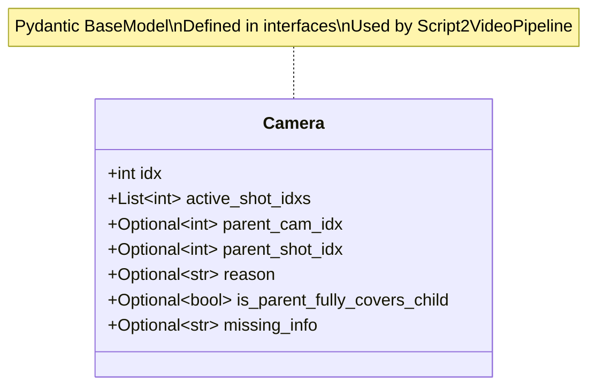
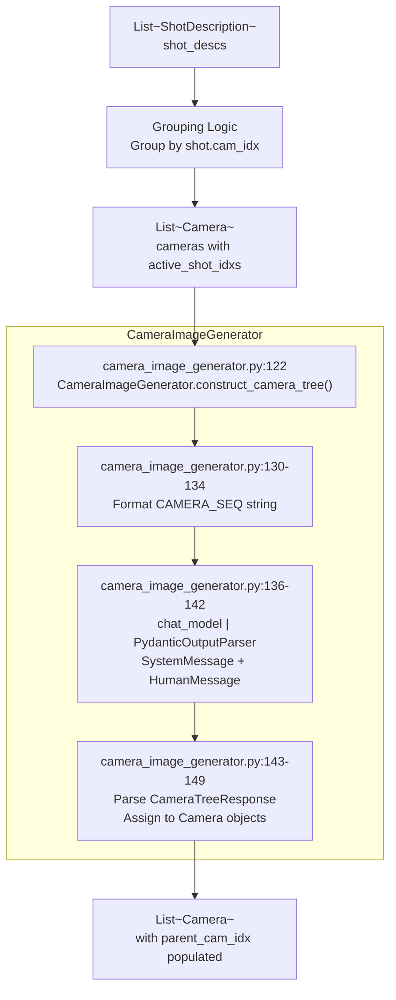
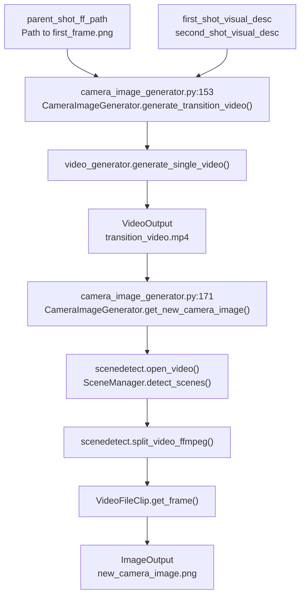

<!-- source: DeepWiki mcp.deepwiki.com · repo HKUDS/ViMax · page 3.4 Camera Tree Architecture · fetched 2026-11-09 -->

# Camera Tree Architecture

<details>
<summary>Relevant source files</summary>

The following files were used as context for generating this wiki page:

- [agent_runtime/context_compactor.py](agent_runtime/context_compactor.py)
- [agents/camera_image_generator.py](agents/camera_image_generator.py)
- [interfaces/shot_description.py](interfaces/shot_description.py)
- [tests/test_crash_regressions.py](tests/test_crash_regressions.py)
- [utils/video.py](utils/video.py)

</details>


## Purpose and Scope

This document explains ViMax's hierarchical camera positioning system, which models spatial relationships between shots to enable smooth visual transitions and efficient parallel processing. The camera tree structure determines which shots can reuse backgrounds from other shots, minimizing redundant image generation while maintaining visual coherence.

For information about how the camera tree integrates with asynchronous processing, see [Asynchronous Execution Model](#3.3). For details about the agent that constructs the tree, see [Camera and Motion Agents](#5.5).

---

## Conceptual Overview

The camera tree is a hierarchical data structure where each node represents a camera position that films one or more consecutive shots. Parent-child relationships model spatial containment: a parent camera captures a wider field of view that encompasses the child camera's narrower view.

**Key Benefits:**

| Benefit | Description |
|---------|-------------|
| **Background Reuse** | Child cameras inherit backgrounds from parent cameras, reducing image generation costs. |
| **Smooth Transitions** | Transition videos between parent and child shots create natural camera movements (zoom, pan). |
| **Visual Consistency** | Shots from the same camera share spatial context, maintaining scene coherence. |
| **Dependency Optimization** | The tree structure determines shot generation order, enabling maximal parallelism. |

**Example Scenario:**

```
Shot 0: Wide shot of a café interior showing Alice and Bob at a table
  └─> Shot 1: Medium close-up of Alice's face as she speaks
  └─> Shot 2: Medium close-up of Bob's face as he responds
```

Here, Shot 0 is the parent camera capturing the entire scene. Shots 1 and 2 are child cameras focusing on individual characters. The system generates Shot 0 first, then uses it as a reference to generate the transition to Shots 1 and 2, ensuring the café background remains consistent.

**Sources:** [agents/camera_image_generator.py:19-57](), [agents/camera_image_generator.py:126-142]()

---

## Camera Data Model

### Camera Class Structure

The `Camera` class (referenced in [agents/camera_image_generator.py:13]()) represents a single camera position. This class is instantiated during camera grouping and populated during tree construction.



### Field Semantics

The metadata for relationships is defined by the `CameraParentItem` model in [agents/camera_image_generator.py:69-101]().

| Field | Purpose |
|-------|---------|
| `idx` | Unique identifier for this camera position in the sequence. |
| `active_shot_idxs` | List of shot indices that use this camera angle (e.g., `[0, 3, 7]`). |
| `parent_cam_idx` | Index of the camera whose view encompasses this camera's view. [agents/camera_image_generator.py:70-74]() |
| `parent_shot_idx` | Specific shot within the parent camera to use as spatial reference. [agents/camera_image_generator.py:75-79]() |
| `reason` | Human-readable justification for the parent-child relationship. [agents/camera_image_generator.py:80-87]() |
| `is_parent_fully_covers_child` | `True` if parent shot contains all elements of child shot. [agents/camera_image_generator.py:88-92]() |
| `missing_info` | Description of elements present in child but absent from parent (e.g., "frontal view of Alice"). [agents/camera_image_generator.py:93-100]() |

The `missing_info` field is critical: when non-null, it indicates that the child shot requires additional image generation beyond the parent's background, typically for character angles not visible in the parent shot.

**Sources:** [agents/camera_image_generator.py:69-105]()

---

## Tree Construction Process

### Overview Diagram

**Camera Tree Construction Data Flow**



**Sources:** [agents/camera_image_generator.py:109-150]()

### Construction Steps

#### 1. LLM-Based Relationship Analysis

The `CameraImageGenerator.construct_camera_tree()` method invokes an LLM to analyze spatial relationships. The LLM receives a formatted sequence of cameras and their constituent shots [agents/camera_image_generator.py:130-134]().

**Input Format:**
```
<CAMERA_SEQ>
<CAMERA_0>
Shot 0: Medium shot of the street. Alice and Bob are walking towards each other.
Shot 2: Medium shot of the street. Alice and Bob hug each other.
</CAMERA_0>
<CAMERA_1>
Shot 1: Close-up of Alice's face. Her expression shifts from surprise to delight.
</CAMERA_1>
</CAMERA_SEQ>
```

**LLM Decision Criteria:**

| Criterion | Description | Weight |
|-----------|-------------|--------|
| **Content Inclusion** | Parent shot must contain all visible elements in child shot. [agents/camera_image_generator.py:50]() | Primary |
| **Shot Size Hierarchy** | Prefer wide → medium → close-up transitions. [agents/camera_image_generator.py:51]() | High |
| **Temporal Proximity** | Parent shot should be close in sequence to child's first shot. [agents/camera_image_generator.py:52]() | Medium |
| **Transition Smoothness** | Avoid extreme jumps (e.g., long shot → close-up). [agents/camera_image_generator.py:51]() | High |

**Sources:** [agents/camera_image_generator.py:19-58](), [agents/camera_image_generator.py:122-150]()

#### 2. Response Parsing

The LLM returns a `CameraTreeResponse` [agents/camera_image_generator.py:102-105]() containing a `CameraParentItem` for each camera. The response is parsed using a `PydanticOutputParser` [agents/camera_image_generator.py:127]() and assigned back to the `Camera` objects:

```python
# agents/camera_image_generator.py:143-149
for cam, parent_cam_item in zip(cameras, response.camera_parent_items):
    if parent_cam_item is not None:
        cam.parent_cam_idx = parent_cam_item.parent_cam_idx
        cam.parent_shot_idx = parent_shot_idx = parent_cam_item.parent_shot_idx
        cam.reason = parent_cam_item.reason
        cam.is_parent_fully_covers_child = parent_cam_item.is_parent_fully_covers_child
        cam.missing_info = parent_cam_item.missing_info
```

---

## Relationship Types

### Type 1: Full Coverage
- `is_parent_fully_covers_child = True`
- `missing_info = None`
- Child shot is a strict spatial subset of parent shot.
- **Strategy**: The child shot's first frame can be directly extracted from a transition video that zooms from the parent shot to the child shot's composition.

### Type 2: Partial Coverage
- `is_parent_fully_covers_child = False`
- `missing_info` describes absent elements (e.g., "The frontal view of Alice" [agents/camera_image_generator.py:97]()).
- **Strategy**: Generate transition video, extract new camera frame, and then regenerate/refine with character portraits to add missing elements.

### Type 3: Root Camera
- `parent_cam_idx = None`
- The first camera must be the root [agents/camera_image_generator.py:57]().
- **Strategy**: Generate the first frame from scratch using visual descriptions.

**Sources:** [agents/camera_image_generator.py:49-58](), [agents/camera_image_generator.py:69-101]()

---

## Transition Video Generation

### Generation Process

**Transition Video Generation and Frame Extraction**



**Sources:** [agents/camera_image_generator.py:153-200]()

### Implementation Details

#### 1. Generate Transition Video
The `CameraImageGenerator.generate_transition_video()` method creates a video transitioning from the parent shot to the child shot's composition [agents/camera_image_generator.py:153-168]().

```python
# agents/camera_image_generator.py:160-167
prompt = f"Two shots. The transition between the shots is a cut to. The style of the two shots should be consistent."
prompt += f"\nThe first shot description: {first_shot_visual_desc}."
prompt += f"\nThe second shot description: {second_shot_visual_desc}."
video_output = await self.video_generator.generate_single_video(
    prompt=prompt,
    reference_image_paths=[first_shot_ff_path],
)
```

#### 2. Extract New Camera Frame
The `get_new_camera_image()` method uses `scenedetect` to isolate the second shot in the transition video [agents/camera_image_generator.py:171-200](). It uses `ContentDetector` to find scene cuts [agents/camera_image_generator.py:177]().

```python
# agents/camera_image_generator.py:182-192
scene_list = scene_manager.get_scene_list()
split_video_ffmpeg(transition_video_path, scene_list, output_dir, show_progress=True)
# ...
clip = VideoFileClip(second_video_path)
ff = clip.get_frame(0)
```

**Sources:** [agents/camera_image_generator.py:153-200](), [utils/video.py:26-44]()

---

## Technical Dependencies

The camera tree architecture relies on several external libraries for media processing:

| Library | Role | Reference |
|---------|------|-----------|
| `scenedetect` | Detects transitions in generated videos to extract specific frames. | [agents/camera_image_generator.py:10-11]() |
| `moviepy` | Frame extraction from video clips using `VideoFileClip`. | [agents/camera_image_generator.py:16](), [utils/video.py:3]() |
| `PIL` | Image manipulation and formatting. | [agents/camera_image_generator.py:17]() |
| `cv2` | Computer vision utilities for frame analysis. | [agents/camera_image_generator.py:3]() |

**Sources:** [agents/camera_image_generator.py:1-18](), [utils/video.py:1-4]()

---

