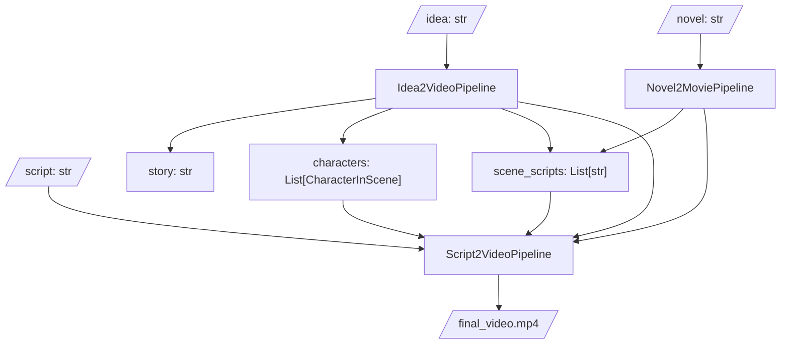
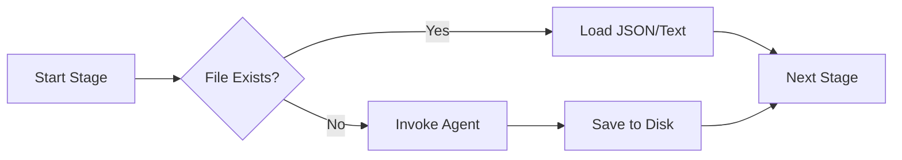

<!-- source: DeepWiki mcp.deepwiki.com · repo HKUDS/ViMax · page 4 Pipelines · fetched 2026-11-09 -->

# Pipelines

Relevant source files

The following files were used as context for generating this wiki page:

- [agents/storyboard_artist.py](agents/storyboard_artist.py)
- [pipelines/idea2video_pipeline.py](pipelines/idea2video_pipeline.py)
- [pipelines/novel2movie_pipeline.py](pipelines/novel2movie_pipeline.py)
- [pipelines/script2video_pipeline.py](pipelines/script2video_pipeline.py)
- [tests/test_novel2movie_pipeline_init.py](tests/test_novel2movie_pipeline_init.py)
- [tests/test_wrong_output_guards.py](tests/test_wrong_output_guards.py)
- [utils/text.py](utils/text.py)

This document describes the primary pipeline implementations in ViMax: `Idea2VideoPipeline`, `Script2VideoPipeline`, and `Novel2MoviePipeline`. Pipelines are top-level orchestration components that coordinate agent execution, manage state, and control the end-to-end workflow from raw input to final video output.

## Pipeline Architecture Overview

ViMax implements a tiered pipeline architecture where high-level narrative pipelines (`Idea2Video`, `Novel2Movie`) focus on story development and script creation, while the `Script2VideoPipeline` handles granular visual production.

**Pipeline Composition Pattern**

**Key Code Entities**

| Entity | Type | File | Purpose |
|--------|------|------|---------|
| `Idea2VideoPipeline` | Class | [pipelines/idea2video_pipeline.py:23]() | Orchestrates idea-to-story-to-script workflow. |
| `Script2VideoPipeline` | Class | [pipelines/script2video_pipeline.py:81]() | Orchestrates script-to-shot-to-video workflow. |
| `Novel2MoviePipeline` | Class | [pipelines/novel2movie_pipeline.py:46]() | Orchestrates long-form novel-to-scene workflow. |
| `init_from_config()` | Method | [pipelines/idea2video_pipeline.py:43]() | Factory method for YAML-based initialization. |

Sources: [pipelines/idea2video_pipeline.py:23-57](), [pipelines/script2video_pipeline.py:81-106](), [pipelines/novel2movie_pipeline.py:46-70]()

## Idea2VideoPipeline

The `Idea2VideoPipeline` transforms raw creative ideas into structured scripts and subsequently into video. It manages the high-level narrative arc before delegating scene-level rendering to `Script2VideoPipeline`.

**Key Workflow Stages:**
1. **Story Development**: Invokes `Screenwriter` to expand an idea into a full narrative [pipelines/idea2video_pipeline.py:121-139]().
2. **Character Extraction**: Uses `CharacterExtractor` to identify and describe characters from the story [pipelines/idea2video_pipeline.py:59-79]().
3. **Portrait Generation**: Generates consistent visual references (front/side/back views) for each character [pipelines/idea2video_pipeline.py:81-119]().
4. **Script Writing**: Converts the story into a multi-scene screenplay [pipelines/idea2video_pipeline.py:141-158]().
5. **Scene Delegation**: Iterates through scenes, initializing a `Script2VideoPipeline` for each [pipelines/idea2video_pipeline.py:226-238]().

For details, see [Idea2VideoPipeline](#4.1).

Sources: [pipelines/idea2video_pipeline.py:37-41](), [pipelines/idea2video_pipeline.py:202-250]()

## Script2VideoPipeline

The `Script2VideoPipeline` is the core visual production engine. It takes a scene script and decomposes it into individual shots, maintaining visual consistency through a "Camera Tree" architecture.

**Key Workflow Stages:**
1. **Storyboard Design**: `StoryboardArtist` creates a sequence of shot descriptions [pipelines/script2video_pipeline.py:596-623]().
2. **Shot Decomposition**: Brief descriptions are expanded into detailed visual, motion, and audio specs [pipelines/script2video_pipeline.py:627-638]().
3. **Camera Tree Construction**: Shots are grouped by camera indices to ensure spatial consistency [pipelines/script2video_pipeline.py:459-483]().
4. **Parallel Generation**: Frames and videos are generated concurrently using `asyncio` [pipelines/script2video_pipeline.py:189-207]().
5. **Assembly**: Individual shot videos are concatenated into a final scene video [pipelines/script2video_pipeline.py:209-221]().

For details, see [Script2VideoPipeline](#4.2).

Sources: [pipelines/script2video_pipeline.py:108-176](), [pipelines/script2video_pipeline.py:373-396]()

## Novel2MoviePipeline

The `Novel2MoviePipeline` is designed for long-form content. It employs a "compress-then-extract" strategy to handle the context window limitations of LLMs when processing entire books.

**Key Workflow Stages:**
1. **Novel Compression**: Splits the text into chunks and generates summaries [pipelines/novel2movie_pipeline.py:89-129]().
2. **Event Extraction**: Identifies major plot points (Events) across the compressed narrative [pipelines/novel2movie_pipeline.py:130-151]().
3. **RAG Retrieval**: Uses FAISS vector search to retrieve original text details for each event [pipelines/novel2movie_pipeline.py:153-181]().
4. **Scene Decomposition**: Breaks events into specific scenes with detailed character tracking [pipelines/novel2movie_pipeline.py:183-206]().
5. **Global Planning**: Ensures consistency across the entire movie using a `GlobalInformationPlanner` [pipelines/novel2movie_pipeline.py:65]().

For details, see [Novel2MoviePipeline](#4.3).

Sources: [pipelines/novel2movie_pipeline.py:47-70](), [pipelines/novel2movie_pipeline.py:73-206]()

## Pipeline State and Resumption

All pipelines follow a strict state-persistence pattern. Before executing an expensive AI task (LLM call or image/video generation), the pipeline checks if the expected output file already exists in the `working_dir`.

**State Management Pattern**

This pattern enables the system to resume from interruptions and allows the **Agent Loop** to pause for user feedback between narrative planning and visual rendering.

Sources: [pipelines/idea2video_pipeline.py:64-77](), [pipelines/script2video_pipeline.py:133-137](), [pipelines/novel2movie_pipeline.py:104-109]()

---

