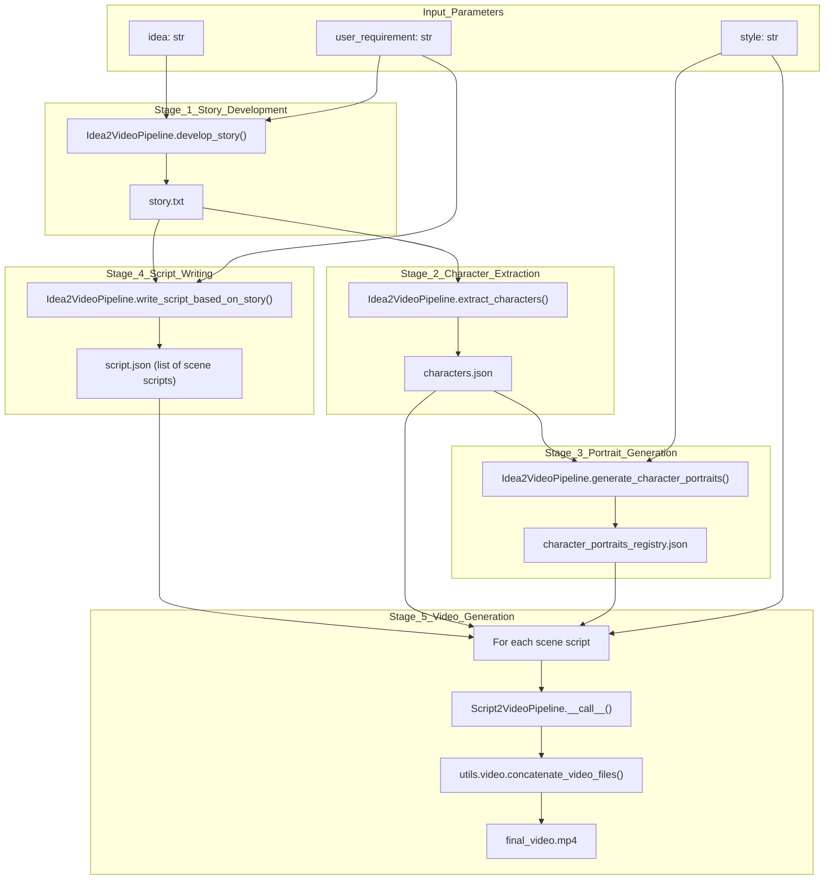
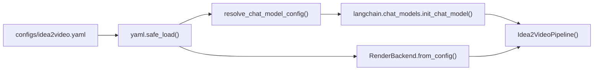

<!-- source: DeepWiki mcp.deepwiki.com · repo HKUDS/ViMax · page 4.1 Idea2VideoPipeline · fetched 2026-11-09 -->

# Idea2VideoPipeline

<details>
<summary>Relevant source files</summary>

The following files were used as context for generating this wiki page:

- [configs/idea2video.yaml](configs/idea2video.yaml)
- [configs/script2video.yaml](configs/script2video.yaml)
- [main_idea2video.py](main_idea2video.py)
- [main_script2video.py](main_script2video.py)
- [pipelines/idea2video_pipeline.py](pipelines/idea2video_pipeline.py)

</details>


## Overview

The `Idea2VideoPipeline` class transforms raw conceptual ideas into complete video stories through an automated multi-stage workflow. This pipeline accepts unstructured natural language ideas and produces final video output by orchestrating multiple specialized agents and delegating scene-level video generation to the `Script2VideoPipeline`.

The pipeline is implemented in [pipelines/idea2video_pipeline.py:23-251]() and serves as the primary entry point for idea-to-video generation in the ViMax system.

**Sources**: [pipelines/idea2video_pipeline.py:23-251](), [main_idea2video.py:1-27]()

## Class Structure and Dependencies

The `Idea2VideoPipeline` class initializes three core agents and delegates to `Script2VideoPipeline` for visual synthesis:

| Component | Class | Purpose | Source |
|-----------|-------|---------|--------|
| **Screenwriter** | `agents.Screenwriter` | Story development and script generation | [pipelines/idea2video_pipeline.py:37]() |
| **CharacterExtractor** | `agents.CharacterExtractor` | Character identification and feature extraction | [pipelines/idea2video_pipeline.py:38-39]() |
| **CharacterPortraitsGenerator** | `agents.CharacterPortraitsGenerator` | Multi-view character portrait generation | [pipelines/idea2video_pipeline.py:40-41]() |
| **Script2VideoPipeline** | `pipelines.Script2VideoPipeline` | Scene-level video generation | [pipelines/idea2video_pipeline.py:226]() |

**Sources**: [pipelines/idea2video_pipeline.py:23-57]()

## Pipeline Workflow

The `Idea2VideoPipeline` executes a five-stage workflow, orchestrated by the `__call__` method at [pipelines/idea2video_pipeline.py:202-251]():

### End-to-End Pipeline Flow



**Sources**: [pipelines/idea2video_pipeline.py:202-251]()

## Detailed Stage Breakdown

### Stage 1: Story Development

**Method**: `develop_story(idea: str, user_requirement: str)` at [pipelines/idea2video_pipeline.py:121-139]()

**Process**:
1. Checks for cached story at `.working_dir/story.txt` [pipelines/idea2video_pipeline.py:127-128]().
2. If not cached, invokes `self.screenwriter.develop_story(idea, user_requirement)` [pipelines/idea2video_pipeline.py:134]().
3. Saves story to `story.txt` [pipelines/idea2video_pipeline.py:135-136]().

**Agent**: Uses `Screenwriter` (initialized at [pipelines/idea2video_pipeline.py:37]()).

---

### Stage 2: Character Extraction

**Method**: `extract_characters(story: str)` at [pipelines/idea2video_pipeline.py:59-79]()

**Process**:
1. Checks for cached characters at `.working_dir/characters.json` [pipelines/idea2video_pipeline.py:64-66]().
2. If not cached, invokes `self.character_extractor.extract_characters(story)` [pipelines/idea2video_pipeline.py:73]().
3. Deserializes to `List[CharacterInScene]` objects [pipelines/idea2video_pipeline.py:69-70]().
4. Saves to `characters.json` [pipelines/idea2video_pipeline.py:74-76]().

**Agent**: Uses `CharacterExtractor` (initialized at [pipelines/idea2video_pipeline.py:38-39]()).

---

### Stage 3: Character Portrait Generation

**Method**: `generate_character_portraits(characters, character_portraits_registry, style)` at [pipelines/idea2video_pipeline.py:81-119]()

**Process**:
1. Loads existing `character_portraits_registry.json` if available [pipelines/idea2video_pipeline.py:87-92]().
2. For each character not in registry, calls `generate_portraits_for_single_character(character, style)` [pipelines/idea2video_pipeline.py:97, 160-200]().
3. Generates views (front, side, back) for visible characters [pipelines/idea2video_pipeline.py:104, 160-200]().
4. Updates registry with portrait paths [pipelines/idea2video_pipeline.py:108-111]().

**Concurrent Execution**: Uses `asyncio.as_completed(tasks)` for parallel generation [pipelines/idea2video_pipeline.py:107-111]().

---

### Stage 4: Script Writing

**Method**: `write_script_based_on_story(story: str, user_requirement: str)` at [pipelines/idea2video_pipeline.py:141-158]()

**Process**:
1. Checks for cached script at `.working_dir/script.json` [pipelines/idea2video_pipeline.py:147-148]().
2. If not cached, invokes `self.screenwriter.write_script_based_on_story(story, user_requirement)` [pipelines/idea2video_pipeline.py:154]().
3. Returns list of scene scripts [pipelines/idea2video_pipeline.py:158]().

---

### Stage 5: Video Generation Per Scene

**Method**: Loop in `__call__` at [pipelines/idea2video_pipeline.py:221-251]()

**Process**:
1. For each scene script in `scene_scripts`:
   - Creates scene-specific working directory: `.working_dir/scene_{idx}/` [pipelines/idea2video_pipeline.py:223-225]().
   - Instantiates `Script2VideoPipeline` [pipelines/idea2video_pipeline.py:226-231]().
   - Invokes the sub-pipeline with character context [pipelines/idea2video_pipeline.py:232-238]().
2. Concatenates all scene videos using `concatenate_video_files()` [pipelines/idea2video_pipeline.py:241-249]().

**Sources**: [pipelines/idea2video_pipeline.py:59-251]()

## Configuration and Initialization

### Configuration Schema

The pipeline is configured via `configs/idea2video.yaml`. Key fields include:

| Field | Path | Purpose |
|-------|------|---------|
| `chat_model` | [configs/idea2video.yaml:1-10]() | LLM parameters (model name, provider, API key) |
| `image_generator` | [configs/idea2video.yaml:12-20]() | Backend for image synthesis (e.g., Nanobanana) |
| `video_generator` | [configs/idea2video.yaml:22-30]() | Backend for video synthesis (e.g., Veo) |
| `working_dir` | [configs/idea2video.yaml:32]() | Directory for all intermediate artifacts |

### Initialization Logic

The pipeline uses a static factory method `init_from_config` to resolve dependencies:



**Sources**: [pipelines/idea2video_pipeline.py:43-57](), [configs/idea2video.yaml:1-32]()

## Entry Point Usage

**File**: [main_idea2video.py:1-27]()

```python
async def main():
    pipeline = Idea2VideoPipeline.init_from_config(
        config_path="configs/idea2video.yaml")
    await pipeline(idea=idea, user_requirement=user_requirement, style=style)
```

**Input Requirements**:
- `idea`: A descriptive prompt of the desired narrative [main_idea2video.py:6-13]().
- `user_requirement`: Constraints on scene count, shot length, or audience [main_idea2video.py:14-17]().
- `style`: Visual aesthetic directive (e.g., "Realistic, warm feel") [main_idea2video.py:18]().

**Sources**: [main_idea2video.py:1-27]()

## Output and Artifacts

The pipeline generates a structured directory tree within the specified `working_dir`:

```text
.working_dir/idea2video/
├── characters.json                      # List[CharacterInScene]
├── character_portraits_registry.json    # Map of identifiers to image paths
├── story.txt                            # Raw narrative text
├── script.json                          # List of scene scripts
├── character_portraits/                 # Sub-dir for portrait images
│   └── {idx}_{name}/
│       ├── front.png
│       ├── side.png
│       └── back.png
├── scene_{idx}/                         # Output from Script2VideoPipeline
│   └── final_video.mp4
└── final_video.mp4                      # Final concatenated result
```

**Sources**: [pipelines/idea2video_pipeline.py:64-250]()

---

