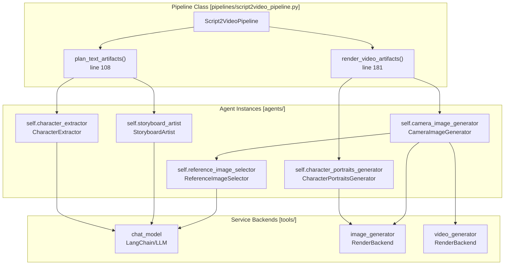
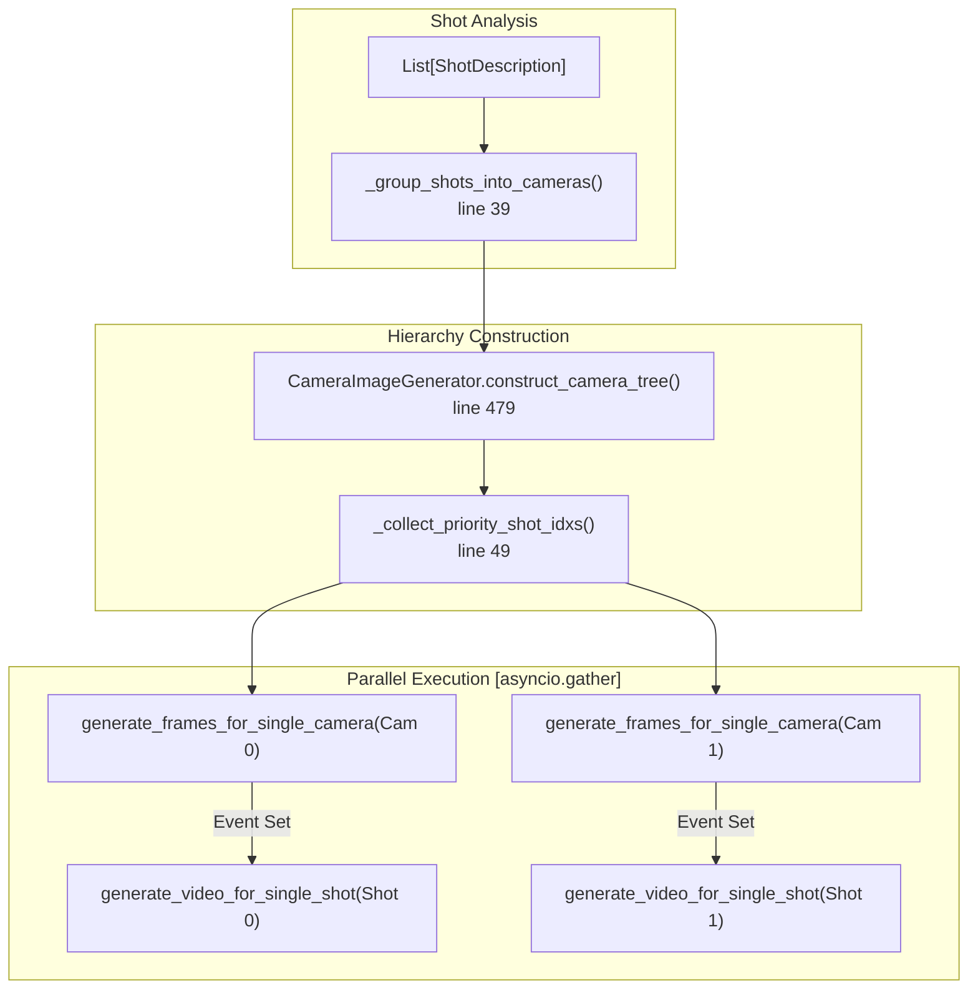

<!-- source: DeepWiki mcp.deepwiki.com · repo HKUDS/ViMax · page 4.2 Script2VideoPipeline · fetched 2026-11-09 -->

# Script2VideoPipeline

Relevant source files

The following files were used as context for generating this wiki page:

- [agents/screenwriter.py](agents/screenwriter.py)
- [agents/script_planner.py](agents/script_planner.py)
- [pipelines/script2video_pipeline.py](pipelines/script2video_pipeline.py)

## Overview

The `Script2VideoPipeline` class implements the scene-level video generation workflow in ViMax. Located at [pipelines/script2video_pipeline.py:81](), this pipeline takes a single scene script and produces a complete video with consistent characters, cinematography, and motion.

The pipeline serves two primary operational modes:
1. **Standalone mode**: Direct script-to-video conversion via `main_script2video.py` [main_script2video.py:28-30]().
2. **Scene-level processing**: Invoked by `Idea2VideoPipeline` for each scene in a multi-scene video [pipelines/idea2video_pipeline.py:286-298]().

Unlike `Idea2VideoPipeline` which orchestrates high-level narrative flow across multiple scenes, `Script2VideoPipeline` focuses on shot-level execution: storyboard design, shot decomposition, parallel frame generation, and video assembly.

**Sources**: [pipelines/script2video_pipeline.py:81-106](), [main_script2video.py:28-30](), [pipelines/idea2video_pipeline.py:286-298]()

## Pipeline Initialization

### Class Constructor

The `Script2VideoPipeline.__init__` method [pipelines/script2video_pipeline.py:83-106]() initializes five specialized agents that handle different parts of the visual production:

| Agent Instance | Agent Class | Role |
|----------------|-------------|------|
| `self.character_extractor` | `CharacterExtractor` | Extract character definitions from script text |
| `self.character_portraits_generator` | `CharacterPortraitsGenerator` | Generate front/side/back character reference images |
| `self.storyboard_artist` | `StoryboardArtist` | Design shot-by-shot storyboard and decompose visual descriptions |
| `self.camera_image_generator` | `CameraImageGenerator` | Construct camera tree, generate frames and transition videos |
| `self.reference_image_selector` | `ReferenceImageSelector` | Select appropriate reference images for frame generation |

### Event Coordination

The pipeline uses three internal event dictionaries [pipelines/script2video_pipeline.py:103-105]() to coordinate asynchronous operations and manage dependencies between parallel tasks:

| Event Dictionary | Type | Purpose |
|------------------|------|---------|
| `self.character_portrait_events` | `Dict[int, asyncio.Event]` | Signals when character portraits for a specific ID are ready |
| `self.shot_desc_events` | `Dict[int, asyncio.Event]` | Signals when shot descriptions are decomposed |
| `self.frame_events` | `Dict[int, asyncio.Event]` | Signals when frames for a specific shot index are generated |

**Sources**: [pipelines/script2video_pipeline.py:83-106]()

## Pipeline Architecture

The following diagram maps the `Script2VideoPipeline` architecture to actual code entities and service integrations.

### Component Hierarchy

**Sources**: [pipelines/script2video_pipeline.py:81-106](), [pipelines/script2video_pipeline.py:108-220]()

## Workflow Stages

The pipeline execution is divided into two primary phases: **Narrative Planning** and **Visual Rendering**.

### 1. Narrative Planning (`plan_text_artifacts`)

This stage focuses on structured text generation before any visual assets are created [pipelines/script2video_pipeline.py:108-176]().

1.  **Character Extraction**: `CharacterExtractor` identifies characters and their traits from the script [pipelines/script2video_pipeline.py:129]().
2.  **Storyboard Design**: `StoryboardArtist` creates a list of `ShotBriefDescription` objects [pipelines/script2video_pipeline.py:141-146]().
3.  **Visual Decomposition**: The briefs are expanded into detailed `ShotDescription` objects containing first/last frame prompts [pipelines/script2video_pipeline.py:148-152]().
4.  **Camera Tree Construction**: Shots are grouped into a hierarchical `Camera` tree to ensure spatial consistency [pipelines/script2video_pipeline.py:159-163]().

### 2. Visual Rendering (`render_video_artifacts`)

This stage executes the heavy lifting of image and video generation in parallel [pipelines/script2video_pipeline.py:181-220]().

1.  **Portrait Generation**: Generates canonical reference images for all extracted characters [pipelines/script2video_pipeline.py:194]().
2.  **Parallel Generation**: Launches concurrent tasks for each camera in the tree [pipelines/script2video_pipeline.py:202-205]().
    *   `generate_frames_for_single_camera`: Generates consistent frames within a camera position [pipelines/script2video_pipeline.py:230]().
    *   `generate_video_for_single_shot`: Synthesizes the video using the generated frames [pipelines/script2video_pipeline.py:373]().
3.  **Video Assembly**: Uses `moviepy` to concatenate individual shot videos into the final scene [pipelines/script2video_pipeline.py:218]().

**Sources**: [pipelines/script2video_pipeline.py:108-220](), [pipelines/script2video_pipeline.py:230](), [pipelines/script2video_pipeline.py:373]()

## Camera Tree and Parallel Processing

The `Script2VideoPipeline` uses a unique "Camera Tree" architecture to maintain visual consistency across shots.

### Camera Tree Data Flow

### Frame Generation Dependencies

Within `generate_frames_for_single_camera` [pipelines/script2video_pipeline.py:230-369](), the pipeline manages dependencies:
- **Parent Cameras**: If a camera has a parent, it waits for the parent's frame to generate a transition video [pipelines/script2video_pipeline.py:252-269]().
- **Priority Shots**: Shots that serve as parents for other cameras are generated first to unblock downstream tasks [pipelines/script2video_pipeline.py:330-334]().
- **Reference Selection**: For every frame, `ReferenceImageSelector` chooses the best character portraits and previous frames to maintain consistency [pipelines/script2video_pipeline.py:297-304]().

**Sources**: [pipelines/script2video_pipeline.py:39-51](), [pipelines/script2video_pipeline.py:230-369](), [pipelines/script2video_pipeline.py:479]()

## Implementation Details

### Shot Decomposition

The `decompose_visual_descriptions` method [pipelines/script2video_pipeline.py:627-638]() maps high-level storyboard ideas to technical frame prompts. It iterates through `ShotBriefDescription` and calls the `StoryboardArtist` to produce detailed `ShotDescription` objects.

### Final Video Concatenation

The pipeline uses `moviepy` to assemble the final output [pipelines/script2video_pipeline.py:210-220]().
- It identifies all completed shot videos in the `working_dir`.
- It sorts them by index.
- It uses `concatenate_videoclips` to merge them into `final_video.mp4`.

**Sources**: [pipelines/script2video_pipeline.py:210-220](), [pipelines/script2video_pipeline.py:627-638]()

---

