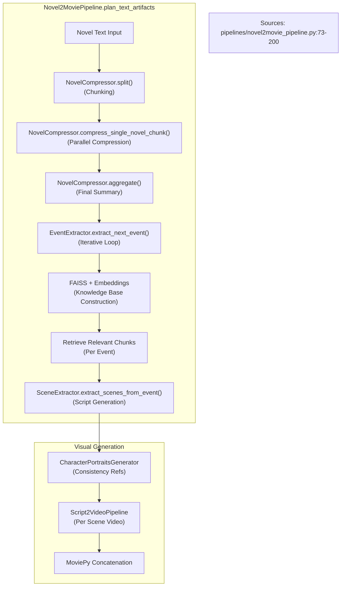
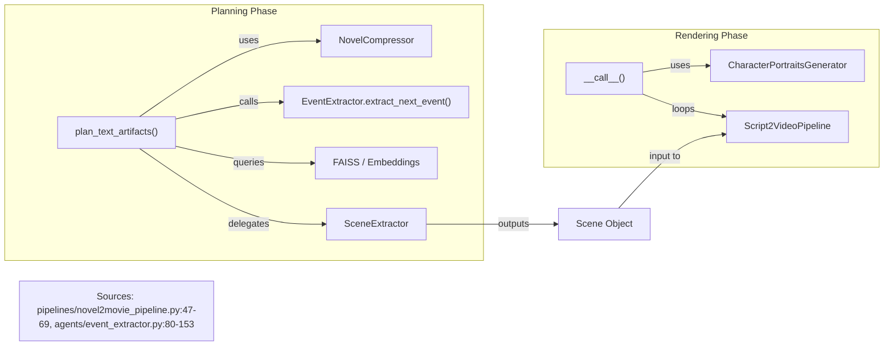

<!-- source: DeepWiki mcp.deepwiki.com · repo HKUDS/ViMax · page 4.3 Novel2MoviePipeline · fetched 2026-11-09 -->

# Novel2MoviePipeline

Relevant source files

The following files were used as context for generating this wiki page:

- [agents/character_portraits_generator.py](agents/character_portraits_generator.py)
- [agents/event_extractor.py](agents/event_extractor.py)
- [agents/storyboard_artist.py](agents/storyboard_artist.py)
- [pipelines/novel2movie_pipeline.py](pipelines/novel2movie_pipeline.py)
- [tests/test_novel2movie_pipeline_init.py](tests/test_novel2movie_pipeline_init.py)
- [tests/test_wrong_output_guards.py](tests/test_wrong_output_guards.py)
- [utils/text.py](utils/text.py)

The `Novel2MoviePipeline` class orchestrates the transformation of long-form literary prose into cinematic video sequences. It implements a multi-stage workflow involving novel compression, iterative event extraction, RAG-based scene decomposition, and long-form video generation via delegation to the `Script2VideoPipeline`.

## Overview and Purpose

The pipeline is designed to handle the complexity of full-length novels by breaking them down into manageable "Events" and "Scenes." It maintains narrative and visual consistency across a long duration by utilizing character portraits and a knowledge base (FAISS) for retrieving context-specific details from the original text.

**Key Capabilities:**
*   **Novel Compression:** Splitting and summarizing long text into a dense narrative summary.
*   **Iterative Event Extraction:** Identifying a sequential chain of high-level plot events.
*   **Contextual Retrieval:** Using RAG (Retrieval-Augmented Generation) to provide detailed local context for each event.
*   **Scene Decomposition:** Breaking events into specific scenes with dialogue and character actions.
*   **Video Assembly:** Orchestrating the generation of individual scene videos and concatenating them.

**Sources:** [pipelines/novel2movie_pipeline.py:46-69](), [pipelines/novel2movie_pipeline.py:73-86]()

## System Architecture and Data Flow

The pipeline operates as a sequence of discrete stages. It uses a "plan-then-execute" model, where text artifacts (events and scenes) are planned before visual generation begins.

### Text Planning and Execution Flow

**Sources:** [pipelines/novel2movie_pipeline.py:73-128](), [pipelines/novel2movie_pipeline.py:130-151](), [pipelines/novel2movie_pipeline.py:153-180](), [pipelines/novel2movie_pipeline.py:182-201]()

## Key Components and Implementation

### 1. Novel Compression
The pipeline uses a `novel_compressor` to handle long inputs. It first splits the text into chunks using `RecursiveCharacterTextSplitter` [pipelines/novel2movie_pipeline.py:95-98](). These chunks are compressed in parallel using an `asyncio.Semaphore(5)` to manage concurrency [pipelines/novel2movie_pipeline.py:111-115](). The final compressed summary is aggregated to provide a global context for event extraction [pipelines/novel2movie_pipeline.py:122-128]().

### 2. Iterative Event Extraction
The `EventExtractor` agent identifies plot points sequentially.
*   **Loop Mechanism:** It calls `extract_next_event` repeatedly until an `is_last` flag is returned by the LLM [agents/event_extractor.py:107-118]().
*   **Contextual Awareness:** Each call receives the full compressed novel and the sequence of previously extracted events to ensure continuity [agents/event_extractor.py:133-145]().
*   **Safety Bound:** A hard limit of 50 events is enforced to prevent infinite LLM loops [agents/event_extractor.py:98-112]().

### 3. RAG-based Scene Context
Because a compressed summary loses detail, the pipeline builds a local knowledge base for every event:
1.  **FAISS Vector Store:** The original novel is split into 512-character chunks and embedded [pipelines/novel2movie_pipeline.py:164-166]().
2.  **Retrieval:** For each event, the pipeline retrieves the most relevant chunks from the original text to provide the `SceneExtractor` with fine-grained details (dialogue, specific actions) [pipelines/novel2movie_pipeline.py:171-180]().

### 4. Character Portrait Generation
To ensure visual consistency, the pipeline generates a standard reference set for each character:
*   **Front Portrait:** Generated from static and dynamic features [agents/character_portraits_generator.py:41-56]().
*   **Side/Back Views:** Generated using the front portrait as an `image_prompt` (reference) to maintain the character's identity [agents/character_portraits_generator.py:58-86]().

**Sources:** [pipelines/novel2movie_pipeline.py:158-180](), [agents/event_extractor.py:80-153](), [agents/character_portraits_generator.py:33-86]()

## Code Entity Mapping

The following diagram maps the logical pipeline stages to the specific classes and methods defined in the codebase.

**Sources:** [pipelines/novel2movie_pipeline.py:47-69](), [pipelines/novel2movie_pipeline.py:73-86](), [agents/event_extractor.py:80-153]()

## Technical Detail: Event Extraction Logic

The `EventExtractor` is a specialized agent that treats the novel as a "Process Chain."

| Field | Description |
| :--- | :--- |
| **Description** | A high-level summary of the dramatic goal (e.g., "The thief evades the guards"). |
| **Process Chain** | A step-by-step account of actions, decisions, and turning points. |
| **Outcome** | The narrative result that leads into the next event. |
| **is_last** | A boolean flag indicating the conclusion of the story. |

**Sources:** [agents/event_extractor.py:14-65](), [interfaces/event.py:1-20]() (Note: interfaces/event.py is inferred from model_validate usage in [pipelines/novel2movie_pipeline.py:141]())

## Implementation Status
> [!IMPORTANT]
> As of the current version, the `Novel2MoviePipeline` is marked as `NOT IMPLEMENTED YET` in the source file header [pipelines/novel2movie_pipeline.py:1](). However, the core logic for `plan_text_artifacts` (the narrative planning engine) is fully defined [pipelines/novel2movie_pipeline.py:73-201]().

**Sources:** [pipelines/novel2movie_pipeline.py:1-201]()

---

