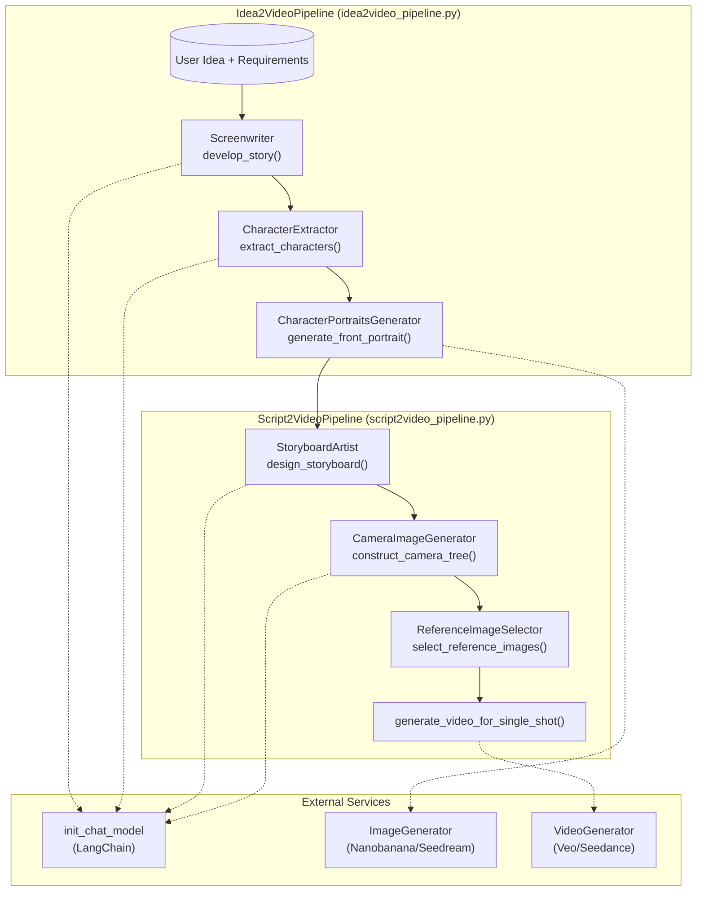
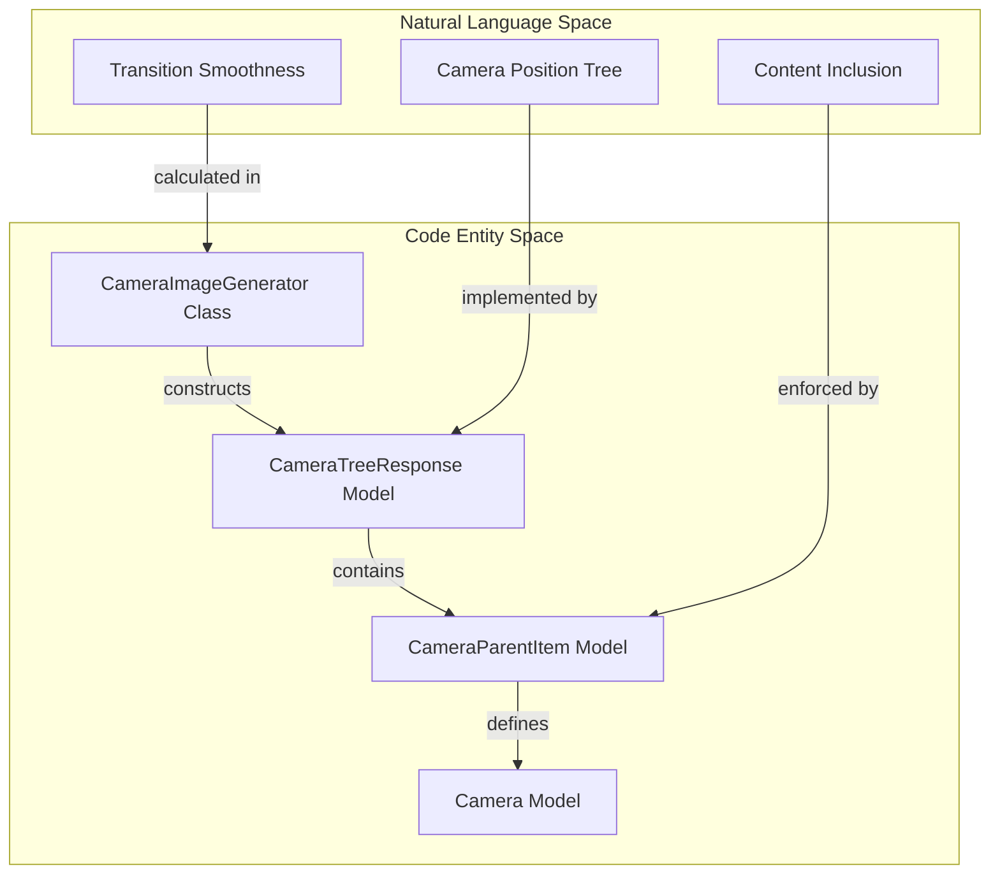

<!-- source: DeepWiki mcp.deepwiki.com · repo HKUDS/ViMax · page 5 Agents · fetched 2026-11-09 -->

# Agents

Relevant source files

The following files were used as context for generating this wiki page:

- [agents/camera_image_generator.py](agents/camera_image_generator.py)
- [agents/character_portraits_generator.py](agents/character_portraits_generator.py)
- [agents/event_extractor.py](agents/event_extractor.py)
- [agents/screenwriter.py](agents/screenwriter.py)
- [agents/script_planner.py](agents/script_planner.py)
- [utils/video.py](utils/video.py)

This document provides comprehensive documentation of the specialized agents in the ViMax system. Agents are modular, autonomous components that handle specific tasks in the video generation pipeline, from script planning to visual asset creation. Each agent encapsulates domain-specific logic and interacts with external AI services through standardized tool interfaces.

For details on the agent abstraction and common patterns, see [Agent Architecture](#5.1).

---

## Overview

The ViMax system employs a multi-agent architecture where specialized agents handle distinct phases of video generation. The system uses six core agents, each encapsulating domain-specific logic:

| Agent | File Path | Primary Responsibility | Used By |
|---|---|---|---|
| **Screenwriter** | `agents/screenwriter.py` | Story development and script generation | Idea2VideoPipeline |
| **CharacterExtractor** | `agents/character_extractor.py` | Character identification and feature extraction | Both pipelines |
| **CharacterPortraitsGenerator** | `agents/character_portraits_generator.py` | Multi-view character portrait generation | Both pipelines |
| **StoryboardArtist** | `agents/storyboard_artist.py` | Shot planning and storyboard design | Script2VideoPipeline |
| **ReferenceImageSelector** | `agents/reference_image_selector.py` | Reference image selection for consistency | Script2VideoPipeline |
| **CameraImageGenerator** | `agents/camera_image_generator.py` | Camera tree construction and frame/video generation | Script2VideoPipeline |
| **EventExtractor** | `agents/event_extractor.py` | Novel-to-event extraction (iterative) | Novel2Video workflow |

Each agent receives structured input via Pydantic models, processes it using external AI services (chat models, image generators, video generators), and produces typed output that feeds into subsequent pipeline stages.

Sources: [agents/screenwriter.py:1-110](), [agents/character_portraits_generator.py:33-87](), [agents/camera_image_generator.py:109-150](), [agents/event_extractor.py:80-153]()

---

## Agent Interaction Flow

The following diagram illustrates how agents interact within the two main pipelines (`Idea2VideoPipeline` and `Script2VideoPipeline`):

**Diagram: Agent Interaction in ViMax Pipelines**

Sources: [agents/screenwriter.py:1-110](), [agents/camera_image_generator.py:109-120](), [agents/event_extractor.py:87-93]()

---

## Narrative Agents 

Narrative agents handle story development and script generation from raw ideas or novels.

*   **Screenwriter**: Transforms raw ideas into complete stories and structured scene scripts using `develop_story` and `write_script_based_on_story` [agents/screenwriter.py:14-110]().
*   **ScriptPlanner**: (Referenced in system overview) Focuses on cinematic language and story structure [agents/script_planner.py:13-81]().
*   **EventExtractor**: Segments long-form novels into discrete narrative events iteratively [agents/event_extractor.py:100-120]().

For details, see [Narrative Agents](#5.2).

---

## Character Management Agents 

Character management agents extract character information and generate visual reference portraits for consistency.

*   **CharacterExtractor**: Identifies characters and extracts `static_features` and `dynamic_features` from scripts.
*   **CharacterPortraitsGenerator**: Generates consistent front, side, and back view portraits using reference-based image generation [agents/character_portraits_generator.py:15-32]().
*   **BestImageSelector**: (Referenced in system overview) Evaluates and selects the highest quality character reference images.

For details, see [Character Management Agents](#5.3).

---

## Visual Design Agents 

Visual design agents translate scripts into cinematographic shot plans and select appropriate reference images.

*   **StoryboardArtist**: Transforms scripts into shot-by-shot storyboards with detailed visual and motion descriptions.
*   **ReferenceImageSelector**: Analyzes target frame descriptions and selects the most relevant character and environment references to maintain consistency.
*   **SceneExtractor**: (Referenced in system overview) Decomposes narratives into distinct scenes based on location and time continuity.

For details, see [Visual Design Agents](#5.4).

---

## Camera and Motion Agents 

These agents handle spatial consistency and the temporal generation of video assets.

*   **CameraImageGenerator**: Constructs a "camera position tree" to represent content inclusion relationships [agents/camera_image_generator.py:20-58](). It also handles `generate_transition_video` to bridge different camera angles.
*   **EventExtractor**: (Contextualized for motion) Extracts specific kinetic events from prose to guide motion generation [agents/event_extractor.py:14-65]().

**Diagram: Camera Tree and Entity Mapping**

Sources: [agents/camera_image_generator.py:69-106](), [agents/camera_image_generator.py:122-150]()

For details, see [Camera and Motion Agents](#5.5).

---

