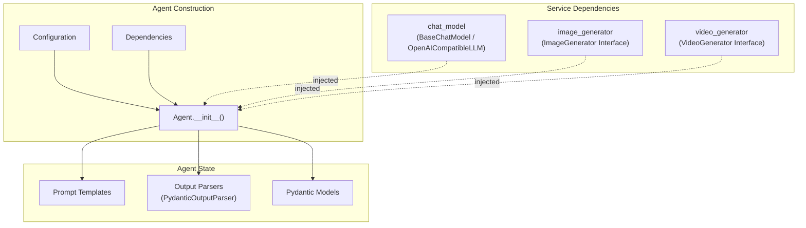
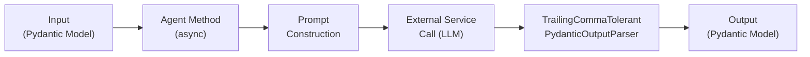
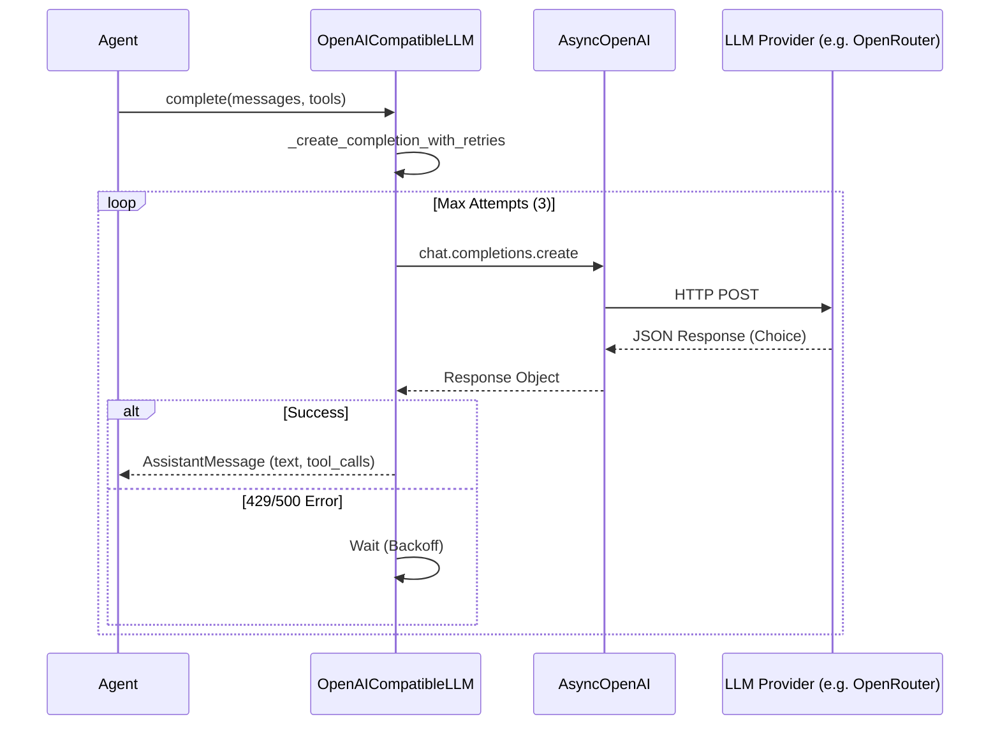
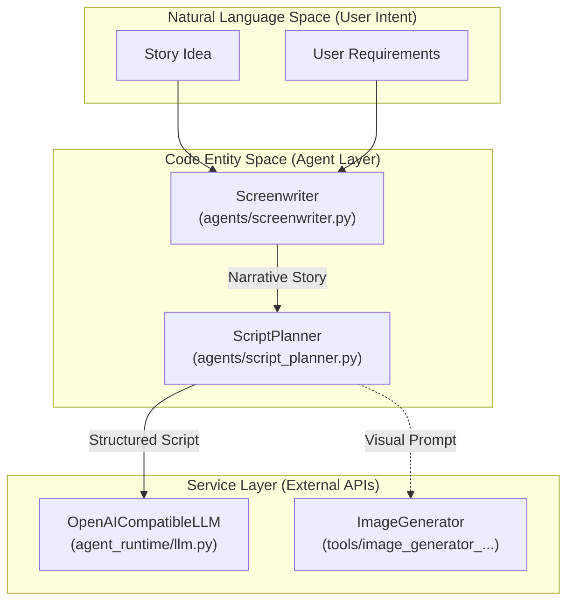

<!-- source: DeepWiki mcp.deepwiki.com · repo HKUDS/ViMax · page 5.1 Agent Architecture · fetched 2026-11-09 -->

# Agent Architecture

Relevant source files

The following files were used as context for generating this wiki page:

- [agent_runtime/llm.py](agent_runtime/llm.py)
- [agents/screenwriter.py](agents/screenwriter.py)
- [agents/script_planner.py](agents/script_planner.py)
- [tests/test_robustness.py](tests/test_robustness.py)
- [tools/image_generator_doubao_seedream_yunwu_api.py](tools/image_generator_doubao_seedream_yunwu_api.py)
- [tools/reranker_bge_silicon_api.py](tools/reranker_bge_silicon_api.py)

This page documents the architectural design of agents in the ViMax system, including their design patterns, dependency structures, and integration with external services. For specific agent implementations and their responsibilities, see [Narrative Agents](#5.2), [Character Management Agents](#5.3), [Visual Design Agents](#5.4), and [Camera and Motion Agents](#5.5). For pipeline-level orchestration, see [System Architecture](#3).

## Overview

Agents in ViMax are specialized components responsible for specific tasks in the video generation pipeline. Each agent encapsulates domain expertise through carefully engineered prompts and interfaces with external AI services (LLMs, image generators, video generators) to perform its designated function. The agent architecture follows a modular design pattern that emphasizes:

- **Single Responsibility**: Each agent handles one specific aspect of the pipeline.
- **Service Abstraction**: Agents depend on abstract service interfaces or standardized LLM wrappers rather than concrete implementations.
- **Retry Resilience**: Built-in retry mechanisms using `tenacity` for handling transient API failures or malformed outputs [agents/script_planner.py:8-10]().
- **Async Operation**: All agents support asynchronous execution for parallel processing within the `asyncio` event loop.

## Agent Design Pattern

### Core Components

All agents in ViMax follow a consistent architectural pattern with three core components:

1. **Initialization Dependencies**: External services (LLMs, Image/Video generators) injected during construction.
2. **Prompt Templates**: System and human prompts that encode domain expertise [agents/screenwriter.py:14-58]().
3. **Execution Methods**: Async methods that orchestrate service calls and output parsing [agents/screenwriter.py:126-150]().

**Agent Construction Pattern**

Sources: [agents/script_planner.py:1-7](), [agents/screenwriter.py:1-11](), [agent_runtime/llm.py:43-50]()

### Agent Interface Pattern

Each agent exposes one or more async methods that accept structured input and return structured output, typically utilizing a `PydanticOutputParser` to ensure type safety.

Sources: [agents/script_planner.py:2-4](), [agents/screenwriter.py:3-5](), [agent_runtime/llm.py:52-69]()

## External Service Integration

### LLM Service Integration (OpenAICompatibleLLM)

ViMax utilizes an `OpenAICompatibleLLM` wrapper to interact with various LLM providers (OpenRouter, OpenAI, etc.). This class handles retries, timeout management, and tool-call parsing [agent_runtime/llm.py:43-50]().

**LLM Execution Flow**

Sources: [agent_runtime/llm.py:16-29](), [agent_runtime/llm.py:52-69](), [agent_runtime/llm.py:71-80]()

### Specialized Tool Integration

Beyond text generation, agents interact with specialized tools for visual asset creation and retrieval.

| Service Category | Implementation Examples | Purpose |
| :--- | :--- | :--- |
| **Image Generation** | `ImageGeneratorDoubaoSeedreamYunwuAPI` | Generates frames and character portraits [tools/image_generator_doubao_seedream_yunwu_api.py:13-23]() |
| **Reranking** | `RerankerBgeSiliconapi` | Ranks story fragments for RAG-based script generation [tools/reranker_bge_silicon_api.py:8-17]() |
| **Video Processing** | `utils/video.py` | Frame extraction and scene detection for transition generation |

## Common Patterns

### Robust Output Parsing

LLMs often produce JSON with minor syntax errors (like trailing commas). ViMax uses a `TrailingCommaTolerantPydanticOutputParser` to improve the reliability of agent outputs [agents/script_planner.py:4](), [agents/screenwriter.py:5]().

### Resilience and Bounded Retries

Agents and tools are decorated with `tenacity` retry policies. These policies are strictly bounded to prevent infinite loops and include exponential backoff [tests/test_robustness.py:153-158]().

**Example Retry Configuration:**
- **Attempts**: Usually 3 [tools/image_generator_doubao_seedream_yunwu_api.py:26]().
- **Wait**: Exponential (e.g., multiplier 1, max 30s) [tools/reranker_bge_silicon_api.py:23]().
- **Exceptions**: Specifically targets `aiohttp.ClientError` or `asyncio.TimeoutError` [tools/image_generator_doubao_seedream_yunwu_api.py:28]().

### Prompt Engineering Structure

Agents use structured prompt templates with distinct sections:

| Section | Purpose | Example File |
| :--- | :--- | :--- |
| `[Role]` | Define agent expertise and persona | [agents/screenwriter.py:16-23]() |
| `[Task]` | Specify the core objective | [agents/screenwriter.py:25-26]() |
| `[Guidelines]` | Constraints and style rules (e.g., "No metaphors") | [agents/script_planner.py:32-57]() |
| `[Examples]` | Few-shot examples for style alignment | [agents/script_planner.py:64-75]() |
| `{format_instructions}` | Pydantic schema requirements | [agents/screenwriter.py:96]() |

## Agent Categories and Specializations

Agents are organized into functional categories based on their role in the video generation lifecycle:

| Category | Primary Agents | Key Responsibility |
| :--- | :--- | :--- |
| **Narrative Planning** | `Screenwriter`, `ScriptPlanner` | Expands ideas into stories and technical scripts [agents/screenwriter.py:126](), [agents/script_planner.py:133]() |
| **Character Management** | `CharacterExtractor`, `CharacterPortraitsGenerator` | Analyzes characters and generates consistent visual references |
| **Visual Design** | `StoryboardArtist`, `SceneExtractor` | Decomposes scripts into shots and visual descriptions |
| **Rendering & Motion** | `CameraImageGenerator`, `EventExtractor` | Generates the actual frames and transition videos |

**Natural Language to Code Entity Mapping**

Sources: [agents/screenwriter.py:126-150](), [agents/script_planner.py:133-160](), [agent_runtime/llm.py:43-50](), [tools/image_generator_doubao_seedream_yunwu_api.py:13-23]()

## Summary

The ViMax agent architecture provides a robust, modular framework for video generation by combining LangChain's flexibility with custom resilience patterns. By abstracting LLM interactions through `OpenAICompatibleLLM` and enforcing strict output schemas via Pydantic, the system maintains high reliability across various model providers and generation tasks.

Sources: [agent_runtime/llm.py:43-70](), [agents/script_planner.py:1-10](), [tests/test_robustness.py:1-29]()

---

